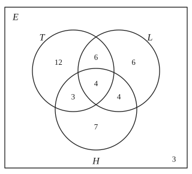

# Chủ đề 1. Mệnh đề và tập hợp

> Mệnh đề và tập hợp là "ngôn ngữ" của toán học THPT: mọi định lý được phát biểu bằng mệnh đề, mọi tập nghiệm được viết bằng tập hợp. Trong đề kiểm tra, chủ đề này thường có câu xét đúng sai, câu phép toán trên khoảng, đoạn và một bài đếm bằng biểu đồ Ven.

## I. Kiến thức cần nắm

### 1. Mệnh đề, phủ định, mệnh đề chứa biến
- **Mệnh đề** là một câu khẳng định có tính đúng hoặc sai, không thể vừa đúng vừa sai. Câu hỏi, câu cảm thán, câu mệnh lệnh không phải là mệnh đề.
- **Mệnh đề chứa biến** là câu chứa biến, chưa xác định đúng sai; mỗi khi thay biến bằng một giá trị cụ thể thì được một mệnh đề. Ví dụ $P(x)$: "$x + 2 > 5$". $P(4)$ đúng, $P(1)$ sai.
- **Phủ định** của mệnh đề $P$, kí hiệu $\overline{P}$, đúng khi $P$ sai và sai khi $P$ đúng. Phủ định của "$a > b$" là "$a \le b$"; phủ định của "$a = b$" là "$a \ne b$".

*Ví dụ:* "$\sqrt2$ là số hữu tỉ" là mệnh đề sai. Phủ định: "$\sqrt2$ không phải là số hữu tỉ", là mệnh đề đúng.

### 2. Mệnh đề kéo theo, mệnh đề đảo, mệnh đề tương đương
- **Kéo theo** $P \Rightarrow Q$ ("Nếu $P$ thì $Q$") chỉ **sai** khi $P$ đúng và $Q$ sai. Các định lý thường có dạng $P \Rightarrow Q$.
- Khi $P \Rightarrow Q$ đúng, ta nói: $P$ là **điều kiện đủ** để có $Q$; $Q$ là **điều kiện cần** để có $P$.
- **Mệnh đề đảo** của $P \Rightarrow Q$ là $Q \Rightarrow P$. Một mệnh đề đúng có thể có mệnh đề đảo sai.
- **Tương đương** $P \Leftrightarrow Q$ đúng khi cả $P \Rightarrow Q$ và $Q \Rightarrow P$ cùng đúng. Khi đó $P$ là **điều kiện cần và đủ** để có $Q$ ("$P$ khi và chỉ khi $Q$").

*Ví dụ:* "Nếu $n$ chia hết cho 6 thì $n$ chia hết cho 3" đúng. Mệnh đề đảo "Nếu $n$ chia hết cho 3 thì $n$ chia hết cho 6" sai ($n = 3$).

**Chứng minh bằng phản chứng.** Muốn chứng minh $P \Rightarrow Q$, ta giả sử $P$ đúng và $Q$ sai, rồi suy ra điều vô lý. Một cách tương đương: chứng minh $\overline{Q} \Rightarrow \overline{P}$ (mệnh đề phản đảo).

### 3. Kí hiệu $\forall$, $\exists$ và cách phủ định
- "$\forall x \in X, P(x)$": với mọi $x$ thuộc $X$, $P(x)$ đúng.
- "$\exists x \in X, P(x)$": có ít nhất một $x$ thuộc $X$ để $P(x)$ đúng.

**Quy tắc phủ định:** đổi $\forall$ thành $\exists$, đổi $\exists$ thành $\forall$, và phủ định phần tính chất.
$$\overline{\forall x \in X, P(x)} \;\text{ là }\; \exists x \in X, \overline{P(x)}; \qquad \overline{\exists x \in X, P(x)} \;\text{ là }\; \forall x \in X, \overline{P(x)}.$$

*Ví dụ:* phủ định của "$\forall x \in \mathbb{R}, x^2 \ge 0$" là "$\exists x \in \mathbb{R}, x^2 < 0$".

> **Cách xét đúng sai:** mệnh đề "$\forall$" muốn bác bỏ chỉ cần **một phản ví dụ**; mệnh đề "$\exists$" muốn khẳng định chỉ cần **một ví dụ**.

### 4. Tập hợp, tập con, hai tập hợp bằng nhau
- Hai cách cho tập hợp: **liệt kê** phần tử, ví dụ $A = \{1; 2; 3\}$, hoặc **chỉ ra tính chất đặc trưng**, ví dụ $A = \{x \in \mathbb{N} \mid 1 \le x \le 3\}$.
- Tập rỗng $\varnothing$ không có phần tử nào.
- $A \subset B$ (A là **tập con** của B) nếu mọi phần tử của $A$ đều thuộc $B$. Quy ước $\varnothing \subset A$ và $A \subset A$ với mọi tập $A$.
- $A = B$ khi $A \subset B$ và $B \subset A$.
- Tập có $n$ phần tử thì có $2^n$ tập con (mỗi phần tử có hai khả năng: được chọn hoặc không).
- Các tập số: $\mathbb{N} \subset \mathbb{Z} \subset \mathbb{Q} \subset \mathbb{R}$.

### 5. Các phép toán trên tập hợp
| Phép toán | Định nghĩa |
|---|---|
| Giao $A \cap B$ | $\{x \mid x \in A \text{ và } x \in B\}$ |
| Hợp $A \cup B$ | $\{x \mid x \in A \text{ hoặc } x \in B\}$ |
| Hiệu $A \setminus B$ | $\{x \mid x \in A \text{ và } x \notin B\}$ |
| Phần bù $C_E A$ (khi $A \subset E$) | $E \setminus A$ |

*Ví dụ:* $A = \{1; 2; 3; 4\}$, $B = \{3; 4; 5\}$: $A \cap B = \{3; 4\}$, $A \cup B = \{1; 2; 3; 4; 5\}$, $A \setminus B = \{1; 2\}$.

### 6. Các tập con thường dùng của $\mathbb{R}$
| Kí hiệu | Tập hợp |
|---|---|
| $(a; b)$ | $\{x \in \mathbb{R} \mid a < x < b\}$ |
| $[a; b]$ | $\{x \in \mathbb{R} \mid a \le x \le b\}$ |
| $[a; b)$, $(a; b]$ | nửa khoảng |
| $(a; +\infty)$, $[a; +\infty)$ | $x > a$, $x \ge a$ |
| $(-\infty; b)$, $(-\infty; b]$ | $x < b$, $x \le b$ |

**Phương pháp:** biểu diễn các tập trên **trục số**, rồi đọc kết quả. Chú ý từng đầu mút: đầu mút nào có ngoặc vuông thì được lấy, ngoặc tròn thì không.

*Ví dụ:* $[-1; 3) \cap (2; 5] = (2; 3)$; $[-1; 3) \cup (2; 5] = [-1; 5]$; $[-1; 3) \setminus (2; 5] = [-1; 2]$.

### 7. Đếm bằng biểu đồ Ven
Kí hiệu $n(A)$ là số phần tử của tập hữu hạn $A$.
$$n(A \cup B) = n(A) + n(B) - n(A \cap B),$$
$$n(A \cup B \cup C) = n(A) + n(B) + n(C) - n(A \cap B) - n(B \cap C) - n(C \cap A) + n(A \cap B \cap C).$$
*Vì sao:* khi cộng $n(A) + n(B)$, mỗi phần tử của $A \cap B$ bị đếm hai lần nên phải trừ đi một lần.

**Cách làm:** vẽ biểu đồ Ven, điền số vào **phần trong cùng trước** (phần chung của nhiều tập nhất), rồi điền dần ra ngoài.

### 8. Sai lầm hay gặp
- Phủ định "$\forall x, x > 2$" thành "$\forall x, x \le 2$" (quên đổi $\forall$ thành $\exists$).
- Phủ định "$x > 2$" thành "$x < 2$" (quên trường hợp bằng).
- Viết $1 \subset \{1; 2\}$ (sai: phải là $1 \in \{1; 2\}$ hoặc $\{1\} \subset \{1; 2\}$).
- Lấy nhầm đầu mút khi tính hiệu hai khoảng: $[-1; 3) \setminus (2; 5]$ chứa điểm 2.

---

## II. Bài tập vận dụng

**Bài 1.** Trong các câu sau, câu nào là mệnh đề? Nếu là mệnh đề, hãy xét tính đúng sai.
a) "17 là số nguyên tố."
b) "Hôm nay trời đẹp quá!"
c) "$x + 2 > 5$."
d) "$\sqrt2$ là số hữu tỉ."
e) "Số 2026 chia hết cho 3."

**Bài 2.** Xét tính đúng sai của mỗi mệnh đề sau và lập mệnh đề phủ định của nó.
a) $\forall x \in \mathbb{R}, x^2 + 1 > 0$.
b) $\exists n \in \mathbb{N}, n^2 = 2n$.
c) $\forall x \in \mathbb{R}, x^2 \ge x$.
d) $\exists x \in \mathbb{Q}, x^2 = 2$.

**Bài 3.** Cho mệnh đề $P \Rightarrow Q$: "Nếu tứ giác $ABCD$ là hình chữ nhật thì $ABCD$ có hai đường chéo bằng nhau."
a) Mệnh đề này đúng hay sai? Phát biểu nó bằng thuật ngữ "điều kiện cần", "điều kiện đủ".
b) Lập mệnh đề đảo và xét tính đúng sai.
c) Thay "tứ giác" bằng "hình bình hành", hãy phát biểu một mệnh đề tương đương đúng.

**Bài 4.** Cho $A = \{x \in \mathbb{Z} \mid -2 \le x < 3\}$ và $B$ là tập các ước tự nhiên của 6.
a) Liệt kê các phần tử của $A$ và $B$.
b) Tìm $A \cap B$, $A \cup B$, $A \setminus B$, $B \setminus A$.
c) Tập $A \cap B$ có bao nhiêu tập con? Liệt kê chúng.

**Bài 5.** Cho $A = [-3; 5)$ và $B = (1; 7]$. Tìm $A \cap B$, $A \cup B$, $A \setminus B$, $B \setminus A$ và $C_{\mathbb{R}}A$.

**Bài 6.** Có bao nhiêu tập hợp $X$ thỏa mãn $\{1; 2\} \subset X \subset \{1; 2; 3; 4; 5\}$?

**Bài 7 (thực tế).** Lớp 10A có 40 học sinh, trong đó 25 em thích bóng đá, 18 em thích cầu lông và 7 em không thích môn nào trong hai môn này. Hỏi có bao nhiêu em thích cả hai môn? Bao nhiêu em chỉ thích bóng đá?

**Bài 8 (thực tế).** Trong một đội tuyển 45 học sinh, có 25 em giỏi Toán, 20 em giỏi Lý, 18 em giỏi Hóa; 10 em giỏi cả Toán và Lý, 8 em giỏi cả Lý và Hóa, 7 em giỏi cả Toán và Hóa, 4 em giỏi cả ba môn.
a) Có bao nhiêu em không giỏi môn nào trong ba môn?
b) Có bao nhiêu em chỉ giỏi đúng một môn Toán?

**Bài 9.** Cho $A = [m; m + 3]$ và $B = (-1; 4)$. Tìm $m$ để
a) $A \subset B$;
b) $A \cap B = \varnothing$.

**Bài 10 (phản chứng).** Chứng minh rằng với mọi số nguyên $n$, nếu $n^2$ chia hết cho 3 thì $n$ chia hết cho 3.

**Bài 11.** Cho $A = (-\infty; m]$ và $B = (2m - 1; +\infty)$. Tìm $m$ để
a) $A \cup B = \mathbb{R}$;
b) $A \cap B \ne \varnothing$.

**Bài 12.** Lớp 10B có 40 học sinh, trong đó 30 em học tiếng Anh và 25 em học tiếng Nhật (có thể có em không học ngoại ngữ nào). Số em học cả hai thứ tiếng ít nhất là bao nhiêu, nhiều nhất là bao nhiêu?

---

## III. Lời giải chi tiết

### Bài 1
a) Là mệnh đề, **đúng** (17 chỉ có hai ước là 1 và 17).
b) Câu cảm thán, **không phải** mệnh đề.
c) Là **mệnh đề chứa biến**, chưa phải mệnh đề: đúng hay sai còn tùy giá trị của $x$.
d) Là mệnh đề, **sai** ($\sqrt2$ là số vô tỉ).
e) Là mệnh đề, **sai**: tổng các chữ số $2 + 0 + 2 + 6 = 10$ không chia hết cho 3.

### Bài 2
a) **Đúng**, vì $x^2 \ge 0$ nên $x^2 + 1 \ge 1 > 0$. Phủ định: "$\exists x \in \mathbb{R}, x^2 + 1 \le 0$" (sai).
b) **Đúng**, chẳng hạn $n = 2$: $2^2 = 4 = 2\cdot 2$. Phủ định: "$\forall n \in \mathbb{N}, n^2 \ne 2n$" (sai).
c) **Sai**, phản ví dụ $x = \frac12$: $\frac14 < \frac12$. Phủ định: "$\exists x \in \mathbb{R}, x^2 < x$" (đúng).
d) **Sai**, vì $x^2 = 2 \iff x = \pm\sqrt2$, không phải số hữu tỉ. Phủ định: "$\forall x \in \mathbb{Q}, x^2 \ne 2$" (đúng).

*Nhận xét:* một mệnh đề và phủ định của nó luôn có tính đúng sai ngược nhau. Đây là cách tự kiểm tra kết quả.

### Bài 3
a) Mệnh đề **đúng** (hình chữ nhật có hai đường chéo bằng nhau). Phát biểu:
- "Tứ giác là hình chữ nhật là **điều kiện đủ** để nó có hai đường chéo bằng nhau."
- "Tứ giác có hai đường chéo bằng nhau là **điều kiện cần** để nó là hình chữ nhật."

b) Mệnh đề đảo: "Nếu tứ giác $ABCD$ có hai đường chéo bằng nhau thì $ABCD$ là hình chữ nhật." Mệnh đề này **sai**: hình thang cân (không phải hình chữ nhật) cũng có hai đường chéo bằng nhau.

c) "Hình bình hành $ABCD$ là hình chữ nhật **khi và chỉ khi** nó có hai đường chéo bằng nhau." Đây là mệnh đề đúng (dấu hiệu nhận biết hình chữ nhật). Nói cách khác, với hình bình hành, hai đường chéo bằng nhau là điều kiện cần và đủ để nó là hình chữ nhật.

### Bài 4
a) $A = \{-2; -1; 0; 1; 2\}$, $B = \{1; 2; 3; 6\}$.

b) $A \cap B = \{1; 2\}$;
$A \cup B = \{-2; -1; 0; 1; 2; 3; 6\}$;
$A \setminus B = \{-2; -1; 0\}$;
$B \setminus A = \{3; 6\}$.

c) $A \cap B$ có 2 phần tử nên có $2^2 = 4$ tập con: $\varnothing$, $\{1\}$, $\{2\}$, $\{1; 2\}$.

### Bài 5
Biểu diễn trên trục số: $A$ từ $-3$ (lấy) đến $5$ (không lấy); $B$ từ $1$ (không lấy) đến $7$ (lấy).
- $A \cap B = (1; 5)$.
- $A \cup B = [-3; 7]$.
- $A \setminus B = [-3; 1]$ (điểm 1 không thuộc $B$ nên được giữ lại).
- $B \setminus A = [5; 7]$ (điểm 5 không thuộc $A$ nên thuộc $B \setminus A$).
- $C_{\mathbb{R}}A = \mathbb{R} \setminus A = (-\infty; -3) \cup [5; +\infty)$.

### Bài 6
$X$ phải chứa 1 và 2, còn mỗi phần tử 3, 4, 5 có thể có hoặc không có trong $X$. Mỗi phần tử có 2 khả năng nên số tập $X$ là $2^3 = 8$:
$\{1;2\}$, $\{1;2;3\}$, $\{1;2;4\}$, $\{1;2;5\}$, $\{1;2;3;4\}$, $\{1;2;3;5\}$, $\{1;2;4;5\}$, $\{1;2;3;4;5\}$.

### Bài 7
Gọi $A$, $B$ lần lượt là tập học sinh thích bóng đá, thích cầu lông. Số em thích ít nhất một môn là $n(A \cup B) = 40 - 7 = 33$.
$$n(A \cap B) = n(A) + n(B) - n(A \cup B) = 25 + 18 - 33 = 10.$$
Số em chỉ thích bóng đá: $25 - 10 = 15$.

**Đáp số:** 10 em thích cả hai môn; 15 em chỉ thích bóng đá.

### Bài 8

*Hình: Biểu đồ Ven ba môn Toán, Lý, Hóa.*

Gọi $T$, $L$, $H$ là tập các em giỏi Toán, Lý, Hóa.

a) Theo công thức cho ba tập hợp:
$$n(T \cup L \cup H) = 25 + 20 + 18 - 10 - 8 - 7 + 4 = 42.$$
Số em không giỏi môn nào: $45 - 42 = 3$.

b) Điền biểu đồ Ven từ trong ra ngoài:
- giỏi cả ba môn: 4;
- chỉ giỏi Toán và Lý: $10 - 4 = 6$; chỉ giỏi Toán và Hóa: $7 - 4 = 3$; chỉ giỏi Lý và Hóa: $8 - 4 = 4$;
- chỉ giỏi Toán: $25 - 6 - 3 - 4 = 12$.

**Đáp số:** a) 3 em; b) 12 em.

*Nhận xét:* kiểm tra lại bằng cách cộng tất cả các phần của biểu đồ: chỉ Lý là $20 - 6 - 4 - 4 = 6$, chỉ Hóa là $18 - 3 - 4 - 4 = 7$; tổng $12 + 6 + 7 + 6 + 3 + 4 + 4 + 3 = 45$, đúng.

### Bài 9
a) $A \subset B$ khi cả hai đầu mút của $A$ nằm trong $B$. Vì $B$ là khoảng mở nên cần
$$\begin{cases} m > -1 \\ m + 3 < 4 \end{cases} \iff -1 < m < 1.$$

b) $A \cap B = \varnothing$ khi $A$ nằm hoàn toàn bên trái hoặc bên phải $B$:
- $A$ bên trái: $m + 3 \le -1 \iff m \le -4$ (khi $m + 3 = -1$, điểm $-1$ không thuộc $B$ nên vẫn không có điểm chung);
- $A$ bên phải: $m \ge 4$.

**Đáp số:** a) $-1 < m < 1$; b) $m \le -4$ hoặc $m \ge 4$.

*Nhận xét:* với bài tham số, hãy thử đúng giá trị ở đầu mút (như $m = -4$, $m = 4$, $m = 1$) để quyết định lấy dấu "$<$" hay "$\le$".

### Bài 10
Giả sử ngược lại: $n^2$ chia hết cho 3 nhưng $n$ không chia hết cho 3. Khi đó $n = 3k + 1$ hoặc $n = 3k + 2$ với $k \in \mathbb{Z}$.
- Nếu $n = 3k + 1$ thì $n^2 = 9k^2 + 6k + 1 = 3(3k^2 + 2k) + 1$ chia 3 dư 1.
- Nếu $n = 3k + 2$ thì $n^2 = 9k^2 + 12k + 4 = 3(3k^2 + 4k + 1) + 1$ chia 3 dư 1.

Cả hai trường hợp $n^2$ đều không chia hết cho 3, trái giả thiết. Vậy $n$ chia hết cho 3.

*Nhận xét:* từ bài này suy ra $\sqrt3$ là số vô tỉ, giống cách chứng minh $\sqrt2$ vô tỉ.

### Bài 11
a) $A \cup B = \mathbb{R}$ khi mọi số thực đều thuộc $A$ hoặc $B$, tức là phần bên phải của $A$ phải "nối liền" với $B$: $2m - 1 \le m \iff m \le 1$.
Kiểm tra đầu mút $m = 1$: $A = (-\infty; 1]$, $B = (1; +\infty)$, hợp bằng $\mathbb{R}$. Nếu $m > 1$ thì điểm $x = 2m - 1$ không thuộc $B$, và vì $2m - 1 > m$ nên cũng không thuộc $A$.

b) $A \cap B \ne \varnothing$ khi có $x$ với $2m - 1 < x \le m$, tức là $2m - 1 < m \iff m < 1$. (Với $m = 1$ thì $A \cap B = \varnothing$.)

**Đáp số:** a) $m \le 1$; b) $m < 1$.

### Bài 12
Gọi $A$, $N$ là tập học sinh học tiếng Anh, tiếng Nhật; $x = n(A \cap N)$.
- Vì $n(A \cup N) = 30 + 25 - x \le 40$ nên $x \ge 15$.
- Vì $A \cap N \subset N$ nên $x \le 25$.

Cả hai giá trị đều xảy ra được:
- $x = 15$: 15 em học cả hai, 15 em chỉ học tiếng Anh, 10 em chỉ học tiếng Nhật, tổng 40 em.
- $x = 25$: cả 25 em học tiếng Nhật đều học tiếng Anh, 5 em chỉ học tiếng Anh, 10 em không học ngoại ngữ nào.

**Đáp số:** ít nhất 15 em, nhiều nhất 25 em.

*Nhận xét:* với bài tìm giá trị lớn nhất, nhỏ nhất, phải chỉ ra một trường hợp cụ thể đạt được giá trị đó, không chỉ chứng minh bất đẳng thức.
