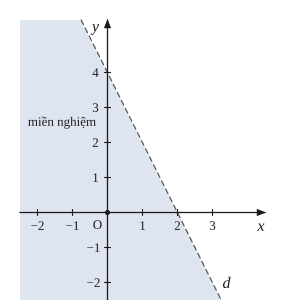
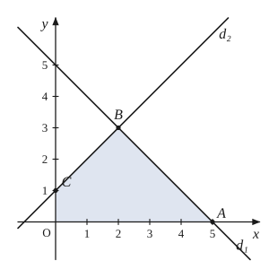
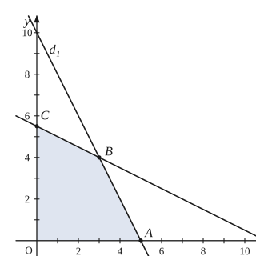
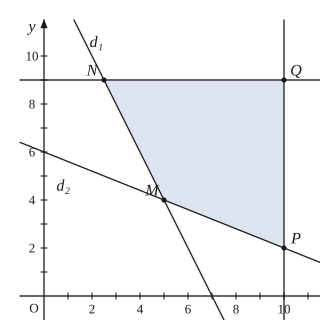
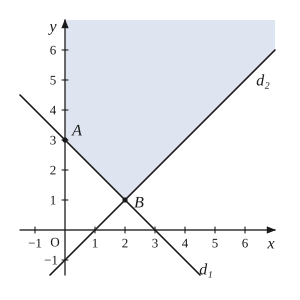

# Chủ đề 2. Bất phương trình và hệ bất phương trình bậc nhất hai ẩn

> Chủ đề này dạy cách biểu diễn miền nghiệm trên mặt phẳng tọa độ, rồi dùng nó để giải các bài toán tối ưu thực tế: sản xuất sao cho lãi nhiều nhất, mua sắm hoặc thuê xe sao cho chi phí ít nhất. Trong đề kiểm tra thường có một câu vẽ miền nghiệm và một bài toán tối ưu có lời văn.

## I. Kiến thức cần nắm

### 1. Bất phương trình bậc nhất hai ẩn
- Là bất phương trình có một trong các dạng $ax + by < c$, $ax + by > c$, $ax + by \le c$, $ax + by \ge c$, trong đó $a, b, c$ là các số thực và $a, b$ **không đồng thời bằng 0**.
- Mỗi cặp số $(x_0; y_0)$ thỏa mãn bất phương trình gọi là một **nghiệm**. Bất phương trình bậc nhất hai ẩn luôn có vô số nghiệm.

*Ví dụ:* $3x - 2y \le 6$ có nghiệm $(0; 0)$ vì $0 \le 6$; cặp $(2; -1)$ không phải nghiệm vì $3\cdot 2 - 2\cdot(-1) = 8 > 6$.

> Các bất phương trình như $x^2 + y \le 3$ hay $xy > 1$ **không** phải bậc nhất hai ẩn. Còn $3x \ge 1$ vẫn là bất phương trình bậc nhất hai ẩn (với $b = 0$).

### 2. Biểu diễn miền nghiệm của bất phương trình
Đường thẳng $d: ax + by = c$ chia mặt phẳng thành hai nửa mặt phẳng. Một nửa là miền nghiệm của $ax + by < c$, nửa kia là miền nghiệm của $ax + by > c$.

**Các bước:**
1. Vẽ đường thẳng $d: ax + by = c$.
2. Lấy một điểm $M(x_0; y_0)$ không nằm trên $d$ (thường là gốc $O(0; 0)$ nếu $c \ne 0$).
3. Tính $ax_0 + by_0$ và so sánh với $c$. Nếu thỏa mãn thì nửa mặt phẳng chứa $M$ là miền nghiệm; nếu không thì miền nghiệm là nửa mặt phẳng còn lại.
4. Với dấu $<$, $>$ thì **bờ $d$ không thuộc miền nghiệm** (vẽ nét đứt); với dấu $\le$, $\ge$ thì bờ thuộc miền nghiệm.

Trong các hình của tài liệu này, **miền nghiệm là phần được tô màu**.

*Ví dụ:* miền nghiệm của $x - y \ge 1$. Vẽ $x - y = 1$. Thay $O(0; 0)$: $0 \ge 1$ sai, nên miền nghiệm là nửa mặt phẳng bờ $d$ **không** chứa $O$, kể cả bờ.

### 3. Hệ bất phương trình bậc nhất hai ẩn
- Hệ gồm nhiều bất phương trình bậc nhất hai ẩn. Miền nghiệm của hệ là **giao** các miền nghiệm của từng bất phương trình.
- Cách làm: biểu diễn từng miền rồi lấy phần chung. Miền nghiệm thường là một **đa giác** (có thể không bị chặn).
- Tọa độ các **đỉnh** của đa giác tìm bằng cách giải hệ hai phương trình của hai đường thẳng đi qua đỉnh đó.

*Ví dụ:* hệ $x \ge 0$, $y \ge 0$, $x + y \le 2$ có miền nghiệm là tam giác với ba đỉnh $(0; 0)$, $(2; 0)$, $(0; 2)$.

### 4. Bài toán tìm giá trị lớn nhất, nhỏ nhất của $F = ax + by$
**Kết quả quan trọng:** nếu miền nghiệm của hệ là một đa giác (bị chặn) thì $F = ax + by$ đạt giá trị lớn nhất và giá trị nhỏ nhất **tại các đỉnh** của đa giác.

*Vì sao (trực quan):* với mỗi số $k$, tập các điểm có $F = k$ là một đường thẳng; khi $k$ thay đổi, các đường này song song với nhau. Tịnh tiến đường thẳng đó theo một chiều thì $k$ tăng dần; điểm cuối cùng của đa giác mà đường thẳng còn chạm tới là một đỉnh.

**Các bước giải bài toán tối ưu thực tế:**
1. Đặt ẩn $x, y$ (kèm điều kiện, thường $x \ge 0$, $y \ge 0$).
2. Lập hệ bất phương trình từ các ràng buộc của đề.
3. Lập biểu thức $F$ cần tìm giá trị lớn nhất hoặc nhỏ nhất.
4. Vẽ miền nghiệm, tìm tọa độ các đỉnh.
5. Tính $F$ tại các đỉnh, so sánh và kết luận.

*Ví dụ:* tìm giá trị lớn nhất của $F = x + 3y$ trên tam giác ở mục 3. $F(0;0) = 0$, $F(2;0) = 2$, $F(0;2) = 6$. Vậy $\max F = 6$ tại $(0; 2)$.

### 5. Sai lầm hay gặp
- Quên các điều kiện $x \ge 0$, $y \ge 0$ trong bài toán thực tế.
- Chọn điểm thử nằm ngay trên bờ (khi $c = 0$ không được thử bằng gốc $O$, phải chọn điểm khác như $(1; 0)$).
- Tìm sai đỉnh do lấy giao của hai đường thẳng mà giao điểm không thuộc miền nghiệm. Sau khi giải hệ, nên thay lại vào tất cả các bất phương trình.
- Với miền **không bị chặn**, $F$ có thể không có giá trị lớn nhất (hoặc nhỏ nhất); không được áp dụng máy móc "tính tại các đỉnh rồi so sánh".

---

## II. Bài tập vận dụng

**Bài 1.** Bất phương trình nào sau đây là bất phương trình bậc nhất hai ẩn?
a) $2x - 3y + 1 > 0$;  b) $x^2 + y \le 3$;  c) $3x \ge 0$;  d) $xy + 2 > 0$.

**Bài 2.** Trong các cặp số $(0; 0)$, $(2; -1)$, $(4; 3)$, $(-1; 5)$, cặp nào là nghiệm của bất phương trình $3x - 2y \le 6$?

**Bài 3.** Biểu diễn miền nghiệm của bất phương trình $2x + y < 4$ trên mặt phẳng tọa độ.

**Bài 4.** Biểu diễn miền nghiệm của hệ bất phương trình
$$\begin{cases} x \ge 0 \\ y \ge 0 \\ x + y \le 5 \\ -x + y \le 1 \end{cases}$$
và tìm tọa độ các đỉnh của miền nghiệm.

**Bài 5.** Tìm giá trị lớn nhất và giá trị nhỏ nhất của $F = 2x + 3y$ trên miền nghiệm của hệ ở Bài 4.

**Bài 6.** Cho tam giác $OAB$ với $O(0; 0)$, $A(4; 0)$, $B(0; 3)$.
a) Viết hệ bất phương trình có miền nghiệm là tam giác $OAB$ (kể cả các cạnh).
b) Điểm $M(1; 1)$ và $N(3; 1)$ có thuộc tam giác đó không?

**Bài 7 (thực tế).** Một cửa hàng bán áo với giá 150 nghìn đồng một chiếc và quần với giá 200 nghìn đồng một chiếc. Gọi $x$, $y$ là số áo và số quần bán được trong một ngày.
a) Lập bất phương trình biểu thị điều kiện "doanh thu trong ngày ít nhất 3 triệu đồng".
b) Nếu bán được 10 áo và 8 quần thì có đạt điều kiện đó không? Bán 8 áo và 8 quần thì sao?

**Bài 8 (sản xuất).** Một xưởng sản xuất hai loại sản phẩm I và II. Mỗi tấn sản phẩm I cần 2 giờ làm việc của máy A và 1 giờ của máy B; mỗi tấn sản phẩm II cần 1 giờ của máy A và 2 giờ của máy B. Mỗi ngày máy A làm việc không quá 10 giờ, máy B không quá 11 giờ. Mỗi tấn sản phẩm I lãi 3 triệu đồng, mỗi tấn sản phẩm II lãi 4 triệu đồng. Mỗi ngày xưởng nên sản xuất bao nhiêu tấn mỗi loại để tiền lãi lớn nhất?

**Bài 9 (khẩu phần).** Mỗi ngày một người cần ít nhất 8 đơn vị chất đạm và 7 đơn vị chất béo. Mỗi gói thực phẩm X chứa 2 đơn vị đạm, 1 đơn vị béo, giá 50 nghìn đồng; mỗi gói thực phẩm Y chứa 1 đơn vị đạm, 2 đơn vị béo, giá 40 nghìn đồng. Mỗi ngày người đó mua không quá 6 gói mỗi loại. Cần mua bao nhiêu gói mỗi loại để đủ chất mà chi phí ít nhất?

**Bài 10.** Có bao nhiêu cặp số nguyên $(x; y)$ thỏa mãn hệ $x \ge 0$, $y \ge 0$, $x + 2y \le 6$?

**Bài 11 (thuê xe).** Một công ty cần chở 140 người và 9 tấn hàng. Nơi cho thuê có 10 xe loại A và 9 xe loại B. Mỗi xe loại A chở được 20 người và $0{,}6$ tấn hàng, giá thuê 4 triệu đồng; mỗi xe loại B chở được 10 người và $1{,}5$ tấn hàng, giá thuê 3 triệu đồng. Hỏi phải thuê bao nhiêu xe mỗi loại để chi phí thấp nhất?

**Bài 12.** Cho hệ $x \ge 0$, $x + y \ge 3$, $x - y \le 1$.
a) Biểu diễn miền nghiệm của hệ.
b) Tìm giá trị nhỏ nhất của $F = x + 2y$ trên miền nghiệm. $F$ có giá trị lớn nhất không?

---

## III. Lời giải chi tiết

### Bài 1
- a) Là bất phương trình bậc nhất hai ẩn ($a = 2$, $b = -3$).
- b) Không phải, vì có $x^2$.
- c) Là bất phương trình bậc nhất hai ẩn ($a = 3$, $b = 0$, không đồng thời bằng 0).
- d) Không phải, vì có tích $xy$.

**Đáp số:** a) và c).

### Bài 2
Tính $3x - 2y$ tại từng cặp:
- $(0; 0)$: $0 \le 6$, là nghiệm.
- $(2; -1)$: $6 + 2 = 8 > 6$, không phải nghiệm.
- $(4; 3)$: $12 - 6 = 6 \le 6$, là nghiệm (điểm nằm trên bờ).
- $(-1; 5)$: $-3 - 10 = -13 \le 6$, là nghiệm.

**Đáp số:** $(0; 0)$, $(4; 3)$, $(-1; 5)$.

### Bài 3

*Hình: Miền nghiệm của bất phương trình 2x + y < 4.*

- Vẽ đường thẳng $d: 2x + y = 4$ đi qua $(2; 0)$ và $(0; 4)$.
- Thay $O(0; 0)$: $2\cdot 0 + 0 = 0 < 4$, đúng. Vậy miền nghiệm là nửa mặt phẳng bờ $d$ chứa gốc $O$.
- Dấu "$<$" nên bờ $d$ không thuộc miền nghiệm (vẽ nét đứt).

### Bài 4

*Hình: Miền nghiệm của hệ bất phương trình bài 4.*

- $x \ge 0$, $y \ge 0$: góc phần tư thứ nhất, kể cả các trục.
- $d_1: x + y = 5$ qua $(5; 0)$, $(0; 5)$. Thay $O$: $0 \le 5$ đúng, lấy nửa mặt phẳng chứa $O$.
- $d_2: -x + y = 1$ qua $(0; 1)$, $(-1; 0)$. Thay $O$: $0 \le 1$ đúng, lấy nửa mặt phẳng chứa $O$.

Miền nghiệm là tứ giác $OABC$. Các đỉnh:
- $O(0; 0)$; $A = d_1 \cap Ox$: $A(5; 0)$; $C = d_2 \cap Oy$: $C(0; 1)$;
- $B = d_1 \cap d_2$: giải $\begin{cases} x + y = 5 \\ -x + y = 1 \end{cases}$ được $y = 3$, $x = 2$, nên $B(2; 3)$.

### Bài 5
Miền nghiệm là tứ giác $OABC$ nên $F$ đạt giá trị lớn nhất, nhỏ nhất tại các đỉnh:
$$F(O) = 0,\quad F(A) = 2\cdot 5 = 10,\quad F(B) = 2\cdot 2 + 3\cdot 3 = 13,\quad F(C) = 3.$$
**Đáp số:** $\max F = 13$ tại $(2; 3)$; $\min F = 0$ tại $(0; 0)$.

### Bài 6
a) Đường thẳng $AB$ đi qua $(4; 0)$ và $(0; 3)$ có phương trình $\frac{x}{4} + \frac{y}{3} = 1$, tức là $3x + 4y = 12$. Gốc $O$ thỏa mãn $3\cdot 0 + 4\cdot 0 = 0 \le 12$ và nằm trong tam giác, nên hệ cần tìm là
$$\begin{cases} x \ge 0 \\ y \ge 0 \\ 3x + 4y \le 12. \end{cases}$$
b) $M(1; 1)$: $3 + 4 = 7 \le 12$, thuộc tam giác. $N(3; 1)$: $9 + 4 = 13 > 12$, không thuộc tam giác.

### Bài 7
a) Doanh thu là $150x + 200y$ (nghìn đồng). Điều kiện: $150x + 200y \ge 3000$, chia cho 50 được
$$3x + 4y \ge 60 \quad (x, y \text{ là số tự nhiên}).$$
b) $(10; 8)$: $30 + 32 = 62 \ge 60$, đạt. $(8; 8)$: $24 + 32 = 56 < 60$, không đạt.

### Bài 8

*Hình: Miền nghiệm của hệ ràng buộc bài 8.*

Gọi $x$, $y$ (tấn) là khối lượng sản phẩm I, II sản xuất mỗi ngày. Điều kiện:
$$\begin{cases} x \ge 0,\ y \ge 0 \\ 2x + y \le 10 \quad (\text{máy A}) \\ x + 2y \le 11 \quad (\text{máy B}) \end{cases}$$
Tiền lãi: $F = 3x + 4y$ (triệu đồng).

Miền nghiệm là tứ giác $OABC$ với $O(0; 0)$, $A(5; 0)$, $C\left(0; \frac{11}{2}\right)$ và $B$ là giao của $d_1: 2x + y = 10$ với $d_2: x + 2y = 11$. Giải hệ: nhân phương trình thứ hai với 2 rồi trừ phương trình thứ nhất được $3y = 12$, $y = 4$, $x = 3$. Vậy $B(3; 4)$.
$$F(O) = 0,\quad F(A) = 15,\quad F(B) = 9 + 16 = 25,\quad F(C) = 22.$$
**Đáp số:** sản xuất 3 tấn sản phẩm I và 4 tấn sản phẩm II, lãi lớn nhất 25 triệu đồng.

### Bài 9
Gọi $x$, $y$ là số gói X, Y mua mỗi ngày. Điều kiện:
$$\begin{cases} 0 \le x \le 6,\ 0 \le y \le 6 \\ 2x + y \ge 8 \quad (\text{đạm}) \\ x + 2y \ge 7 \quad (\text{béo}) \end{cases}$$
Chi phí: $F = 50x + 40y$ (nghìn đồng).

Miền nghiệm là tứ giác với các đỉnh:
- giao của $2x + y = 8$ và $x + 2y = 7$: $(3; 2)$;
- giao của $2x + y = 8$ và $y = 6$: $(1; 6)$;
- giao của $x + 2y = 7$ và $x = 6$: $\left(6; \frac12\right)$;
- $(6; 6)$.

Tính chi phí: $F(3; 2) = 230$, $F(1; 6) = 290$, $F\left(6; \frac12\right) = 320$, $F(6; 6) = 540$.

**Đáp số:** mua 3 gói X và 2 gói Y, chi phí ít nhất 230 nghìn đồng.

*Nhận xét:* bài toán "chi phí ít nhất" có các ràng buộc dạng "$\ge$"; miền nghiệm nằm **xa** gốc tọa độ, khác với bài toán "lãi nhiều nhất".

### Bài 10
Từ $x \ge 0$ và $x + 2y \le 6$ suy ra $2y \le 6$, nên $y \in \{0; 1; 2; 3\}$. Đếm theo $y$:
- $y = 0$: $0 \le x \le 6$, có 7 giá trị;
- $y = 1$: $0 \le x \le 4$, có 5 giá trị;
- $y = 2$: $0 \le x \le 2$, có 3 giá trị;
- $y = 3$: $x = 0$, có 1 giá trị.

**Đáp số:** $7 + 5 + 3 + 1 = 16$ cặp.

### Bài 11

*Hình: Miền nghiệm của hệ ràng buộc bài 11.*

Gọi $x$, $y$ là số xe loại A, B cần thuê ($x, y$ là số tự nhiên). Điều kiện:
$$\begin{cases} 0 \le x \le 10,\ 0 \le y \le 9 \\ 20x + 10y \ge 140 \\ 0{,}6x + 1{,}5y \ge 9 \end{cases} \iff \begin{cases} 0 \le x \le 10,\ 0 \le y \le 9 \\ 2x + y \ge 14 \\ 2x + 5y \ge 30 \end{cases}$$
Chi phí: $F = 4x + 3y$ (triệu đồng).

Miền nghiệm là tứ giác $MNQP$ với $d_1: 2x + y = 14$, $d_2: 2x + 5y = 30$:
- $M = d_1 \cap d_2$: trừ hai phương trình được $4y = 16$, $y = 4$, $x = 5$; $M(5; 4)$;
- $N = d_1 \cap \{y = 9\}$: $N\left(\frac52; 9\right)$;
- $P = d_2 \cap \{x = 10\}$: $P(10; 2)$;
- $Q(10; 9)$.

$$F(M) = 32,\quad F(N) = 37,\quad F(P) = 46,\quad F(Q) = 67.$$
Giá trị nhỏ nhất đạt tại $M(5; 4)$, là cặp số tự nhiên nên thỏa mãn đề bài.

**Đáp số:** thuê 5 xe loại A và 4 xe loại B, chi phí thấp nhất 32 triệu đồng.

*Nhận xét:* nếu đỉnh tối ưu không có tọa độ nguyên thì phải xét thêm các điểm nguyên gần đó trong miền nghiệm.

### Bài 12

*Hình: Miền nghiệm không bị chặn của bài 12.*

a) Vẽ $d_1: x + y = 3$ và $d_2: x - y = 1$. Thay $O(0; 0)$: $0 \ge 3$ sai, nên lấy nửa mặt phẳng bờ $d_1$ không chứa $O$; $0 \le 1$ đúng, nên lấy nửa mặt phẳng bờ $d_2$ chứa $O$. Kết hợp với $x \ge 0$, miền nghiệm là miền **không bị chặn** có hai đỉnh $A(0; 3)$ và $B(2; 1)$ (giao của $d_1$ và $d_2$).

b) Vì miền không bị chặn, ta chứng minh trực tiếp. Viết $x - y \le 1$ thành $y - x \ge -1$ rồi cộng vế theo vế với $x + y \ge 3$ (hai bất đẳng thức cùng chiều) được $2y \ge 2$, tức là $y \ge 1$. Do đó
$$F = x + 2y = (x + y) + y \ge 3 + 1 = 4.$$
Dấu "=" khi $x + y = 3$ và $y = 1$, tức là tại $B(2; 1)$, điểm này thuộc miền nghiệm. Vậy $\min F = 4$.

$F$ không có giá trị lớn nhất: các điểm $(0; t)$ với $t \ge 3$ đều thuộc miền nghiệm, và $F(0; t) = 2t$ lớn tùy ý khi $t$ tăng.

*Nhận xét:* so sánh với các đỉnh: $F(A) = 6$, $F(B) = 4$. Với miền không bị chặn, giá trị nhỏ nhất vẫn có thể đạt tại một đỉnh, nhưng phải lập luận thêm như trên chứ không chỉ so sánh các đỉnh.
