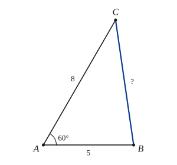
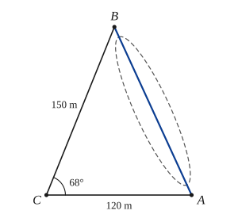
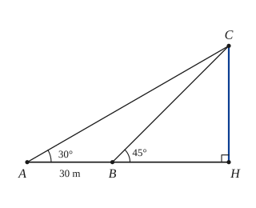
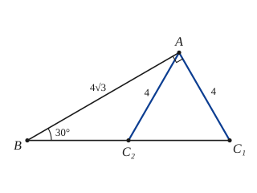

# Chủ đề 3. Hệ thức lượng trong tam giác

> Định lý côsin và định lý sin cho phép tính mọi yếu tố của một tam giác bất kỳ khi biết ba yếu tố (trong đó có ít nhất một cạnh). Đây là công cụ của các bài đo đạc thực tế: khoảng cách qua hồ, chiều cao của tháp, khoảng cách giữa hai con tàu. Đề kiểm tra hầu như luôn có một câu giải tam giác hoặc tính diện tích.

## I. Kiến thức cần nắm

### 1. Giá trị lượng giác của góc từ $0^\circ$ đến $180^\circ$
Trên nửa đường tròn đơn vị (tâm $O$, bán kính 1, nằm phía trên trục $Ox$), lấy điểm $M(x_0; y_0)$ sao cho $\widehat{xOM} = \alpha$. Khi đó
$$\sin\alpha = y_0,\quad \cos\alpha = x_0,\quad \tan\alpha = \frac{y_0}{x_0}\ (\alpha \ne 90^\circ),\quad \cot\alpha = \frac{x_0}{y_0}\ (\alpha \ne 0^\circ, 180^\circ).$$
- Với $0^\circ \le \alpha \le 180^\circ$: $\sin\alpha \ge 0$; $\cos\alpha > 0$ khi $\alpha$ nhọn, $\cos\alpha < 0$ khi $\alpha$ tù.
- $\sin^2\alpha + \cos^2\alpha = 1$; $\ \tan\alpha\cdot\cot\alpha = 1$; $\ 1 + \tan^2\alpha = \frac{1}{\cos^2\alpha}$.
- **Hai góc bù nhau** ($\alpha$ và $180^\circ - \alpha$): sin bằng nhau, còn cos, tan, cot đối nhau:
$$\sin(180^\circ - \alpha) = \sin\alpha,\quad \cos(180^\circ - \alpha) = -\cos\alpha,\quad \tan(180^\circ - \alpha) = -\tan\alpha.$$

| $\alpha$ | $0^\circ$ | $30^\circ$ | $45^\circ$ | $60^\circ$ | $90^\circ$ | $120^\circ$ | $135^\circ$ | $150^\circ$ | $180^\circ$ |
|---|---|---|---|---|---|---|---|---|---|
| $\sin$ | $0$ | $\frac12$ | $\frac{\sqrt2}{2}$ | $\frac{\sqrt3}{2}$ | $1$ | $\frac{\sqrt3}{2}$ | $\frac{\sqrt2}{2}$ | $\frac12$ | $0$ |
| $\cos$ | $1$ | $\frac{\sqrt3}{2}$ | $\frac{\sqrt2}{2}$ | $\frac12$ | $0$ | $-\frac12$ | $-\frac{\sqrt2}{2}$ | $-\frac{\sqrt3}{2}$ | $-1$ |
| $\tan$ | $0$ | $\frac{\sqrt3}{3}$ | $1$ | $\sqrt3$ | không xác định | $-\sqrt3$ | $-1$ | $-\frac{\sqrt3}{3}$ | $0$ |

*Ví dụ:* $\cos 135^\circ = -\cos 45^\circ = -\frac{\sqrt2}{2}$.

### 2. Định lý côsin
Trong tam giác $ABC$ với $BC = a$, $CA = b$, $AB = c$:
$$a^2 = b^2 + c^2 - 2bc\cos A,\qquad b^2 = c^2 + a^2 - 2ca\cos B,\qquad c^2 = a^2 + b^2 - 2ab\cos C.$$
**Hệ quả:** $\cos A = \dfrac{b^2 + c^2 - a^2}{2bc}$ (tương tự cho $B$, $C$).
- Khi $A = 90^\circ$, định lý côsin chính là định lý Pythagore.
- Dấu của $b^2 + c^2 - a^2$ cho biết góc $A$ nhọn, vuông hay tù. Góc lớn nhất nằm đối diện cạnh lớn nhất.

**Công thức trung tuyến** (suy ra từ định lý côsin): $m_a^2 = \dfrac{b^2 + c^2}{2} - \dfrac{a^2}{4}$.
*Vì sao:* gọi $M$ là trung điểm $BC$. Áp dụng định lý côsin cho hai tam giác $ABM$, $ACM$ với hai góc $\widehat{AMB}$, $\widehat{AMC}$ bù nhau (côsin đối nhau), cộng hai đẳng thức thì các số hạng chứa côsin triệt tiêu: $b^2 + c^2 = 2m_a^2 + \frac{a^2}{2}$.

*Ví dụ:* $b = 3$, $c = 5$, $A = 120^\circ$ thì $a^2 = 9 + 25 - 2\cdot 3\cdot 5\cdot\left(-\frac12\right) = 49$, $a = 7$.

### 3. Định lý sin
$$\frac{a}{\sin A} = \frac{b}{\sin B} = \frac{c}{\sin C} = 2R,$$
với $R$ là bán kính đường tròn ngoại tiếp tam giác.
- Dùng khi biết **hai góc và một cạnh**, hoặc khi cần tính $R$.
- Biết hai cạnh và một góc **không xen giữa** (chẳng hạn $b$, $c$, $B$) thì từ $\sin C = \frac{c\sin B}{b}$ có thể được **hai** giá trị của $C$ (một nhọn, một tù). Phải kiểm tra từng giá trị.

*Ví dụ:* $a = 6$, $A = 30^\circ$ thì $2R = \frac{6}{1/2} = 12$, $R = 6$.

### 4. Các công thức tính diện tích
Với $p = \frac{a + b + c}{2}$ là nửa chu vi, $r$ là bán kính đường tròn nội tiếp, $h_a$ là đường cao ứng với cạnh $a$:
$$S = \frac12 a h_a = \frac12 bc\sin A = \frac{abc}{4R} = pr = \sqrt{p(p - a)(p - b)(p - c)}\ \ (\text{Heron}).$$
- $\frac12 bc\sin A$: biết hai cạnh và góc xen giữa.
- Heron: biết ba cạnh.
- Từ $S$ suy ra $R = \frac{abc}{4S}$, $r = \frac{S}{p}$, $h_a = \frac{2S}{a}$.

*Ví dụ:* tam giác cạnh 3, 4, 5 có $p = 6$, $S = \sqrt{6\cdot 3\cdot 2\cdot 1} = 6$, $r = 1$.

### 5. Giải tam giác và ứng dụng thực tế
**Giải tam giác** là tính các cạnh, các góc còn lại khi biết một số yếu tố.

| Biết | Dùng |
|---|---|
| Ba cạnh (c.c.c) | Hệ quả định lý côsin để tính góc |
| Hai cạnh và góc xen giữa (c.g.c) | Định lý côsin tính cạnh thứ ba |
| Một cạnh và hai góc (g.c.g) | Tổng ba góc bằng $180^\circ$, rồi định lý sin |
| Hai cạnh và góc không xen giữa | Định lý sin (cẩn thận có thể có hai nghiệm) |

**Bài toán thực tế:** vẽ hình, đưa các khoảng cách và góc đo được vào một tam giác, rồi giải tam giác đó. Góc nâng (góc giữa phương ngang và hướng nhìn lên) thường cho các tam giác có góc bù hoặc góc ngoài.

### 6. Sai lầm hay gặp
- Quên rằng $\cos A < 0$ khi $A$ tù, dẫn tới lấy sai dấu khi tính $\cos A$ từ $\sin A$.
- Từ $\sin C = \frac{\sqrt3}{2}$ chỉ lấy $C = 60^\circ$, bỏ sót $C = 120^\circ$.
- Dùng $S = \frac12 ab\sin A$ (góc **không xen giữa** hai cạnh $a$, $b$). Đúng phải là $\frac12 ab\sin C$.
- Để máy tính ở chế độ radian khi tính với độ.

---

## II. Bài tập vận dụng

**Bài 1.** Tính giá trị các biểu thức
a) $A = \sin 150^\circ + \cos 120^\circ + \tan 135^\circ$;
b) $B = \cos^2 30^\circ + \sin^2 150^\circ + \cot 45^\circ$.

**Bài 2.** Cho góc $\alpha$ với $0^\circ \le \alpha \le 180^\circ$ và $\cos\alpha = -\frac35$. Tính $\sin\alpha$, $\tan\alpha$, $\cot\alpha$.

**Bài 3.** Cho tam giác $ABC$ có $AB = 5$, $AC = 8$, $\widehat{A} = 60^\circ$. Tính $BC$, diện tích tam giác và bán kính đường tròn ngoại tiếp.

**Bài 4.** Cho tam giác $ABC$ có $BC = 10$, $\widehat{B} = 45^\circ$, $\widehat{C} = 75^\circ$. Tính $\widehat{A}$, $AC$, $AB$ và bán kính $R$ của đường tròn ngoại tiếp.

**Bài 5.** Cho tam giác có ba cạnh $13$, $14$, $15$. Tính diện tích $S$, bán kính $R$ của đường tròn ngoại tiếp, bán kính $r$ của đường tròn nội tiếp và đường cao ứng với cạnh dài 14.

**Bài 6.** Tam giác có ba cạnh $3$, $5$, $7$ là tam giác nhọn, vuông hay tù? Tính góc lớn nhất của tam giác.

**Bài 7 (đo khoảng cách qua hồ).** Hai điểm $A$, $B$ nằm ở hai bờ của một cái hồ. Từ điểm $C$ người ta đo được $CA = 120$ m, $CB = 150$ m và $\widehat{ACB} = 68^\circ$. Tính khoảng cách $AB$ (làm tròn đến mét).

**Bài 8 (đo chiều cao).** Để đo chiều cao tháp $CH$ ($H$ là chân tháp), người ta chọn hai điểm $A$, $B$ trên mặt đất thẳng hàng với $H$, $B$ nằm giữa $A$ và $H$, $AB = 30$ m. Góc nâng từ $A$ và từ $B$ đến đỉnh tháp lần lượt là $30^\circ$ và $45^\circ$. Tính chiều cao của tháp.

**Bài 9.** Cho tam giác $ABC$ có $AB = 4$, $AC = 6$, $BC = 8$. Tính độ dài đường trung tuyến $AM$.

**Bài 10 (hai con tàu).** Hai tàu cùng rời cảng $O$ một lúc theo hai hướng tạo với nhau góc $60^\circ$. Tàu thứ nhất chạy với vận tốc 20 km/h, tàu thứ hai 15 km/h. Sau 2 giờ, hai tàu cách nhau bao xa?

**Bài 11.** Chứng minh rằng nếu tam giác $ABC$ thỏa mãn $\sin A = 2\sin B\cos C$ thì tam giác đó cân.

**Bài 12 (hai nghiệm).** Giải tam giác $ABC$ biết $AC = b = 4$, $AB = c = 4\sqrt3$, $\widehat{B} = 30^\circ$.

**Bài 13.** Tam giác $ABC$ có diện tích $S = a^2 - (b - c)^2$. Tính $\tan A$.

---

## III. Lời giải chi tiết

### Bài 1
a) $\sin 150^\circ = \sin 30^\circ = \frac12$; $\cos 120^\circ = -\cos 60^\circ = -\frac12$; $\tan 135^\circ = -\tan 45^\circ = -1$.
$$A = \frac12 - \frac12 - 1 = -1.$$
b) $\cos^2 30^\circ = \frac34$, $\sin^2 150^\circ = \sin^2 30^\circ = \frac14$, $\cot 45^\circ = 1$.
$$B = \frac34 + \frac14 + 1 = 2.$$

### Bài 2
$\sin^2\alpha = 1 - \cos^2\alpha = 1 - \frac{9}{25} = \frac{16}{25}$. Vì $0^\circ \le \alpha \le 180^\circ$ nên $\sin\alpha \ge 0$, do đó $\sin\alpha = \frac45$.
$$\tan\alpha = \frac{\sin\alpha}{\cos\alpha} = \frac{4/5}{-3/5} = -\frac43,\qquad \cot\alpha = -\frac34.$$
($\cos\alpha < 0$ nên $\alpha$ là góc tù.)

### Bài 3

*Hình: Tam giác ABC với AB = 5, AC = 8, góc A bằng 60 độ.*

- Định lý côsin: $BC^2 = 5^2 + 8^2 - 2\cdot 5\cdot 8\cos 60^\circ = 25 + 64 - 40 = 49$, nên $BC = 7$.
- Diện tích: $S = \frac12\cdot AB\cdot AC\cdot\sin A = \frac12\cdot 5\cdot 8\cdot\frac{\sqrt3}{2} = 10\sqrt3$.
- Định lý sin: $2R = \frac{BC}{\sin A} = \frac{7}{\sqrt3/2} = \frac{14}{\sqrt3}$, nên $R = \frac{7}{\sqrt3} = \frac{7\sqrt3}{3}$.

**Đáp số:** $BC = 7$, $S = 10\sqrt3$, $R = \frac{7\sqrt3}{3}$.

### Bài 4
$\widehat{A} = 180^\circ - 45^\circ - 75^\circ = 60^\circ$.

Định lý sin: $\frac{BC}{\sin A} = \frac{10}{\sqrt3/2} = \frac{20}{\sqrt3} = 2R$, nên $R = \frac{10}{\sqrt3} = \frac{10\sqrt3}{3}$.
- $AC = 2R\sin B = \frac{20}{\sqrt3}\cdot\frac{\sqrt2}{2} = \frac{10\sqrt2}{\sqrt3} = \frac{10\sqrt6}{3} \approx 8{,}16$.
- $AB = 2R\sin C = \frac{20}{\sqrt3}\sin 75^\circ \approx \frac{20}{1{,}7321}\cdot 0{,}9659 \approx 11{,}15$.

**Đáp số:** $\widehat{A} = 60^\circ$, $AC = \frac{10\sqrt6}{3} \approx 8{,}16$, $AB \approx 11{,}15$, $R = \frac{10\sqrt3}{3}$.

*Nhận xét:* giá trị đúng là $AB = \frac{5(3\sqrt2 + \sqrt6)}{3}$, nhưng ở lớp 10 chỉ cần tính gần đúng bằng máy tính.

### Bài 5
$p = \frac{13 + 14 + 15}{2} = 21$. Theo Heron:
$$S = \sqrt{21\cdot 8\cdot 7\cdot 6} = \sqrt{7056} = 84.$$
- $R = \frac{abc}{4S} = \frac{13\cdot 14\cdot 15}{4\cdot 84} = \frac{2730}{336} = \frac{65}{8}$.
- $r = \frac{S}{p} = \frac{84}{21} = 4$.
- Đường cao ứng với cạnh 14: $h = \frac{2S}{14} = \frac{168}{14} = 12$.

**Đáp số:** $S = 84$, $R = \frac{65}{8}$, $r = 4$, $h = 12$.

### Bài 6
Góc lớn nhất là góc $C$ đối diện cạnh lớn nhất $c = 7$:
$$\cos C = \frac{a^2 + b^2 - c^2}{2ab} = \frac{9 + 25 - 49}{2\cdot 3\cdot 5} = \frac{-15}{30} = -\frac12.$$
Vậy $\widehat{C} = 120^\circ$, tam giác là **tam giác tù**.

### Bài 7

*Hình: Đo khoảng cách AB qua hồ từ điểm C.*

Áp dụng định lý côsin trong tam giác $ABC$:
$$AB^2 = CA^2 + CB^2 - 2\cdot CA\cdot CB\cos 68^\circ = 14400 + 22500 - 36000\cos 68^\circ \approx 36900 - 13486{,}0 = 23414{,}0.$$
Suy ra $AB \approx 153$ m.

**Đáp số:** khoảng 153 m.

### Bài 8

*Hình: Đo chiều cao tháp CH từ hai điểm A và B.*

Đặt $h = CH$. Trong tam giác $BHC$ vuông tại $H$, $\widehat{CBH} = 45^\circ$ nên $BH = h$. Trong tam giác $AHC$ vuông tại $H$, $\tan 30^\circ = \frac{h}{AH}$ nên $AH = \frac{h}{\tan 30^\circ} = h\sqrt3$.

Vì $AH - BH = AB = 30$:
$$h\sqrt3 - h = 30 \iff h = \frac{30}{\sqrt3 - 1} = \frac{30(\sqrt3 + 1)}{2} = 15(\sqrt3 + 1) \approx 40{,}98 \text{ (m)}.$$

**Cách 2 (định lý sin).** Trong tam giác $ABC$: $\widehat{ABC} = 180^\circ - 45^\circ = 135^\circ$, $\widehat{ACB} = 180^\circ - 30^\circ - 135^\circ = 15^\circ$. Theo định lý sin, $BC = \frac{AB\sin 30^\circ}{\sin 15^\circ} \approx \frac{15}{0{,}2588} \approx 57{,}96$ m. Do đó $h = BC\sin 45^\circ \approx 40{,}98$ m.

**Đáp số:** $h = 15(\sqrt3 + 1) \approx 41$ m.

*Nhận xét:* cách 2 dùng được cả khi các góc không đặc biệt, là cách làm chung cho bài đo chiều cao từ hai vị trí.

### Bài 9
Theo công thức trung tuyến với $a = BC = 8$, $b = AC = 6$, $c = AB = 4$:
$$AM^2 = \frac{b^2 + c^2}{2} - \frac{a^2}{4} = \frac{36 + 16}{2} - \frac{64}{4} = 26 - 16 = 10.$$
**Đáp số:** $AM = \sqrt{10}$.

### Bài 10
Sau 2 giờ, tàu thứ nhất đến $A$ với $OA = 40$ km, tàu thứ hai đến $B$ với $OB = 30$ km, và $\widehat{AOB} = 60^\circ$. Định lý côsin:
$$AB^2 = 40^2 + 30^2 - 2\cdot 40\cdot 30\cdot\frac12 = 1600 + 900 - 1200 = 1300.$$
**Đáp số:** $AB = 10\sqrt{13} \approx 36{,}06$ km.

### Bài 11
Theo định lý sin, $\sin A = \frac{a}{2R}$, $\sin B = \frac{b}{2R}$; theo hệ quả định lý côsin, $\cos C = \frac{a^2 + b^2 - c^2}{2ab}$. Thay vào giả thiết:
$$\frac{a}{2R} = 2\cdot\frac{b}{2R}\cdot\frac{a^2 + b^2 - c^2}{2ab} \iff a = \frac{a^2 + b^2 - c^2}{a} \iff a^2 = a^2 + b^2 - c^2 \iff b^2 = c^2.$$
Vậy $b = c$, tam giác $ABC$ cân tại $A$.

*Nhận xét:* phương pháp chung để nhận dạng tam giác: dùng định lý sin và định lý côsin để **đổi hết về cạnh**, rồi biến đổi đại số.

### Bài 12

*Hình: Hai tam giác ABC1 và ABC2 cùng thỏa mãn đề bài.*

Định lý sin: $\sin C = \frac{c\sin B}{b} = \frac{4\sqrt3\cdot\frac12}{4} = \frac{\sqrt3}{2}$. Do đó $\widehat{C} = 60^\circ$ hoặc $\widehat{C} = 120^\circ$. Cả hai đều thỏa mãn $\widehat{B} + \widehat{C} < 180^\circ$.

- **Trường hợp 1:** $\widehat{C} = 60^\circ$, $\widehat{A} = 90^\circ$. Khi đó $a = \frac{b\sin A}{\sin B} = \frac{4\cdot 1}{1/2} = 8$.
- **Trường hợp 2:** $\widehat{C} = 120^\circ$, $\widehat{A} = 30^\circ$. Khi đó $a = \frac{4\cdot\frac12}{\frac12} = 4$ (tam giác cân tại $C$).

Kiểm tra bằng định lý côsin: $b^2 = a^2 + c^2 - 2ac\cos B$ cho $a^2 - 12a + 32 = 0$, có hai nghiệm $a = 8$ và $a = 4$, khớp với hai trường hợp.

**Đáp số:** có hai tam giác: ($\widehat{A} = 90^\circ$, $\widehat{C} = 60^\circ$, $a = 8$) và ($\widehat{A} = 30^\circ$, $\widehat{C} = 120^\circ$, $a = 4$).

### Bài 13
Theo định lý côsin, $a^2 = b^2 + c^2 - 2bc\cos A$, nên
$$a^2 - (b - c)^2 = b^2 + c^2 - 2bc\cos A - b^2 + 2bc - c^2 = 2bc(1 - \cos A).$$
Mặt khác $S = \frac12 bc\sin A$. Từ giả thiết: $\frac12 bc\sin A = 2bc(1 - \cos A)$, tức là $\sin A = 4(1 - \cos A)$.

Bình phương và dùng $\sin^2 A = 1 - \cos^2 A = (1 - \cos A)(1 + \cos A)$:
$$(1 - \cos A)(1 + \cos A) = 16(1 - \cos A)^2.$$
Vì $0^\circ < A < 180^\circ$ nên $\cos A \ne 1$, chia hai vế cho $1 - \cos A$: $1 + \cos A = 16 - 16\cos A$, suy ra $\cos A = \frac{15}{17}$. Khi đó $\sin A = 4\left(1 - \frac{15}{17}\right) = \frac{8}{17}$ (dương, thỏa mãn).
$$\tan A = \frac{\sin A}{\cos A} = \frac{8}{15}.$$
**Đáp số:** $\tan A = \frac{8}{15}$.
