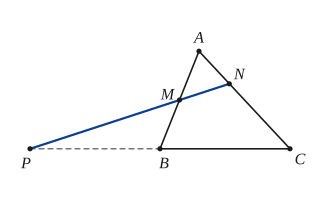
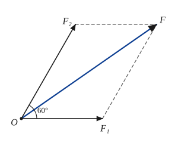
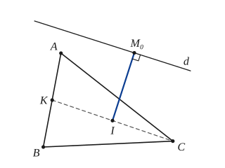

# Chủ đề 4. Vectơ

> Vectơ là đại lượng có cả độ lớn và hướng, như lực, vận tốc, độ dời. Với vectơ, nhiều bài hình học (chứng minh đẳng thức, ba điểm thẳng hàng, tính độ dài, tính góc) được đưa về phép tính gần giống đại số. Đề kiểm tra thường có câu phân tích vectơ, câu chứng minh thẳng hàng và câu tính tích vô hướng.

## I. Kiến thức cần nắm

### 1. Các khái niệm
- **Vectơ** $\overrightarrow{AB}$ là đoạn thẳng có hướng, điểm đầu $A$, điểm cuối $B$. **Độ dài** $\lvert\overrightarrow{AB}\rvert = AB$.
- **Giá** của vectơ là đường thẳng chứa nó. Hai vectơ **cùng phương** nếu giá của chúng song song hoặc trùng nhau. Hai vectơ cùng phương thì cùng hướng hoặc ngược hướng.
- Hai vectơ **bằng nhau** nếu cùng hướng và cùng độ dài. Từ đó: $ABCD$ là hình bình hành $\iff \overrightarrow{AB} = \overrightarrow{DC}$.
- **Vectơ-không** $\vec 0$ có điểm đầu trùng điểm cuối, cùng phương, cùng hướng với mọi vectơ.

### 2. Tổng và hiệu hai vectơ
- **Quy tắc ba điểm:** $\overrightarrow{AB} + \overrightarrow{BC} = \overrightarrow{AC}$ (với mọi điểm $A$, $B$, $C$).
- **Quy tắc hình bình hành:** $ABCD$ là hình bình hành thì $\overrightarrow{AB} + \overrightarrow{AD} = \overrightarrow{AC}$.
- **Vectơ đối:** $-\overrightarrow{AB} = \overrightarrow{BA}$. **Hiệu:** $\vec a - \vec b = \vec a + (-\vec b)$; với mọi $O$, $A$, $B$: $\overrightarrow{OB} - \overrightarrow{OA} = \overrightarrow{AB}$.
- **Trung điểm:** $I$ là trung điểm $AB \iff \overrightarrow{IA} + \overrightarrow{IB} = \vec 0 \iff \overrightarrow{MA} + \overrightarrow{MB} = 2\overrightarrow{MI}$ với mọi $M$.
- **Trọng tâm:** $G$ là trọng tâm tam giác $ABC \iff \overrightarrow{GA} + \overrightarrow{GB} + \overrightarrow{GC} = \vec 0 \iff \overrightarrow{MA} + \overrightarrow{MB} + \overrightarrow{MC} = 3\overrightarrow{MG}$ với mọi $M$.

*Ví dụ:* với bốn điểm bất kỳ, $\overrightarrow{AB} + \overrightarrow{CD} = \overrightarrow{AD} + \overrightarrow{CB}$, vì $\overrightarrow{AB} = \overrightarrow{AD} + \overrightarrow{DB}$ và $\overrightarrow{DB} + \overrightarrow{CD} = \overrightarrow{CD} + \overrightarrow{DB} = \overrightarrow{CB}$.

### 3. Tích của vectơ với một số
- $k\vec a$ (với $k \ne 0$, $\vec a \ne \vec 0$) cùng hướng với $\vec a$ nếu $k > 0$, ngược hướng nếu $k < 0$, và $\lvert k\vec a\rvert = \lvert k\rvert\cdot\lvert\vec a\rvert$.
- **Điều kiện cùng phương:** $\vec b$ cùng phương với $\vec a \ne \vec 0$ khi và chỉ khi có số $k$ để $\vec b = k\vec a$.
- **Ba điểm thẳng hàng:** $A$, $B$, $C$ thẳng hàng $\iff$ có số $k$ để $\overrightarrow{AB} = k\overrightarrow{AC}$.
- **Phân tích vectơ:** nếu $\vec a$, $\vec b$ không cùng phương thì mọi vectơ $\vec x$ viết được duy nhất dưới dạng $\vec x = m\vec a + n\vec b$.

*Ví dụ:* $M$ là trung điểm $BC$ thì $\overrightarrow{AM} = \frac12\overrightarrow{AB} + \frac12\overrightarrow{AC}$; $G$ là trọng tâm thì $\overrightarrow{AG} = \frac23\overrightarrow{AM} = \frac13\overrightarrow{AB} + \frac13\overrightarrow{AC}$.

**Phương pháp chứng minh thẳng hàng:** chọn hai vectơ "gốc" không cùng phương (thường là $\overrightarrow{AB}$, $\overrightarrow{AC}$), phân tích hai vectơ cần so sánh theo hai vectơ gốc, rồi chỉ ra chúng tỉ lệ.

### 4. Tích vô hướng
- **Góc giữa hai vectơ** $(\vec a, \vec b)$: vẽ $\overrightarrow{OA} = \vec a$, $\overrightarrow{OB} = \vec b$ thì $(\vec a, \vec b) = \widehat{AOB}$, từ $0^\circ$ đến $180^\circ$. Chú ý: phải **đưa hai vectơ về chung điểm đầu**.
- **Định nghĩa:** $\vec a\cdot\vec b = \lvert\vec a\rvert\cdot\lvert\vec b\rvert\cdot\cos(\vec a, \vec b)$.
- **Tính chất:** giao hoán, phân phối với phép cộng; $\vec a^2 = \lvert\vec a\rvert^2$; $\vec a \perp \vec b \iff \vec a\cdot\vec b = 0$.
- Hằng đẳng thức: $(\vec a \pm \vec b)^2 = \vec a^2 \pm 2\vec a\cdot\vec b + \vec b^2$.
- **Tính góc:** $\cos(\vec a, \vec b) = \dfrac{\vec a\cdot\vec b}{\lvert\vec a\rvert\cdot\lvert\vec b\rvert}$.
- **Trong tam giác:** $\overrightarrow{AB}\cdot\overrightarrow{AC} = bc\cos A = \dfrac{b^2 + c^2 - a^2}{2}$ (vì $a^2 = \overrightarrow{BC}^2 = (\overrightarrow{AC} - \overrightarrow{AB})^2$).

*Ví dụ:* tam giác đều $ABC$ cạnh $a$: $\overrightarrow{AB}\cdot\overrightarrow{AC} = a^2\cos 60^\circ = \frac{a^2}{2}$, nhưng $\overrightarrow{AB}\cdot\overrightarrow{BC} = a^2\cos 120^\circ = -\frac{a^2}{2}$ (góc giữa $\overrightarrow{AB}$ và $\overrightarrow{BC}$ là góc ngoài tại $B$).

**Ứng dụng vật lý:** hợp lực của hai lực cùng điểm đặt là tổng hai vectơ lực; công của lực $\vec F$ làm vật dời theo $\overrightarrow{AB}$ là $A = \vec F\cdot\overrightarrow{AB}$.

### 5. Sai lầm hay gặp
- Viết $\lvert\vec a + \vec b\rvert = \lvert\vec a\rvert + \lvert\vec b\rvert$. Điều này chỉ đúng khi hai vectơ cùng hướng. Muốn tính độ dài của tổng, hãy dựng vectơ tổng bằng quy tắc hình bình hành, hoặc bình phương vô hướng.
- Lấy góc $(\overrightarrow{AB}, \overrightarrow{BC})$ bằng góc $\widehat{ABC}$. Đúng là $180^\circ - \widehat{ABC}$.
- Nhầm thứ tự trong hiệu: $\overrightarrow{OB} - \overrightarrow{OA} = \overrightarrow{AB}$ chứ không phải $\overrightarrow{BA}$.
- Viết $\vec a\cdot\vec b$ là một vectơ. Tích vô hướng là một **số**.

---

## II. Bài tập vận dụng

**Bài 1.** Cho hình bình hành $ABCD$ tâm $O$. Trong các vectơ có điểm đầu và điểm cuối thuộc tập $\{A; B; C; D; O\}$, hãy chỉ ra:
a) các vectơ bằng $\overrightarrow{AB}$;
b) các vectơ bằng $\overrightarrow{AO}$;
c) các vectơ đối của $\overrightarrow{AB}$.

**Bài 2.** Chứng minh rằng với bốn điểm $A$, $B$, $C$, $D$ bất kỳ: $\overrightarrow{AB} + \overrightarrow{CD} = \overrightarrow{AD} + \overrightarrow{CB}$.

**Bài 3.** Cho hình vuông $ABCD$ cạnh $a$. Tính $\lvert\overrightarrow{AB} + \overrightarrow{AD}\rvert$, $\lvert\overrightarrow{AB} - \overrightarrow{AD}\rvert$ và $\lvert\overrightarrow{AB} + \overrightarrow{AC}\rvert$.

**Bài 4.** Cho tam giác $ABC$ có $M$ là trung điểm $BC$, $G$ là trọng tâm.
a) Phân tích $\overrightarrow{AM}$ và $\overrightarrow{AG}$ theo $\overrightarrow{AB}$ và $\overrightarrow{AC}$.
b) Xác định điểm $I$ thỏa mãn $\overrightarrow{IA} + 2\overrightarrow{IB} = \vec 0$.

**Bài 5.** Cho tam giác $ABC$. Gọi $M$ là trung điểm $AB$, $N$ là điểm trên cạnh $AC$ sao cho $AN = \frac13 AC$, $P$ là điểm đối xứng với $C$ qua $B$. Chứng minh ba điểm $M$, $N$, $P$ thẳng hàng.

**Bài 6.** Cho tam giác đều $ABC$ cạnh $a$, trọng tâm $G$. Tính $\overrightarrow{AB}\cdot\overrightarrow{AC}$, $\overrightarrow{AB}\cdot\overrightarrow{BC}$ và $\overrightarrow{AG}\cdot\overrightarrow{BC}$.

**Bài 7.** Cho tam giác $ABC$ có $AB = 2$, $AC = 3$, $\widehat{BAC} = 120^\circ$, $M$ là trung điểm $BC$.
a) Tính $\overrightarrow{AB}\cdot\overrightarrow{AC}$.
b) Tính độ dài $BC$ và $AM$ bằng tích vô hướng.

**Bài 8 (hợp lực).** Hai lực $\vec F_1$, $\vec F_2$ cùng tác dụng vào một vật tại điểm $O$, có độ lớn lần lượt 30 N và 40 N, góc giữa chúng bằng $60^\circ$. Tính độ lớn của hợp lực $\vec F = \vec F_1 + \vec F_2$.

**Bài 9 (công của lực).** Một người kéo một thùng hàng đi 50 m trên mặt sàn nằm ngang bằng một sợi dây, lực kéo có độ lớn 100 N và hợp với phương ngang góc $30^\circ$. Tính công của lực kéo.

**Bài 10.** Cho đoạn thẳng $AB$ cố định. Tìm tập hợp các điểm $M$ thỏa mãn $\lvert\overrightarrow{MA} + \overrightarrow{MB}\rvert = \lvert\overrightarrow{MA} - \overrightarrow{MB}\rvert$.

**Bài 11.** Cho tam giác $ABC$ và đường thẳng $d$.
a) Xác định điểm $I$ thỏa mãn $\overrightarrow{IA} + \overrightarrow{IB} + 2\overrightarrow{IC} = \vec 0$.
b) Tìm điểm $M$ trên $d$ sao cho $\lvert\overrightarrow{MA} + \overrightarrow{MB} + 2\overrightarrow{MC}\rvert$ nhỏ nhất.

**Bài 12.** Cho tam giác $ABC$ với $BC = a$, $CA = b$, $AB = c$. Gọi $BM$, $CN$ là hai đường trung tuyến. Chứng minh rằng $BM \perp CN$ khi và chỉ khi $b^2 + c^2 = 5a^2$.

---

## III. Lời giải chi tiết

### Bài 1
a) $\overrightarrow{AB} = \overrightarrow{DC}$ (vì $ABCD$ là hình bình hành).
b) $O$ là trung điểm $AC$ nên $\overrightarrow{AO} = \overrightarrow{OC}$.
c) Vectơ đối của $\overrightarrow{AB}$ là các vectơ ngược hướng, cùng độ dài: $\overrightarrow{BA}$ và $\overrightarrow{CD}$.

### Bài 2
Theo quy tắc ba điểm, $\overrightarrow{AB} = \overrightarrow{AD} + \overrightarrow{DB}$. Do đó
$$\overrightarrow{AB} + \overrightarrow{CD} = \overrightarrow{AD} + \left(\overrightarrow{CD} + \overrightarrow{DB}\right) = \overrightarrow{AD} + \overrightarrow{CB}.$$

*Nhận xét:* cách khác là chuyển vế: đẳng thức tương đương $\overrightarrow{AB} - \overrightarrow{AD} = \overrightarrow{CB} - \overrightarrow{CD}$, tức là $\overrightarrow{DB} = \overrightarrow{DB}$, luôn đúng.

### Bài 3
- Quy tắc hình bình hành: $\overrightarrow{AB} + \overrightarrow{AD} = \overrightarrow{AC}$, nên $\lvert\overrightarrow{AB} + \overrightarrow{AD}\rvert = AC = a\sqrt2$.
- $\overrightarrow{AB} - \overrightarrow{AD} = \overrightarrow{DB}$, nên $\lvert\overrightarrow{AB} - \overrightarrow{AD}\rvert = DB = a\sqrt2$.
- Gọi $M$ là trung điểm $BC$: $\overrightarrow{AB} + \overrightarrow{AC} = 2\overrightarrow{AM}$. Tam giác $ABM$ vuông tại $B$ nên $AM = \sqrt{a^2 + \frac{a^2}{4}} = \frac{a\sqrt5}{2}$. Vậy $\lvert\overrightarrow{AB} + \overrightarrow{AC}\rvert = a\sqrt5$.

### Bài 4
a) $M$ là trung điểm $BC$ nên $\overrightarrow{AB} + \overrightarrow{AC} = 2\overrightarrow{AM}$, tức là $\overrightarrow{AM} = \frac12\overrightarrow{AB} + \frac12\overrightarrow{AC}$.
$G$ nằm trên trung tuyến $AM$ với $AG = \frac23 AM$, nên $\overrightarrow{AG} = \frac23\overrightarrow{AM} = \frac13\overrightarrow{AB} + \frac13\overrightarrow{AC}$.

b) Chèn điểm $A$: $\overrightarrow{IB} = \overrightarrow{IA} + \overrightarrow{AB}$. Khi đó
$$\overrightarrow{IA} + 2\left(\overrightarrow{IA} + \overrightarrow{AB}\right) = \vec 0 \iff 3\overrightarrow{IA} = -2\overrightarrow{AB} \iff \overrightarrow{AI} = \frac23\overrightarrow{AB}.$$
Vậy $I$ là điểm trên đoạn $AB$ với $AI = \frac23 AB$.

### Bài 5

*Hình: M, N, P thẳng hàng.*

Đặt $\vec b = \overrightarrow{AB}$, $\vec c = \overrightarrow{AC}$ (không cùng phương). Ta có $\overrightarrow{AM} = \frac12\vec b$, $\overrightarrow{AN} = \frac13\vec c$. Vì $B$ là trung điểm $CP$ nên $\overrightarrow{AP} = 2\overrightarrow{AB} - \overrightarrow{AC} = 2\vec b - \vec c$.
$$\overrightarrow{MN} = \overrightarrow{AN} - \overrightarrow{AM} = \frac13\vec c - \frac12\vec b,$$
$$\overrightarrow{MP} = \overrightarrow{AP} - \overrightarrow{AM} = \frac32\vec b - \vec c = -3\left(\frac13\vec c - \frac12\vec b\right).$$
Vậy $\overrightarrow{MP} = -3\overrightarrow{MN}$, nên $M$, $N$, $P$ thẳng hàng (và $M$ nằm giữa $N$, $P$).

*Nhận xét:* đây là cách làm chuẩn cho bài ba điểm thẳng hàng: phân tích mọi vectơ theo hai vectơ gốc rồi so sánh hệ số.

### Bài 6
- $(\overrightarrow{AB}, \overrightarrow{AC}) = 60^\circ$ nên $\overrightarrow{AB}\cdot\overrightarrow{AC} = a\cdot a\cos 60^\circ = \frac{a^2}{2}$.
- Góc giữa $\overrightarrow{AB}$ và $\overrightarrow{BC}$: vẽ $\overrightarrow{BE} = \overrightarrow{AB}$ thì góc cần tìm là $\widehat{EBC} = 180^\circ - 60^\circ = 120^\circ$. Do đó $\overrightarrow{AB}\cdot\overrightarrow{BC} = a^2\cos 120^\circ = -\frac{a^2}{2}$.
- Trong tam giác đều, $AG$ nằm trên đường trung tuyến, cũng là đường cao, nên $AG \perp BC$ và $\overrightarrow{AG}\cdot\overrightarrow{BC} = 0$.

### Bài 7
a) $\overrightarrow{AB}\cdot\overrightarrow{AC} = 2\cdot 3\cdot\cos 120^\circ = -3$.

b) $\overrightarrow{BC} = \overrightarrow{AC} - \overrightarrow{AB}$, nên
$$BC^2 = AC^2 - 2\overrightarrow{AB}\cdot\overrightarrow{AC} + AB^2 = 9 + 6 + 4 = 19,\quad BC = \sqrt{19}.$$
$\overrightarrow{AM} = \frac12\left(\overrightarrow{AB} + \overrightarrow{AC}\right)$, nên
$$AM^2 = \frac14\left(AB^2 + 2\overrightarrow{AB}\cdot\overrightarrow{AC} + AC^2\right) = \frac14(4 - 6 + 9) = \frac74,\quad AM = \frac{\sqrt7}{2}.$$

### Bài 8

*Hình: Hợp lực của hai lực F1 và F2.*

$$\lvert\vec F\rvert^2 = \left(\vec F_1 + \vec F_2\right)^2 = F_1^2 + 2\vec F_1\cdot\vec F_2 + F_2^2 = 900 + 2\cdot 30\cdot 40\cdot\frac12 + 1600 = 3700.$$
**Đáp số:** $\lvert\vec F\rvert = 10\sqrt{37} \approx 60{,}83$ N.

*Nhận xét:* độ lớn hợp lực nhỏ hơn $30 + 40 = 70$ N vì hai lực không cùng hướng.

### Bài 9
Công của lực kéo: $A = \vec F\cdot\overrightarrow{s} = \lvert\vec F\rvert\cdot\lvert\overrightarrow{s}\rvert\cdot\cos 30^\circ = 100\cdot 50\cdot\frac{\sqrt3}{2} = 2500\sqrt3$ (J).

**Đáp số:** $A = 2500\sqrt3 \approx 4330$ J.

### Bài 10
Gọi $I$ là trung điểm $AB$. Khi đó $\overrightarrow{MA} + \overrightarrow{MB} = 2\overrightarrow{MI}$ và $\overrightarrow{MA} - \overrightarrow{MB} = \overrightarrow{BA}$. Điều kiện trở thành
$$2MI = AB \iff MI = \frac{AB}{2}.$$
**Đáp số:** tập hợp các điểm $M$ là đường tròn đường kính $AB$.

*Nhận xét:* có thể giải cách khác: bình phương hai vế được $\overrightarrow{MA}\cdot\overrightarrow{MB} = 0$, tức là $\widehat{AMB} = 90^\circ$ (hoặc $M$ trùng $A$, $B$).

### Bài 11

*Hình: Điểm I và hình chiếu M0 của I trên d.*

a) Gọi $K$ là trung điểm $AB$, ta có $\overrightarrow{IA} + \overrightarrow{IB} = 2\overrightarrow{IK}$. Điều kiện trở thành
$$2\overrightarrow{IK} + 2\overrightarrow{IC} = \vec 0 \iff \overrightarrow{IK} + \overrightarrow{IC} = \vec 0.$$
Vậy $I$ là trung điểm của đoạn $KC$.

b) Với mọi điểm $M$, chèn điểm $I$:
$$\overrightarrow{MA} + \overrightarrow{MB} + 2\overrightarrow{MC} = 4\overrightarrow{MI} + \left(\overrightarrow{IA} + \overrightarrow{IB} + 2\overrightarrow{IC}\right) = 4\overrightarrow{MI}.$$
Do đó $\lvert\overrightarrow{MA} + \overrightarrow{MB} + 2\overrightarrow{MC}\rvert = 4MI$. Với $M$ chạy trên $d$, $MI$ nhỏ nhất khi $M$ là hình chiếu vuông góc $M_0$ của $I$ trên $d$.

**Đáp số:** $M$ là hình chiếu vuông góc của $I$ (trung điểm $KC$) trên $d$.

*Nhận xét:* kỹ thuật "chèn điểm $I$" biến tổng nhiều vectơ thành một vectơ duy nhất; điểm $I$ được chọn sao cho phần thừa bằng $\vec 0$.

### Bài 12
Đặt $\vec u = \overrightarrow{AB}$, $\vec v = \overrightarrow{AC}$; khi đó $\vec u^2 = c^2$, $\vec v^2 = b^2$ và $\vec u\cdot\vec v = \frac{b^2 + c^2 - a^2}{2}$.

$M$ là trung điểm $AC$, $N$ là trung điểm $AB$, nên
$$\overrightarrow{BM} = \overrightarrow{AM} - \overrightarrow{AB} = \frac12\vec v - \vec u,\qquad \overrightarrow{CN} = \overrightarrow{AN} - \overrightarrow{AC} = \frac12\vec u - \vec v.$$
Tính tích vô hướng:
$$\overrightarrow{BM}\cdot\overrightarrow{CN} = \frac14\vec u\cdot\vec v - \frac12\vec v^2 - \frac12\vec u^2 + \vec u\cdot\vec v = \frac54\vec u\cdot\vec v - \frac{b^2 + c^2}{2}.$$
Thay $\vec u\cdot\vec v$:
$$\overrightarrow{BM}\cdot\overrightarrow{CN} = \frac{5(b^2 + c^2 - a^2)}{8} - \frac{4(b^2 + c^2)}{8} = \frac{b^2 + c^2 - 5a^2}{8}.$$
Vậy $BM \perp CN \iff \overrightarrow{BM}\cdot\overrightarrow{CN} = 0 \iff b^2 + c^2 = 5a^2$.

*Nhận xét:* chọn hai vectơ gốc chung điểm đầu (ở đây là $A$) giúp mọi tích vô hướng quy về $c^2$, $b^2$ và $\vec u\cdot\vec v$, đều tính được theo ba cạnh.
