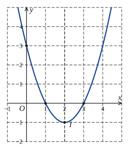
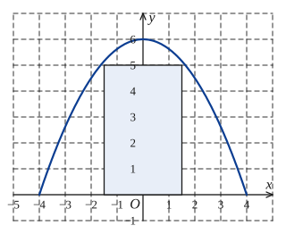

# Chủ đề 6. Hàm số, đồ thị và hàm số bậc hai

> Chủ đề này gồm khái niệm hàm số, tập xác định, sự đồng biến – nghịch biến, và hàm số bậc hai $y = ax^2 + bx + c$ với đồ thị là parabol. Bài toán tìm giá trị lớn nhất, nhỏ nhất của hàm bậc hai giải quyết nhiều câu hỏi thực tế: rào vườn có diện tích lớn nhất, độ cao cực đại của quả bóng, kích thước cổng parabol.

## I. Kiến thức cần nắm

### 1. Hàm số và tập xác định

- Hàm số $y = f(x)$ cho tương ứng mỗi $x \in D$ với đúng một $y$. $D$ là tập xác định.
- Điều kiện thường gặp: mẫu khác 0; biểu thức dưới căn bậc hai không âm.
- $f$ **đồng biến** trên $K$ nếu $x_1 < x_2 \Rightarrow f(x_1) < f(x_2)$; **nghịch biến** nếu $x_1 < x_2 \Rightarrow f(x_1) > f(x_2)$.

### 2. Hàm số bậc hai $y = ax^2 + bx + c$ ($a \ne 0$)

- Đồ thị là **parabol** có đỉnh $I\left(-\dfrac{b}{2a}; -\dfrac{\Delta}{4a}\right)$, trục đối xứng $x = -\dfrac{b}{2a}$.
- $a > 0$: bề lõm hướng lên, nghịch biến trên $\left(-\infty; -\dfrac{b}{2a}\right)$, đồng biến trên $\left(-\dfrac{b}{2a}; +\infty\right)$, giá trị nhỏ nhất $-\dfrac{\Delta}{4a}$.
- $a < 0$: bề lõm hướng xuống, đồng biến rồi nghịch biến, giá trị lớn nhất $-\dfrac{\Delta}{4a}$.

### 3. Vẽ parabol

Xác định đỉnh, trục đối xứng, giao điểm với $Oy$ ($x = 0$), với $Ox$ (nghiệm của $ax^2 + bx + c = 0$), lấy thêm điểm đối xứng, rồi nối thành đường cong.

### 4. Xác định parabol

Biết đồ thị đi qua ba điểm, hoặc biết đỉnh và một điểm: lập hệ phương trình theo $a, b, c$.

### 5. Giá trị lớn nhất, nhỏ nhất trên một đoạn

Hàm bậc hai trên đoạn $[m; n]$ đạt cực trị tại đỉnh (nếu đỉnh thuộc đoạn) hoặc tại hai đầu mút. So sánh các giá trị đó.

### 6. Sai lầm hay gặp

- Quên điều kiện $a \ne 0$.
- Nhầm hoành độ đỉnh $-\dfrac{b}{2a}$ thành $\dfrac{b}{2a}$.
- Tìm GTLN, GTNN trên đoạn mà chỉ xét đỉnh.

## II. Bài tập vận dụng

**Bài 1.** Tìm tập xác định của hàm số $y = \sqrt{x - 2} + \dfrac{1}{x - 5}$.

**Bài 2.** Lập bảng biến thiên và vẽ đồ thị hàm số $y = x^2 - 4x + 3$.

**Bài 3.** Xác định parabol $y = ax^2 + bx + c$ đi qua ba điểm $A(0; -1)$, $B(1; 2)$, $C(-1; 0)$.

**Bài 4.** Tìm $a, b$ để parabol $y = ax^2 + bx + 2$ có đỉnh $I(1; 0)$.

**Bài 5.** Tìm giá trị lớn nhất của hàm số $y = -x^2 + 6x - 5$.

**Bài 6.** Tìm giá trị lớn nhất và nhỏ nhất của $y = x^2 - 2x$ trên đoạn $[0; 3]$.

**Bài 7 (thực tế).** Bác An có 40 m lưới, muốn rào một mảnh vườn hình chữ nhật dựa vào một bức tường (cạnh sát tường không cần rào). Tính diện tích lớn nhất có thể rào được.

**Bài 8 (thực tế).** Một quả bóng được ném lên, độ cao (m) sau $t$ giây là $h(t) = -5t^2 + 20t + 1$. a) Sau bao lâu quả bóng đạt độ cao lớn nhất, độ cao đó là bao nhiêu? b) Sau bao lâu quả bóng chạm đất (làm tròn đến hàng phần trăm)?

**Bài 9.** Chứng minh hàm số $y = 2x + 3$ đồng biến trên $\mathbb{R}$.

**Bài 10.** Tìm tọa độ giao điểm của parabol $y = x^2 - 2x - 3$ và đường thẳng $y = x + 1$.

**Bài 11 (vận dụng cao).** Tìm $m$ để đường thẳng $y = m$ cắt parabol $y = x^2 - 4x + 3$ tại hai điểm phân biệt.

**Bài 12 (vận dụng cao).** Một cổng có dạng parabol, khoảng cách hai chân cổng là 8 m, chiều cao cổng là 6 m. Một xe tải rộng 3 m, cao 5 m có đi qua cổng được không (xe đi chính giữa)?

**Bài 13 (vận dụng cao).** Tìm $m$ để đỉnh của parabol $y = x^2 - 2mx + m^2 + m - 1$ nằm trên đường thẳng $y = 2x + 1$.

---

## III. Lời giải chi tiết

### Bài 1
Điều kiện: $x - 2 \ge 0$ và $x - 5 \ne 0$. $D = [2; +\infty) \setminus \{5\}$.

### Bài 2

*Hình: Đồ thị hàm số y = x² − 4x + 3.*

$a = 1 > 0$, đỉnh $I(2; -1)$, trục $x = 2$. Hàm số nghịch biến trên $(-\infty; 2)$, đồng biến trên $(2; +\infty)$, giá trị nhỏ nhất $-1$ tại $x = 2$.
Giao $Oy$: $(0; 3)$. Giao $Ox$: $x^2 - 4x + 3 = 0$, $x = 1$ hoặc $x = 3$.

### Bài 3
$c = -1$; $a + b - 1 = 2$; $a - b - 1 = 0$. Suy ra $a = 2$, $b = 1$: $y = 2x^2 + x - 1$.

### Bài 4
$-\dfrac{b}{2a} = 1$ nên $b = -2a$; $I$ thuộc parabol: $a + b + 2 = 0$. Suy ra $-a + 2 = 0$, $a = 2$, $b = -4$.

### Bài 5
$a = -1 < 0$, đỉnh tại $x = 3$: $y_{\max} = -9 + 18 - 5 = 4$.

### Bài 6
Đỉnh $x = 1 \in [0; 3]$, $y(1) = -1$; $y(0) = 0$; $y(3) = 3$. Giá trị nhỏ nhất $-1$ (tại $x = 1$), lớn nhất 3 (tại $x = 3$).

### Bài 7
Gọi cạnh vuông góc với tường là $x$ (m), cạnh song song là $40 - 2x$ ($0 < x < 20$). Diện tích $S = x(40 - 2x) = -2x^2 + 40x$, lớn nhất tại $x = 10$: $S = 200 \text{ m}^2$.

### Bài 8
a) Đỉnh tại $t = 2$: $h(2) = -20 + 40 + 1 = 21$ (m).
b) $-5t^2 + 20t + 1 = 0$, nghiệm dương $t = \dfrac{20 + \sqrt{420}}{10} = 2 + \sqrt{4{,}2} \approx 4{,}05$ (giây).

### Bài 9
Với $x_1 < x_2$: $f(x_2) - f(x_1) = 2(x_2 - x_1) > 0$. Vậy hàm số đồng biến trên $\mathbb{R}$.

### Bài 10
$x^2 - 2x - 3 = x + 1 \Leftrightarrow x^2 - 3x - 4 = 0 \Leftrightarrow x = -1$ hoặc $x = 4$. Giao điểm $(-1; 0)$ và $(4; 5)$.

### Bài 11
Phương trình $x^2 - 4x + 3 = m$ có hai nghiệm phân biệt khi $\Delta' = 4 - 3 + m > 0$, tức $m > -1$. (Hình học: đường thẳng $y = m$ nằm phía trên đỉnh $I(2; -1)$.)

### Bài 12

*Hình: Cổng hình parabol rộng 8 m, cao 6 m.*

Chọn hệ trục gốc ở trung điểm hai chân cổng: parabol $y = ax^2 + 6$ qua $(4; 0)$ nên $a = -\dfrac{3}{8}$.
Tại $x = \pm 1{,}5$: $y = 6 - \dfrac{3}{8} \cdot 2{,}25 \approx 5{,}16 > 5$. Xe đi qua được.

### Bài 13
Đỉnh $x = m$, $y = m^2 - 2m^2 + m^2 + m - 1 = m - 1$. Đỉnh $(m; m - 1)$ thuộc đường thẳng: $m - 1 = 2m + 1$, $m = -2$.
