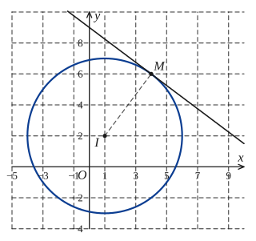
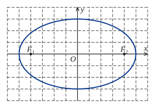

# Chủ đề 9. Phương pháp tọa độ trong mặt phẳng

> Chủ đề này đưa hình học phẳng về tính toán đại số: tọa độ của vectơ, phương trình đường thẳng, khoảng cách và góc, phương trình đường tròn và tiếp tuyến, cùng ba đường conic (elip, hypebol, parabol) với các ứng dụng như quỹ đạo, gương phản xạ, ăng-ten chảo.

## I. Kiến thức cần nắm

### 1. Tọa độ vectơ

- $A(x_A; y_A)$, $B(x_B; y_B)$: $\overrightarrow{AB} = (x_B - x_A; y_B - y_A)$, $AB = \sqrt{(x_B - x_A)^2 + (y_B - y_A)^2}$.
- Trung điểm $I\left(\dfrac{x_A + x_B}{2}; \dfrac{y_A + y_B}{2}\right)$; trọng tâm $G\left(\dfrac{x_A + x_B + x_C}{3}; \dfrac{y_A + y_B + y_C}{3}\right)$.
- $\vec a = (a_1; a_2)$, $\vec b = (b_1; b_2)$: $\vec a \cdot \vec b = a_1b_1 + a_2b_2$; $\vec a \perp \vec b \iff a_1b_1 + a_2b_2 = 0$; cùng phương $\iff a_1b_2 - a_2b_1 = 0$.

### 2. Đường thẳng

- Phương trình tham số qua $M_0(x_0; y_0)$, vectơ chỉ phương $\vec u = (u_1; u_2)$: $x = x_0 + u_1t$, $y = y_0 + u_2t$.
- Phương trình tổng quát qua $M_0$, vectơ pháp tuyến $\vec n = (a; b)$: $a(x - x_0) + b(y - y_0) = 0$, tức $ax + by + c = 0$.
- $\vec u = (u_1; u_2)$ là chỉ phương thì $\vec n = (u_2; -u_1)$ là pháp tuyến.
- **Khoảng cách** từ $M(x_0; y_0)$ đến $\Delta: ax + by + c = 0$: $d = \dfrac{\lvert ax_0 + by_0 + c\rvert}{\sqrt{a^2 + b^2}}$.
- **Góc** giữa hai đường thẳng có pháp tuyến $\vec n_1, \vec n_2$: $\cos\varphi = \dfrac{\lvert \vec n_1 \cdot \vec n_2\rvert}{\lvert\vec n_1\rvert\lvert\vec n_2\rvert}$.

### 3. Đường tròn

- Tâm $I(a; b)$, bán kính $R$: $(x - a)^2 + (y - b)^2 = R^2$.
- Dạng khai triển $x^2 + y^2 - 2ax - 2by + c = 0$ là đường tròn khi $a^2 + b^2 - c > 0$, bán kính $R = \sqrt{a^2 + b^2 - c}$.
- Tiếp tuyến tại $M_0$ thuộc đường tròn nhận $\overrightarrow{IM_0}$ làm pháp tuyến. Đường thẳng tiếp xúc đường tròn $\iff d(I, \Delta) = R$.

### 4. Ba đường conic

- **Elip** $\dfrac{x^2}{a^2} + \dfrac{y^2}{b^2} = 1$ ($a > b > 0$): $c^2 = a^2 - b^2$, tiêu điểm $F_{1,2}(\mp c; 0)$, $MF_1 + MF_2 = 2a$.
- **Hypebol** $\dfrac{x^2}{a^2} - \dfrac{y^2}{b^2} = 1$: $c^2 = a^2 + b^2$, $\lvert MF_1 - MF_2\rvert = 2a$.
- **Parabol** $y^2 = 2px$ ($p > 0$): tiêu điểm $F\left(\dfrac{p}{2}; 0\right)$, đường chuẩn $x = -\dfrac{p}{2}$, $MF = d(M, \text{đường chuẩn})$.

### 5. Sai lầm hay gặp

- Nhầm vectơ chỉ phương với vectơ pháp tuyến khi viết phương trình.
- Quên dấu giá trị tuyệt đối trong công thức khoảng cách, góc.
- Elip dùng $c^2 = a^2 + b^2$ (đó là của hypebol).

## II. Bài tập vận dụng

**Bài 1.** Cho $A(1; 2)$, $B(3; -2)$, $C(-1; 0)$. Tìm tọa độ trung điểm $I$ của $AB$, trọng tâm $G$ của tam giác $ABC$ và tính độ dài $AB$.

**Bài 2.** Viết phương trình tham số và phương trình tổng quát của đường thẳng đi qua $A(1; 2)$ và $B(3; -2)$.

**Bài 3.** Viết phương trình đường thẳng đi qua $M(2; 1)$ và vuông góc với đường thẳng $d: x - 3y + 5 = 0$.

**Bài 4.** Tính khoảng cách từ gốc tọa độ $O$ đến đường thẳng $\Delta: 3x + 4y - 10 = 0$.

**Bài 5.** Tính góc giữa hai đường thẳng $d_1: x - 2y + 1 = 0$ và $d_2: 3x - y = 0$.

**Bài 6.** Cho tam giác $ABC$ có $A(1; 1)$, $B(4; 5)$, $C(4; 1)$. Chứng minh tam giác vuông và tính diện tích.

**Bài 7.** Tìm tâm và bán kính của đường tròn $x^2 + y^2 - 2x - 4y - 20 = 0$.

**Bài 8.** Viết phương trình đường tròn có đường kính $AB$ với $A(-1; 3)$, $B(5; -5)$.

**Bài 9.** Viết phương trình tiếp tuyến của đường tròn $(C): (x - 1)^2 + (y - 2)^2 = 25$ tại điểm $M(4; 6)$.

**Bài 10.** Cho elip $(E): \dfrac{x^2}{25} + \dfrac{y^2}{9} = 1$. Tìm độ dài các trục, tọa độ tiêu điểm. Điểm $M$ thuộc $(E)$; tính $MF_1 + MF_2$.

**Bài 11.** Tìm tiêu điểm và đường chuẩn của parabol $y^2 = 8x$. Tính khoảng cách từ điểm $M(2; 4)$ thuộc parabol đến tiêu điểm.

**Bài 12 (vận dụng cao).** Tìm $m$ để đường thẳng $\Delta: 3x + 4y + m = 0$ tiếp xúc với đường tròn $(x - 1)^2 + (y + 2)^2 = 4$.

**Bài 13 (thực tế).** Một sân vận động có mặt cắt dạng elip với độ dài trục lớn 100 m và trục nhỏ 60 m. Tính khoảng cách giữa hai tiêu điểm.

---

## III. Lời giải chi tiết

### Bài 1
$I(2; 0)$; $G\left(1; 0\right)$; $AB = \sqrt{4 + 16} = 2\sqrt{5}$.

### Bài 2
$\overrightarrow{AB} = (2; -4)$, chọn chỉ phương $\vec u = (1; -2)$: $x = 1 + t$, $y = 2 - 2t$.
Pháp tuyến $\vec n = (2; 1)$: $2(x - 1) + (y - 2) = 0$, tức $2x + y - 4 = 0$.

### Bài 3
Pháp tuyến của $d$ là $(1; -3)$, là chỉ phương của đường cần tìm; pháp tuyến của nó là $(3; 1)$: $3(x - 2) + (y - 1) = 0$, tức $3x + y - 7 = 0$.

### Bài 4
$d = \dfrac{\lvert -10\rvert}{\sqrt{9 + 16}} = 2$.

### Bài 5
$\cos\varphi = \dfrac{\lvert 1 \cdot 3 + (-2)(-1)\rvert}{\sqrt{5}\sqrt{10}} = \dfrac{5}{5\sqrt{2}} = \dfrac{\sqrt{2}}{2}$, $\varphi = 45^\circ$.

### Bài 6
$\overrightarrow{CA} = (-3; 0)$, $\overrightarrow{CB} = (0; 4)$, $\overrightarrow{CA} \cdot \overrightarrow{CB} = 0$: tam giác vuông tại $C$. $S = \dfrac{1}{2} \cdot 3 \cdot 4 = 6$.

### Bài 7
$a = 1$, $b = 2$, $c = -20$: tâm $I(1; 2)$, $R = \sqrt{1 + 4 + 20} = 5$.

### Bài 8
Tâm là trung điểm $(2; -1)$, $R = \dfrac{AB}{2} = \dfrac{\sqrt{36 + 64}}{2} = 5$: $(x - 2)^2 + (y + 1)^2 = 25$.

### Bài 9

*Hình: Đường tròn tâm I(1; 2) bán kính 5 và tiếp tuyến tại M(4; 6).*

$(4 - 1)^2 + (6 - 2)^2 = 25$ nên $M$ thuộc đường tròn. Pháp tuyến $\overrightarrow{IM} = (3; 4)$: $3(x - 4) + 4(y - 6) = 0$, tức $3x + 4y - 36 = 0$.

### Bài 10

*Hình: Elip x²/25 + y²/9 = 1 với hai tiêu điểm.*

$a = 5$, $b = 3$: trục lớn 10, trục nhỏ 6. $c = \sqrt{25 - 9} = 4$: $F_1(-4; 0)$, $F_2(4; 0)$. $MF_1 + MF_2 = 2a = 10$.

### Bài 11
$2p = 8$, $p = 4$: tiêu điểm $F(2; 0)$, đường chuẩn $x = -2$. $MF = d(M, \text{đường chuẩn}) = 2 + 2 = 4$.

### Bài 12
Tâm $I(1; -2)$, $R = 2$. Tiếp xúc: $\dfrac{\lvert 3 - 8 + m\rvert}{5} = 2 \iff \lvert m - 5\rvert = 10 \iff m = 15$ hoặc $m = -5$.

### Bài 13
$a = 50$, $b = 30$, $c = \sqrt{2500 - 900} = 40$. Khoảng cách hai tiêu điểm $2c = 80$ m.
