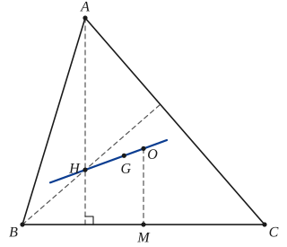

# Chủ đề 6. Vectơ và hệ thức lượng nâng cao

> Trong đề học sinh giỏi lớp 10, vectơ là công cụ mạnh để chứng minh thẳng hàng, tìm điểm cố định, tìm giá trị nhỏ nhất của tổng bình phương khoảng cách và chứng minh các hệ thức kiểu Euler. Hệ thức lượng dùng để nhận dạng tam giác và chứng minh bất đẳng thức hình học.

## I. Kiến thức cần nắm

### 1. Tâm tỉ cự

Với $\alpha + \beta + \gamma \ne 0$, tồn tại duy nhất điểm $I$ thỏa mãn $\alpha\overrightarrow{IA} + \beta\overrightarrow{IB} + \gamma\overrightarrow{IC} = \vec 0$, và với mọi $M$:
$$\alpha\overrightarrow{MA} + \beta\overrightarrow{MB} + \gamma\overrightarrow{MC} = (\alpha + \beta + \gamma)\overrightarrow{MI}.$$
Hệ quả: $\overrightarrow{AI} = \dfrac{\beta\overrightarrow{AB} + \gamma\overrightarrow{AC}}{\alpha + \beta + \gamma}$.

### 2. Tổng bình phương khoảng cách

Với $\alpha + \beta + \gamma > 0$ và $I$ là tâm tỉ cự:
$$\alpha MA^2 + \beta MB^2 + \gamma MC^2 = (\alpha + \beta + \gamma)MI^2 + \alpha IA^2 + \beta IB^2 + \gamma IC^2,$$
nhỏ nhất khi $M \equiv I$. Đặc biệt $MA^2 + MB^2 + MC^2 = 3MG^2 + \dfrac{a^2 + b^2 + c^2}{3}$.

### 3. Thẳng hàng và đồng quy

$M, N, P$ thẳng hàng $\iff \overrightarrow{MP} = k\overrightarrow{MN}$. Biểu diễn mọi vectơ theo hai vectơ không cùng phương (ví dụ $\overrightarrow{AB}$, $\overrightarrow{AC}$) rồi so sánh hệ số.

### 4. Tâm ngoại tiếp, trực tâm

$O$ là tâm ngoại tiếp, $H$ là trực tâm, $G$ là trọng tâm: $\overrightarrow{OH} = \overrightarrow{OA} + \overrightarrow{OB} + \overrightarrow{OC} = 3\overrightarrow{OG}$ (đường thẳng Euler). Ngoài ra $\overrightarrow{OA} \cdot \overrightarrow{OB} = R^2 - \dfrac{c^2}{2}$.

### 5. Hệ thức lượng

- Định lý côsin, sin: $a^2 = b^2 + c^2 - 2bc\cos A$; $\dfrac{a}{\sin A} = 2R$.
- Hình chiếu: $a = b\cos C + c\cos B$.
- Diện tích: $S = \dfrac{1}{2}bc\sin A = \dfrac{abc}{4R} = pr = \sqrt{p(p - a)(p - b)(p - c)}$.
- Trung tuyến $m_a^2 = \dfrac{2b^2 + 2c^2 - a^2}{4}$; phân giác $\ell_a = \dfrac{2bc\cos\frac{A}{2}}{b + c}$.

### 6. Nhận dạng tam giác và bất đẳng thức

- Đổi hết về cạnh (dùng $\sin A = \dfrac{a}{2R}$, $\cos A = \dfrac{b^2 + c^2 - a^2}{2bc}$) rồi biến đổi đại số.
- Bình phương vô hướng không âm: $(\vec u + \vec v + \vec w)^2 \ge 0$ cho nhiều bất đẳng thức lượng giác.

## II. Bài tập vận dụng

**Bài 1.** Cho tam giác $ABC$. Xác định điểm $I$ thỏa mãn $\overrightarrow{IA} + 2\overrightarrow{IB} + 3\overrightarrow{IC} = \vec 0$, biểu diễn $\overrightarrow{AI}$ theo $\overrightarrow{AB}$, $\overrightarrow{AC}$.

**Bài 2.** Với tam giác $ABC$ và điểm $I$ ở bài 1, tìm điểm $M$ sao cho $MA^2 + 2MB^2 + 3MC^2$ nhỏ nhất.

**Bài 3.** Cho tam giác $ABC$ có trọng tâm $G$. Chứng minh với mọi điểm $M$: $MA^2 + MB^2 + MC^2 = 3MG^2 + GA^2 + GB^2 + GC^2$, và $GA^2 + GB^2 + GC^2 = \dfrac{a^2 + b^2 + c^2}{3}$.

**Bài 4.** Cho tam giác $ABC$, $M$ là trung điểm $AB$, $N$ là điểm trên cạnh $AC$ sao cho $AN = 2NC$, $P$ là điểm sao cho $C$ là trung điểm $BP$. Chứng minh $M$, $N$, $P$ thẳng hàng.

**Bài 5.** Chứng minh trong mọi tam giác $ABC$: $a = b\cos C + c\cos B$.

**Bài 6.** Tam giác $ABC$ thỏa mãn $\sin A = 2\sin B\cos C$. Chứng minh tam giác $ABC$ cân.

**Bài 7.** Tam giác $ABC$ thỏa mãn $\dfrac{b^3 + c^3 - a^3}{b + c - a} = a^2$. Tính góc $A$.

**Bài 8.** Chứng minh trong mọi tam giác: $\cos A + \cos B + \cos C \le \dfrac{3}{2}$.

**Bài 9.** Tam giác $ABC$ có $b = 3$, $c = 6$, $\widehat{A} = 120^\circ$. Tính độ dài đường phân giác trong $AD$.

**Bài 10 (Weitzenböck).** Chứng minh trong mọi tam giác: $a^2 + b^2 + c^2 \ge 4\sqrt{3}S$.

**Bài 11 (đường thẳng Euler).** Cho tam giác $ABC$ có tâm ngoại tiếp $O$, trọng tâm $G$. Gọi $H$ là điểm thỏa mãn $\overrightarrow{OH} = \overrightarrow{OA} + \overrightarrow{OB} + \overrightarrow{OC}$. Chứng minh $H$ là trực tâm tam giác $ABC$ và $O$, $G$, $H$ thẳng hàng.

**Bài 12.** Với $O$, $H$ như bài 11 và $R$ là bán kính đường tròn ngoại tiếp, chứng minh $OH^2 = 9R^2 - (a^2 + b^2 + c^2)$.

**Bài 13.** Cho tam giác đều $ABC$ cạnh $a$ và điểm $M$ bất kỳ trên đường tròn ngoại tiếp. Chứng minh $MA^2 + MB^2 + MC^2 = 2a^2$.

**Bài 14 (HSG).** Tam giác $ABC$ có $AB = 5$, $AC = 8$, $\widehat{A} = 60^\circ$. Tính $BC$, bán kính đường tròn nội tiếp $r$ và khoảng cách từ trọng tâm $G$ đến cạnh $BC$.

---

## III. Lời giải chi tiết

### Bài 1
$\overrightarrow{IA} + 2(\overrightarrow{IA} + \overrightarrow{AB}) + 3(\overrightarrow{IA} + \overrightarrow{AC}) = \vec 0 \iff 6\overrightarrow{IA} + 2\overrightarrow{AB} + 3\overrightarrow{AC} = \vec 0$, nên
$$\overrightarrow{AI} = \dfrac{1}{3}\overrightarrow{AB} + \dfrac{1}{2}\overrightarrow{AC}.$$
Cách dựng: gọi $K$ là điểm trên $BC$ với $\overrightarrow{BK} = \dfrac{3}{5}\overrightarrow{BC}$ (tức $2\overrightarrow{KB} + 3\overrightarrow{KC} = \vec 0$); khi đó $\overrightarrow{IA} + 5\overrightarrow{IK} = \vec 0$, $I$ nằm trên đoạn $AK$ với $AI = \dfrac{5}{6}AK$.

### Bài 2
$MA^2 = (\overrightarrow{MI} + \overrightarrow{IA})^2 = MI^2 + 2\overrightarrow{MI} \cdot \overrightarrow{IA} + IA^2$, tương tự với $B$, $C$. Cộng với hệ số 1, 2, 3:
$$MA^2 + 2MB^2 + 3MC^2 = 6MI^2 + 2\overrightarrow{MI} \cdot (\overrightarrow{IA} + 2\overrightarrow{IB} + 3\overrightarrow{IC}) + IA^2 + 2IB^2 + 3IC^2 = 6MI^2 + \text{const}.$$
Nhỏ nhất khi $M \equiv I$.

### Bài 3
Như bài 2 với các hệ số 1, 1, 1 và $\overrightarrow{GA} + \overrightarrow{GB} + \overrightarrow{GC} = \vec 0$ được đẳng thức thứ nhất.
$GA = \dfrac{2}{3}m_a$ nên $GA^2 + GB^2 + GC^2 = \dfrac{4}{9}(m_a^2 + m_b^2 + m_c^2) = \dfrac{4}{9} \cdot \dfrac{3(a^2 + b^2 + c^2)}{4} = \dfrac{a^2 + b^2 + c^2}{3}$.

### Bài 4
Đặt $\vec b = \overrightarrow{AB}$, $\vec c = \overrightarrow{AC}$. $\overrightarrow{AM} = \dfrac{1}{2}\vec b$, $\overrightarrow{AN} = \dfrac{2}{3}\vec c$, $\overrightarrow{AP} = 2\overrightarrow{AC} - \overrightarrow{AB} = 2\vec c - \vec b$.
$\overrightarrow{MN} = -\dfrac{1}{2}\vec b + \dfrac{2}{3}\vec c$, $\overrightarrow{MP} = -\dfrac{3}{2}\vec b + 2\vec c = 3\overrightarrow{MN}$. Vậy $M$, $N$, $P$ thẳng hàng.

### Bài 5
$\overrightarrow{BC} = \overrightarrow{BA} + \overrightarrow{AC}$. Nhân vô hướng hai vế với $\overrightarrow{BC}$: $a^2 = \overrightarrow{BA} \cdot \overrightarrow{BC} + \overrightarrow{AC} \cdot \overrightarrow{BC} = ca\cos B + ba\cos C$. Chia cho $a$.

### Bài 6
$\dfrac{a}{2R} = 2 \cdot \dfrac{b}{2R} \cdot \dfrac{a^2 + b^2 - c^2}{2ab} \iff a^2 = a^2 + b^2 - c^2 \iff b = c$. Tam giác cân tại $A$.

### Bài 7
$b^3 + c^3 - a^3 = a^2(b + c) - a^3 \iff b^3 + c^3 = a^2(b + c) \iff b^2 - bc + c^2 = a^2$.
So với $a^2 = b^2 + c^2 - 2bc\cos A$: $\cos A = \dfrac{1}{2}$, $\widehat{A} = 60^\circ$.

### Bài 8
Gọi $I$ là tâm nội tiếp, $\vec e_1, \vec e_2, \vec e_3$ là các vectơ đơn vị cùng hướng với $\overrightarrow{ID}, \overrightarrow{IE}, \overrightarrow{IF}$ ($D, E, F$ là tiếp điểm trên $BC, CA, AB$). Tứ giác $AEIF$ có hai góc vuông nên $(\vec e_2, \vec e_3) = 180^\circ - A$, tương tự cho các cặp khác.
$$0 \le (\vec e_1 + \vec e_2 + \vec e_3)^2 = 3 + 2[\cos(180^\circ - A) + \cos(180^\circ - B) + \cos(180^\circ - C)] = 3 - 2(\cos A + \cos B + \cos C).$$
Dấu bằng khi tam giác đều.

### Bài 9
$S_{ABC} = S_{ABD} + S_{ADC}$: $\dfrac{1}{2} \cdot 3 \cdot 6 \sin 120^\circ = \dfrac{1}{2}\ell \cdot 6\sin 60^\circ + \dfrac{1}{2}\ell \cdot 3\sin 60^\circ$, tức $18 = 9\ell$, $\ell = 2$.

### Bài 10
$a^2 + b^2 + c^2 = 2(b^2 + c^2) - 2bc\cos A \ge 4bc - 2bc\cos A$. Cần chứng minh $4bc - 2bc\cos A \ge 2\sqrt{3}bc\sin A$, tức $\sqrt{3}\sin A + \cos A \le 2$, hay $2\sin(A + 30^\circ) \le 2$: đúng. Dấu bằng khi $b = c$, $A = 60^\circ$ (tam giác đều).

### Bài 11

*Hình: Tam giác ABC với tâm ngoại tiếp O, trọng tâm G, trực tâm H thẳng hàng trên đường thẳng Euler.*

$\overrightarrow{AH} = \overrightarrow{OH} - \overrightarrow{OA} = \overrightarrow{OB} + \overrightarrow{OC} = 2\overrightarrow{OM}$ ($M$ trung điểm $BC$). Vì $OM \perp BC$ nên $AH \perp BC$. Tương tự $BH \perp CA$. Vậy $H$ là trực tâm.
$\overrightarrow{OG} = \dfrac{1}{3}(\overrightarrow{OA} + \overrightarrow{OB} + \overrightarrow{OC}) = \dfrac{1}{3}\overrightarrow{OH}$: $O$, $G$, $H$ thẳng hàng và $OH = 3OG$.

### Bài 12
$c^2 = (\overrightarrow{OB} - \overrightarrow{OA})^2 = 2R^2 - 2\overrightarrow{OA} \cdot \overrightarrow{OB}$, nên $\overrightarrow{OA} \cdot \overrightarrow{OB} = R^2 - \dfrac{c^2}{2}$; tương tự cho hai cặp kia.
$OH^2 = (\overrightarrow{OA} + \overrightarrow{OB} + \overrightarrow{OC})^2 = 3R^2 + 2\left(3R^2 - \dfrac{a^2 + b^2 + c^2}{2}\right) = 9R^2 - (a^2 + b^2 + c^2)$.

### Bài 13
Tâm $O$ trùng trọng tâm, $R = \dfrac{a}{\sqrt{3}}$, $OM = R$. $MA^2 = (\overrightarrow{OA} - \overrightarrow{OM})^2 = 2R^2 - 2\overrightarrow{OA} \cdot \overrightarrow{OM}$. Cộng ba đẳng thức:
$MA^2 + MB^2 + MC^2 = 6R^2 - 2\overrightarrow{OM} \cdot (\overrightarrow{OA} + \overrightarrow{OB} + \overrightarrow{OC}) = 6R^2 = 2a^2$.

### Bài 14
$BC^2 = 25 + 64 - 40 = 49$, $BC = 7$. $S = \dfrac{1}{2} \cdot 5 \cdot 8 \cdot \dfrac{\sqrt{3}}{2} = 10\sqrt{3}$, $p = 10$, $r = \sqrt{3}$.
Đường cao từ $A$: $h_a = \dfrac{2S}{7} = \dfrac{20\sqrt{3}}{7}$. $GM = \dfrac{1}{3}AM$ nên khoảng cách từ $G$ đến $BC$ bằng $\dfrac{1}{3}h_a = \dfrac{20\sqrt{3}}{21}$.
