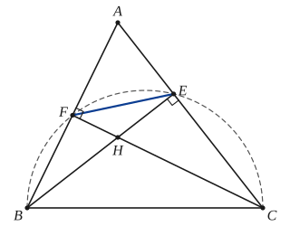
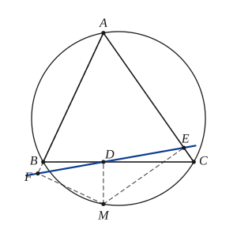
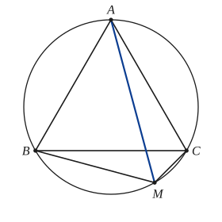
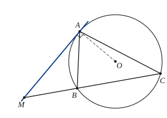

# Chủ đề 7. Hình học phẳng

> Câu hình học trong đề học sinh giỏi lớp 10 xoay quanh tứ giác nội tiếp, phương tích, trục đẳng phương, cùng các kết quả kinh điển như đường thẳng Simson, định lý Ptolemy, đường thẳng Euler và đường tròn Euler. Nắm vững các công cụ này giúp nhìn ra đường phụ cần kẻ.

## I. Kiến thức cần nắm

### 1. Tứ giác nội tiếp

Tứ giác $ABCD$ nội tiếp khi có một trong các điều kiện:
- Tổng hai góc đối bằng $180^\circ$;
- Hai đỉnh kề cùng nhìn cạnh nối hai đỉnh còn lại dưới hai góc bằng nhau ($\widehat{ADB} = \widehat{ACB}$);
- Góc ngoài tại một đỉnh bằng góc trong của đỉnh đối;
- $MA \cdot MB = MC \cdot MD$ với $M = AB \cap CD$ (đảo phương tích).

### 2. Phương tích

Phương tích của $M$ đối với $(O; R)$: $\mathcal{P}_{M/(O)} = OM^2 - R^2$. Với mọi đường thẳng qua $M$ cắt đường tròn tại $A$, $B$: $\overrightarrow{MA} \cdot \overrightarrow{MB} = \mathcal{P}_{M/(O)}$. Nếu $MT$ là tiếp tuyến: $MT^2 = MA \cdot MB$.

### 3. Trục đẳng phương

Tập hợp các điểm có cùng phương tích với hai đường tròn không đồng tâm là một đường thẳng vuông góc với đường nối tâm (trục đẳng phương). Hai đường tròn cắt nhau tại $A$, $B$ thì trục đẳng phương là đường thẳng $AB$. Ba đường tròn có tâm không thẳng hàng thì ba trục đẳng phương đồng quy (tâm đẳng phương).

### 4. Các kết quả kinh điển

- **Simson:** $M$ thuộc đường tròn ngoại tiếp tam giác $ABC$ thì chân ba đường vuông góc từ $M$ xuống ba cạnh thẳng hàng.
- **Ptolemy:** $ABCD$ nội tiếp thì $AC \cdot BD = AB \cdot CD + AD \cdot BC$.
- **Euler:** $O$, $G$, $H$ thẳng hàng, $\overrightarrow{OH} = 3\overrightarrow{OG}$.
- **Đường tròn Euler:** trung điểm ba cạnh, chân ba đường cao, trung điểm $AH$, $BH$, $CH$ cùng nằm trên đường tròn tâm là trung điểm $OH$, bán kính $\dfrac{R}{2}$.

### 5. Góc tạo bởi tiếp tuyến và dây

Góc giữa tiếp tuyến tại $A$ và dây $AB$ bằng góc nội tiếp chắn cung $AB$. Hay dùng để chứng minh hai tam giác đồng dạng.

### 6. Chiến lược

- Tìm tứ giác nội tiếp để "chuyển góc".
- Đẳng thức tích đoạn thẳng: nghĩ tới phương tích hoặc tam giác đồng dạng.
- Ba đường đồng quy: nghĩ tới trục đẳng phương.

## II. Bài tập vận dụng

**Bài 1.** Cho tam giác nhọn $ABC$ có hai đường cao $BE$, $CF$ cắt nhau tại $H$. Chứng minh tứ giác $BCEF$ nội tiếp và $AE \cdot AC = AF \cdot AB$.

**Bài 2.** Với tam giác ở bài 1, gọi $H'$ là điểm đối xứng của $H$ qua $BC$. Chứng minh $H'$ thuộc đường tròn ngoại tiếp tam giác $ABC$.

**Bài 3.** Từ điểm $M$ nằm ngoài đường tròn $(O)$ kẻ tiếp tuyến $MT$ và cát tuyến $MAB$ ($A$ nằm giữa $M$ và $B$). Biết $MA = 4$, $AB = 5$. Tính $MT$.

**Bài 4.** Hai dây $AB$ và $CD$ của một đường tròn cắt nhau tại $I$. Biết $IA = 2$, $IB = 6$, $IC = 3$. Tính $ID$.

**Bài 5.** Cho đường tròn $(O; 5)$ và điểm $M$ với $OM = 3$. Một dây cung đi qua $M$ cắt đường tròn tại $A$, $B$. Tính $MA \cdot MB$.

**Bài 6.** Hai đường tròn cắt nhau tại $A$ và $B$. Điểm $M$ nằm trên đường thẳng $AB$, ngoài đoạn $AB$. Kẻ các tiếp tuyến $MT_1$, $MT_2$ tới hai đường tròn. Chứng minh $MT_1 = MT_2$.

**Bài 7.** Chứng minh rằng ba trục đẳng phương của ba đường tròn có tâm không thẳng hàng (từng đôi không đồng tâm) đồng quy.

**Bài 8 (Simson).** Cho tam giác $ABC$ nội tiếp đường tròn $(O)$ và điểm $M$ thuộc $(O)$. Gọi $D$, $E$, $F$ là hình chiếu của $M$ lên $BC$, $CA$, $AB$. Chứng minh $D$, $E$, $F$ thẳng hàng.

**Bài 9 (Ptolemy).** Cho tam giác đều $ABC$ nội tiếp đường tròn, $M$ là điểm trên cung nhỏ $BC$. Chứng minh $MA = MB + MC$.

**Bài 10 (đường tròn Euler).** Cho tam giác $ABC$ có tâm ngoại tiếp $O$, bán kính $R$, trực tâm $H$. Gọi $N$ là trung điểm $OH$. Chứng minh trung điểm $M_a$ của $BC$, trung điểm $K$ của $AH$ và chân đường cao $D$ từ $A$ cùng thuộc đường tròn tâm $N$ bán kính $\dfrac{R}{2}$.

**Bài 11.** Cho đường tròn đường kính $AB$, hai điểm $C$, $D$ thuộc đường tròn (cùng phía với $AB$). $AC$ cắt $BD$ tại $E$, $AD$ cắt $BC$ tại $F$. Chứng minh $EF \perp AB$.

**Bài 12 (HSG).** Tam giác $ABC$ ($AB < AC$) nội tiếp đường tròn $(O)$. Tiếp tuyến tại $A$ cắt đường thẳng $BC$ tại $M$. Chứng minh $\dfrac{MB}{MC} = \dfrac{AB^2}{AC^2}$.

---

## III. Lời giải chi tiết

### Bài 1

*Hình: Tam giác nhọn ABC với hai đường cao BE, CF cắt nhau tại H; tứ giác BCEF nội tiếp đường tròn đường kính BC.*

$\widehat{BEC} = \widehat{BFC} = 90^\circ$ nên $E$, $F$ thuộc đường tròn đường kính $BC$: $BCEF$ nội tiếp.
$A$ nằm ngoài đường tròn đó, hai cát tuyến $AEC$ và $AFB$: theo phương tích, $AE \cdot AC = AF \cdot AB$.

### Bài 2
Gọi $D$ là chân đường cao từ $A$, $H'$ đối xứng $H$ qua $BC$ nằm trên tia $AD$. $\widehat{BH'C} = \widehat{BHC}$ (đối xứng) $= \widehat{EHF}$ (đối đỉnh) $= 180^\circ - \widehat{A}$ (tứ giác $AEHF$ có hai góc vuông). Vậy $\widehat{BH'C} + \widehat{BAC} = 180^\circ$, và $H'$, $A$ nằm khác phía đối với $BC$, nên $ABH'C$ nội tiếp.

### Bài 3
$MT^2 = MA \cdot MB = 4 \cdot 9 = 36$, $MT = 6$.

### Bài 4
$IA \cdot IB = IC \cdot ID$: $12 = 3 \cdot ID$, $ID = 4$.

### Bài 5
$M$ nằm trong đường tròn: $\overrightarrow{MA} \cdot \overrightarrow{MB} = OM^2 - R^2 = 9 - 25 = -16$, nên $MA \cdot MB = 16$.

### Bài 6
$M$ thuộc trục đẳng phương $AB$ nên có cùng phương tích với hai đường tròn: $MT_1^2 = MA \cdot MB = MT_2^2$.

### Bài 7
Gọi $\Delta_{12}$, $\Delta_{23}$, $\Delta_{31}$ là các trục đẳng phương. Vì các tâm không thẳng hàng, $\Delta_{12} \perp O_1O_2$ và $\Delta_{23} \perp O_2O_3$ không song song, cắt nhau tại $I$. Khi đó $\mathcal{P}_{I/(O_1)} = \mathcal{P}_{I/(O_2)} = \mathcal{P}_{I/(O_3)}$, nên $I$ thuộc $\Delta_{31}$.

### Bài 8

*Hình: Điểm M trên đường tròn ngoại tiếp tam giác ABC, các hình chiếu D, E, F của M lên ba cạnh thẳng hàng.*

Xét trường hợp như hình: $M$ trên cung $BC$ không chứa $A$, $\widehat{ACM}$ nhọn nên $E$ nằm trên cạnh $CA$ và $F$ nằm trên tia đối của tia $BA$ (các trường hợp khác chứng minh tương tự).
- $\widehat{MDB} = \widehat{MFB} = 90^\circ$: tứ giác $MDBF$ nội tiếp, nên $\widehat{BDF} = \widehat{BMF}$.
- $\widehat{MDC} = \widehat{MEC} = 90^\circ$: tứ giác $MDEC$ nội tiếp, nên $\widehat{CDE} = \widehat{CME}$.
- $\widehat{BMF} = 90^\circ - \widehat{MBF}$ và $\widehat{CME} = 90^\circ - \widehat{MCE}$. Tứ giác $ABMC$ nội tiếp nên góc ngoài $\widehat{MBF} = \widehat{ACM}$, tức $\widehat{MBF} = \widehat{MCE}$ (vì $E$ nằm trên tia $CA$).

Do đó $\widehat{BDF} = \widehat{CDE}$; hai góc này ở hai phía của đường thẳng $BC$ và có cạnh $DB$, $DC$ đối nhau, nên là hai góc đối đỉnh: $F$, $D$, $E$ thẳng hàng.

### Bài 9

*Hình: Tam giác đều ABC nội tiếp đường tròn, M trên cung nhỏ BC.*

Tứ giác $ABMC$ nội tiếp. Ptolemy: $AM \cdot BC = AB \cdot MC + AC \cdot MB$. Vì $AB = BC = CA$, chia hai vế cho cạnh tam giác: $MA = MB + MC$.

### Bài 10
Đặt gốc vectơ tại $O$, ký hiệu $\vec a = \overrightarrow{OA}$, $\vec b$, $\vec c$ tương tự, $\lvert\vec a\rvert = \lvert\vec b\rvert = \lvert\vec c\rvert = R$. Ta có $\overrightarrow{OH} = \vec a + \vec b + \vec c$, $\overrightarrow{ON} = \dfrac{\vec a + \vec b + \vec c}{2}$.
- $\overrightarrow{OM_a} = \dfrac{\vec b + \vec c}{2}$, nên $\overrightarrow{NM_a} = -\dfrac{\vec a}{2}$, $NM_a = \dfrac{R}{2}$.
- $\overrightarrow{OK} = \dfrac{\vec a + (\vec a + \vec b + \vec c)}{2}$, nên $\overrightarrow{NK} = \dfrac{\vec a}{2}$, $NK = \dfrac{R}{2}$.
- Hai kết quả trên cho thấy $N$ là trung điểm $M_aK$, tức $M_aK$ là đường kính của đường tròn $\left(N; \dfrac{R}{2}\right)$. Mà $D$ thuộc đường thẳng $AH$ và $M_a$ thuộc $BC$ với $AH \perp BC$, nên $\widehat{KDM_a} = 90^\circ$: $D$ thuộc đường tròn đường kính $KM_a$.

### Bài 11
$C$, $D$ thuộc đường tròn đường kính $AB$ nên $AC \perp BC$ và $BD \perp AD$. Xét tam giác $ABF$: $AC \perp BF$ và $BD \perp AF$, nên $E = AC \cap BD$ là trực tâm tam giác $ABF$. Do đó $FE \perp AB$.

### Bài 12

*Hình: Tam giác ABC nội tiếp đường tròn tâm O, tiếp tuyến tại A cắt đường thẳng BC tại M.*

$\widehat{MAB} = \widehat{MCA}$ (góc tạo bởi tiếp tuyến và dây bằng góc nội tiếp cùng chắn cung $AB$), $\widehat{M}$ chung, nên $\triangle MAB \backsim \triangle MCA$:
$$\dfrac{MA}{MC} = \dfrac{MB}{MA} = \dfrac{AB}{CA}.$$
Nhân hai tỉ số: $\dfrac{MB}{MC} = \dfrac{MB}{MA} \cdot \dfrac{MA}{MC} = \dfrac{AB^2}{AC^2}$.
