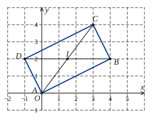
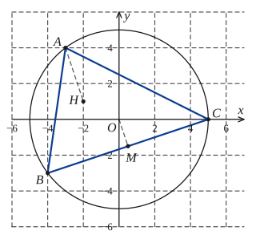

# Chủ đề 8. Hình học tọa độ Oxy

> Bài tọa độ Oxy trong đề học sinh giỏi không giải bằng tính toán "vét cạn" mà bằng cách phát hiện một tính chất hình học (đối xứng qua phân giác, tính chất trực tâm, góc bằng nhau trong hình chữ nhật, hình chiếu…) để rút gọn số ẩn. Chủ đề này luyện các tính chất hay gặp nhất.

## I. Kiến thức cần nắm

### 1. Công cụ cơ bản

- Tham số hóa điểm: $M \in d: ax + by + c = 0$ thì $M$ chỉ còn một ẩn.
- Hình chiếu $H$ của $A$ lên $d$; điểm đối xứng $A' = 2H - A$.
- Khoảng cách, góc giữa hai đường thẳng; trung điểm, trọng tâm.

### 2. Tính chất hình học hay dùng

- **Phân giác:** điểm đối xứng của $B$ qua phân giác trong góc $A$ nằm trên đường thẳng $AC$.
- **Đường cao, trung tuyến:** điểm trên trung tuyến từ $C$ thì trung điểm $AB$ thuộc đường đó; điểm trên đường cao từ $B$ thì $\overrightarrow{AC}$ vuông góc với chỉ phương đường cao.
- **Tam giác nội tiếp:** $\overrightarrow{AH} = 2\overrightarrow{OM}$ ($M$ trung điểm $BC$, $O$ tâm ngoại tiếp, $H$ trực tâm); $\overrightarrow{OH} = 3\overrightarrow{OG}$.
- **Hình vuông, hình thoi:** hai đường chéo vuông góc tại trung điểm; quay $90^\circ$: vectơ $(a; b)$ thành $(-b; a)$ hoặc $(b; -a)$.
- **Hình chữ nhật:** tam giác $IAB$ cân tại tâm $I$, nên góc giữa $AC$ và $AB$ bằng góc giữa $BD$ và $AB$.
- **Tâm nội tiếp:** $I = \dfrac{aA + bB + cC}{a + b + c}$ ($a = BC$, …).

### 3. Đường tròn

- Tâm cách đều hai đường thẳng thì nằm trên đường phân giác của góc tạo bởi chúng.
- Từ $M$ ngoài đường tròn $(x - a)^2 + (y - b)^2 = R^2$ kẻ hai tiếp tuyến $MA$, $MB$: đường thẳng $AB$ là $(x_M - a)(x - a) + (y_M - b)(y - b) = R^2$.

### 4. Cực trị

$M$ chạy trên $d$, $A$, $B$ cùng phía: $MA + MB$ nhỏ nhất khi $M = A'B \cap d$ với $A'$ đối xứng $A$ qua $d$.

### 5. Quy trình

1. Vẽ hình nháp đúng tỉ lệ, đoán kết quả.
2. Tìm tính chất hình học giảm số ẩn.
3. Tham số hóa, giải, rồi **kiểm tra lại** điều kiện (điểm nằm đúng phía, phân giác trong hay ngoài…).

## II. Bài tập vận dụng

**Bài 1.** Cho tam giác $ABC$ có $A(-3; 4)$, $B(-4; -3)$, $C(5; 0)$. Tìm tâm đường tròn ngoại tiếp $O$, trực tâm $H$, trọng tâm $G$ và kiểm tra $\overrightarrow{OH} = 3\overrightarrow{OG}$.

**Bài 2.** Tam giác $ABC$ có $A(0; 2)$, đường cao kẻ từ $B$ là $2x - y + 2 = 0$, đường trung tuyến kẻ từ $C$ là $y = 0$. Tìm tọa độ $B$ và $C$.

**Bài 3.** Hình vuông $ABCD$ có $A(1; 1)$ và tâm $I(3; 2)$. Tìm tọa độ các đỉnh còn lại.

**Bài 4.** Tam giác $ABC$ vuông cân tại $A(3; 3)$, cạnh $BC$ nằm trên đường thẳng $x + y - 2 = 0$. Tìm $B$, $C$.

**Bài 5.** Tam giác $ABC$ có $B(2; -1)$, $C(-4; 5)$, đường phân giác trong góc $A$ là $d: x - y + 1 = 0$. Tìm tọa độ $A$.

**Bài 6.** Cho $A(1; 2)$, $B(5; 4)$. Tìm điểm $M$ trên trục $Ox$ sao cho $MA + MB$ nhỏ nhất.

**Bài 7.** Tìm tâm và bán kính đường tròn nội tiếp tam giác $OAB$ với $O(0; 0)$, $A(6; 0)$, $B(0; 8)$.

**Bài 8.** Hình chữ nhật $ABCD$ có cạnh $AB$ nằm trên đường thẳng $x - 2y = 0$, đường chéo $BD$ nằm trên đường thẳng $y - 2 = 0$, đường thẳng $AC$ đi qua $M(-3; -4)$. Tìm tọa độ các đỉnh.

**Bài 9.** Tam giác $ABC$ nội tiếp đường tròn $(C): x^2 + y^2 = 25$, có $A(-3; 4)$ và trực tâm $H(-2; 1)$. Viết phương trình đường thẳng $BC$ và tìm $B$, $C$.

**Bài 10.** Hình thoi $ABCD$ có $A(0; 1)$, $C(4; 3)$ và diện tích bằng 20. Tìm $B$, $D$ biết $B$ có hoành độ dương.

**Bài 11.** Viết phương trình đường tròn có tâm thuộc đường thẳng $2x - y - 4 = 0$ và tiếp xúc với cả hai trục tọa độ.

**Bài 12 (HSG).** Cho đường tròn $(C): (x - 1)^2 + (y - 2)^2 = 5$ và điểm $M(6; 2)$. Từ $M$ kẻ hai tiếp tuyến $MA$, $MB$ tới $(C)$. Viết phương trình đường thẳng $AB$ và tính độ dài tiếp tuyến.

---

## III. Lời giải chi tiết

### Bài 1
$OA^2 = OB^2 = OC^2 = 25$ nên tâm ngoại tiếp là $O(0; 0)$, $R = 5$. $G\left(-\dfrac{2}{3}; \dfrac{1}{3}\right)$.
Đặt $H = A + B + C = (-2; 1)$ (theo tọa độ): $\overrightarrow{AH} = (1; -3)$, $\overrightarrow{BC} = (9; 3)$, tích vô hướng $9 - 9 = 0$; $\overrightarrow{BH} = (2; 4)$, $\overrightarrow{AC} = (8; -4)$, tích $16 - 16 = 0$. Vậy $H(-2; 1)$ là trực tâm và $\overrightarrow{OH} = (-2; 1) = 3\overrightarrow{OG}$.

### Bài 2
$B$ thuộc đường cao: $B(b; 2b + 2)$. Trung điểm $AB$ là $\left(\dfrac{b}{2}; b + 2\right)$ thuộc $y = 0$: $b = -2$, $B(-2; -2)$.
$C(c; 0)$ thuộc trung tuyến. $AC$ vuông góc với đường cao (chỉ phương $(1; 2)$): $\overrightarrow{AC} = (c; -2)$, $c - 4 = 0$, $C(4; 0)$.

### Bài 3
$C = 2I - A = (5; 3)$. $\overrightarrow{IA} = (-2; -1)$; quay $90^\circ$ được $(1; -2)$, nên hai đỉnh kia là $I \pm (1; -2)$: $(4; 0)$ và $(2; 4)$.
**Đáp số:** $B(4; 0)$, $C(5; 3)$, $D(2; 4)$ (hoặc đổi vai trò $B$ và $D$).

### Bài 4
Hình chiếu của $A$ lên $BC$: $H(1; 1)$ (trung điểm $BC$), $AH = 2\sqrt{2}$. Tam giác vuông cân nên $HB = HC = AH$. Chỉ phương đơn vị của $BC$ là $\dfrac{1}{\sqrt{2}}(1; -1)$, nên $B, C = H \pm (2; -2)$.
**Đáp số:** $(3; -1)$ và $(-1; 3)$. Kiểm tra: $\overrightarrow{AB} = (0; -4)$, $\overrightarrow{AC} = (-4; 0)$ vuông góc và bằng nhau.

### Bài 5
Điểm đối xứng của $B$ qua $d$: hình chiếu của $B$ lên $d$ là $(0; 1)$, nên $B'(-2; 3)$. $B'$ thuộc đường thẳng $AC$; $AC$ qua $C(-4; 5)$ và $B'(-2; 3)$: $x + y - 1 = 0$. $A = AC \cap d$: $A(0; 1)$.
Kiểm tra phân giác trong: $d$ cắt $BC$ tại điểm ứng với tham số $s = \dfrac{1}{3} \in (0; 1)$ trên đoạn $BC$, nên $B$, $C$ nằm khác phía đối với $d$.

### Bài 6
$A$, $B$ cùng phía với $Ox$. $A'(1; -2)$. Đường thẳng $A'B$: $3x - 2y - 7 = 0$, cắt $Ox$ tại $M\left(\dfrac{7}{3}; 0\right)$. Giá trị nhỏ nhất $A'B = \sqrt{16 + 36} = 2\sqrt{13}$.

### Bài 7
$OA = 6$, $OB = 8$, $AB = 10$; tam giác vuông tại $O$. $r = \dfrac{6 + 8 - 10}{2} = 2$. Tâm nội tiếp cách hai trục một khoảng 2 và nằm trong góc phần tư thứ nhất: $I(2; 2)$.
(Kiểm tra bằng công thức: $I = \dfrac{10 \cdot O + 8 \cdot A + 6 \cdot B}{24} = \left(\dfrac{48}{24}; \dfrac{48}{24}\right) = (2; 2)$.)

### Bài 8

*Hình: Hình chữ nhật ABCD với A(0; 0), B(4; 2), C(3; 4), D(−1; 2) và tâm I.*

$B = AB \cap BD = (4; 2)$. Tam giác $IAB$ cân tại $I$ nên đường thẳng $AC$ đối xứng với $BD$ qua đường trung trực của $AB$; nói cách khác, chỉ phương của $AC$ là ảnh của chỉ phương $\vec v = (1; 0)$ của $BD$ qua phép đối xứng theo phương $\vec u = (2; 1)$ của $AB$:
$$\vec w = \dfrac{2(\vec v \cdot \vec u)}{\lvert\vec u\rvert^2}\vec u - \vec v = \dfrac{4}{5}(2; 1) - (1; 0) = \left(\dfrac{3}{5}; \dfrac{4}{5}\right).$$
$AC$ qua $M(-3; -4)$ với chỉ phương $(3; 4)$: $4x - 3y = 0$. $A = AC \cap AB = (0; 0)$, $I = AC \cap BD = \left(\dfrac{3}{2}; 2\right)$, $C = 2I - A = (3; 4)$, $D = 2I - B = (-1; 2)$.
Kiểm tra: $\overrightarrow{AB} \cdot \overrightarrow{AD} = (4; 2) \cdot (-1; 2) = 0$.

### Bài 9

*Hình: Tam giác ABC nội tiếp đường tròn tâm O bán kính 5, trực tâm H, M là trung điểm BC.*

$\overrightarrow{OM} = \dfrac{1}{2}\overrightarrow{AH} = \dfrac{1}{2}(1; -3)$, nên $M\left(\dfrac{1}{2}; -\dfrac{3}{2}\right)$. $BC$ qua $M$, vuông góc với $AH$: $x - 3y - 5 = 0$.
Giao với đường tròn: $x = 3y + 5$, $(3y + 5)^2 + y^2 = 25 \iff 10y^2 + 30y = 0 \iff y = 0$ hoặc $y = -3$. $B, C$ là $(5; 0)$ và $(-4; -3)$.

### Bài 10
$I(2; 2)$, $AC = 2\sqrt{5}$. $S = \dfrac{AC \cdot BD}{2} = 20$ nên $BD = 4\sqrt{5}$, $IB = 2\sqrt{5}$. $BD \perp AC$, chỉ phương $(1; -2)$ có độ dài $\sqrt{5}$: $B, D = I \pm 2(1; -2) = (4; -2)$ hoặc $(0; 6)$. $B$ có hoành độ dương: $B(4; -2)$, $D(0; 6)$.

### Bài 11
Tiếp xúc hai trục thì tâm $(a; a)$ hoặc $(a; -a)$, bán kính $\lvert a\rvert$.
- $(a; a)$: $2a - a - 4 = 0$, $a = 4$: $(x - 4)^2 + (y - 4)^2 = 16$.
- $(a; -a)$: $2a + a - 4 = 0$, $a = \dfrac{4}{3}$: $\left(x - \dfrac{4}{3}\right)^2 + \left(y + \dfrac{4}{3}\right)^2 = \dfrac{16}{9}$.

### Bài 12
Tâm $I(1; 2)$, $R^2 = 5$, $IM = 5$. Độ dài tiếp tuyến $MA = \sqrt{IM^2 - R^2} = 2\sqrt{5}$.
$A$, $B$ thuộc đường tròn đường kính $IM$ (vì $\widehat{IAM} = \widehat{IBM} = 90^\circ$), nên $AB$ là trục đẳng phương của $(C)$ và đường tròn đó. Đường tròn đường kính $IM$: $(x - 1)(x - 6) + (y - 2)^2 = 0$. Trừ hai phương trình:
$(x - 1)^2 - (x - 1)(x - 6) = 5 \iff 5(x - 1) = 5 \iff x = 2$.
**Đáp số:** $AB: x = 2$; tiếp tuyến dài $2\sqrt{5}$.
