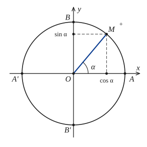
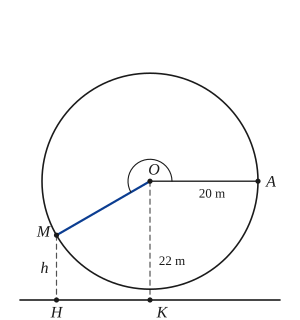

# Chủ đề 1. Giá trị lượng giác của góc lượng giác và công thức lượng giác

> Đây là nền tảng của cả chương lượng giác lớp 11: không nắm chắc đường tròn lượng giác và các công thức thì không giải được phương trình lượng giác. Trong đề kiểm tra, chủ đề này thường xuất hiện ở câu tính giá trị, rút gọn biểu thức và chứng minh đẳng thức.

## I. Kiến thức cần nắm

### 1. Góc lượng giác và số đo
- **Radian:** cung tròn có độ dài bằng bán kính thì có số đo $1$ rad. Ta có $\pi \text{ rad} = 180^\circ$, nên
$$1^\circ = \frac{\pi}{180}\text{ rad}, \qquad 1 \text{ rad} = \left(\frac{180}{\pi}\right)^\circ \approx 57^\circ 18'.$$
- **Độ dài cung:** cung có số đo $\alpha$ rad trên đường tròn bán kính $R$ có độ dài $l = R\alpha$.
- **Góc lượng giác** $(Ou, Ov)$ có hướng: quay ngược chiều kim đồng hồ là chiều dương. Nếu một góc lượng giác có số đo $\alpha$ thì mọi góc lượng giác cùng tia đầu, tia cuối có số đo
$$\alpha + k2\pi \ (k \in \mathbb{Z}) \quad\text{hay}\quad a^\circ + k360^\circ.$$
- **Hệ thức Chasles:** $\text{sđ}(Ou, Ov) + \text{sđ}(Ov, Ow) = \text{sđ}(Ou, Ow) + k2\pi$.

*Ví dụ:* $\frac{5\pi}{6} = \frac{5\cdot 180^\circ}{6} = 150^\circ$; $\;-45^\circ = -\frac{\pi}{4}$. Góc $\frac{17\pi}{3} = \frac{5\pi}{3} + 2\pi$ có cùng điểm cuối với góc $\frac{5\pi}{3}$.

### 2. Đường tròn lượng giác và giá trị lượng giác
Đường tròn lượng giác là đường tròn tâm $O$, bán kính $1$, định hướng, điểm gốc $A(1; 0)$. Điểm $M(x; y)$ trên đường tròn ứng với góc lượng giác $\alpha = (OA, OM)$. Khi đó
$$\cos\alpha = x, \quad \sin\alpha = y, \quad \tan\alpha = \frac{\sin\alpha}{\cos\alpha}\ (\cos\alpha \ne 0), \quad \cot\alpha = \frac{\cos\alpha}{\sin\alpha}\ (\sin\alpha \ne 0).$$

*Hình: Đường tròn lượng giác.*

- $-1 \le \sin\alpha \le 1$, $-1 \le \cos\alpha \le 1$.
- $\sin(\alpha + k2\pi) = \sin\alpha$, $\cos(\alpha + k2\pi) = \cos\alpha$; $\tan(\alpha + k\pi) = \tan\alpha$, $\cot(\alpha + k\pi) = \cot\alpha$.
- **Dấu** theo góc phần tư của điểm $M$:

| | I | II | III | IV |
|---|---|---|---|---|
| $\cos\alpha$ | $+$ | $-$ | $-$ | $+$ |
| $\sin\alpha$ | $+$ | $+$ | $-$ | $-$ |
| $\tan\alpha$, $\cot\alpha$ | $+$ | $-$ | $+$ | $-$ |

Mẹo nhớ: "Nhất cả, nhì sin, tam tan, tứ cos" (góc phần tư thứ mấy thì những giá trị nào dương).

- **Giá trị đặc biệt:**

| $\alpha$ | $0$ | $\frac{\pi}{6}$ | $\frac{\pi}{4}$ | $\frac{\pi}{3}$ | $\frac{\pi}{2}$ |
|---|---|---|---|---|---|
| $\sin\alpha$ | $0$ | $\frac12$ | $\frac{\sqrt2}{2}$ | $\frac{\sqrt3}{2}$ | $1$ |
| $\cos\alpha$ | $1$ | $\frac{\sqrt3}{2}$ | $\frac{\sqrt2}{2}$ | $\frac12$ | $0$ |
| $\tan\alpha$ | $0$ | $\frac{\sqrt3}{3}$ | $1$ | $\sqrt3$ | không xác định |

### 3. Hệ thức cơ bản và giá trị lượng giác của các góc liên quan
**Hệ thức cơ bản:**
$$\sin^2\alpha + \cos^2\alpha = 1, \qquad 1 + \tan^2\alpha = \frac{1}{\cos^2\alpha}, \qquad 1 + \cot^2\alpha = \frac{1}{\sin^2\alpha}, \qquad \tan\alpha\cot\alpha = 1.$$
*Vì sao:* $M(\cos\alpha; \sin\alpha)$ nằm trên đường tròn bán kính $1$ nên $OM^2 = \cos^2\alpha + \sin^2\alpha = 1$. Chia hai vế cho $\cos^2\alpha$ hoặc $\sin^2\alpha$ được hai hệ thức sau.

**Các góc liên quan đặc biệt** (suy ra từ tính đối xứng trên đường tròn lượng giác):

| Quan hệ | Công thức | Cách nhớ |
|---|---|---|
| Đối nhau: $\alpha$ và $-\alpha$ | $\cos(-\alpha) = \cos\alpha$, $\sin(-\alpha) = -\sin\alpha$ | cos đối |
| Bù nhau: $\alpha$ và $\pi - \alpha$ | $\sin(\pi - \alpha) = \sin\alpha$, $\cos(\pi - \alpha) = -\cos\alpha$ | sin bù |
| Phụ nhau: $\alpha$ và $\frac{\pi}{2} - \alpha$ | $\sin(\frac{\pi}{2} - \alpha) = \cos\alpha$, $\cos(\frac{\pi}{2} - \alpha) = \sin\alpha$ | phụ chéo |
| Hơn kém $\pi$ | $\sin(\pi + \alpha) = -\sin\alpha$, $\cos(\pi + \alpha) = -\cos\alpha$, $\tan(\pi + \alpha) = \tan\alpha$ | hơn kém $\pi$ tan, cot |

*Ví dụ:* cho $\cos\alpha = \frac35$ với $-\frac{\pi}{2} < \alpha < 0$. Khi đó $\sin^2\alpha = 1 - \frac{9}{25} = \frac{16}{25}$, mà $\sin\alpha < 0$ nên $\sin\alpha = -\frac45$, $\tan\alpha = -\frac43$.

### 4. Công thức cộng
$$\cos(a \pm b) = \cos a\cos b \mp \sin a\sin b, \qquad \sin(a \pm b) = \sin a\cos b \pm \cos a\sin b,$$
$$\tan(a \pm b) = \frac{\tan a \pm \tan b}{1 \mp \tan a\tan b}.$$
*Ví dụ:* $\sin 15^\circ = \sin(45^\circ - 30^\circ) = \frac{\sqrt2}{2}\cdot\frac{\sqrt3}{2} - \frac{\sqrt2}{2}\cdot\frac12 = \frac{\sqrt6 - \sqrt2}{4}$.

**Hệ quả hay dùng:** $\sin a + \cos a = \sqrt2\sin\left(a + \frac{\pi}{4}\right)$, $\;\sqrt3\sin a + \cos a = 2\sin\left(a + \frac{\pi}{6}\right)$. Tổng quát, $a\sin x + b\cos x = \sqrt{a^2 + b^2}\sin(x + \varphi)$ với $\cos\varphi = \frac{a}{\sqrt{a^2+b^2}}$, $\sin\varphi = \frac{b}{\sqrt{a^2+b^2}}$.

### 5. Công thức nhân đôi và hạ bậc
Cho $b = a$ trong công thức cộng:
$$\sin 2a = 2\sin a\cos a, \qquad \cos 2a = \cos^2 a - \sin^2 a = 2\cos^2 a - 1 = 1 - 2\sin^2 a, \qquad \tan 2a = \frac{2\tan a}{1 - \tan^2 a}.$$
**Hạ bậc:** $\cos^2 a = \frac{1 + \cos 2a}{2}$, $\quad\sin^2 a = \frac{1 - \cos 2a}{2}$.

*Ví dụ:* $\cos^2\frac{\pi}{8} = \frac{1 + \cos\frac{\pi}{4}}{2} = \frac{2 + \sqrt2}{4}$, nên $\cos\frac{\pi}{8} = \frac{\sqrt{2 + \sqrt2}}{2}$ (vì $\cos\frac{\pi}{8} > 0$).

### 6. Biến đổi tích thành tổng và tổng thành tích
**Tích thành tổng:**
$$\cos a\cos b = \tfrac12[\cos(a - b) + \cos(a + b)], \quad \sin a\sin b = \tfrac12[\cos(a - b) - \cos(a + b)], \quad \sin a\cos b = \tfrac12[\sin(a - b) + \sin(a + b)].$$
**Tổng thành tích:**
$$\cos u + \cos v = 2\cos\frac{u + v}{2}\cos\frac{u - v}{2}, \qquad \cos u - \cos v = -2\sin\frac{u + v}{2}\sin\frac{u - v}{2},$$
$$\sin u + \sin v = 2\sin\frac{u + v}{2}\cos\frac{u - v}{2}, \qquad \sin u - \sin v = 2\cos\frac{u + v}{2}\sin\frac{u - v}{2}.$$
*Vì sao:* cộng, trừ hai công thức $\cos(a - b)$ và $\cos(a + b)$ được tích thành tổng; đặt $u = a + b$, $v = a - b$ được tổng thành tích.

### 7. Các dạng toán và sai lầm hay gặp
- **Tính giá trị khi biết một giá trị:** dùng hệ thức cơ bản, **xét dấu** theo góc phần tư rồi mới lấy căn.
- **Biết $\tan\alpha$, tính biểu thức thuần nhất** theo $\sin$, $\cos$: chia tử và mẫu cho $\cos\alpha$ (bậc 1) hoặc $\cos^2\alpha$ (bậc 2).
- **Góc lớn:** bớt đi bội của $2\pi$ (với $\sin$, $\cos$) hoặc bội của $\pi$ (với $\tan$, $\cot$) để đưa về góc nhỏ.
- **Rút gọn, chứng minh:** dùng góc liên quan, công thức cộng, nhân đôi; với tổng nhiều $\sin$ hoặc $\cos$ thì ghép cặp và biến tổng thành tích.

> **Sai lầm hay gặp:**
> - Quên xét dấu: từ $\sin^2\alpha = \frac{16}{25}$ viết ngay $\sin\alpha = \frac45$ mà không xem $\alpha$ ở góc phần tư nào.
> - Nhầm $\sin(a + b) = \sin a + \sin b$. Ví dụ $\sin\left(\frac{\pi}{2} + \frac{\pi}{2}\right) = 0 \ne 2$.
> - Viết $\sin 2a = 2\sin a$; đúng là $\sin 2a = 2\sin a\cos a$.
> - Đổi đơn vị lẫn lộn: trong một công thức chỉ dùng một đơn vị (độ hoặc radian). Công thức $l = R\alpha$ chỉ đúng khi $\alpha$ tính bằng radian.

---

## II. Bài tập vận dụng

**Bài 1.** a) Đổi sang radian: $135^\circ$; $-210^\circ$.
b) Đổi sang độ: $\frac{5\pi}{12}$; $3$ rad (làm tròn đến phút).
c) Tính độ dài cung tròn có số đo $1{,}5$ rad trên đường tròn bán kính $20$ cm.

**Bài 2.** Tính $\sin(-1125^\circ)$, $\cos\frac{31\pi}{3}$ và $\tan\left(-\frac{17\pi}{4}\right)$.

**Bài 3.** Cho $\sin\alpha = \frac35$ với $\frac{\pi}{2} < \alpha < \pi$. Tính $\cos\alpha$, $\tan\alpha$, $\cot\alpha$.

**Bài 4.** Cho $\tan\alpha = 2$. Tính $A = \frac{2\sin\alpha + \cos\alpha}{\sin\alpha - 3\cos\alpha}$ và $B = \sin\alpha\cos\alpha$.

**Bài 5.** a) Rút gọn $A = \cos\left(\frac{\pi}{2} - x\right) + \sin(\pi - x) + \cos(\pi + x) + \sin\left(\frac{3\pi}{2} - x\right)$.
b) Chứng minh $\tan^2 x - \sin^2 x = \tan^2 x\sin^2 x$ (với $\cos x \ne 0$).

**Bài 6 (công thức cộng).** a) Tính chính xác $\cos 75^\circ$ và $\tan 15^\circ$.
b) Cho $\sin a = \frac45$, $\cos b = \frac{5}{13}$ với $0 < a, b < \frac{\pi}{2}$. Tính $\sin(a + b)$ và $\cos(a - b)$.

**Bài 7 (công thức nhân đôi).** Cho $\cos\alpha = -\frac13$ với $\pi < \alpha < \frac{3\pi}{2}$. Tính $\sin 2\alpha$, $\cos 2\alpha$ và $\cos\frac{\alpha}{2}$.

**Bài 8 (tổng thành tích).** a) Tính $\sin 75^\circ + \sin 15^\circ$.
b) Rút gọn $P = \frac{\sin x + \sin 3x + \sin 5x}{\cos x + \cos 3x + \cos 5x}$ (giả sử mẫu khác $0$).

**Bài 9 (thực tế).** Một bánh xe đạp có đường kính $70$ cm quay đều $60$ vòng mỗi phút. Trong $5$ giây, bánh xe quay được một góc bao nhiêu radian và xe đi được quãng đường bao nhiêu mét (làm tròn đến hàng phần mười)?

**Bài 10.** Không dùng máy tính, tính $P = \cos\frac{\pi}{7}\cos\frac{2\pi}{7}\cos\frac{4\pi}{7}$.

**Bài 11 (thực tế).** Một vòng đu quay có bán kính $20$ m, tâm $O$ cách mặt đất $22$ m. Gọi $A$ là điểm trên vòng sao cho $OA$ nằm ngang (bên phải tâm). Một cabin ở vị trí $M$ với góc lượng giác $(OA, OM) = \alpha$. Chứng minh độ cao của cabin so với mặt đất là $h = 22 + 20\sin\alpha$ (mét). Tính $h$ khi $\alpha = \frac{7\pi}{6}$ và khi $\alpha = \frac{2\pi}{3}$.

**Bài 12 (vận dụng cao).** Chứng minh rằng trong mọi tam giác $ABC$:
$$\sin A + \sin B + \sin C = 4\cos\frac A2\cos\frac B2\cos\frac C2.$$

**Bài 13 (vận dụng cao).** Tìm giá trị lớn nhất và giá trị nhỏ nhất của:
a) $P = \sin^6 x + \cos^6 x$;
b) $Q = 3\sin x + 4\cos x + 1$.

---

## III. Lời giải chi tiết

### Bài 1
a) $135^\circ = \frac{135\pi}{180} = \frac{3\pi}{4}$; $\quad -210^\circ = -\frac{210\pi}{180} = -\frac{7\pi}{6}$.

b) $\frac{5\pi}{12} = \frac{5\cdot 180^\circ}{12} = 75^\circ$; $\quad 3 \text{ rad} = \left(\frac{540}{\pi}\right)^\circ \approx 171{,}887^\circ \approx 171^\circ 53'$.

c) $l = R\alpha = 20\cdot 1{,}5 = 30$ (cm).

### Bài 2
- $-1125^\circ = -45^\circ - 3\cdot 360^\circ$ nên $\sin(-1125^\circ) = \sin(-45^\circ) = -\frac{\sqrt2}{2}$.
- $\frac{31\pi}{3} = \frac{\pi}{3} + 5\cdot 2\pi$ nên $\cos\frac{31\pi}{3} = \cos\frac{\pi}{3} = \frac12$.
- $-\frac{17\pi}{4} = -\frac{\pi}{4} - 4\pi$, mà $\tan$ tuần hoàn với chu kỳ $\pi$, nên $\tan\left(-\frac{17\pi}{4}\right) = \tan\left(-\frac{\pi}{4}\right) = -1$.

### Bài 3
$\cos^2\alpha = 1 - \sin^2\alpha = 1 - \frac{9}{25} = \frac{16}{25}$. Vì $\frac{\pi}{2} < \alpha < \pi$ nên $\cos\alpha < 0$, do đó $\cos\alpha = -\frac45$.
$$\tan\alpha = \frac{\sin\alpha}{\cos\alpha} = -\frac34, \qquad \cot\alpha = \frac{1}{\tan\alpha} = -\frac43.$$

### Bài 4
$\tan\alpha = 2$ nên $\cos\alpha \ne 0$. Chia tử và mẫu của $A$ cho $\cos\alpha$:
$$A = \frac{2\tan\alpha + 1}{\tan\alpha - 3} = \frac{5}{-1} = -5.$$
Với $B$, viết $B = \frac{\sin\alpha\cos\alpha}{\sin^2\alpha + \cos^2\alpha}$ rồi chia tử và mẫu cho $\cos^2\alpha$:
$$B = \frac{\tan\alpha}{\tan^2\alpha + 1} = \frac{2}{5}.$$
*Nhận xét:* biểu thức thuần nhất bậc $k$ theo $\sin$, $\cos$ thì chia cho $\cos^k\alpha$. Với biểu thức bậc 2 không có mẫu, nhớ "tạo mẫu" bằng $1 = \sin^2\alpha + \cos^2\alpha$.

### Bài 5
a) $\cos\left(\frac{\pi}{2} - x\right) = \sin x$; $\sin(\pi - x) = \sin x$; $\cos(\pi + x) = -\cos x$; $\sin\left(\frac{3\pi}{2} - x\right) = \sin\left(\pi + \frac{\pi}{2} - x\right) = -\sin\left(\frac{\pi}{2} - x\right) = -\cos x$.
Vậy $A = 2\sin x - 2\cos x = 2(\sin x - \cos x)$.

b) $\tan^2 x - \sin^2 x = \frac{\sin^2 x}{\cos^2 x} - \sin^2 x = \sin^2 x\cdot\frac{1 - \cos^2 x}{\cos^2 x} = \sin^2 x\cdot\frac{\sin^2 x}{\cos^2 x} = \tan^2 x\sin^2 x$.

### Bài 6
a) $\cos 75^\circ = \cos(45^\circ + 30^\circ) = \frac{\sqrt2}{2}\cdot\frac{\sqrt3}{2} - \frac{\sqrt2}{2}\cdot\frac12 = \frac{\sqrt6 - \sqrt2}{4}$.
$$\tan 15^\circ = \tan(45^\circ - 30^\circ) = \frac{1 - \frac{\sqrt3}{3}}{1 + \frac{\sqrt3}{3}} = \frac{3 - \sqrt3}{3 + \sqrt3} = \frac{(3 - \sqrt3)^2}{6} = \frac{12 - 6\sqrt3}{6} = 2 - \sqrt3.$$

b) Vì $0 < a, b < \frac{\pi}{2}$ nên $\cos a > 0$, $\sin b > 0$: $\cos a = \sqrt{1 - \frac{16}{25}} = \frac35$, $\sin b = \sqrt{1 - \frac{25}{169}} = \frac{12}{13}$.
$$\sin(a + b) = \frac45\cdot\frac{5}{13} + \frac35\cdot\frac{12}{13} = \frac{20 + 36}{65} = \frac{56}{65},$$
$$\cos(a - b) = \frac35\cdot\frac{5}{13} + \frac45\cdot\frac{12}{13} = \frac{15 + 48}{65} = \frac{63}{65}.$$

### Bài 7
Vì $\pi < \alpha < \frac{3\pi}{2}$ nên $\sin\alpha < 0$: $\sin\alpha = -\sqrt{1 - \frac19} = -\frac{2\sqrt2}{3}$.
- $\sin 2\alpha = 2\sin\alpha\cos\alpha = 2\cdot\left(-\frac{2\sqrt2}{3}\right)\cdot\left(-\frac13\right) = \frac{4\sqrt2}{9}$.
- $\cos 2\alpha = 2\cos^2\alpha - 1 = \frac29 - 1 = -\frac79$.
- $\cos^2\frac{\alpha}{2} = \frac{1 + \cos\alpha}{2} = \frac{1 - \frac13}{2} = \frac13$. Vì $\frac{\pi}{2} < \frac{\alpha}{2} < \frac{3\pi}{4}$ nên $\cos\frac{\alpha}{2} < 0$, do đó $\cos\frac{\alpha}{2} = -\frac{1}{\sqrt3} = -\frac{\sqrt3}{3}$.

*Nhận xét:* khi tính giá trị của góc $\frac{\alpha}{2}$, phải xác định lại khoảng chứa $\frac{\alpha}{2}$ để chọn dấu, không dùng dấu của $\alpha$.

### Bài 8
a) $\sin 75^\circ + \sin 15^\circ = 2\sin\frac{75^\circ + 15^\circ}{2}\cos\frac{75^\circ - 15^\circ}{2} = 2\sin 45^\circ\cos 30^\circ = 2\cdot\frac{\sqrt2}{2}\cdot\frac{\sqrt3}{2} = \frac{\sqrt6}{2}$.

b) Ghép số hạng đầu và cuối:
$\sin x + \sin 5x = 2\sin 3x\cos 2x$, $\quad\cos x + \cos 5x = 2\cos 3x\cos 2x$. Do đó
$$P = \frac{2\sin 3x\cos 2x + \sin 3x}{2\cos 3x\cos 2x + \cos 3x} = \frac{\sin 3x(2\cos 2x + 1)}{\cos 3x(2\cos 2x + 1)} = \tan 3x.$$
(Mẫu khác $0$ nên $2\cos 2x + 1 \ne 0$ và $\cos 3x \ne 0$, được phép giản ước.)

*Nhận xét:* với tổng các $\sin$ (hoặc $\cos$) có góc lập cấp số cộng, ghép cặp số hạng cách đều hai đầu để xuất hiện thừa số chung.

### Bài 9
$60$ vòng/phút nghĩa là $1$ vòng mỗi giây. Trong $5$ giây bánh xe quay $5$ vòng, tức là một góc $5\cdot 2\pi = 10\pi$ (rad).
Bán kính $R = 35$ cm $= 0{,}35$ m. Quãng đường xe đi bằng độ dài cung mà một điểm trên vành bánh quay được:
$$l = R\alpha = 0{,}35\cdot 10\pi = 3{,}5\pi \approx 11{,}0 \text{ (m)}.$$

### Bài 10
Nhân hai vế với $\sin\frac{\pi}{7} \ne 0$ và dùng $\sin a\cos a = \frac12\sin 2a$ liên tiếp:
$$P\sin\frac{\pi}{7} = \frac12\sin\frac{2\pi}{7}\cos\frac{2\pi}{7}\cos\frac{4\pi}{7} = \frac14\sin\frac{4\pi}{7}\cos\frac{4\pi}{7} = \frac18\sin\frac{8\pi}{7}.$$
Mà $\sin\frac{8\pi}{7} = \sin\left(\pi + \frac{\pi}{7}\right) = -\sin\frac{\pi}{7}$. Vậy $P\sin\frac{\pi}{7} = -\frac18\sin\frac{\pi}{7}$, suy ra $P = -\frac18$.

*Nhận xét:* tích các $\cos$ của góc gấp đôi nhau: nhân thêm $\sin$ của góc nhỏ nhất để "dồn" bằng công thức nhân đôi.

### Bài 11

*Hình: Đu quay tâm O, cabin ở vị trí M.*

Chọn hệ trục gốc $O$, trục hoành theo hướng $OA$, đơn vị là $20$ m (bán kính vòng quay). Khi đó $M$ có tung độ (theo đơn vị này) bằng $\sin\alpha$, tức là $M$ cao hơn tâm $O$ một đoạn $20\sin\alpha$ mét (âm nếu $M$ thấp hơn $O$). Tâm cao $22$ m nên
$$h = 22 + 20\sin\alpha.$$
- $\alpha = \frac{7\pi}{6}$: $\sin\frac{7\pi}{6} = -\sin\frac{\pi}{6} = -\frac12$, nên $h = 22 - 10 = 12$ (m).
- $\alpha = \frac{2\pi}{3}$: $\sin\frac{2\pi}{3} = \frac{\sqrt3}{2}$, nên $h = 22 + 10\sqrt3 \approx 39{,}32$ (m).

### Bài 12
Vì $A + B + C = \pi$ nên $\frac{A + B}{2} = \frac{\pi}{2} - \frac{C}{2}$, suy ra $\sin\frac{A + B}{2} = \cos\frac C2$ và $\cos\frac{A + B}{2} = \sin\frac C2$.
$$\sin A + \sin B = 2\sin\frac{A + B}{2}\cos\frac{A - B}{2} = 2\cos\frac C2\cos\frac{A - B}{2}.$$
$$\sin C = 2\sin\frac C2\cos\frac C2 = 2\cos\frac C2\cos\frac{A + B}{2}.$$
Cộng lại:
$$\sin A + \sin B + \sin C = 2\cos\frac C2\left(\cos\frac{A - B}{2} + \cos\frac{A + B}{2}\right) = 2\cos\frac C2\cdot 2\cos\frac A2\cos\frac B2 = 4\cos\frac A2\cos\frac B2\cos\frac C2.$$

*Nhận xét:* đẳng thức trong tam giác luôn khai thác $A + B + C = \pi$ để chuyển $\frac{A + B}{2}$ thành góc phụ với $\frac C2$.

### Bài 13
a) Đặt $s = \sin^2 x$, $c = \cos^2 x$, $s + c = 1$. Dùng $a^3 + b^3 = (a + b)^3 - 3ab(a + b)$:
$$P = s^3 + c^3 = 1 - 3sc = 1 - 3\sin^2 x\cos^2 x = 1 - \frac34\sin^2 2x.$$
Vì $0 \le \sin^2 2x \le 1$ nên $\frac14 \le P \le 1$.
- $P = 1$ khi $\sin 2x = 0$, chẳng hạn $x = 0$. Giá trị lớn nhất là $1$.
- $P = \frac14$ khi $\sin^2 2x = 1$, chẳng hạn $x = \frac{\pi}{4}$. Giá trị nhỏ nhất là $\frac14$.

b) $3\sin x + 4\cos x = 5\left(\frac35\sin x + \frac45\cos x\right)$. Chọn góc $\varphi$ với $\cos\varphi = \frac35$, $\sin\varphi = \frac45$ (có vì $\left(\frac35\right)^2 + \left(\frac45\right)^2 = 1$). Khi đó
$$3\sin x + 4\cos x = 5(\sin x\cos\varphi + \cos x\sin\varphi) = 5\sin(x + \varphi).$$
Do $-1 \le \sin(x + \varphi) \le 1$ nên $-4 \le Q \le 6$.
- $Q = 6$ khi $x = \frac{\pi}{2} - \varphi$; $\quad Q = -4$ khi $x = -\frac{\pi}{2} - \varphi$.

Vậy giá trị lớn nhất của $Q$ là $6$, giá trị nhỏ nhất là $-4$.

*Nhận xét:* $a\sin x + b\cos x$ luôn nằm trong đoạn $\left[-\sqrt{a^2 + b^2}; \sqrt{a^2 + b^2}\right]$.
