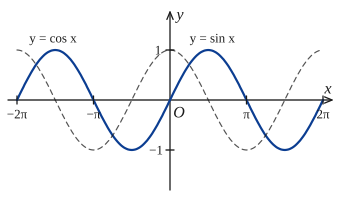

# Chủ đề 2. Hàm số lượng giác và phương trình lượng giác

> Chủ đề này dùng đường tròn lượng giác và các công thức của Chủ đề 1 để khảo sát bốn hàm số $\sin$, $\cos$, $\tan$, $\cot$ và giải phương trình lượng giác. Câu giải phương trình lượng giác cơ bản gần như luôn có mặt trong đề kiểm tra lớp 11; bài toán thực tế về chuyển động tuần hoàn (thủy triều, số giờ có ánh sáng) cũng hay gặp.

## I. Kiến thức cần nắm

### 1. Hàm số chẵn, hàm số lẻ, hàm số tuần hoàn
Cho hàm số $y = f(x)$ có tập xác định $D$.
- $f$ là **hàm số chẵn** nếu với mọi $x \in D$: $-x \in D$ và $f(-x) = f(x)$. Đồ thị đối xứng qua trục tung.
- $f$ là **hàm số lẻ** nếu với mọi $x \in D$: $-x \in D$ và $f(-x) = -f(x)$. Đồ thị đối xứng qua gốc tọa độ.
- $f$ là **hàm số tuần hoàn** nếu có số $T \ne 0$ sao cho $f(x + T) = f(x)$ với mọi $x \in D$. Số $T$ dương nhỏ nhất như vậy (nếu có) là **chu kỳ**.

*Cách chứng minh không chẵn, không lẻ:* chỉ ra một giá trị $x_0$ với $f(-x_0) \ne f(x_0)$ và $f(-x_0) \ne -f(x_0)$.

### 2. Bốn hàm số lượng giác

| | $y = \sin x$ | $y = \cos x$ | $y = \tan x$ | $y = \cot x$ |
|---|---|---|---|---|
| Tập xác định | $\mathbb{R}$ | $\mathbb{R}$ | $x \ne \frac{\pi}{2} + k\pi$ | $x \ne k\pi$ |
| Tập giá trị | $[-1; 1]$ | $[-1; 1]$ | $\mathbb{R}$ | $\mathbb{R}$ |
| Chẵn, lẻ | lẻ | chẵn | lẻ | lẻ |
| Chu kỳ | $2\pi$ | $2\pi$ | $\pi$ | $\pi$ |
| Đồng biến trên | $\left(-\frac{\pi}{2} + k2\pi; \frac{\pi}{2} + k2\pi\right)$ | $(-\pi + k2\pi; k2\pi)$ | mỗi khoảng $\left(-\frac{\pi}{2} + k\pi; \frac{\pi}{2} + k\pi\right)$ | không có |
| Nghịch biến trên | $\left(\frac{\pi}{2} + k2\pi; \frac{3\pi}{2} + k2\pi\right)$ | $(k2\pi; \pi + k2\pi)$ | không có | mỗi khoảng $(k\pi; \pi + k\pi)$ |

*Hình: Đồ thị $y = \sin x$ (nét liền) và $y = \cos x$ (nét đứt).*

- Đồ thị $y = \cos x$ có được khi tịnh tiến đồ thị $y = \sin x$ sang trái $\frac{\pi}{2}$, vì $\cos x = \sin\left(x + \frac{\pi}{2}\right)$.
- Hàm số $y = \sin(ax + b)$, $y = \cos(ax + b)$ (với $a \ne 0$) tuần hoàn với chu kỳ $\frac{2\pi}{\lvert a\rvert}$; hàm $y = \tan(ax + b)$ có chu kỳ $\frac{\pi}{\lvert a\rvert}$.

*Ví dụ:* $y = 2 - 3\sin x$ có $-1 \le \sin x \le 1$ nên $-1 \le y \le 5$; giá trị lớn nhất $5$ khi $\sin x = -1$, giá trị nhỏ nhất $-1$ khi $\sin x = 1$.

### 3. Phương trình lượng giác cơ bản
**Phương trình $\sin x = m$.** Nếu $\lvert m\rvert > 1$: vô nghiệm. Nếu $\lvert m\rvert \le 1$: gọi $\alpha$ là một góc có $\sin\alpha = m$, khi đó
$$\sin x = \sin\alpha \iff x = \alpha + k2\pi \ \text{ hoặc } \ x = \pi - \alpha + k2\pi \quad (k \in \mathbb{Z}).$$
**Phương trình $\cos x = m$.** Nếu $\lvert m\rvert > 1$: vô nghiệm. Nếu $\lvert m\rvert \le 1$, với $\cos\alpha = m$:
$$\cos x = \cos\alpha \iff x = \alpha + k2\pi \ \text{ hoặc } \ x = -\alpha + k2\pi.$$
**Phương trình $\tan x = m$** (điều kiện $x \ne \frac{\pi}{2} + k\pi$) và **$\cot x = m$** (điều kiện $x \ne k\pi$): luôn có nghiệm
$$\tan x = \tan\alpha \iff x = \alpha + k\pi, \qquad \cot x = \cot\alpha \iff x = \alpha + k\pi.$$
**Trường hợp đặc biệt:** $\sin x = 0 \iff x = k\pi$; $\sin x = 1 \iff x = \frac{\pi}{2} + k2\pi$; $\sin x = -1 \iff x = -\frac{\pi}{2} + k2\pi$; $\cos x = 0 \iff x = \frac{\pi}{2} + k\pi$; $\cos x = 1 \iff x = k2\pi$; $\cos x = -1 \iff x = \pi + k2\pi$.

*Vì sao:* trên đường tròn lượng giác, đường thẳng $y = m$ ($\lvert m\rvert < 1$) cắt đường tròn tại hai điểm đối xứng qua trục tung, ứng với các góc $\alpha$ và $\pi - \alpha$. Tương tự, đường thẳng $x = m$ cắt tại hai điểm đối xứng qua trục hoành, ứng với $\alpha$ và $-\alpha$.

Nếu $m$ không phải giá trị đặc biệt, viết nghiệm qua $\arcsin m$, $\arccos m$, $\arctan m$. Khi đề cho số đo bằng độ thì viết nghiệm bằng độ: $\sin x = \sin a^\circ \iff x = a^\circ + k360^\circ$ hoặc $x = 180^\circ - a^\circ + k360^\circ$.

*Ví dụ:* $\cos x = -\frac{\sqrt2}{2} = \cos\frac{3\pi}{4} \iff x = \pm\frac{3\pi}{4} + k2\pi$.

### 4. Phương trình quy về phương trình cơ bản
- **Dạng $\sin u = \sin v$, $\cos u = \cos v$:** áp dụng công thức nghiệm với $u$, $v$ là biểu thức. Nếu gặp $\sin u = \cos v$ thì đổi $\cos v = \sin\left(\frac{\pi}{2} - v\right)$; gặp $\cos u = -\cos v$ thì đổi $-\cos v = \cos(\pi - v)$.
- **Dạng bậc hai theo một hàm lượng giác:** đặt $t = \sin x$ (hoặc $\cos x$, với điều kiện $-1 \le t \le 1$), hoặc $t = \tan x$. Dùng $\cos 2x = 1 - 2\sin^2 x = 2\cos^2 x - 1$ để đưa về một hàm.
- **Dạng $a\sin x + b\cos x = c$:** chia hai vế cho $\sqrt{a^2 + b^2}$, đưa về $\sin(x + \varphi) = \frac{c}{\sqrt{a^2 + b^2}}$. Phương trình có nghiệm khi và chỉ khi $a^2 + b^2 \ge c^2$.
- **Đưa về tích:** dùng công thức biến tổng thành tích, nhân đôi, đặt nhân tử chung, rồi giải từng phương trình cơ bản.

### 5. Chọn nghiệm và các sai lầm hay gặp
**Đếm nghiệm trên một khoảng:** với họ nghiệm $x = \alpha + k\frac{2\pi}{n}$, giải bất phương trình theo $k$ (với $k$ nguyên) để biết những giá trị $k$ thỏa mãn.

> **Sai lầm hay gặp:**
> - Quên điều kiện xác định với $\tan$, $\cot$, mẫu số, hoặc quên đối chiếu nghiệm với điều kiện.
> - Trộn đơn vị: viết $x = 30^\circ + k\pi$. Đã dùng độ thì chu kỳ là $180^\circ$, $360^\circ$.
> - Với $\sin x = m$ chỉ lấy họ $x = \alpha + k2\pi$, bỏ sót họ $x = \pi - \alpha + k2\pi$.
> - Giải $\sin x = 2$ hoặc $\cos x = -\frac32$ mà không nhận ra phương trình vô nghiệm; khi đặt $t = \sin x$ phải loại nghiệm $t$ nằm ngoài $[-1; 1]$.
> - Chia hai vế cho biểu thức có thể bằng $0$ (như $\sin x$, $\cos x$) làm mất nghiệm.

---

## II. Bài tập vận dụng

**Bài 1.** Tìm tập xác định của các hàm số:
a) $y = \frac{1}{\sin x}$; $\quad$ b) $y = \tan\left(2x - \frac{\pi}{3}\right)$; $\quad$ c) $y = \frac{1 + \cos x}{1 - \cos x}$.

**Bài 2.** Xét tính chẵn, lẻ của các hàm số:
a) $y = x\sin x$; $\quad$ b) $y = \tan x - 2\sin x$; $\quad$ c) $y = \sin x + \cos x$.

**Bài 3.** Tìm giá trị lớn nhất và giá trị nhỏ nhất của các hàm số:
a) $y = 3 - 2\cos x$; $\quad$ b) $y = \sin^2 x - 2\sin x + 3$.

**Bài 4.** Giải các phương trình:
a) $\sin x = \frac{\sqrt3}{2}$; $\quad$ b) $\cos\left(2x - \frac{\pi}{4}\right) = -\frac12$; $\quad$ c) $\tan(x + 30^\circ) = \sqrt3$; $\quad$ d) $\cot 3x = -1$.

**Bài 5.** Giải các phương trình:
a) $\sin 3x = \sin\left(x + \frac{\pi}{4}\right)$; $\quad$ b) $\cos 3x + \cos x = 0$.

**Bài 6.** Tìm các nghiệm thuộc đoạn $[0; 2\pi]$ của phương trình $\sin 2x = \frac12$ và tính tổng các nghiệm đó.

**Bài 7.** Giải các phương trình:
a) $2\cos^2 x - 3\cos x + 1 = 0$; $\quad$ b) $\cos 2x + 5\sin x - 3 = 0$.

**Bài 8.** Giải phương trình $\sqrt3\sin x + \cos x = \sqrt2$.

**Bài 9 (thực tế).** Độ sâu $h$ (mét) của mực nước ở một cảng biển vào thời điểm $t$ (giờ) trong một ngày được cho bởi $h = 3\cos\frac{\pi t}{6} + 12$, với $0 \le t \le 24$.
a) Độ sâu lớn nhất và nhỏ nhất của mực nước là bao nhiêu, vào những thời điểm nào?
b) Vào những thời điểm nào độ sâu của mực nước là $13{,}5$ m?

**Bài 10 (thực tế).** Số giờ có ánh sáng mặt trời của một thành phố ở vĩ độ $40^\circ$ Bắc vào ngày thứ $t$ của một năm không nhuận được cho bởi
$$d(t) = 3\sin\left[\frac{\pi}{182}(t - 80)\right] + 12, \qquad t \in \mathbb{Z},\ 0 < t \le 365.$$
Ngày nào trong năm thành phố có nhiều giờ ánh sáng nhất? Ngày nào có ít giờ ánh sáng nhất?

**Bài 11 (vận dụng cao).** Giải phương trình $\sin x + \sin 2x + \sin 3x = 0$.

**Bài 12 (vận dụng cao).** Giải phương trình $\tan x + \cot x = 4$.

**Bài 13 (vận dụng cao).** Tìm $m$ để phương trình $\cos 2x - (2m + 1)\cos x + m + 1 = 0$ có nghiệm thuộc khoảng $\left(\frac{\pi}{2}; \frac{3\pi}{2}\right)$.

---

## III. Lời giải chi tiết

### Bài 1
a) Điều kiện $\sin x \ne 0 \iff x \ne k\pi$. Tập xác định $D = \mathbb{R}\setminus\{k\pi \mid k \in \mathbb{Z}\}$.

b) Điều kiện $\cos\left(2x - \frac{\pi}{3}\right) \ne 0 \iff 2x - \frac{\pi}{3} \ne \frac{\pi}{2} + k\pi \iff x \ne \frac{5\pi}{12} + k\frac{\pi}{2}$.
Tập xác định $D = \mathbb{R}\setminus\left\{\frac{5\pi}{12} + k\frac{\pi}{2} \mid k \in \mathbb{Z}\right\}$.

c) Điều kiện $1 - \cos x \ne 0 \iff \cos x \ne 1 \iff x \ne k2\pi$. Tập xác định $D = \mathbb{R}\setminus\{k2\pi \mid k \in \mathbb{Z}\}$.

### Bài 2
a) $D = \mathbb{R}$ đối xứng. $f(-x) = (-x)\sin(-x) = (-x)(-\sin x) = x\sin x = f(x)$. Hàm số **chẵn**.

b) $D = \mathbb{R}\setminus\left\{\frac{\pi}{2} + k\pi\right\}$; nếu $x \in D$ thì $-x \in D$. $f(-x) = \tan(-x) - 2\sin(-x) = -\tan x + 2\sin x = -f(x)$. Hàm số **lẻ**.

c) $f\left(\frac{\pi}{4}\right) = \frac{\sqrt2}{2} + \frac{\sqrt2}{2} = \sqrt2$, còn $f\left(-\frac{\pi}{4}\right) = -\frac{\sqrt2}{2} + \frac{\sqrt2}{2} = 0$. Ta thấy $f\left(-\frac{\pi}{4}\right) \ne f\left(\frac{\pi}{4}\right)$ và $f\left(-\frac{\pi}{4}\right) \ne -f\left(\frac{\pi}{4}\right)$, nên hàm số **không chẵn, không lẻ**.

### Bài 3
a) $-1 \le \cos x \le 1 \Rightarrow -2 \le -2\cos x \le 2 \Rightarrow 1 \le y \le 5$.
Giá trị lớn nhất $5$ khi $\cos x = -1 \iff x = \pi + k2\pi$; giá trị nhỏ nhất $1$ khi $\cos x = 1 \iff x = k2\pi$.

b) Đặt $t = \sin x$, $t \in [-1; 1]$. Khi đó $y = t^2 - 2t + 3 = (t - 1)^2 + 2$.
Với $-1 \le t \le 1$: $0 \le 1 - t \le 2$, nên $0 \le (t - 1)^2 \le 4$, suy ra $2 \le y \le 6$.
- $y = 2$ khi $t = 1$, tức $x = \frac{\pi}{2} + k2\pi$. Giá trị nhỏ nhất là $2$.
- $y = 6$ khi $t = -1$, tức $x = -\frac{\pi}{2} + k2\pi$. Giá trị lớn nhất là $6$.

*Nhận xét:* sau khi đặt ẩn phụ, luôn ghi miền giá trị của ẩn phụ. Ở đây đỉnh parabol $t = 1$ nằm ở đầu mút của đoạn $[-1; 1]$.

### Bài 4
a) $\sin x = \sin\frac{\pi}{3} \iff x = \frac{\pi}{3} + k2\pi$ hoặc $x = \frac{2\pi}{3} + k2\pi$.

b) $-\frac12 = \cos\frac{2\pi}{3}$, nên $2x - \frac{\pi}{4} = \pm\frac{2\pi}{3} + k2\pi$.
- $2x = \frac{\pi}{4} + \frac{2\pi}{3} + k2\pi = \frac{11\pi}{12} + k2\pi \iff x = \frac{11\pi}{24} + k\pi$.
- $2x = \frac{\pi}{4} - \frac{2\pi}{3} + k2\pi = -\frac{5\pi}{12} + k2\pi \iff x = -\frac{5\pi}{24} + k\pi$.

c) Điều kiện $x + 30^\circ \ne 90^\circ + k180^\circ$. $\tan(x + 30^\circ) = \tan 60^\circ \iff x + 30^\circ = 60^\circ + k180^\circ \iff x = 30^\circ + k180^\circ$ (thỏa mãn điều kiện).

d) Điều kiện $3x \ne k\pi$. $\cot 3x = \cot\left(-\frac{\pi}{4}\right) \iff 3x = -\frac{\pi}{4} + k\pi \iff x = -\frac{\pi}{12} + k\frac{\pi}{3}$ (thỏa mãn điều kiện).

### Bài 5
a) $\sin 3x = \sin\left(x + \frac{\pi}{4}\right) \iff \left[\begin{array}{l} 3x = x + \frac{\pi}{4} + k2\pi \\ 3x = \pi - x - \frac{\pi}{4} + k2\pi \end{array}\right. \iff \left[\begin{array}{l} x = \frac{\pi}{8} + k\pi \\ x = \frac{3\pi}{16} + k\frac{\pi}{2} \end{array}\right.$

b) $\cos 3x = -\cos x = \cos(\pi - x) \iff 3x = \pm(\pi - x) + k2\pi$.
- $3x = \pi - x + k2\pi \iff x = \frac{\pi}{4} + k\frac{\pi}{2}$.
- $3x = -\pi + x + k2\pi \iff x = -\frac{\pi}{2} + k\pi$, tức là $x = \frac{\pi}{2} + k\pi$.

*Cách khác:* $\cos 3x + \cos x = 2\cos 2x\cos x = 0 \iff \cos 2x = 0$ hoặc $\cos x = 0$, cho cùng kết quả.

### Bài 6
$\sin 2x = \sin\frac{\pi}{6} \iff 2x = \frac{\pi}{6} + k2\pi$ hoặc $2x = \frac{5\pi}{6} + k2\pi$, tức là $x = \frac{\pi}{12} + k\pi$ hoặc $x = \frac{5\pi}{12} + k\pi$.
- $0 \le \frac{\pi}{12} + k\pi \le 2\pi \iff -\frac{1}{12} \le k \le \frac{23}{12}$, $k$ nguyên nên $k \in \{0; 1\}$: $x = \frac{\pi}{12}$, $x = \frac{13\pi}{12}$.
- $0 \le \frac{5\pi}{12} + k\pi \le 2\pi \iff -\frac{5}{12} \le k \le \frac{19}{12}$, nên $k \in \{0; 1\}$: $x = \frac{5\pi}{12}$, $x = \frac{17\pi}{12}$.

Phương trình có $4$ nghiệm trên $[0; 2\pi]$, tổng bằng $\frac{\pi + 13\pi + 5\pi + 17\pi}{12} = \frac{36\pi}{12} = 3\pi$.

### Bài 7
a) Đặt $t = \cos x$, $t \in [-1; 1]$: $2t^2 - 3t + 1 = 0 \iff t = 1$ hoặc $t = \frac12$ (cả hai thỏa mãn).
- $\cos x = 1 \iff x = k2\pi$.
- $\cos x = \frac12 \iff x = \pm\frac{\pi}{3} + k2\pi$.

b) Thay $\cos 2x = 1 - 2\sin^2 x$: $1 - 2\sin^2 x + 5\sin x - 3 = 0 \iff 2\sin^2 x - 5\sin x + 2 = 0$.
Đặt $t = \sin x \in [-1; 1]$: $2t^2 - 5t + 2 = 0 \iff t = 2$ (loại) hoặc $t = \frac12$.
$\sin x = \frac12 \iff x = \frac{\pi}{6} + k2\pi$ hoặc $x = \frac{5\pi}{6} + k2\pi$.

### Bài 8
Chia hai vế cho $\sqrt{3 + 1} = 2$:
$$\frac{\sqrt3}{2}\sin x + \frac12\cos x = \frac{\sqrt2}{2} \iff \sin x\cos\frac{\pi}{6} + \cos x\sin\frac{\pi}{6} = \frac{\sqrt2}{2} \iff \sin\left(x + \frac{\pi}{6}\right) = \sin\frac{\pi}{4}.$$
- $x + \frac{\pi}{6} = \frac{\pi}{4} + k2\pi \iff x = \frac{\pi}{12} + k2\pi$.
- $x + \frac{\pi}{6} = \frac{3\pi}{4} + k2\pi \iff x = \frac{7\pi}{12} + k2\pi$.

*Nhận xét:* phương trình $a\sin x + b\cos x = c$ luôn chia cho $\sqrt{a^2 + b^2}$ để dùng công thức cộng.

### Bài 9
a) Vì $-1 \le \cos\frac{\pi t}{6} \le 1$ nên $9 \le h \le 15$.
- $h = 15$ khi $\cos\frac{\pi t}{6} = 1 \iff \frac{\pi t}{6} = k2\pi \iff t = 12k$. Với $0 \le t \le 24$: $t \in \{0; 12; 24\}$.
- $h = 9$ khi $\cos\frac{\pi t}{6} = -1 \iff \frac{\pi t}{6} = \pi + k2\pi \iff t = 6 + 12k$: $t \in \{6; 18\}$.

Độ sâu lớn nhất $15$ m lúc $0$ giờ, $12$ giờ, $24$ giờ; nhỏ nhất $9$ m lúc $6$ giờ và $18$ giờ.

b) $h = 13{,}5 \iff \cos\frac{\pi t}{6} = \frac12 \iff \frac{\pi t}{6} = \pm\frac{\pi}{3} + k2\pi \iff t = \pm 2 + 12k$.
Với $0 \le t \le 24$: $t \in \{2; 10; 14; 22\}$. Vậy độ sâu là $13{,}5$ m lúc $2$ giờ, $10$ giờ, $14$ giờ và $22$ giờ.

### Bài 10
Vì $-1 \le \sin\left[\frac{\pi}{182}(t - 80)\right] \le 1$ nên $9 \le d(t) \le 15$.

**Nhiều giờ ánh sáng nhất** ($d = 15$): $\frac{\pi}{182}(t - 80) = \frac{\pi}{2} + k2\pi \iff t = 171 + 364k$. Với $0 < t \le 365$ và $k$ nguyên thì $k = 0$, $t = 171$.

**Ít giờ ánh sáng nhất** ($d = 9$): $\frac{\pi}{182}(t - 80) = -\frac{\pi}{2} + k2\pi \iff t = -11 + 364k$. Với $0 < t \le 365$ thì $k = 1$, $t = 353$.

Đếm ngày trong năm không nhuận (tháng 1 đến tháng 5 có $31 + 28 + 31 + 30 + 31 = 151$ ngày) thì ngày thứ $171$ là ngày $20$ tháng $6$; ngày thứ $353$ là ngày $19$ tháng $12$ (vì $365 - 353 = 12$ và $31 - 12 = 19$).

Vậy thành phố có nhiều giờ ánh sáng nhất ($15$ giờ) vào ngày $20/6$ và ít nhất ($9$ giờ) vào ngày $19/12$.

### Bài 11
Ghép $\sin x + \sin 3x = 2\sin 2x\cos x$. Phương trình trở thành
$$2\sin 2x\cos x + \sin 2x = 0 \iff \sin 2x(2\cos x + 1) = 0.$$
- $\sin 2x = 0 \iff 2x = k\pi \iff x = k\frac{\pi}{2}$.
- $\cos x = -\frac12 \iff x = \pm\frac{2\pi}{3} + k2\pi$.

Vậy nghiệm là $x = k\frac{\pi}{2}$ hoặc $x = \pm\frac{2\pi}{3} + k2\pi$ ($k \in \mathbb{Z}$).

*Nhận xét:* với tổng ba $\sin$ có góc lập cấp số cộng, ghép số hạng đầu và cuối để xuất hiện số hạng ở giữa làm nhân tử chung.

### Bài 12
Điều kiện: $\sin x \ne 0$ và $\cos x \ne 0$, tức là $\sin 2x \ne 0$.
$$\tan x + \cot x = \frac{\sin x}{\cos x} + \frac{\cos x}{\sin x} = \frac{\sin^2 x + \cos^2 x}{\sin x\cos x} = \frac{2}{\sin 2x}.$$
Phương trình trở thành $\frac{2}{\sin 2x} = 4 \iff \sin 2x = \frac12$ (thỏa mãn điều kiện $\sin 2x \ne 0$).
$$\sin 2x = \frac12 \iff x = \frac{\pi}{12} + k\pi \ \text{ hoặc } \ x = \frac{5\pi}{12} + k\pi.$$

### Bài 13
Thay $\cos 2x = 2\cos^2 x - 1$ và đặt $t = \cos x$:
$$2t^2 - 1 - (2m + 1)t + m + 1 = 0 \iff 2t^2 - (2m + 1)t + m = 0 \iff (2t - 1)(t - m) = 0.$$
Kiểm tra: $(2t - 1)(t - m) = 2t^2 - 2mt - t + m$, đúng. Vậy $t = \frac12$ hoặc $t = m$.

Khi $x \in \left(\frac{\pi}{2}; \frac{3\pi}{2}\right)$, điểm cuối của $x$ nằm ở nửa trái của đường tròn lượng giác (không kể hai điểm $B$, $B'$), nên $\cos x$ nhận mọi giá trị trong $[-1; 0)$ và chỉ những giá trị đó.
- $\cos x = \frac12$ không có nghiệm trong khoảng này.
- $\cos x = m$ có nghiệm trong khoảng này $\iff -1 \le m < 0$.

Vậy $m \in [-1; 0)$.

*Nhận xét:* bài toán tham số thường đưa về "một nghiệm cố định và một nghiệm phụ thuộc $m$"; khi đó chỉ cần tìm tập giá trị của $\cos x$ (hay $\sin x$) trên khoảng đã cho.
