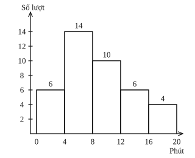

# Chủ đề 4. Các số đặc trưng của mẫu số liệu ghép nhóm

> Khi số liệu nhiều hoặc liên tục (chiều cao, thời gian, điểm số), người ta chia thành các nhóm $[u_1; u_2), [u_2; u_3), \dots$ và ghi tần số mỗi nhóm. Chủ đề này dạy cách ước lượng số trung bình, trung vị, tứ phân vị và mốt từ bảng ghép nhóm, rồi dùng chúng để so sánh và đưa ra nhận xét.

## I. Kiến thức cần nắm

### 1. Mẫu số liệu ghép nhóm

Bảng gồm các nhóm $[u_i; u_{i+1})$ có độ dài $h$ (thường bằng nhau) và tần số $n_i$; cỡ mẫu $n = n_1 + \dots + n_k$. **Giá trị đại diện** của nhóm là trung điểm $x_i = \dfrac{u_i + u_{i+1}}{2}$.

### 2. Số trung bình

$$\bar x = \dfrac{n_1x_1 + n_2x_2 + \dots + n_kx_k}{n}.$$

### 3. Trung vị và tứ phân vị

Gọi $[u_m; u_{m+1})$ là nhóm chứa giá trị thứ $\dfrac{n}{2}$ (tức nhóm đầu tiên có tần số tích lũy $\ge \dfrac{n}{2}$), $C$ là tần số tích lũy của các nhóm **trước** nhóm đó, $n_m$ là tần số nhóm đó:
$$M_e = u_m + \dfrac{\frac{n}{2} - C}{n_m}(u_{m+1} - u_m).$$
- $Q_1$: thay $\dfrac{n}{2}$ bởi $\dfrac{n}{4}$; $Q_3$: thay bởi $\dfrac{3n}{4}$; $Q_2 = M_e$.

### 4. Mốt

Nhóm chứa mốt $[u_m; u_{m+1})$ là nhóm có tần số lớn nhất $n_m$; gọi $n_{m-1}$, $n_{m+1}$ là tần số hai nhóm kề (bằng 0 nếu không có):
$$M_o = u_m + \dfrac{n_m - n_{m-1}}{(n_m - n_{m-1}) + (n_m - n_{m+1})} \cdot h.$$

### 5. Ý nghĩa

- Các số đặc trưng của mẫu ghép nhóm chỉ là **giá trị xấp xỉ**.
- Trung vị chia mẫu thành hai nửa; $Q_1$, $Q_3$ giới hạn 50% số liệu ở giữa; $\Delta_Q = Q_3 - Q_1$ nhỏ thì số liệu tập trung.
- Mốt cho biết giá trị "hay gặp nhất".

### 6. Sai lầm hay gặp

- Lấy $C$ là tần số tích lũy **đến hết** nhóm chứa trung vị (phải là các nhóm **trước** nó).
- Dùng đầu mút nhóm thay cho trung điểm khi tính số trung bình.
- Nhóm chứa mốt ở đầu hoặc cuối bảng mà quên gán tần số nhóm kề bằng 0.

## II. Bài tập vận dụng

Dùng bảng sau cho các bài 1, 2, 3 (điểm thi của 40 học sinh):

| Điểm | $[40; 50)$ | $[50; 60)$ | $[60; 70)$ | $[70; 80)$ | $[80; 90)$ |
|---|---|---|---|---|---|
| Số học sinh | 4 | 10 | 16 | 7 | 3 |

**Bài 1.** Tính điểm trung bình.

**Bài 2.** Tìm trung vị và mốt.

**Bài 3.** Tìm tứ phân vị thứ nhất, thứ ba và khoảng tứ phân vị.

Dùng bảng sau cho các bài 4, 5 (chiều cao của 40 học sinh, đơn vị cm):

| Chiều cao | $[150; 155)$ | $[155; 160)$ | $[160; 165)$ | $[165; 170)$ | $[170; 175)$ |
|---|---|---|---|---|---|
| Số học sinh | 5 | 8 | 15 | 9 | 3 |

**Bài 4.** Tính chiều cao trung bình, trung vị và mốt (làm tròn đến hàng phần trăm).

**Bài 5.** Tìm $Q_1$ và $Q_3$. Có khoảng bao nhiêu phần trăm học sinh cao từ $Q_1$ đến $Q_3$?

**Bài 6.** Thời gian tự học mỗi ngày (giờ) của 30 học sinh:

| Thời gian | $[0; 2)$ | $[2; 4)$ | $[4; 6)$ | $[6; 8)$ |
|---|---|---|---|---|
| Số học sinh | 5 | 12 | 8 | 5 |

Tính thời gian tự học trung bình, trung vị và mốt.

**Bài 7.** Với bảng ở bài 6, tìm khoảng tứ phân vị.

**Bài 8 (thực tế).** Biểu đồ dưới đây cho biết thời gian chờ xe buýt (phút) của 40 lượt khách.

*Hình: Biểu đồ tần số thời gian chờ xe buýt.*

Lập bảng tần số ghép nhóm; tính thời gian chờ trung bình, trung vị, mốt và các tứ phân vị.

**Bài 9.** Số tiền (nghìn đồng) học sinh tiêu mỗi tuần:

| Số tiền | $[0; 10)$ | $[10; 20)$ | $[20; 30)$ | $[30; 40)$ | $[40; 50)$ |
|---|---|---|---|---|---|
| Số học sinh | 3 | 8 | 12 | 10 | 7 |

Tính số trung bình, trung vị và mốt.

**Bài 10.** Bảng ghép nhóm có các nhóm $[0; 10)$, $[10; 20)$, $[20; 30)$, $[30; 40)$ với tần số lần lượt $5$, $x$, $10$, $5$. Biết số trung bình bằng 21. Tìm $x$.

**Bài 11.** Với bảng ở bài 9, nhóm nào chứa trung vị, nhóm nào chứa $Q_3$? Giải thích bằng tần số tích lũy.

**Bài 12 (vận dụng cao).** Bảng ghép nhóm có các nhóm $[0; 10)$, $[10; 20)$, $[20; 30)$, $[30; 40)$ với tần số lần lượt $4$, $x$, $12$, $6$ ($x < 12$). Biết mốt bằng 24. Tìm $x$.

**Bài 13 (vận dụng cao).** Điểm thi của lớp A cho bởi bảng ở bài 1. Lớp B (40 học sinh, cùng các nhóm điểm) có tần số lần lượt $2$, $8$, $18$, $10$, $2$. So sánh trung vị và khoảng tứ phân vị của hai lớp; lớp nào học tốt hơn và đồng đều hơn?

---

## III. Lời giải chi tiết

### Bài 1
Giá trị đại diện: 45, 55, 65, 75, 85.
$\bar x = \dfrac{4 \cdot 45 + 10 \cdot 55 + 16 \cdot 65 + 7 \cdot 75 + 3 \cdot 85}{40} = \dfrac{2\,550}{40} = 63{,}75$.

### Bài 2
Tần số tích lũy: 4; 14; 30; 37; 40. $\dfrac{n}{2} = 20$, nhóm chứa trung vị $[60; 70)$, $C = 14$, $n_m = 16$:
$M_e = 60 + \dfrac{20 - 14}{16} \cdot 10 = 63{,}75$.
Mốt: nhóm $[60; 70)$ có tần số lớn nhất, $n_{m-1} = 10$, $n_{m+1} = 7$:
$M_o = 60 + \dfrac{6}{6 + 9} \cdot 10 = 64$.

### Bài 3
$\dfrac{n}{4} = 10$: nhóm $[50; 60)$, $C = 4$: $Q_1 = 50 + \dfrac{10 - 4}{10} \cdot 10 = 56$.
$\dfrac{3n}{4} = 30$: nhóm $[60; 70)$, $C = 14$: $Q_3 = 60 + \dfrac{30 - 14}{16} \cdot 10 = 70$.
$\Delta_Q = 14$.

### Bài 4
$\bar x = \dfrac{5 \cdot 152{,}5 + 8 \cdot 157{,}5 + 15 \cdot 162{,}5 + 9 \cdot 167{,}5 + 3 \cdot 172{,}5}{40} = \dfrac{6\,485}{40} \approx 162{,}13$ (cm).
Tần số tích lũy: 5; 13; 28; 37; 40. $M_e = 160 + \dfrac{20 - 13}{15} \cdot 5 \approx 162{,}33$ (cm).
$M_o = 160 + \dfrac{15 - 8}{(15 - 8) + (15 - 9)} \cdot 5 = 160 + \dfrac{35}{13} \approx 162{,}69$ (cm).

### Bài 5
$\dfrac{n}{4} = 10$: nhóm $[155; 160)$, $C = 5$: $Q_1 = 155 + \dfrac{5}{8} \cdot 5 = 158{,}125$.
$\dfrac{3n}{4} = 30$: nhóm $[165; 170)$, $C = 28$: $Q_3 = 165 + \dfrac{2}{9} \cdot 5 \approx 166{,}11$.
Khoảng 50% học sinh có chiều cao từ $Q_1$ đến $Q_3$.

### Bài 6
$\bar x = \dfrac{5 \cdot 1 + 12 \cdot 3 + 8 \cdot 5 + 5 \cdot 7}{30} = \dfrac{116}{30} \approx 3{,}87$ (giờ).
Tần số tích lũy: 5; 17; 25; 30. $M_e = 2 + \dfrac{15 - 5}{12} \cdot 2 = \dfrac{11}{3} \approx 3{,}67$ (giờ).
$M_o = 2 + \dfrac{12 - 5}{(12 - 5) + (12 - 8)} \cdot 2 = 2 + \dfrac{14}{11} \approx 3{,}27$ (giờ).

### Bài 7
$\dfrac{n}{4} = 7{,}5$: nhóm $[2; 4)$, $C = 5$: $Q_1 = 2 + \dfrac{2{,}5}{12} \cdot 2 \approx 2{,}42$.
$\dfrac{3n}{4} = 22{,}5$: nhóm $[4; 6)$, $C = 17$: $Q_3 = 4 + \dfrac{5{,}5}{8} \cdot 2 = 5{,}375$.
$\Delta_Q \approx 2{,}96$ (giờ).

### Bài 8
Bảng: $[0; 4)$: 6; $[4; 8)$: 14; $[8; 12)$: 10; $[12; 16)$: 6; $[16; 20)$: 4.
$\bar x = \dfrac{6 \cdot 2 + 14 \cdot 6 + 10 \cdot 10 + 6 \cdot 14 + 4 \cdot 18}{40} = \dfrac{352}{40} = 8{,}8$ (phút).
Tần số tích lũy: 6; 20; 30; 36; 40.
- $M_e$: $\dfrac{n}{2} = 20$ nằm ở nhóm $[4; 8)$ (tích lũy vừa đủ 20): $M_e = 4 + \dfrac{20 - 6}{14} \cdot 4 = 8$.
- $Q_1 = 4 + \dfrac{10 - 6}{14} \cdot 4 = \dfrac{36}{7} \approx 5{,}14$; $Q_3 = 8 + \dfrac{30 - 20}{10} \cdot 4 = 12$.
- $M_o = 4 + \dfrac{14 - 6}{(14 - 6) + (14 - 10)} \cdot 4 = \dfrac{20}{3} \approx 6{,}67$ (phút).

### Bài 9
$\bar x = \dfrac{3 \cdot 5 + 8 \cdot 15 + 12 \cdot 25 + 10 \cdot 35 + 7 \cdot 45}{40} = \dfrac{1\,100}{40} = 27{,}5$ (nghìn đồng).
Tần số tích lũy: 3; 11; 23; 33; 40. $M_e = 20 + \dfrac{20 - 11}{12} \cdot 10 = 27{,}5$.
$M_o = 20 + \dfrac{12 - 8}{(12 - 8) + (12 - 10)} \cdot 10 = \dfrac{80}{3} \approx 26{,}67$.

### Bài 10
$\dfrac{5 \cdot 5 + 15x + 25 \cdot 10 + 35 \cdot 5}{20 + x} = 21 \iff 450 + 15x = 420 + 21x \iff x = 5$.

### Bài 11
Tần số tích lũy 3; 11; 23; 33; 40. $\dfrac{n}{2} = 20$: nhóm đầu tiên có tích lũy $\ge 20$ là $[20; 30)$, chứa trung vị. $\dfrac{3n}{4} = 30$: nhóm đầu tiên có tích lũy $\ge 30$ là $[30; 40)$, chứa $Q_3$.

### Bài 12
Nhóm chứa mốt $[20; 30)$ (tần số 12 lớn nhất): $24 = 20 + \dfrac{12 - x}{(12 - x) + (12 - 6)} \cdot 10 \iff \dfrac{12 - x}{18 - x} = 0{,}4 \iff x = 8$.

### Bài 13
Lớp A: $M_e = 63{,}75$, $\Delta_Q = 14$ (bài 2, 3).
Lớp B: tích lũy 2; 10; 28; 38; 40. $M_e = 60 + \dfrac{20 - 10}{18} \cdot 10 \approx 65{,}56$; $Q_1 = 50 + \dfrac{10 - 2}{8} \cdot 10 = 60$; nhóm chứa $Q_3$ là $[70; 80)$ (tích lũy đạt 38 $\ge 30$), $C = 28$: $Q_3 = 70 + \dfrac{30 - 28}{10} \cdot 10 = 72$. $\Delta_Q = 12$.
Lớp B có trung vị cao hơn và khoảng tứ phân vị nhỏ hơn: học tốt hơn và đồng đều hơn.
