# Chủ đề 5. Đường thẳng và mặt phẳng, quan hệ song song trong không gian

> Chủ đề này mở đầu hình học không gian: cách xác định mặt phẳng, tìm giao tuyến của hai mặt phẳng, giao điểm của đường thẳng với mặt phẳng, chứng minh đường thẳng song song với mặt phẳng, hai mặt phẳng song song, tìm thiết diện và phép chiếu song song.

## I. Kiến thức cần nắm

### 1. Xác định mặt phẳng, giao tuyến, giao điểm

- Mặt phẳng được xác định bởi ba điểm không thẳng hàng, hoặc một đường thẳng và một điểm ngoài nó, hoặc hai đường thẳng cắt nhau (song song).
- **Giao tuyến** của hai mặt phẳng: tìm hai điểm chung. Điểm chung thường là giao của hai đường thẳng lần lượt nằm trong hai mặt phẳng và **cùng nằm trong một mặt phẳng thứ ba**.
- **Giao điểm** của đường thẳng $d$ với $(P)$: chọn mặt phẳng phụ $(Q) \supset d$, tìm giao tuyến $\Delta = (P) \cap (Q)$; giao điểm là $d \cap \Delta$.

### 2. Hai đường thẳng song song

- Hai đường thẳng song song khi đồng phẳng và không có điểm chung.
- Hai mặt phẳng cắt nhau lần lượt chứa hai đường thẳng song song thì giao tuyến song song (hoặc trùng) với hai đường thẳng đó.
- Đường trung bình của tam giác; tính chất trọng tâm (chia trung tuyến theo tỉ số $2 : 1$) hay dùng để chứng minh song song.

### 3. Đường thẳng song song với mặt phẳng

- $d \not\subset (P)$ và $d \parallel d' \subset (P)$ thì $d \parallel (P)$.
- $d \parallel (P)$, mặt phẳng $(Q) \supset d$ cắt $(P)$ theo giao tuyến $\Delta$ thì $\Delta \parallel d$.

### 4. Hai mặt phẳng song song

- $(P)$ chứa hai đường thẳng cắt nhau cùng song song với $(Q)$ thì $(P) \parallel (Q)$.
- Một mặt phẳng cắt hai mặt phẳng song song theo hai giao tuyến song song.
- **Định lý Thalès:** ba mặt phẳng song song chắn trên hai cát tuyến những đoạn tương ứng tỉ lệ.
- Hình lăng trụ, hình hộp: các mặt bên là hình bình hành, hai đáy song song và bằng nhau.

### 5. Thiết diện

Thiết diện là đa giác tạo bởi các đoạn giao tuyến của mặt phẳng cắt với các mặt của hình chóp (hình lăng trụ). Tìm lần lượt giao tuyến với từng mặt, thường dùng tính chất song song để kẻ.

### 6. Phép chiếu song song

Biến đường thẳng thành đường thẳng, giữ nguyên quan hệ song song và **tỉ số độ dài của hai đoạn thẳng cùng phương** (nên trung điểm biến thành trung điểm, trọng tâm thành trọng tâm). Không giữ độ dài và góc.

## II. Bài tập vận dụng

**Bài 1.** Cho hình chóp $S.ABCD$ có đáy là tứ giác $ABCD$ với $AB$ cắt $CD$ tại $E$, $AC$ cắt $BD$ tại $O$. Tìm giao tuyến của các cặp mặt phẳng $(SAC)$ và $(SBD)$; $(SAB)$ và $(SCD)$.

**Bài 2.** Cho tứ diện $ABCD$, $M$ là trung điểm $AB$, $N$ là điểm trên cạnh $AC$ sao cho $AN = 2NC$. Tìm giao điểm $K$ của đường thẳng $MN$ với mặt phẳng $(BCD)$ và giao tuyến của $(DMN)$ với $(BCD)$.

**Bài 3.** Cho hình chóp $S.ABCD$ có đáy là hình bình hành. Tìm giao tuyến $d$ của hai mặt phẳng $(SAB)$ và $(SCD)$.

**Bài 4.** Cho tứ diện $ABCD$. Gọi $G_1$, $G_2$ lần lượt là trọng tâm các tam giác $ABC$ và $ABD$. Chứng minh $G_1G_2 \parallel CD$ và $G_1G_2 \parallel (BCD)$.

**Bài 5.** Cho hình chóp $S.ABCD$ có đáy là hình bình hành tâm $O$, $M$ là trung điểm $SC$. Chứng minh $OM \parallel (SAB)$ và $SA \parallel (MBD)$.

**Bài 6.** Cho hình chóp $S.ABCD$ có đáy là hình bình hành. Gọi $M$, $N$, $Q$, $P$ lần lượt là trung điểm $SA$, $SB$, $SC$, $SD$. Chứng minh $(MNQP) \parallel (ABCD)$.

**Bài 7.** Cho hình lăng trụ $ABC.A'B'C'$, $M$ và $M'$ lần lượt là trung điểm $BC$ và $B'C'$, $I$ là tâm hình bình hành $ACC'A'$. Chứng minh $AMM'A'$ là hình bình hành và $IM \parallel (ABB'A')$.

**Bài 8.** Cho hình hộp $ABCD.A'B'C'D'$. a) Chứng minh $(BDA') \parallel (B'D'C)$. b) Đường chéo $AC'$ cắt hai mặt phẳng trên tại $G_1$, $G_2$. Chứng minh $G_1$, $G_2$ là trọng tâm các tam giác $A'BD$, $B'D'C$ và $AG_1 = G_1G_2 = G_2C'$.

**Bài 9.** Cho hình chóp $S.ABCD$ có đáy $ABCD$ là hình thang ($AB \parallel CD$), $M$ là trung điểm $SA$. Tìm thiết diện của hình chóp cắt bởi mặt phẳng $(MCD)$. Thiết diện là hình gì?

**Bài 10.** Vẽ hình chiếu song song của một tam giác đều $ABC$ có trọng tâm $G$ lên một mặt phẳng. Hình chiếu của $G$ có còn là trọng tâm của hình chiếu tam giác không? Hình chiếu của tam giác đều có nhất thiết là tam giác đều không?

**Bài 11 (vận dụng cao).** Cho tứ diện $ABCD$, $M$ là điểm trên cạnh $AC$. Mặt phẳng $(\alpha)$ qua $M$ song song với $AB$ và $CD$. Tìm thiết diện của tứ diện cắt bởi $(\alpha)$ và chứng minh thiết diện là hình bình hành.

**Bài 12 (vận dụng cao).** Cho hình chóp $S.ABCD$ có đáy là hình bình hành tâm $O$, $M$ là trung điểm $SC$. Mặt phẳng $(\alpha)$ chứa $AM$ và song song với $BD$ cắt $SB$, $SD$ tại $E$, $F$. Tính $\dfrac{SE}{SB}$ và mô tả thiết diện.

---

## III. Lời giải chi tiết

### Bài 1
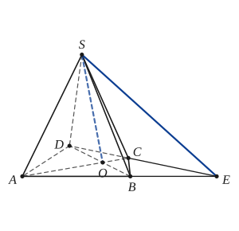
*Hình: Hình chóp S.ABCD, AB cắt CD tại E, AC cắt BD tại O.*

- $S$ là điểm chung của $(SAC)$, $(SBD)$. $O \in AC \subset (SAC)$ và $O \in BD \subset (SBD)$. Vậy $(SAC) \cap (SBD) = SO$.
- Tương tự, $E \in AB \subset (SAB)$, $E \in CD \subset (SCD)$: $(SAB) \cap (SCD) = SE$.

### Bài 2
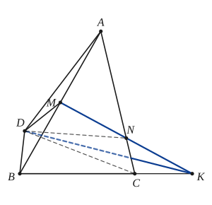
*Hình: Tứ diện ABCD, MN cắt BC tại K.*

$MN$ và $BC$ cùng nằm trong $(ABC)$. Vì $\dfrac{AM}{AB} = \dfrac{1}{2} \ne \dfrac{2}{3} = \dfrac{AN}{AC}$ nên $MN$ không song song với $BC$; chúng cắt nhau tại $K$. $K \in BC \subset (BCD)$ nên $K = MN \cap (BCD)$.
$D$ và $K$ là hai điểm chung của $(DMN)$ và $(BCD)$: giao tuyến là $DK$.

### Bài 3
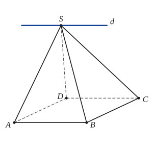
*Hình: Giao tuyến d của (SAB) và (SCD) đi qua S, song song với AB.*

$S$ là điểm chung. $AB \parallel CD$, $AB \subset (SAB)$, $CD \subset (SCD)$, nên giao tuyến là đường thẳng $d$ qua $S$ song song với $AB$ (và $CD$).

### Bài 4
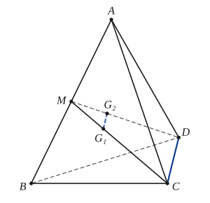
*Hình: Tứ diện ABCD, G1 và G2 là trọng tâm các tam giác ABC, ABD.*

Gọi $M$ là trung điểm $AB$. $G_1 \in MC$ với $\dfrac{MG_1}{MC} = \dfrac{1}{3}$, $G_2 \in MD$ với $\dfrac{MG_2}{MD} = \dfrac{1}{3}$. Theo định lý Thalès đảo trong tam giác $MCD$: $G_1G_2 \parallel CD$. Vì $CD \subset (BCD)$ và $G_1G_2 \not\subset (BCD)$ nên $G_1G_2 \parallel (BCD)$.

### Bài 5
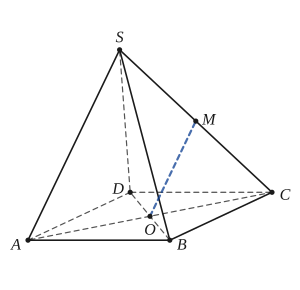
*Hình: Hình chóp S.ABCD đáy hình bình hành tâm O, M là trung điểm SC.*

$O$ là trung điểm $AC$, $M$ là trung điểm $SC$: $OM$ là đường trung bình của tam giác $SAC$, nên $OM \parallel SA$.
- $SA \subset (SAB)$, $OM \not\subset (SAB)$: $OM \parallel (SAB)$.
- $OM \subset (MBD)$ (vì $O \in BD$), $SA \not\subset (MBD)$: $SA \parallel (MBD)$.

### Bài 6
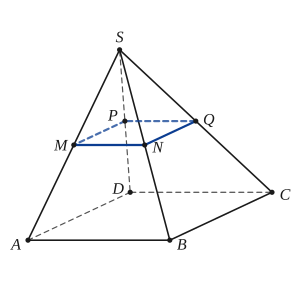
*Hình: Mặt phẳng (MNP) đi qua trung điểm các cạnh bên.*

$MN$ là đường trung bình tam giác $SAB$: $MN \parallel AB$, nên $MN \parallel (ABCD)$. Tương tự $MP \parallel AD$, $MP \parallel (ABCD)$. Mặt phẳng $(MNQP)$ chứa hai đường thẳng cắt nhau $MN$, $MP$ cùng song song với $(ABCD)$, nên $(MNQP) \parallel (ABCD)$.

### Bài 7
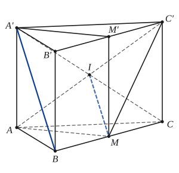
*Hình: Lăng trụ ABC.A′B′C′, I là tâm hình bình hành ACC′A′.*

$BCC'B'$ là hình bình hành, $M$, $M'$ là trung điểm hai cạnh đối nên $MM' \parallel BB'$ và $MM' = BB'$. Mà $BB' \parallel AA'$, $BB' = AA'$, nên $MM' \parallel AA'$, $MM' = AA'$: $AMM'A'$ là hình bình hành.
$I$ là trung điểm $A'C$, $M$ là trung điểm $BC$: $IM$ là đường trung bình tam giác $A'BC$, $IM \parallel A'B$. Vì $A'B \subset (ABB'A')$ nên $IM \parallel (ABB'A')$.

### Bài 8
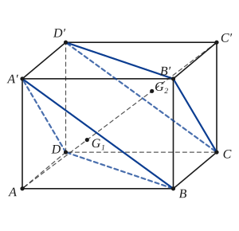
*Hình: Hình hộp ABCD.A′B′C′D′, hai mặt phẳng (BDA′) và (B′D′C).*

a) $BDD'B'$ là hình bình hành nên $BD \parallel B'D'$, do đó $BD \parallel (B'D'C)$. $A'BCD'$ là hình bình hành ($A'D' \parallel BC$, $A'D' = BC$) nên $A'B \parallel D'C$, do đó $A'B \parallel (B'D'C)$. $(BDA')$ chứa hai đường thẳng cắt nhau $BD$, $A'B$ song song với $(B'D'C)$: hai mặt phẳng song song.
b) Gọi $O$ là tâm $ABCD$. Trong mặt phẳng $(ACC'A')$, $AC'$ cắt $A'O$ tại $G_1$. Tam giác $G_1AO$ và $G_1C'A'$ có $AO \parallel A'C'$, $AO = \dfrac{1}{2}A'C'$, nên $\dfrac{G_1O}{G_1A'} = \dfrac{AG_1}{G_1C'} = \dfrac{1}{2}$. $A'O$ là trung tuyến của tam giác $A'BD$ và $A'G_1 = \dfrac{2}{3}A'O$: $G_1$ là trọng tâm tam giác $A'BD$, $AG_1 = \dfrac{1}{3}AC'$. Tương tự $G_2$ là trọng tâm tam giác $B'D'C$ và $C'G_2 = \dfrac{1}{3}AC'$. Vậy $AG_1 = G_1G_2 = G_2C'$.

### Bài 9
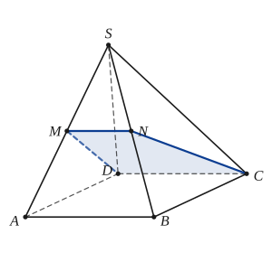
*Hình: Thiết diện MNCD của hình chóp cắt bởi mặt phẳng (MCD).*

$CD \parallel AB$ nên $(MCD)$ cắt $(SAB)$ theo giao tuyến qua $M$ song song với $AB$; giao tuyến cắt $SB$ tại $N$, với $N$ là trung điểm $SB$. Thiết diện là tứ giác $MNCD$ có $MN \parallel CD$: **hình thang**.

### Bài 10
Phép chiếu song song biến trung điểm thành trung điểm, nên biến trung tuyến thành trung tuyến; hình chiếu của $G$ (giao ba trung tuyến) là trọng tâm của tam giác hình chiếu. Phép chiếu song song không giữ độ dài, nên hình chiếu của tam giác đều có thể là một tam giác bất kỳ (không nhất thiết đều).

### Bài 11
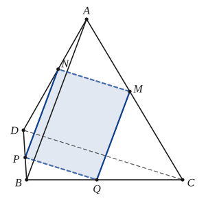
*Hình: Thiết diện MNPQ song song với AB và CD.*

$(\alpha) \parallel CD$, $(\alpha) \cap (ACD)$ là đường qua $M$ song song $CD$, cắt $AD$ tại $N$. $(\alpha) \parallel AB$: trong $(ABD)$ kẻ $NP \parallel AB$ ($P \in BD$); trong $(BCD)$ kẻ $PQ \parallel CD$ ($Q \in BC$); trong $(ABC)$, $QM \parallel AB$. Thiết diện $MNPQ$ có $MN \parallel PQ$ (cùng song song $CD$) và $NP \parallel QM$ (cùng song song $AB$): hình bình hành.

### Bài 12
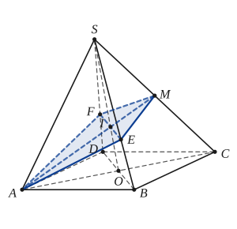
*Hình: Thiết diện AEMF đi qua AM và song song với BD.*

Trong $(SAC)$, $AM$ cắt $SO$ tại $I$. $AM$, $SO$ là hai trung tuyến của tam giác $SAC$, nên $I$ là trọng tâm: $\dfrac{SI}{SO} = \dfrac{2}{3}$.
$(\alpha) \parallel BD$ nên $(\alpha) \cap (SBD)$ là đường qua $I$ song song với $BD$, cắt $SB$, $SD$ tại $E$, $F$. Theo Thalès: $\dfrac{SE}{SB} = \dfrac{SF}{SD} = \dfrac{SI}{SO} = \dfrac{2}{3}$.
Thiết diện là tứ giác $AEMF$ (có hai đường chéo $AM$ và $EF$ cắt nhau tại $I$).
