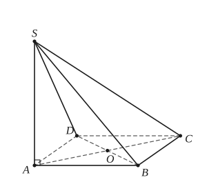
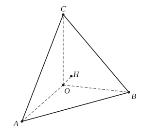
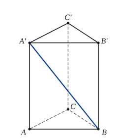
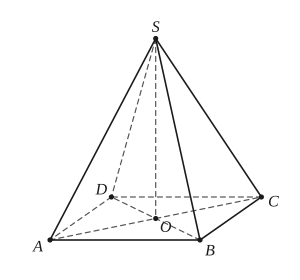
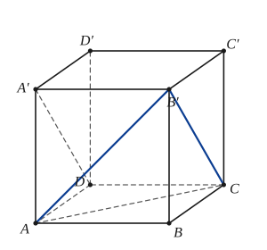

# Chủ đề 8. Quan hệ vuông góc trong không gian

> Chủ đề này gồm hai đường thẳng vuông góc, đường thẳng vuông góc với mặt phẳng, hai mặt phẳng vuông góc, các loại góc (giữa đường thẳng và mặt phẳng, giữa hai mặt phẳng), các loại khoảng cách và thể tích khối chóp, khối lăng trụ — nội dung trọng tâm của hình học không gian trong đề thi tốt nghiệp.

## I. Kiến thức cần nắm

### 1. Đường thẳng vuông góc với mặt phẳng

- $d \perp (P)$ khi $d$ vuông góc với **hai đường thẳng cắt nhau** trong $(P)$; khi đó $d$ vuông góc với mọi đường thẳng trong $(P)$.
- **Định lý ba đường vuông góc:** $a \subset (P)$, $b$ có hình chiếu $b'$ trên $(P)$. Khi đó $a \perp b \iff a \perp b'$.

### 2. Hai mặt phẳng vuông góc

- $(P) \perp (Q)$ khi $(P)$ chứa một đường thẳng vuông góc với $(Q)$.
- Hai mặt phẳng vuông góc, đường thẳng nằm trong mặt này vuông góc với giao tuyến thì vuông góc với mặt kia.

### 3. Góc

- Góc giữa $d$ và $(P)$: góc giữa $d$ và hình chiếu của nó trên $(P)$. Với $SA \perp (ABC)$: góc giữa $SB$ và đáy là $\widehat{SBA}$.
- Góc giữa hai mặt phẳng cắt nhau theo giao tuyến $\Delta$: lấy hai đường thẳng lần lượt nằm trong hai mặt phẳng, cùng vuông góc với $\Delta$ tại một điểm.
- Góc giữa hai đường thẳng chéo nhau: góc giữa hai đường thẳng cắt nhau lần lượt song song với chúng.

### 4. Khoảng cách

- Từ điểm đến mặt phẳng: độ dài đoạn vuông góc. Với $SA \perp$ đáy, khoảng cách từ $A$ đến $(SBC)$ (khi $BC \perp AB$) là đường cao $AH$ của tam giác vuông $SAB$: $\dfrac{1}{AH^2} = \dfrac{1}{SA^2} + \dfrac{1}{AB^2}$.
- Giữa đường thẳng và mặt phẳng song song, giữa hai mặt phẳng song song: quy về khoảng cách từ một điểm.
- Giữa hai đường thẳng chéo nhau: độ dài đoạn vuông góc chung, hoặc khoảng cách từ đường này đến mặt phẳng chứa đường kia và song song với nó.

### 5. Thể tích

- Khối chóp: $V = \dfrac{1}{3}S_{\text{đáy}} \cdot h$. Khối lăng trụ: $V = S_{\text{đáy}} \cdot h$.
- Hình chóp đều: đáy là đa giác đều, chân đường cao là tâm đáy.

### 6. Sai lầm hay gặp

- Lấy góc giữa cạnh bên và đáy mà không đi qua hình chiếu.
- Góc giữa hai mặt phẳng lấy hai đường không cùng vuông góc với giao tuyến.
- Quên hệ số $\dfrac{1}{3}$ trong thể tích khối chóp.

## II. Bài tập vận dụng

Các bài 1, 3, 4, 5, 6, 7 dùng chung hình chóp $S.ABCD$ có đáy là hình vuông cạnh $a$, tâm $O$, $SA \perp (ABCD)$.

**Bài 1.** Chứng minh $BC \perp (SAB)$ và $BD \perp (SAC)$.

**Bài 2.** Cho tứ diện $OABC$ có $OA$, $OB$, $OC$ đôi một vuông góc, $H$ là hình chiếu của $O$ lên $(ABC)$. a) Chứng minh $OA \perp BC$ và $H$ là trực tâm tam giác $ABC$. b) Chứng minh $\dfrac{1}{OH^2} = \dfrac{1}{OA^2} + \dfrac{1}{OB^2} + \dfrac{1}{OC^2}$; tính $OH$ khi $OA = OB = OC = a$.

**Bài 3.** Biết $SA = a\sqrt{2}$. Tính góc giữa $SC$ và mặt phẳng $(ABCD)$.

**Bài 4.** Biết $SA = a$. Tính góc giữa mặt phẳng $(SBD)$ và $(ABCD)$ (làm tròn đến hàng phần trăm của độ).

**Bài 5.** Biết $SA = a$. Tính khoảng cách từ $A$ đến mặt phẳng $(SBC)$.

**Bài 6.** Biết $SA = a$. Tính khoảng cách giữa hai đường thẳng $AB$ và $SC$.

**Bài 7.** Biết $SA = a\sqrt{3}$. Tính thể tích khối chóp $S.ABCD$.

**Bài 8.** Cho lăng trụ đứng $ABC.A'B'C'$ có đáy là tam giác đều cạnh $a$, $AA' = 2a$. Tính thể tích khối lăng trụ và góc giữa $A'B$ với mặt phẳng đáy.

**Bài 9.** Cho hình chóp tứ giác đều $S.ABCD$ có cạnh đáy $a$, cạnh bên $a\sqrt{2}$. Tính chiều cao, thể tích và góc giữa cạnh bên với mặt đáy.

**Bài 10.** Cho hình lập phương $ABCD.A'B'C'D'$ cạnh $a$. Tính góc giữa hai đường thẳng $AC$ và $A'D$; tính khoảng cách giữa hai đường thẳng $BB'$ và $AC$.

**Bài 11 (thực tế).** Kim tự tháp Kheops có dạng hình chóp tứ giác đều với cạnh đáy khoảng 230 m và chiều cao khoảng 147 m. Tính thể tích và góc giữa mặt bên với mặt đáy (làm tròn đến hàng phần trăm của độ).

**Bài 12 (vận dụng cao).** Tính thể tích khối tứ diện đều cạnh $a$ và khoảng cách giữa hai cạnh đối diện.

**Bài 13 (vận dụng cao).** Cho hình chóp $S.ABC$ có $SA \perp (ABC)$, tam giác $ABC$ vuông tại $B$, $SA = AB = a$, $BC = a\sqrt{3}$. Tính góc giữa hai mặt phẳng $(SBC)$ và $(ABC)$, khoảng cách từ $A$ đến $(SBC)$ và thể tích khối chóp.

---

## III. Lời giải chi tiết

### Bài 1

*Hình: Hình chóp S.ABCD đáy hình vuông, SA vuông góc với đáy.*

$BC \perp AB$ (hình vuông) và $BC \perp SA$ (vì $SA \perp$ đáy); $AB$, $SA$ cắt nhau trong $(SAB)$: $BC \perp (SAB)$.
$BD \perp AC$ (hai đường chéo hình vuông) và $BD \perp SA$: $BD \perp (SAC)$.

### Bài 2

*Hình: Tứ diện OABC có OA, OB, OC đôi một vuông góc, H là hình chiếu của O lên (ABC).*

a) $OA \perp OB$, $OA \perp OC$ nên $OA \perp (OBC)$, suy ra $OA \perp BC$. Mặt khác $OH \perp BC$, nên $BC \perp (OAH)$, $BC \perp AH$. Tương tự $CA \perp BH$: $H$ là trực tâm.
b) Gọi $K = AH \cap BC$. $OK$ là đường cao tam giác vuông $OBC$: $\dfrac{1}{OK^2} = \dfrac{1}{OB^2} + \dfrac{1}{OC^2}$. $OH$ là đường cao tam giác vuông $OAK$ (vuông tại $O$ vì $OA \perp (OBC)$): $\dfrac{1}{OH^2} = \dfrac{1}{OA^2} + \dfrac{1}{OK^2}$. Cộng lại được điều phải chứng minh. Khi $OA = OB = OC = a$: $OH = \dfrac{a}{\sqrt{3}} = \dfrac{a\sqrt{3}}{3}$.

### Bài 3
Hình chiếu của $SC$ lên đáy là $AC = a\sqrt{2}$. $\tan\widehat{SCA} = \dfrac{SA}{AC} = 1$: góc bằng $45^\circ$.

### Bài 4
Giao tuyến là $BD$. $AO \perp BD$ và $SO \perp BD$ (vì $BD \perp (SAC)$). Góc cần tìm là $\widehat{SOA}$: $\tan\widehat{SOA} = \dfrac{SA}{AO} = \dfrac{a}{\frac{a\sqrt{2}}{2}} = \sqrt{2}$, góc $\approx 54{,}74^\circ$.

### Bài 5
$BC \perp (SAB)$ nên $(SBC) \perp (SAB)$. Kẻ $AH \perp SB$ thì $AH \perp (SBC)$. $\dfrac{1}{AH^2} = \dfrac{1}{a^2} + \dfrac{1}{a^2}$, $AH = \dfrac{a\sqrt{2}}{2}$.

### Bài 6
$AB \parallel CD$ nên $AB \parallel (SCD)$; $d(AB, SC) = d(A, (SCD))$. Tương tự bài 5 ($CD \perp (SAD)$): kẻ $AK \perp SD$, $AK = \dfrac{a\sqrt{2}}{2}$.

### Bài 7
$V = \dfrac{1}{3} \cdot a^2 \cdot a\sqrt{3} = \dfrac{a^3\sqrt{3}}{3}$.

### Bài 8

*Hình: Lăng trụ đứng ABC.A′B′C′ có đáy là tam giác đều.*

$V = \dfrac{a^2\sqrt{3}}{4} \cdot 2a = \dfrac{a^3\sqrt{3}}{2}$. Hình chiếu của $A'B$ lên đáy là $AB$: $\tan\widehat{A'BA} = \dfrac{2a}{a} = 2$, góc $\approx 63{,}43^\circ$.

### Bài 9

*Hình: Hình chóp tứ giác đều S.ABCD có tâm đáy O.*

$OA = \dfrac{a\sqrt{2}}{2}$, $SO = \sqrt{2a^2 - \dfrac{a^2}{2}} = \dfrac{a\sqrt{6}}{2}$. $V = \dfrac{1}{3}a^2 \cdot \dfrac{a\sqrt{6}}{2} = \dfrac{a^3\sqrt{6}}{6}$. $\cos\widehat{SAO} = \dfrac{OA}{SA} = \dfrac{1}{2}$: góc $60^\circ$.

### Bài 10

*Hình: Hình lập phương ABCD.A′B′C′D′.*

$A'D \parallel B'C$ ($A'B'CD$ là hình bình hành), nên góc giữa $AC$ và $A'D$ bằng góc giữa $AC$ và $B'C$. Tam giác $AB'C$ có ba cạnh là đường chéo các mặt, bằng $a\sqrt{2}$: tam giác đều, góc $60^\circ$.
$BB' \perp (ABCD)$; kẻ $BI \perp AC$ ($I$ là tâm đáy) thì $BI \perp BB'$ và $BI \perp AC$: $BI$ là đoạn vuông góc chung, $d = BI = \dfrac{a\sqrt{2}}{2}$.

### Bài 11
$V = \dfrac{1}{3} \cdot 230^2 \cdot 147 = 2\,592\,100$ (m³). Gọi $M$ là trung điểm một cạnh đáy, $OM = 115$: $\tan\varphi = \dfrac{147}{115}$, $\varphi \approx 51{,}96^\circ$.

### Bài 12
Chân đường cao là trọng tâm $G$ của mặt đáy, $AG = \dfrac{a\sqrt{3}}{3}$, chiều cao $h = \sqrt{a^2 - \dfrac{a^2}{3}} = \dfrac{a\sqrt{6}}{3}$. $V = \dfrac{1}{3} \cdot \dfrac{a^2\sqrt{3}}{4} \cdot \dfrac{a\sqrt{6}}{3} = \dfrac{a^3\sqrt{2}}{12}$.
Với tứ diện $ABCD$, gọi $M$, $N$ là trung điểm $AB$, $CD$: $MN$ là đoạn vuông góc chung (do tính đối xứng, $MC = MD$ nên $MN \perp CD$; tương tự $MN \perp AB$). $MN^2 = MC^2 - NC^2 = \dfrac{3a^2}{4} - \dfrac{a^2}{4} = \dfrac{a^2}{2}$, $MN = \dfrac{a\sqrt{2}}{2}$.

### Bài 13
$BC \perp AB$, $BC \perp SA$ nên $BC \perp SB$. Góc giữa hai mặt phẳng là $\widehat{SBA}$, $\tan = \dfrac{SA}{AB} = 1$: $45^\circ$.
Kẻ $AH \perp SB$: $AH \perp (SBC)$, $AH = \dfrac{a\sqrt{2}}{2}$.
$V = \dfrac{1}{3} \cdot \dfrac{1}{2} \cdot a \cdot a\sqrt{3} \cdot a = \dfrac{a^3\sqrt{3}}{6}$.
