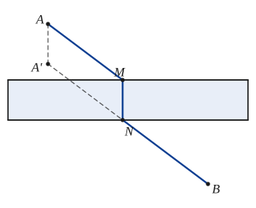
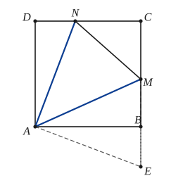
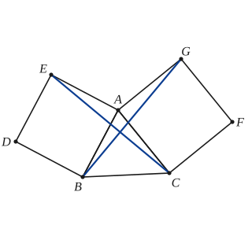

# Chủ đề 9. Hình học phẳng nâng cao: phép biến hình

> Phép biến hình (tịnh tiến, đối xứng, quay, vị tự) là công cụ mạnh trong đề học sinh giỏi lớp 11: biến một hình phức tạp thành hình quen thuộc, chuyển các đoạn thẳng rời nhau về chung một tam giác, tìm quỹ tích và giải các bài toán dựng hình, cực trị.

## I. Kiến thức cần nắm

### 1. Phép dời hình

- **Tịnh tiến** theo $\vec v$: $M \mapsto M'$ với $\overrightarrow{MM'} = \vec v$.
- **Đối xứng trục** $d$, **đối xứng tâm** $O$.
- **Quay** tâm $O$ góc $\alpha$: $OM' = OM$, $(OM; OM') = \alpha$. Phép quay biến đường thẳng thành đường thẳng hợp với nó góc $\alpha$ (với $0 < \alpha \le 90^\circ$).
- Phép dời hình bảo toàn khoảng cách, góc; biến đường tròn thành đường tròn cùng bán kính.

### 2. Phép vị tự

Vị tự tâm $I$ tỉ số $k \ne 0$: $\overrightarrow{IM'} = k\overrightarrow{IM}$. Biến đường thẳng thành đường thẳng song song (hoặc trùng), độ dài nhân $\lvert k\rvert$, đường tròn bán kính $R$ thành đường tròn bán kính $\lvert k\rvert R$.

### 3. Ứng dụng điển hình

- **Quỹ tích:** điểm $M'$ là ảnh của điểm $M$ chạy trên hình $\mathcal{H}$ qua một phép biến hình cố định thì $M'$ chạy trên ảnh của $\mathcal{H}$.
- **Cực trị:** đối xứng, tịnh tiến để "duỗi thẳng" đường gấp khúc.
- **Chứng minh:** phép quay $60^\circ$ với tam giác đều, $90^\circ$ với hình vuông.
- **Dựng hình:** dựng hình đồng dạng trước, rồi vị tự để có kích thước đúng.

### 4. Một số kết quả

- Vị tự tâm $G$ tỉ số $-\dfrac{1}{2}$ biến tam giác $ABC$ thành tam giác trung điểm, biến trực tâm $H$ thành tâm ngoại tiếp $O$ (đường thẳng Euler).
- Đường tròn Apollonius: tập hợp $M$ với $\dfrac{MA}{MB} = k \ne 1$ là một đường tròn.

## II. Bài tập vận dụng

**Bài 1 (tịnh tiến).** Hai điểm $A$, $B$ ở hai bên bờ một con sông có hai bờ song song. Cần xây cây cầu $MN$ vuông góc với hai bờ ($M$ ở bờ phía $A$) sao cho đường đi $AMNB$ ngắn nhất. Xác định vị trí cầu.

**Bài 2 (quay).** Điểm $M$ nằm trong tam giác đều $ABC$ với $MA = 3$, $MB = 4$, $MC = 5$. Tính $\widehat{AMB}$ và cạnh tam giác.

**Bài 3 (quay).** Cho hình vuông $ABCD$, $M$ thuộc cạnh $BC$, $N$ thuộc cạnh $CD$ sao cho $\widehat{MAN} = 45^\circ$. Chứng minh $MN = BM + DN$.

**Bài 4 (vị tự).** Chứng minh trọng tâm $G$, trực tâm $H$, tâm ngoại tiếp $O$ của tam giác thẳng hàng và $GH = 2GO$ bằng phép vị tự.

**Bài 5 (quỹ tích).** Cho hai điểm $B$, $C$ cố định và điểm $A$ chạy trên đường tròn $(O; R)$ (không thẳng hàng với $B$, $C$). Tìm quỹ tích trọng tâm $G$ của tam giác $ABC$.

**Bài 6 (quay $90^\circ$).** Về phía ngoài tam giác $ABC$ dựng các hình vuông $ABDE$ và $ACFG$. Chứng minh $BG = CE$ và $BG \perp CE$.

**Bài 7 (đối xứng).** Cho góc nhọn $xOy$ và điểm $A$ nằm trong góc. Tìm $B \in Ox$, $C \in Oy$ để tam giác $ABC$ có chu vi nhỏ nhất.

**Bài 8 (vị tự, dựng hình).** Tam giác $ABC$ có $BC = a$, đường cao $AH = h$. Dựng hình vuông $MNPQ$ có $M$, $N$ trên $BC$, $P$ trên $AC$, $Q$ trên $AB$; tính cạnh hình vuông.

**Bài 9.** Một đường tròn qua $B$, $C$ cắt các cạnh $AB$, $AC$ của tam giác $ABC$ tại $D$, $E$. Chứng minh $AD \cdot AB = AE \cdot AC$ và $\widehat{ADE} = \widehat{ACB}$.

**Bài 10 (Apollonius).** Cho $A(0; 0)$, $B(3; 0)$. Tìm tập hợp các điểm $M$ thỏa mãn $MA = 2MB$.

**Bài 11 (quay $60^\circ$).** Cho hai tam giác đều $ABC$ và $ADE$ có chung đỉnh $A$, cùng hướng. Chứng minh $BD = CE$ và góc giữa hai đường thẳng $BD$, $CE$ bằng $60^\circ$.

**Bài 12 (HSG).** Cho đường tròn $(O)$ và dây $AB$ cố định. Điểm $M$ chạy trên $(O)$ (khác $A$, $B$). Tìm quỹ tích trực tâm $H$ của tam giác $MAB$.

---

## III. Lời giải chi tiết

### Bài 1

*Hình: Hai điểm A, B ở hai bên bờ sông, cầu MN vuông góc với hai bờ, A′ là ảnh của A qua phép tịnh tiến theo vectơ MN.*

$\overrightarrow{MN} = \vec v$ không đổi (vuông góc với bờ, độ dài bằng bề rộng sông). Gọi $A'$ là ảnh của $A$ qua phép tịnh tiến theo $\vec v$: $AMNA'$ là hình bình hành, $AM = A'N$. Khi đó $AM + MN + NB = A'N + NB + MN \ge A'B + MN$, dấu bằng khi $N = A'B \cap$ bờ phía $B$. Cầu đặt tại $N$ đó.

### Bài 2
Quay tâm $B$ góc $60^\circ$ biến $A \mapsto C$, $M \mapsto M'$. Tam giác $BMM'$ đều: $MM' = 4$, $\widehat{BM'M} = 60^\circ$; $CM' = AM = 3$. Tam giác $MM'C$ có $3^2 + 4^2 = 5^2$ nên vuông tại $M'$. Vậy $\widehat{AMB} = \widehat{CM'B} = 60^\circ + 90^\circ = 150^\circ$.
$AB^2 = 9 + 16 - 2 \cdot 3 \cdot 4\cos 150^\circ = 25 + 12\sqrt{3}$, $AB = \sqrt{25 + 12\sqrt{3}} \approx 6{,}77$.

### Bài 3

*Hình: Hình vuông ABCD, M trên BC, N trên CD với góc MAN bằng 45 độ, E là ảnh của N qua phép quay tâm A góc 90 độ.*

Quay tâm $A$ góc $90^\circ$ biến $D \mapsto B$, $N \mapsto E$ ($E$ trên tia đối của tia $BC$, $BE = DN$, $AE = AN$). $\widehat{MAE} = \widehat{MAB} + \widehat{BAE} = \widehat{MAB} + \widehat{DAN} = 90^\circ - 45^\circ = 45^\circ = \widehat{MAN}$. $\triangle MAE = \triangle MAN$ (c.g.c) nên $MN = ME = MB + BE = BM + DN$.

### Bài 4
Gọi $A'$, $B'$, $C'$ là trung điểm $BC$, $CA$, $AB$. Vị tự $V$ tâm $G$ tỉ số $-\dfrac{1}{2}$ biến $A \mapsto A'$, $B \mapsto B'$, $C \mapsto C'$. Đường cao từ $A$ (qua $A$, vuông góc $BC$) biến thành đường qua $A'$ vuông góc $B'C' \parallel BC$, tức đường trung trực của $BC$. Vậy $V$ biến trực tâm $H$ thành giao các trung trực, tức $O$: $\overrightarrow{GO} = -\dfrac{1}{2}\overrightarrow{GH}$. $G$, $H$, $O$ thẳng hàng và $GH = 2GO$.

### Bài 5
Gọi $M$ là trung điểm $BC$ (cố định): $\overrightarrow{MG} = \dfrac{1}{3}\overrightarrow{MA}$. $G$ là ảnh của $A$ qua vị tự tâm $M$ tỉ số $\dfrac{1}{3}$, nên chạy trên đường tròn tâm $O'$ ($\overrightarrow{MO'} = \dfrac{1}{3}\overrightarrow{MO}$), bán kính $\dfrac{R}{3}$, bỏ đi các điểm ứng với $A$ thẳng hàng với $B$, $C$.

### Bài 6

*Hình: Tam giác ABC và hai hình vuông ABDE, ACFG dựng ra phía ngoài.*

Phép quay tâm $A$ góc $90^\circ$ (theo chiều thích hợp) biến $E \mapsto B$ và $C \mapsto G$ (vì $AE = AB$, $AC = AG$ và các góc $\widehat{EAB} = \widehat{CAG} = 90^\circ$ cùng chiều). Do đó nó biến đoạn $EC$ thành đoạn $BG$: $BG = CE$ và góc giữa hai đường thẳng bằng góc quay $90^\circ$.

### Bài 7
Gọi $A_1$, $A_2$ là các điểm đối xứng của $A$ qua $Ox$, $Oy$. Với $B \in Ox$, $C \in Oy$: $AB + BC + CA = A_1B + BC + CA_2 \ge A_1A_2$. Vì góc $xOy$ nhọn ($\widehat{A_1OA_2} = 2\widehat{xOy} < 180^\circ$), đoạn $A_1A_2$ cắt $Ox$, $Oy$; chọn $B$, $C$ là các giao điểm đó thì chu vi nhỏ nhất bằng $A_1A_2$.

### Bài 8
Dựng hình vuông $M_1N_1P_1Q_1$ bất kỳ có $M_1$, $N_1$ trên $BC$, $Q_1$ trên $AB$. Tia $BP_1$ cắt $AC$ tại $P$; vị tự tâm $B$ tỉ số $\dfrac{BP}{BP_1}$ biến hình vuông đó thành hình vuông cần dựng.
Tính cạnh $x$: $PQ \parallel BC$, tam giác $AQP$ đồng dạng $ABC$ với tỉ số đường cao $\dfrac{h - x}{h}$: $\dfrac{x}{a} = \dfrac{h - x}{h}$, $x = \dfrac{ah}{a + h}$.

### Bài 9
Phương tích của $A$ với đường tròn: $AD \cdot AB = AE \cdot AC$. Suy ra $\dfrac{AD}{AC} = \dfrac{AE}{AB}$, $\triangle ADE \backsim \triangle ACB$ (c.g.c, góc $A$ chung): $\widehat{ADE} = \widehat{ACB}$. (Cũng có thể dùng tứ giác nội tiếp $BCED$: góc ngoài $\widehat{ADE}$ bằng góc trong $\widehat{ECB}$.)

### Bài 10
$MA^2 = 4MB^2 \iff x^2 + y^2 = 4(x - 3)^2 + 4y^2 \iff x^2 + y^2 - 8x + 12 = 0 \iff (x - 4)^2 + y^2 = 4$. Tập hợp là đường tròn tâm $(4; 0)$ bán kính 2.

### Bài 11
Phép quay tâm $A$ góc $60^\circ$ (cùng hướng hai tam giác) biến $B \mapsto C$, $D \mapsto E$, nên biến đoạn $BD$ thành $CE$: $BD = CE$ và góc giữa hai đường thẳng bằng $60^\circ$.

### Bài 12
Đặt gốc vectơ tại $O$. Với tam giác $MAB$ nội tiếp $(O)$: $\overrightarrow{OH} = \overrightarrow{OM} + \overrightarrow{OA} + \overrightarrow{OB}$ (hệ thức Euler), nên $\overrightarrow{MH} = \overrightarrow{OA} + \overrightarrow{OB} = \vec v$ không đổi. $H$ là ảnh của $M$ qua phép tịnh tiến theo $\vec v$: quỹ tích là đường tròn $(O')$ ảnh của $(O)$ ($\overrightarrow{OO'} = \vec v$, cùng bán kính), bỏ đi hai điểm ứng với $M \equiv A$, $M \equiv B$.
