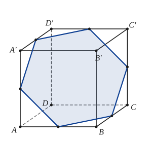
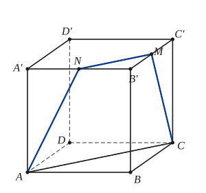

# Chủ đề 10. Hình học không gian nâng cao

> Câu hình không gian trong đề học sinh giỏi lớp 11 thường hỏi thiết diện và diện tích thiết diện, góc và khoảng cách trong các khối quen thuộc (hình lập phương, tứ diện đều, tứ diện vuông), và bài toán cực trị thể tích. Kỹ năng then chốt là chọn mặt phẳng phụ hợp lý và quy bài toán không gian về tính toán phẳng.

## I. Kiến thức cần nắm

### 1. Thiết diện

Tìm giao tuyến của mặt phẳng cắt với từng mặt của khối; khi mặt phẳng song song với một đường thẳng thì các giao tuyến song song với đường đó. Thiết diện của hình lập phương có thể là tam giác, tứ giác, ngũ giác hoặc lục giác.

### 2. Góc

- Giữa hai đường thẳng chéo nhau: dời về chung một điểm.
- Giữa đường thẳng và mặt phẳng: góc với hình chiếu.
- Giữa hai mặt phẳng: dùng hai đường cùng vuông góc với giao tuyến, hoặc công thức diện tích hình chiếu $S' = S\cos\varphi$.

### 3. Khoảng cách

- Từ điểm đến mặt phẳng: dựng hình chiếu, hoặc dùng thể tích $d = \dfrac{3V}{S}$.
- Giữa hai đường chéo nhau: đoạn vuông góc chung, hoặc khoảng cách đến mặt phẳng song song.
- Trong hình lập phương cạnh $a$: đường chéo khối $a\sqrt{3}$ vuông góc với hai mặt $(A'BD)$, $(CB'D')$ và bị chúng chia thành ba đoạn bằng nhau.

### 4. Khối đặc biệt

- Tứ diện vuông $OABC$: $V = \dfrac{OA \cdot OB \cdot OC}{6}$, $\dfrac{1}{d^2} = \dfrac{1}{OA^2} + \dfrac{1}{OB^2} + \dfrac{1}{OC^2}$.
- Tứ diện gần đều (ba cặp cạnh đối bằng nhau) nội tiếp được trong một hình hộp chữ nhật: $V = \dfrac{1}{3}V_{\text{hộp}}$.

### 5. Cực trị

Biểu diễn đại lượng cần tìm theo một biến rồi dùng AM-GM hoặc khảo sát (đạo hàm).

## II. Bài tập vận dụng

**Bài 1.** Cho hình lập phương cạnh $a$. Mặt phẳng đi qua trung điểm các cạnh $AB$, $BC$, $CC'$ cắt hình lập phương theo thiết diện gì? Tính diện tích thiết diện.

**Bài 2.** Cho tứ diện đều $ABCD$ cạnh $a$. Mặt phẳng qua trung điểm $M$ của $AC$, song song với $AB$ và $CD$ cắt tứ diện theo thiết diện gì? Tính diện tích.

**Bài 3.** Chứng minh hai cạnh đối của tứ diện đều vuông góc với nhau.

**Bài 4.** Cho hình lập phương $ABCD.A'B'C'D'$ cạnh $a$. Tính khoảng cách từ $A$ đến đường thẳng $BD'$.

**Bài 5.** Với hình lập phương ở bài 4, tính khoảng cách giữa hai đường thẳng chéo nhau $AB'$ và $BC'$.

**Bài 6.** Với hình lập phương ở bài 4, tính góc giữa hai mặt phẳng $(A'BD)$ và $(C'BD)$ (làm tròn đến hàng phần trăm của độ).

**Bài 7.** Tứ diện $OABC$ có $OA$, $OB$, $OC$ đôi một vuông góc và bằng $a$. Tính thể tích, diện tích tam giác $ABC$ và khoảng cách từ $O$ đến $(ABC)$.

**Bài 8 (cực trị).** Trong các hình chóp tứ giác đều có cạnh bên bằng 1, tìm hình chóp có thể tích lớn nhất.

**Bài 9.** Cho hình lập phương cạnh $a$, $M$, $N$ là trung điểm $B'C'$, $A'B'$. Tìm thiết diện của hình lập phương cắt bởi mặt phẳng $(ACM)$ và tính diện tích.

**Bài 10.** Tính góc giữa cạnh bên và mặt đáy của tứ diện đều (làm tròn đến hàng phần trăm của độ).

**Bài 11.** Với hình lập phương ở bài 4, chứng minh $(AB'D') \parallel (C'BD)$ và tính khoảng cách giữa hai mặt phẳng đó.

**Bài 12 (HSG).** Tứ diện $ABCD$ có $AB = CD = AC = BD = \sqrt{5}$, $AD = BC = 2\sqrt{2}$. Tính thể tích tứ diện.

---

## III. Lời giải chi tiết

### Bài 1

*Hình: Thiết diện lục giác đều của hình lập phương qua trung điểm sáu cạnh.*

Mặt phẳng qua trung điểm của $AB$, $BC$ song song với $AC$ và qua trung điểm $CC'$; kéo dài các giao tuyến (song song với các đường chéo mặt), mặt phẳng đi qua trung điểm sáu cạnh $AB$, $BC$, $CC'$, $C'D'$, $D'A'$, $A'A$. Mỗi cạnh của thiết diện là đường trung bình của một tam giác vuông cân cạnh $a$, dài $\dfrac{a\sqrt{2}}{2}$; mặt phẳng vuông góc với đường chéo $DB'$ và đi qua tâm, nên thiết diện là **lục giác đều** cạnh $\dfrac{a\sqrt{2}}{2}$.
$S = \dfrac{3\sqrt{3}}{2}\left(\dfrac{a\sqrt{2}}{2}\right)^2 = \dfrac{3\sqrt{3}a^2}{4}$.

### Bài 2
Thiết diện $MNPQ$ có các cạnh song song với $AB$ hoặc $CD$, độ dài $\dfrac{a}{2}$ (đường trung bình): hình thoi cạnh $\dfrac{a}{2}$. Vì $AB \perp CD$ (bài 3) nên các góc vuông: **hình vuông** cạnh $\dfrac{a}{2}$, diện tích $\dfrac{a^2}{4}$.

### Bài 3
Gọi $M$ là trung điểm $CD$. Tam giác $ACD$, $BCD$ đều nên $AM \perp CD$, $BM \perp CD$. Suy ra $CD \perp (ABM)$, nên $CD \perp AB$.

### Bài 4
$AB \perp (ADD'A')$ nên $AB \perp AD'$: tam giác $ABD'$ vuông tại $A$, $AB = a$, $AD' = a\sqrt{2}$, $BD' = a\sqrt{3}$. Khoảng cách là đường cao: $d = \dfrac{a \cdot a\sqrt{2}}{a\sqrt{3}} = \dfrac{a\sqrt{6}}{3}$.

### Bài 5
Đặt hệ trục với $A(0; 0; 0)$, $B(a; 0; 0)$, $D(0; a; 0)$, $A'(0; 0; a)$. $\overrightarrow{AB'} = (a; 0; a)$, $\overrightarrow{BC'} = (0; a; a)$. Mặt phẳng chứa $BC'$ song song với $AB'$ có pháp tuyến cùng phương với $(-1; -1; 1)$ (vuông góc với cả hai vectơ). Khoảng cách bằng khoảng cách từ $A$ đến mặt phẳng qua $B$ có pháp tuyến đó: $\dfrac{\lvert\overrightarrow{BA} \cdot (-1; -1; 1)\rvert}{\sqrt{3}} = \dfrac{a}{\sqrt{3}} = \dfrac{a\sqrt{3}}{3}$.

### Bài 6
Gọi $O$ là tâm $ABCD$: $A'O \perp BD$, $C'O \perp BD$ (các tam giác $A'BD$, $C'BD$ đều). Góc cần tìm là góc giữa $OA'$ và $OC'$ (hoặc bù). $OA' = OC' = \sqrt{a^2 + \dfrac{a^2}{2}} = \dfrac{a\sqrt{6}}{2}$, $A'C' = a\sqrt{2}$:
$\cos\widehat{A'OC'} = \dfrac{\frac{3a^2}{2} + \frac{3a^2}{2} - 2a^2}{2 \cdot \frac{3a^2}{2}} = \dfrac{1}{3}$. Góc giữa hai mặt phẳng $\approx 70{,}53^\circ$.

### Bài 7
$V = \dfrac{a^3}{6}$. Tam giác $ABC$ đều cạnh $a\sqrt{2}$: $S = \dfrac{\sqrt{3}}{4} \cdot 2a^2 = \dfrac{a^2\sqrt{3}}{2}$. $d = \dfrac{3V}{S} = \dfrac{a}{\sqrt{3}} = \dfrac{a\sqrt{3}}{3}$.

### Bài 8
Gọi $h$ là chiều cao ($0 < h < 1$); nửa đường chéo đáy $\sqrt{1 - h^2}$, diện tích đáy $2(1 - h^2)$. $V(h) = \dfrac{2}{3}(h - h^3)$, $V'(h) = \dfrac{2}{3}(1 - 3h^2) = 0 \iff h = \dfrac{1}{\sqrt{3}}$; $V$ tăng rồi giảm. $V_{\max} = \dfrac{2}{3} \cdot \dfrac{1}{\sqrt{3}} \cdot \dfrac{2}{3} = \dfrac{4\sqrt{3}}{27}$, khi $h = \dfrac{\sqrt{3}}{3}$ (cạnh đáy $\dfrac{2\sqrt{3}}{3}$).

### Bài 9

*Hình: Thiết diện ACMN của hình lập phương, M và N là trung điểm B′C′ và A′B′.*

$(ACM)$ cắt mặt trên theo đường qua $M$ song song với $AC$ (vì $AC \parallel (A'B'C'D')$), tức song song $A'C'$, cắt $A'B'$ tại trung điểm $N$. Thiết diện là hình thang cân $ACMN$ với $AC = a\sqrt{2}$, $NM = \dfrac{a\sqrt{2}}{2}$, $AN = CM = \dfrac{a\sqrt{5}}{2}$. Chiều cao $h = \sqrt{\dfrac{5a^2}{4} - \left(\dfrac{a\sqrt{2}}{4}\right)^2} = \dfrac{3a\sqrt{2}}{4}$.
$S = \dfrac{1}{2}\left(a\sqrt{2} + \dfrac{a\sqrt{2}}{2}\right) \cdot \dfrac{3a\sqrt{2}}{4} = \dfrac{9a^2}{8}$.

### Bài 10
Hình chiếu của đỉnh là trọng tâm $G$ mặt đáy, $AG = \dfrac{a\sqrt{3}}{3}$: $\cos\varphi = \dfrac{\sqrt{3}}{3}$, $\varphi \approx 54{,}74^\circ$.

### Bài 11
$AB' \parallel DC'$, $B'D' \parallel BD$ nên hai mặt phẳng song song. Đường chéo $A'C$ vuông góc với cả hai mặt phẳng và bị chia thành ba đoạn bằng nhau, nên khoảng cách bằng $\dfrac{a\sqrt{3}}{3}$.

### Bài 12
Tứ diện có ba cặp cạnh đối bằng nhau nên nội tiếp được trong hình hộp chữ nhật kích thước $x, y, z$ với các cạnh tứ diện là đường chéo các mặt: $x^2 + y^2 = 5$, $x^2 + z^2 = 5$, $y^2 + z^2 = 8$. Suy ra $x = 1$, $y = z = 2$.
Thể tích tứ diện bằng thể tích hộp trừ bốn tứ diện góc, mỗi tứ diện bằng $\dfrac{xyz}{6}$: $V = xyz - 4 \cdot \dfrac{xyz}{6} = \dfrac{xyz}{3} = \dfrac{4}{3}$.
