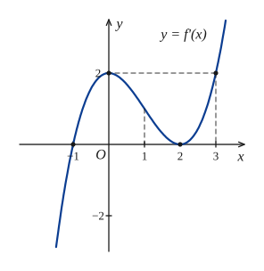
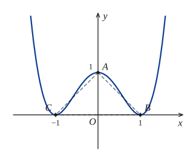

# Chủ đề 1. Tính đơn điệu và cực trị của hàm số

> Đạo hàm cho biết hàm số tăng hay giảm ở đâu và đạt cực đại, cực tiểu tại đâu. Đây là nội dung mở đầu đề thi tốt nghiệp THPT, xuất hiện ở cả câu trắc nghiệm, câu đúng/sai (đọc bảng biến thiên, đồ thị $f'$) và câu trả lời ngắn (tham số, bài toán thực tế).

## I. Kiến thức cần nắm

### 1. Hàm số đồng biến, nghịch biến
Cho hàm số $y = f(x)$ xác định trên khoảng $K$ (khoảng, đoạn hoặc nửa khoảng).
- $f$ **đồng biến** (tăng) trên $K$ nếu với mọi $x_1 < x_2$ thuộc $K$ thì $f(x_1) < f(x_2)$.
- $f$ **nghịch biến** (giảm) trên $K$ nếu với mọi $x_1 < x_2$ thuộc $K$ thì $f(x_1) > f(x_2)$.

Trên đồ thị: đồng biến thì đồ thị "đi lên" từ trái sang phải, nghịch biến thì "đi xuống".

**Định lý (điều kiện đủ).** Cho $f$ có đạo hàm trên khoảng $K$.
- Nếu $f'(x) \ge 0$ với mọi $x \in K$ và $f'(x) = 0$ chỉ tại hữu hạn điểm thì $f$ đồng biến trên $K$.
- Nếu $f'(x) \le 0$ với mọi $x \in K$ và $f'(x) = 0$ chỉ tại hữu hạn điểm thì $f$ nghịch biến trên $K$.

*Vì sao (ý trực quan):* $f'(x_0)$ là hệ số góc của tiếp tuyến tại $x_0$. Hệ số góc dương ở mọi điểm thì đồ thị luôn đi lên. Một vài điểm có tiếp tuyến nằm ngang (như $x = 0$ của $y = x^3$) không làm hàm số "quay đầu".

**Quy trình xét tính đơn điệu:**
1. Tìm tập xác định $D$.
2. Tính $f'(x)$, tìm các điểm $f'(x) = 0$ hoặc $f'(x)$ không xác định.
3. Lập bảng xét dấu $f'(x)$ (hoặc bảng biến thiên).
4. Kết luận các khoảng đồng biến, nghịch biến.

*Ví dụ mẫu.* $y = x^3 - 3x$ có $y' = 3x^2 - 3 = 3(x - 1)(x + 1)$. $y' > 0$ khi $x < -1$ hoặc $x > 1$, $y' < 0$ khi $-1 < x < 1$. Hàm số đồng biến trên $(-\infty; -1)$ và $(1; +\infty)$, nghịch biến trên $(-1; 1)$.

**Hàm phân thức bậc nhất trên bậc nhất** $y = \frac{ax + b}{cx + d}$ ($c \ne 0$, $ad - bc \ne 0$): $y' = \frac{ad - bc}{(cx + d)^2}$ luôn cùng dấu với $ad - bc$. Vậy hàm số luôn đồng biến (hoặc luôn nghịch biến) trên **từng khoảng** $\left(-\infty; -\frac dc\right)$ và $\left(-\frac dc; +\infty\right)$.

### 2. Cực trị của hàm số
Cho $f$ xác định trên khoảng $(a; b)$ chứa $x_0$.
- $x_0$ là **điểm cực đại** nếu có một khoảng $(x_0 - h; x_0 + h)$ để $f(x) < f(x_0)$ với mọi $x \ne x_0$ trong khoảng đó. Khi đó $f(x_0)$ là **giá trị cực đại**, điểm $(x_0; f(x_0))$ là **điểm cực đại của đồ thị**.
- **Điểm cực tiểu**, giá trị cực tiểu định nghĩa tương tự với $f(x) > f(x_0)$.

Cực trị là khái niệm **địa phương**: giá trị cực đại có thể nhỏ hơn giá trị cực tiểu (xem Bài 3).

**Định lý 1 (dấu hiệu đổi dấu của $f'$).** Giả sử $f$ liên tục tại $x_0$ và có đạo hàm ở hai bên $x_0$.
- $f'$ đổi dấu từ $+$ sang $-$ khi đi qua $x_0$ thì $x_0$ là điểm cực đại.
- $f'$ đổi dấu từ $-$ sang $+$ khi đi qua $x_0$ thì $x_0$ là điểm cực tiểu.
- $f'$ không đổi dấu thì $x_0$ **không** là điểm cực trị.

**Định lý 2 (dùng đạo hàm cấp hai).** Giả sử $f'(x_0) = 0$.
- $f''(x_0) < 0$ thì $x_0$ là điểm cực đại.
- $f''(x_0) > 0$ thì $x_0$ là điểm cực tiểu.
- $f''(x_0) = 0$ thì chưa kết luận được, phải quay về xét dấu $f'$.

*Ví dụ mẫu.* $y = x^4 - 2x^2$: $y' = 4x^3 - 4x = 4x(x - 1)(x + 1)$, $y'' = 12x^2 - 4$. $y''(0) = -4 < 0$ nên $x = 0$ là điểm cực đại, $y_{\text{CĐ}} = 0$. $y''(\pm1) = 8 > 0$ nên $x = \pm1$ là điểm cực tiểu, $y_{\text{CT}} = -1$.

### 3. Đọc bảng biến thiên và đồ thị của $f'$
Đề thi hay cho **bảng xét dấu $f'$**, **biểu thức $f'(x)$ dạng tích** hoặc **đồ thị của $f'$** rồi hỏi về $f$.
- Khoảng mà đồ thị $f'$ nằm **trên** trục hoành: $f$ đồng biến. Nằm **dưới** trục hoành: $f$ nghịch biến.
- Điểm mà đồ thị $f'$ **cắt** (xuyên qua) trục hoành: điểm cực trị của $f$. Điểm mà đồ thị $f'$ chỉ **tiếp xúc** trục hoành: không phải điểm cực trị.
- Với $f'(x) = (x - a)^k\cdot g(x)$, $g(a) \ne 0$: nếu $k$ **lẻ** thì $f'$ đổi dấu tại $a$; nếu $k$ **chẵn** thì không đổi dấu.

*Ví dụ mẫu.* $f'(x) = (x - 1)^2(x + 3)$: $f'$ chỉ đổi dấu tại $x = -3$ (từ $-$ sang $+$). Hàm số có đúng một điểm cực trị là điểm cực tiểu $x = -3$.

Bảng biến thiên viết như sau (ví dụ cho $y = x^3 - 3x$):

| $x$ | $-\infty$ | | $-1$ | | $1$ | | $+\infty$ |
|---|---|---|---|---|---|---|---|
| $y'$ | | $+$ | $0$ | $-$ | $0$ | $+$ | |
| $y$ | $-\infty$ | $\nearrow$ | $2$ | $\searrow$ | $-2$ | $\nearrow$ | $+\infty$ |

### 4. Bài toán chứa tham số
**Hàm bậc ba** $y = ax^3 + bx^2 + cx + d$ ($a \ne 0$), $y' = 3ax^2 + 2bx + c$, $\Delta' = b^2 - 3ac$.
- Đồng biến trên $\mathbb R$ $\iff a > 0$ và $\Delta' \le 0$. Nghịch biến trên $\mathbb R$ $\iff a < 0$ và $\Delta' \le 0$.
- Có hai điểm cực trị $\iff y' = 0$ có hai nghiệm phân biệt $\iff \Delta' > 0$. Khi đó, nếu $a > 0$ thì điểm cực đại là nghiệm **nhỏ** của $y' = 0$, điểm cực tiểu là nghiệm **lớn**.

**Hàm $y = \frac{ax + b}{cx + d}$ đơn điệu trên khoảng $(\alpha; \beta)$:** cần dấu của $ad - bc$ đúng yêu cầu **và** $-\frac dc \notin (\alpha; \beta)$.

**Hàm trùng phương** $y = ax^4 + bx^2 + c$: $y' = 2x(2ax^2 + b)$. Có ba điểm cực trị $\iff ab < 0$.

**Tìm $m$ để hàm số đạt cực trị tại $x_0$:** giải $f'(x_0) = 0$ tìm $m$, sau đó **bắt buộc thử lại** bằng dấu $f'$ hoặc $f''(x_0)$ (điều kiện $f'(x_0) = 0$ chỉ là điều kiện cần).

*Ví dụ mẫu.* $y = x^3 - 3x^2 + mx$ đồng biến trên $\mathbb R$ $\iff y' = 3x^2 - 6x + m \ge 0$ với mọi $x$ $\iff \Delta' = 9 - 3m \le 0 \iff m \ge 3$.

### 5. Ứng dụng trong thực tế
- $s(t)$ là quãng đường (tọa độ) thì $v(t) = s'(t)$ là vận tốc; vật chuyển động theo chiều dương khi $v > 0$, ngược chiều khi $v < 0$.
- Một đại lượng $Q(t)$ **tăng** khi $Q'(t) > 0$ và **giảm** khi $Q'(t) < 0$; thời điểm $Q$ đạt cực đại là nơi $Q'$ đổi dấu từ $+$ sang $-$.
- Luôn chú ý **miền xác định thực tế** (thời gian $t \ge 0$, số lượng không âm, ...).

### 6. Sai lầm hay gặp
- Kết luận "hàm số đồng biến trên $(-\infty; -1) \cup (1; +\infty)$". Phải viết "trên **từng** khoảng $(-\infty; -1)$ và $(1; +\infty)$". Ví dụ $y = -\frac1x$ đồng biến trên từng khoảng nhưng $y(-1) = 1 > y(1) = -1$.
- Cho rằng $f'(x_0) = 0$ thì $x_0$ là điểm cực trị. Phản ví dụ: $y = x^3$ tại $x_0 = 0$.
- Quên điểm $f'$ **không xác định** (như $y = \lvert x\rvert$ đạt cực tiểu tại $0$ dù không có đạo hàm tại đó).
- Nhầm "điểm cực trị" (là $x_0$), "giá trị cực trị" (là $f(x_0)$) và "điểm cực trị của đồ thị" (là $(x_0; f(x_0))$).
- Bài tham số: quên trường hợp hệ số $a = 0$ (hàm suy biến), hoặc quên thử lại sau khi giải $f'(x_0) = 0$.

---

## II. Bài tập vận dụng

**Bài 1.** Xét tính đơn điệu và tìm cực trị của hàm số $y = x^3 - 3x^2 - 9x + 1$.

**Bài 2.** Xét tính đơn điệu của các hàm số:
a) $y = \frac{2x - 1}{x + 1}$;
b) $y = x^4 - 2x^2 + 3$ (tìm thêm các điểm cực trị).

**Bài 3.** Tìm cực trị của hàm số $y = \frac{x^2 + 3}{x - 1}$. So sánh giá trị cực đại và giá trị cực tiểu.

**Bài 4 (đúng/sai).** Cho hàm số $y = f(x)$ có đạo hàm $f'(x) = x(x - 1)^2(x + 2)$ với mọi $x \in \mathbb R$. Mỗi khẳng định sau đúng hay sai? Giải thích.
a) Hàm số đồng biến trên khoảng $(0; +\infty)$.
b) Hàm số có ba điểm cực trị.
c) $x = 0$ là điểm cực tiểu của hàm số.
d) $f\left(\frac12\right) > f\left(\frac32\right)$.

**Bài 5 (đồ thị của $f'$).** Cho hàm số $y = f(x)$ có đạo hàm liên tục trên $\mathbb R$. Đồ thị của hàm số $y = f'(x)$ như hình dưới, cắt trục hoành tại $x = -1$ và tiếp xúc với trục hoành tại $x = 2$.

*Hình: Đồ thị hàm số y = f'(x).*

a) Tìm các khoảng đơn điệu của $f$.
b) Hàm số $f$ có bao nhiêu điểm cực trị? Đó là điểm cực đại hay cực tiểu?
c) So sánh $f(0)$, $f(2)$ và $f(3)$.

**Bài 6 (trả lời ngắn).** Có bao nhiêu giá trị nguyên của tham số $m$ để hàm số $y = \frac13x^3 - mx^2 + (m + 2)x - 1$ đồng biến trên $\mathbb R$?

**Bài 7 (trả lời ngắn).** Có bao nhiêu giá trị nguyên của tham số $m$ để hàm số $y = \frac{mx + 4}{x + m}$ nghịch biến trên khoảng $(0; +\infty)$?

**Bài 8.** Tìm $m$ để hàm số $y = x^3 - 3(m + 1)x^2 + 3m(m + 2)x$ đạt cực tiểu tại $x = 2$.

**Bài 9 (thực tế).** Nồng độ (mg/L) của một loại thuốc trong máu bệnh nhân sau $t$ giờ kể từ khi tiêm được mô hình hóa bởi $C(t) = \frac{5t}{t^2 + 4}$, $t \ge 0$.
a) Trong khoảng thời gian nào nồng độ thuốc tăng, trong khoảng nào nồng độ thuốc giảm?
b) Sau bao nhiêu giờ thì nồng độ thuốc cao nhất, và nồng độ cao nhất bằng bao nhiêu?

**Bài 10 (đúng/sai, thực tế).** Một vật chuyển động thẳng có tọa độ $s(t) = t^3 - 9t^2 + 24t$ (mét), với $t$ (giây) là thời gian tính từ lúc bắt đầu, $0 \le t \le 6$. Mỗi khẳng định sau đúng hay sai?
a) Vận tốc của vật tại thời điểm $t$ là $v(t) = 3t^2 - 18t + 24$ (m/s).
b) Vật chuyển động ngược chiều dương trong khoảng thời gian từ giây thứ 2 đến giây thứ 4.
c) Tọa độ $s(t)$ đạt giá trị cực đại tại $t = 4$.
d) Tổng quãng đường vật đi được trong 6 giây đầu là 44 m.

**Bài 11 (vận dụng cao).** Cho hàm số $y = f(x)$ có đạo hàm $f'(x) = (x - 1)^2(x - 3)$ với mọi $x \in \mathbb R$. Hàm số $g(x) = f(x^2)$ có bao nhiêu điểm cực trị? Chỉ rõ điểm cực đại, điểm cực tiểu.

**Bài 12 (vận dụng cao, trả lời ngắn).** Tìm $m$ để đồ thị hàm số $y = x^4 - 2mx^2 + 1$ có ba điểm cực trị tạo thành một tam giác vuông.

---

## III. Lời giải chi tiết

### Bài 1
Tập xác định $D = \mathbb R$. $y' = 3x^2 - 6x - 9 = 3(x + 1)(x - 3)$, $y' = 0 \iff x = -1$ hoặc $x = 3$.

$y(-1) = -1 - 3 + 9 + 1 = 6$, $y(3) = 27 - 27 - 27 + 1 = -26$.

| $x$ | $-\infty$ | | $-1$ | | $3$ | | $+\infty$ |
|---|---|---|---|---|---|---|---|
| $y'$ | | $+$ | $0$ | $-$ | $0$ | $+$ | |
| $y$ | $-\infty$ | $\nearrow$ | $6$ | $\searrow$ | $-26$ | $\nearrow$ | $+\infty$ |

- Hàm số đồng biến trên các khoảng $(-\infty; -1)$ và $(3; +\infty)$, nghịch biến trên $(-1; 3)$.
- Hàm số đạt cực đại tại $x = -1$, $y_{\text{CĐ}} = 6$; đạt cực tiểu tại $x = 3$, $y_{\text{CT}} = -26$.

### Bài 2
**a)** $D = \mathbb R \setminus \{-1\}$. $y' = \frac{2\cdot1 - (-1)\cdot1}{(x + 1)^2} = \frac{3}{(x + 1)^2} > 0$ với mọi $x \ne -1$.
Hàm số đồng biến trên từng khoảng $(-\infty; -1)$ và $(-1; +\infty)$, không có cực trị.

**b)** $D = \mathbb R$. $y' = 4x^3 - 4x = 4x(x - 1)(x + 1)$, $y' = 0 \iff x \in \{-1; 0; 1\}$. $y(\pm1) = 2$, $y(0) = 3$.

| $x$ | $-\infty$ | | $-1$ | | $0$ | | $1$ | | $+\infty$ |
|---|---|---|---|---|---|---|---|---|---|
| $y'$ | | $-$ | $0$ | $+$ | $0$ | $-$ | $0$ | $+$ | |
| $y$ | $+\infty$ | $\searrow$ | $2$ | $\nearrow$ | $3$ | $\searrow$ | $2$ | $\nearrow$ | $+\infty$ |

Hàm số nghịch biến trên $(-\infty; -1)$ và $(0; 1)$, đồng biến trên $(-1; 0)$ và $(1; +\infty)$. Cực đại tại $x = 0$, $y_{\text{CĐ}} = 3$; cực tiểu tại $x = \pm1$, $y_{\text{CT}} = 2$.

### Bài 3
$D = \mathbb R \setminus \{1\}$.
$$y' = \frac{2x(x - 1) - (x^2 + 3)}{(x - 1)^2} = \frac{x^2 - 2x - 3}{(x - 1)^2},\qquad y' = 0 \iff x = -1 \text{ hoặc } x = 3.$$
$y(-1) = \frac{4}{-2} = -2$, $y(3) = \frac{12}{2} = 6$.

| $x$ | $-\infty$ | | $-1$ | | $1$ | | $3$ | | $+\infty$ |
|---|---|---|---|---|---|---|---|---|---|
| $y'$ | | $+$ | $0$ | $-$ | $\Vert$ | $-$ | $0$ | $+$ | |
| $y$ | $-\infty$ | $\nearrow$ | $-2$ | $\searrow$ | $\Vert$ | $\searrow$ | $6$ | $\nearrow$ | $+\infty$ |

Hàm số đạt cực đại tại $x = -1$, $y_{\text{CĐ}} = -2$; đạt cực tiểu tại $x = 3$, $y_{\text{CT}} = 6$.

Ta thấy $y_{\text{CĐ}} = -2 < y_{\text{CT}} = 6$.

*Nhận xét:* cực trị chỉ so sánh với các điểm **ở gần**. Hai nhánh của đồ thị bị ngăn cách bởi $x = 1$, nên giá trị cực đại (nhánh trái) nhỏ hơn giá trị cực tiểu (nhánh phải) là chuyện bình thường.

### Bài 4
Xét dấu $f'(x) = x(x - 1)^2(x + 2)$: thừa số $(x - 1)^2 \ge 0$ không làm đổi dấu, nên dấu của $f'$ là dấu của $x(x + 2)$, trừ tại $x = 1$ thì $f' = 0$.

| $x$ | $-\infty$ | | $-2$ | | $0$ | | $1$ | | $+\infty$ |
|---|---|---|---|---|---|---|---|---|---|
| $f'(x)$ | | $+$ | $0$ | $-$ | $0$ | $+$ | $0$ | $+$ | |

**a) Đúng.** Trên $(0; +\infty)$, $f'(x) \ge 0$ và chỉ bằng $0$ tại $x = 1$, nên $f$ đồng biến.

**b) Sai.** $f'$ chỉ đổi dấu tại $x = -2$ và $x = 0$; tại $x = 1$ không đổi dấu. Hàm số có **hai** điểm cực trị.

**c) Đúng.** $f'$ đổi dấu từ $-$ sang $+$ khi đi qua $x = 0$.

**d) Sai.** $f$ đồng biến trên $(0; +\infty)$ và $\frac12 < \frac32$ nên $f\left(\frac12\right) < f\left(\frac32\right)$.

*Nhận xét:* nghiệm bội chẵn của $f'$ không phải điểm cực trị. Đây là bẫy quen thuộc của câu đúng/sai.

### Bài 5
Từ đồ thị: $f'(x) < 0$ khi $x < -1$; $f'(x) > 0$ khi $-1 < x < 2$ và khi $x > 2$; $f'(-1) = f'(2) = 0$.

**a)** $f$ nghịch biến trên $(-\infty; -1)$. Trên $(-1; +\infty)$, $f' \ge 0$ và chỉ bằng $0$ tại $x = 2$, nên $f$ đồng biến trên $(-1; +\infty)$.

**b)** $f'$ đổi dấu (từ $-$ sang $+$) duy nhất tại $x = -1$. Tại $x = 2$ đồ thị $f'$ chỉ tiếp xúc trục hoành, $f'$ không đổi dấu. Vậy $f$ có **một** điểm cực trị, là điểm cực tiểu $x = -1$.

**c)** $f$ đồng biến trên $(-1; +\infty)$ và $0 < 2 < 3$ nên $f(0) < f(2) < f(3)$.

### Bài 6
$D = \mathbb R$, $y' = x^2 - 2mx + m + 2$. Hàm số đồng biến trên $\mathbb R$ khi và chỉ khi $y' \ge 0$ với mọi $x$ (dấu "=" chỉ xảy ra tại hữu hạn điểm, điều này luôn đúng vì $y'$ là tam thức bậc hai). Do hệ số của $x^2$ là $1 > 0$, điều kiện là
$$\Delta' = m^2 - (m + 2) \le 0 \iff m^2 - m - 2 \le 0 \iff -1 \le m \le 2.$$
Các giá trị nguyên: $m \in \{-1; 0; 1; 2\}$.

**Đáp số:** $4$.

### Bài 7
$D = \mathbb R \setminus \{-m\}$, $y' = \frac{m^2 - 4}{(x + m)^2}$.

Hàm số nghịch biến trên $(0; +\infty)$ khi và chỉ khi:
- $y' < 0$ trên khoảng đó: $m^2 - 4 < 0 \iff -2 < m < 2$;
- hàm số xác định trên cả khoảng $(0; +\infty)$: $-m \notin (0; +\infty) \iff -m \le 0 \iff m \ge 0$.

Kết hợp: $0 \le m < 2$. Các giá trị nguyên: $m \in \{0; 1\}$.

**Đáp số:** $2$.

*Nhận xét:* khi $m = \pm2$ thì $y$ là hàm hằng (với $x \ne -m$), không nghịch biến, nên phải lấy dấu bất đẳng thức chặt.

### Bài 8
$y' = 3x^2 - 6(m + 1)x + 3m(m + 2)$.

**Điều kiện cần:** $y'(2) = 0 \iff 12 - 12(m + 1) + 3m(m + 2) = 0 \iff 3m^2 - 6m = 0 \iff m = 0$ hoặc $m = 2$.

**Thử lại:** $y'' = 6x - 6(m + 1)$.
- $m = 0$: $y''(2) = 12 - 6 = 6 > 0$, nên $x = 2$ là điểm cực tiểu. Nhận.
- $m = 2$: $y''(2) = 12 - 18 = -6 < 0$, nên $x = 2$ là điểm cực đại. Loại.

*Cách khác:* $y' = 3(x - m)(x - m - 2)$ có hai nghiệm $m < m + 2$. Vì hệ số của $x^3$ dương nên điểm cực tiểu là nghiệm lớn $x = m + 2$. Cho $m + 2 = 2$ được $m = 0$.

**Đáp số:** $m = 0$.

*Nhận xét:* $f'(x_0) = 0$ chỉ là điều kiện cần. Nếu không thử lại sẽ nhận thêm $m = 2$, là đáp án sai.

### Bài 9
$$C'(t) = \frac{5(t^2 + 4) - 5t\cdot 2t}{(t^2 + 4)^2} = \frac{5(4 - t^2)}{(t^2 + 4)^2}.$$
Với $t \ge 0$: $C'(t) = 0 \iff t = 2$.

| $t$ | $0$ | | $2$ | | $+\infty$ |
|---|---|---|---|---|---|
| $C'(t)$ | | $+$ | $0$ | $-$ | |
| $C(t)$ | $0$ | $\nearrow$ | $\frac54$ | $\searrow$ | $0$ |

**a)** Nồng độ thuốc tăng trong 2 giờ đầu ($0 < t < 2$) và giảm sau đó ($t > 2$).

**b)** Nồng độ cao nhất sau **2 giờ**, bằng $C(2) = \frac{10}{8} = 1{,}25$ mg/L.

### Bài 10
**a) Đúng.** $v(t) = s'(t) = 3t^2 - 18t + 24$.

**b) Đúng.** $v(t) = 3(t - 2)(t - 4) < 0 \iff 2 < t < 4$. Vật chuyển động ngược chiều dương khi vận tốc âm.

**c) Sai.** $v$ đổi dấu từ $+$ sang $-$ tại $t = 2$ nên $s$ đạt cực đại tại $t = 2$; tại $t = 4$, $v$ đổi dấu từ $-$ sang $+$, nên đó là điểm cực tiểu.

**d) Đúng.** $s(0) = 0$, $s(2) = 8 - 36 + 48 = 20$, $s(4) = 64 - 144 + 96 = 16$, $s(6) = 216 - 324 + 144 = 36$.
Quãng đường: từ 0 đến 2 giây đi $20$ m, từ 2 đến 4 giây quay lại $20 - 16 = 4$ m, từ 4 đến 6 giây đi $36 - 16 = 20$ m. Tổng $20 + 4 + 20 = 44$ m.

*Nhận xét:* quãng đường khác độ dời. Độ dời là $s(6) - s(0) = 36$ m, còn quãng đường phải cộng cả đoạn vật đi lùi.

### Bài 11
$g'(x) = 2x\cdot f'(x^2) = 2x(x^2 - 1)^2(x^2 - 3)$.

$g'(x) = 0 \iff x = 0$, $x = \pm1$ hoặc $x = \pm\sqrt3$.
- Tại $x = \pm1$: thừa số $(x^2 - 1)^2 = (x - 1)^2(x + 1)^2$ là bội chẵn, $g'$ không đổi dấu.
- Tại $x = 0$, $x = \pm\sqrt3$: nghiệm đơn, $g'$ đổi dấu.

Dấu của $g'$ là dấu của $x(x^2 - 3)$ (khi $x \ne \pm1$):

| $x$ | $-\infty$ | | $-\sqrt3$ | | $0$ | | $\sqrt3$ | | $+\infty$ |
|---|---|---|---|---|---|---|---|---|---|
| $g'(x)$ | | $-$ | $0$ | $+$ | $0$ | $-$ | $0$ | $+$ | |

Vậy $g$ có **3 điểm cực trị**: cực tiểu tại $x = \pm\sqrt3$, cực đại tại $x = 0$.

*Nhận xét:* với hàm hợp $f(u(x))$, đạo hàm là $u'(x)\,f'(u(x))$. Đừng quên thừa số $u'(x) = 2x$, chính nó tạo thêm điểm cực trị $x = 0$.

### Bài 12

*Hình: Trường hợp m = 1, tam giác ABC vuông cân tại A.*

$y' = 4x^3 - 4mx = 4x(x^2 - m)$. Có ba điểm cực trị khi và chỉ khi $x^2 = m$ có hai nghiệm phân biệt khác $0$, tức là $m > 0$.

Ba điểm cực trị: $A(0; 1)$, $B(\sqrt m; 1 - m^2)$, $C(-\sqrt m; 1 - m^2)$. Vì $B$, $C$ đối xứng qua $Oy$ nên $AB = AC$, tam giác $ABC$ cân tại $A$; nếu vuông thì chỉ có thể vuông tại $A$.
$$\overrightarrow{AB} = (\sqrt m; -m^2),\quad \overrightarrow{AC} = (-\sqrt m; -m^2),\quad \overrightarrow{AB}\cdot\overrightarrow{AC} = -m + m^4.$$
Vuông tại $A$: $m^4 - m = 0 \iff m(m^3 - 1) = 0 \iff m = 1$ (do $m > 0$).

**Đáp số:** $m = 1$. Khi đó $A(0; 1)$, $B(1; 0)$, $C(-1; 0)$, tam giác $ABC$ vuông cân tại $A$.

*Nhận xét:* với $y = ax^4 + bx^2 + c$, điều kiện tam giác cực trị vuông cân là $b^3 = -8a$. Ở đây $a = 1$, $b = -2m$: $-8m^3 = -8$, $m = 1$.
