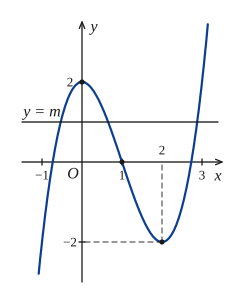
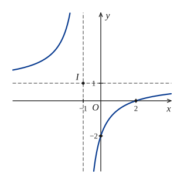
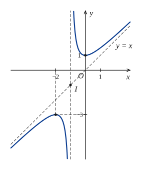
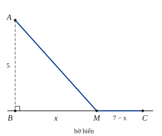

# Chủ đề 2. Giá trị lớn nhất, nhỏ nhất; tiệm cận; khảo sát và vẽ đồ thị hàm số

> Chủ đề này hoàn thiện bức tranh về hàm số: tìm giá trị lớn nhất, nhỏ nhất, tìm tiệm cận, vẽ đồ thị và dùng đồ thị để biện luận số nghiệm. Đề thi tốt nghiệp luôn có câu đọc đồ thị, bảng biến thiên và một câu trả lời ngắn về bài toán tối ưu thực tế.

## I. Kiến thức cần nắm

### 1. Giá trị lớn nhất, giá trị nhỏ nhất
Cho $f$ xác định trên tập $D$. Số $M$ là **giá trị lớn nhất** của $f$ trên $D$ nếu $f(x) \le M$ với mọi $x \in D$ **và** có $x_0 \in D$ để $f(x_0) = M$. Kí hiệu $M = \max\limits_D f(x)$. Giá trị nhỏ nhất $\min\limits_D f(x)$ định nghĩa tương tự.

**Trên một đoạn $[a; b]$** (hàm liên tục luôn có max và min):
1. Tìm các điểm $x_1, \dots, x_k$ thuộc $(a; b)$ mà $f'(x) = 0$ hoặc $f'$ không xác định.
2. Tính $f(a)$, $f(b)$, $f(x_1)$, ..., $f(x_k)$.
3. Số lớn nhất là $\max$, số nhỏ nhất là $\min$.

**Trên một khoảng** (hoặc nửa khoảng): lập bảng biến thiên rồi đọc. Có thể không tồn tại max hoặc min.

*Ví dụ mẫu.* $f(x) = x^3 - 3x$ trên $[0; 2]$: $f'(x) = 3x^2 - 3 = 0 \iff x = 1$ (nhận), $x = -1$ (loại). $f(0) = 0$, $f(1) = -2$, $f(2) = 2$. Vậy $\max = 2$, $\min = -2$.

*Mẹo:* nếu $f$ đồng biến trên $[a; b]$ thì $\max = f(b)$, $\min = f(a)$; không cần tìm điểm tới hạn.

### 2. Đường tiệm cận
- **Tiệm cận ngang** $y = y_0$: nếu $\lim\limits_{x \to +\infty} f(x) = y_0$ hoặc $\lim\limits_{x \to -\infty} f(x) = y_0$.
- **Tiệm cận đứng** $x = x_0$: nếu ít nhất một trong các giới hạn một phía $\lim\limits_{x \to x_0^{\pm}} f(x)$ bằng $+\infty$ hoặc $-\infty$.
- **Tiệm cận xiên** $y = ax + b$ ($a \ne 0$): nếu $\lim\limits_{x \to \pm\infty}[f(x) - (ax + b)] = 0$. Tính bằng $a = \lim\frac{f(x)}{x}$, $b = \lim[f(x) - ax]$.

**Với hàm phân thức:**
- $y = \frac{ax + b}{cx + d}$ ($c \ne 0$, $ad - bc \ne 0$): tiệm cận đứng $x = -\frac dc$, tiệm cận ngang $y = \frac ac$.
- $y = \frac{P(x)}{Q(x)}$: bậc tử nhỏ hơn bậc mẫu thì có tiệm cận ngang $y = 0$; bằng nhau thì $y = $ tỉ số hệ số bậc cao nhất; bậc tử lớn hơn bậc mẫu đúng 1 thì có tiệm cận xiên (chia đa thức: $y = ax + b + \frac{r}{\dots}$).
- Nghiệm $x_0$ của mẫu là tiệm cận đứng **khi nó không đồng thời làm tử bằng 0** (nếu cả tử và mẫu cùng bằng 0, phải rút gọn trước rồi xét lại).

*Ví dụ mẫu.* $y = \frac{2x^2 + x - 1}{x - 1} = 2x + 3 + \frac{2}{x - 1}$: tiệm cận đứng $x = 1$, tiệm cận xiên $y = 2x + 3$.

### 3. Sơ đồ khảo sát và vẽ đồ thị
1. Tìm tập xác định.
2. **Sự biến thiên:** tính $y'$, xét dấu; tìm cực trị; giới hạn và tiệm cận; lập bảng biến thiên.
3. **Vẽ đồ thị:** vẽ tiệm cận (nếu có), các điểm cực trị, giao điểm với trục tọa độ, thêm vài điểm; nối theo bảng biến thiên.

**Các dạng đồ thị cần nhận ra nhanh:**
- **Bậc ba** $y = ax^3 + bx^2 + cx + d$: $a > 0$ thì nhánh phải đi lên; có hai cực trị khi $y' = 0$ có hai nghiệm phân biệt. Đồ thị nhận điểm uốn $I$ (hoành độ là nghiệm của $y'' = 0$, tức $x = -\frac{b}{3a}$) làm **tâm đối xứng**.
- **$y = \frac{ax + b}{cx + d}$**: hai nhánh hypebol, nhận giao điểm hai tiệm cận làm **tâm đối xứng**; không có cực trị.
- **$y = \frac{ax^2 + bx + c}{mx + n}$** (tử không chia hết cho mẫu): một tiệm cận đứng, một tiệm cận xiên, có hai cực trị hoặc không có cực trị; tâm đối xứng là giao điểm hai tiệm cận.

**Đọc dấu hệ số từ đồ thị bậc ba:** nhánh cuối đi lên thì $a > 0$; giao điểm với $Oy$ là $(0; d)$; hai cực trị nằm hai phía $Oy$ thì $ac < 0$.

### 4. Dùng đồ thị biện luận số nghiệm
Số nghiệm của phương trình $f(x) = m$ bằng **số giao điểm** của đồ thị $y = f(x)$ với đường thẳng nằm ngang $y = m$.

*Ví dụ mẫu.* $f(x) = x^3 - 3x$ có $y_{\text{CĐ}} = 2$ (tại $x = -1$), $y_{\text{CT}} = -2$ (tại $x = 1$). Phương trình $x^3 - 3x = m$ có ba nghiệm phân biệt $\iff -2 < m < 2$; có hai nghiệm $\iff m = \pm2$; có một nghiệm $\iff \lvert m\rvert > 2$.

Với phương trình dạng $\lvert f(x)\rvert = k$ ($k > 0$): tách thành $f(x) = k$ hoặc $f(x) = -k$, đếm nghiệm từng phương trình rồi cộng (hai phương trình không có nghiệm chung).

### 5. Bài toán tối ưu trong thực tế
1. Chọn **biến** $x$ (có đơn vị), tìm **miền giá trị thực tế** của $x$.
2. Biểu diễn đại lượng cần tối ưu thành **hàm số** $f(x)$.
3. Tìm max/min của $f$ trên miền đó bằng đạo hàm.
4. Trả lời đúng câu hỏi (đôi khi hỏi giá trị của $x$, đôi khi hỏi giá trị của $f$), kèm đơn vị.

*Ví dụ mẫu.* Hình chữ nhật chu vi 20 m có diện tích $S = x(10 - x)$, $0 < x < 10$. $S' = 10 - 2x = 0 \iff x = 5$, $S$ đổi dấu từ $+$ sang $-$, nên $S_{\max} = 25$ m² khi hình chữ nhật là hình vuông cạnh 5 m.

### 6. Sai lầm hay gặp
- Tìm max/min trên đoạn nhưng **quên tính giá trị tại hai đầu mút**, hoặc tính cả điểm tới hạn **nằm ngoài** đoạn.
- Lấy giá trị cực đại làm giá trị lớn nhất (cực đại chỉ là lớn nhất ở gần điểm đó).
- Kết luận mọi nghiệm của mẫu đều là tiệm cận đứng mà không kiểm tra tử.
- Bài thực tế: quên điều kiện của biến ($x > 0$, độ dài nhỏ hơn cạnh, ...), hoặc trả lời nhầm đại lượng.

---

## II. Bài tập vận dụng

**Bài 1.** Tìm giá trị lớn nhất và giá trị nhỏ nhất của hàm số $y = x^3 - 3x^2 - 9x + 35$ trên đoạn $[-4; 4]$.

**Bài 2.** Tìm giá trị lớn nhất và giá trị nhỏ nhất của hàm số $y = x + \sqrt{4 - x^2}$.

**Bài 3.** Tìm các đường tiệm cận của đồ thị mỗi hàm số:
a) $y = \frac{2x - 1}{x + 3}$;
b) $y = \frac{x^2 - x + 2}{x - 1}$;
c) $y = \frac{x^2 - 1}{x^2 - 3x + 2}$.

**Bài 4.** Khảo sát sự biến thiên và vẽ đồ thị hàm số $y = x^3 - 3x^2 + 2$. Dựa vào đồ thị, tìm $m$ để phương trình $x^3 - 3x^2 + 2 = m$ có ba nghiệm phân biệt.

**Bài 5.** Khảo sát sự biến thiên và vẽ đồ thị hàm số $y = \frac{x - 2}{x + 1}$. Chỉ ra tâm đối xứng của đồ thị.

**Bài 6 (đúng/sai).** Cho hàm số $y = \frac{x^2 + x + 1}{x + 1}$ có đồ thị $(C)$. Mỗi khẳng định sau đúng hay sai? Giải thích.
a) $(C)$ có tiệm cận xiên là đường thẳng $y = x$.
b) Hàm số đạt cực đại tại $x = 0$.
c) Giá trị cực đại của hàm số nhỏ hơn giá trị cực tiểu.
d) $(C)$ cắt trục hoành tại hai điểm phân biệt.

**Bài 7 (trả lời ngắn).** Cho hàm số $y = f(x)$ liên tục trên $\mathbb R$ và có bảng biến thiên:

| $x$ | $-\infty$ | | $-1$ | | $1$ | | $+\infty$ |
|---|---|---|---|---|---|---|---|
| $f'(x)$ | | $+$ | $0$ | $-$ | $0$ | $+$ | |
| $f(x)$ | $-\infty$ | $\nearrow$ | $3$ | $\searrow$ | $-1$ | $\nearrow$ | $+\infty$ |

a) Phương trình $2f(x) - 3 = 0$ có bao nhiêu nghiệm?
b) Phương trình $f(x) = 3$ có bao nhiêu nghiệm?
c) Phương trình $\lvert f(x)\rvert = 1$ có bao nhiêu nghiệm?

**Bài 8 (thực tế, trả lời ngắn).** Từ một tấm bìa hình vuông cạnh 12 cm, người ta cắt ở bốn góc bốn hình vuông bằng nhau cạnh $x$ cm rồi gập lại thành một chiếc hộp không nắp. Tìm thể tích lớn nhất của chiếc hộp (đơn vị cm³).

**Bài 9 (thực tế).** Một con cá hồi bơi ngược dòng để vượt khoảng cách 300 km. Vận tốc dòng nước là 6 km/h. Nếu vận tốc bơi của cá khi nước đứng yên là $v$ (km/h) thì năng lượng tiêu hao trong $t$ giờ là $E(v) = cv^3t$, với $c$ là hằng số dương. Tìm vận tốc $v$ để năng lượng tiêu hao là ít nhất.

**Bài 10 (thực tế, trả lời ngắn).** Một cửa hàng nhập một loại áo với giá 30 nghìn đồng một chiếc và bán với giá 50 nghìn đồng một chiếc; với giá đó mỗi tháng bán được 200 chiếc. Khảo sát cho thấy cứ giảm giá bán 1 nghìn đồng thì mỗi tháng bán thêm được 20 chiếc. Hỏi cửa hàng nên bán với giá bao nhiêu nghìn đồng một chiếc để lợi nhuận mỗi tháng lớn nhất?

**Bài 11 (trả lời ngắn).** Tìm $m$ để giá trị nhỏ nhất của hàm số $y = x^3 - 3x + m$ trên đoạn $[0; 2]$ bằng $3$.

**Bài 12 (vận dụng cao, trả lời ngắn).** Có bao nhiêu số nguyên $m \in [-10; 10]$ để đồ thị hàm số $y = \frac{x + 1}{x^2 - 2mx + 4}$ có đúng ba đường tiệm cận?

**Bài 13 (vận dụng cao, thực tế).** Một ngọn hải đăng đặt tại vị trí $A$ cách bờ biển 5 km; điểm $B$ trên bờ gần $A$ nhất. Trên bờ biển (coi là đường thẳng) có một kho hàng $C$ cách $B$ 7 km. Người canh hải đăng chèo thuyền từ $A$ đến điểm $M$ trên đoạn $BC$ với vận tốc 4 km/h, rồi đi bộ từ $M$ đến $C$ với vận tốc 6 km/h. Xác định vị trí của $M$ để người đó đến kho nhanh nhất.

---

## III. Lời giải chi tiết

### Bài 1
$y' = 3x^2 - 6x - 9 = 3(x + 1)(x - 3)$; $y' = 0 \iff x = -1$ hoặc $x = 3$, cả hai đều thuộc $[-4; 4]$.
$$y(-4) = -41,\quad y(-1) = 40,\quad y(3) = 8,\quad y(4) = 15.$$
Vậy $\max\limits_{[-4; 4]} y = 40$ tại $x = -1$, $\min\limits_{[-4; 4]} y = -41$ tại $x = -4$.

*Nhận xét:* giá trị nhỏ nhất đạt tại đầu mút $x = -4$, không phải tại điểm cực tiểu $x = 3$.

### Bài 2
Tập xác định $D = [-2; 2]$. Với $-2 < x < 2$:
$$y' = 1 - \frac{x}{\sqrt{4 - x^2}} = \frac{\sqrt{4 - x^2} - x}{\sqrt{4 - x^2}}.$$
$y' = 0 \iff \sqrt{4 - x^2} = x \iff \begin{cases} x \ge 0 \\ 4 - x^2 = x^2\end{cases} \iff x = \sqrt2$.
$$y(-2) = -2,\quad y(\sqrt2) = \sqrt2 + \sqrt2 = 2\sqrt2,\quad y(2) = 2.$$
Vậy $\max y = 2\sqrt2$ tại $x = \sqrt2$; $\min y = -2$ tại $x = -2$.

### Bài 3
**a)** $\lim\limits_{x \to \pm\infty}\frac{2x - 1}{x + 3} = 2$ nên $y = 2$ là tiệm cận ngang. $\lim\limits_{x \to -3^+} y = -\infty$ (tử dần tới $-7$, mẫu dần tới $0^+$) nên $x = -3$ là tiệm cận đứng.

**b)** Chia đa thức: $y = x + \frac{2}{x - 1}$.
- $\lim\limits_{x \to \pm\infty}[y - x] = \lim\frac{2}{x - 1} = 0$ nên $y = x$ là tiệm cận xiên.
- $\lim\limits_{x \to 1^+} y = +\infty$ nên $x = 1$ là tiệm cận đứng.

**c)** $x^2 - 3x + 2 = (x - 1)(x - 2)$, $x^2 - 1 = (x - 1)(x + 1)$. Với $x \ne 1$: $y = \frac{x + 1}{x - 2}$.
- $\lim\limits_{x \to 1} y = \frac{2}{-1} = -2$ (hữu hạn), nên $x = 1$ **không** là tiệm cận đứng.
- $\lim\limits_{x \to 2^+} y = +\infty$, nên $x = 2$ là tiệm cận đứng.
- $\lim\limits_{x \to \pm\infty} y = 1$, nên $y = 1$ là tiệm cận ngang.

*Nhận xét:* câu c là bẫy: $x = 1$ làm mẫu bằng 0 nhưng cũng làm tử bằng 0.

### Bài 4

*Hình: Đồ thị y = x³ − 3x² + 2 và đường thẳng y = m.*

**Tập xác định:** $D = \mathbb R$.

**Sự biến thiên.** $y' = 3x^2 - 6x = 3x(x - 2)$; $y' = 0 \iff x = 0$ hoặc $x = 2$. $\lim\limits_{x \to -\infty} y = -\infty$, $\lim\limits_{x \to +\infty} y = +\infty$.

| $x$ | $-\infty$ | | $0$ | | $2$ | | $+\infty$ |
|---|---|---|---|---|---|---|---|
| $y'$ | | $+$ | $0$ | $-$ | $0$ | $+$ | |
| $y$ | $-\infty$ | $\nearrow$ | $2$ | $\searrow$ | $-2$ | $\nearrow$ | $+\infty$ |

Hàm số đồng biến trên $(-\infty; 0)$ và $(2; +\infty)$, nghịch biến trên $(0; 2)$. Cực đại tại $x = 0$, $y_{\text{CĐ}} = 2$; cực tiểu tại $x = 2$, $y_{\text{CT}} = -2$.

**Đồ thị.** $y'' = 6x - 6 = 0 \iff x = 1$, $y(1) = 0$: điểm uốn $I(1; 0)$ là tâm đối xứng. Đồ thị cắt $Oy$ tại $(0; 2)$; cắt $Ox$ tại $x = 1$ và $x = 1 \pm \sqrt3$ (vì $x^3 - 3x^2 + 2 = (x - 1)(x^2 - 2x - 2)$). Thêm điểm $(-1; -2)$, $(3; 2)$.

**Biện luận.** Số nghiệm của phương trình bằng số giao điểm của đồ thị với đường thẳng $y = m$. Có ba giao điểm khi đường thẳng nằm giữa hai giá trị cực trị: $-2 < m < 2$.

### Bài 5

*Hình: Đồ thị y = (x − 2)/(x + 1), tâm đối xứng I(−1; 1).*

**Tập xác định:** $D = \mathbb R \setminus \{-1\}$.

**Sự biến thiên.** $y' = \frac{1\cdot1 - (-2)\cdot1}{(x + 1)^2} = \frac{3}{(x + 1)^2} > 0$ với mọi $x \ne -1$. Hàm số đồng biến trên từng khoảng $(-\infty; -1)$ và $(-1; +\infty)$, không có cực trị.

**Tiệm cận.** $\lim\limits_{x \to \pm\infty} y = 1$: tiệm cận ngang $y = 1$. $\lim\limits_{x \to -1^-} y = +\infty$, $\lim\limits_{x \to -1^+} y = -\infty$: tiệm cận đứng $x = -1$.

| $x$ | $-\infty$ | | $-1$ | | $+\infty$ |
|---|---|---|---|---|---|
| $y'$ | | $+$ | $\Vert$ | $+$ | |
| $y$ | $1$ | $\nearrow$ | $+\infty \;\Vert\; -\infty$ | $\nearrow$ | $1$ |

**Đồ thị.** Cắt $Ox$ tại $(2; 0)$, cắt $Oy$ tại $(0; -2)$. Thêm điểm $(-2; 4)$, $(-4; 2)$. Đồ thị gồm hai nhánh, nhận giao điểm hai tiệm cận $I(-1; 1)$ làm **tâm đối xứng**.

### Bài 6
$D = \mathbb R \setminus \{-1\}$, $y = x + \frac{1}{x + 1}$, $y' = 1 - \frac{1}{(x + 1)^2} = \frac{x(x + 2)}{(x + 1)^2}$; $y' = 0 \iff x = 0$ hoặc $x = -2$. $y(0) = 1$, $y(-2) = -3$.

| $x$ | $-\infty$ | | $-2$ | | $-1$ | | $0$ | | $+\infty$ |
|---|---|---|---|---|---|---|---|---|---|
| $y'$ | | $+$ | $0$ | $-$ | $\Vert$ | $-$ | $0$ | $+$ | |
| $y$ | $-\infty$ | $\nearrow$ | $-3$ | $\searrow$ | $-\infty \;\Vert\; +\infty$ | $\searrow$ | $1$ | $\nearrow$ | $+\infty$ |

*Hình: Đồ thị (C), tiệm cận đứng x = −1 và tiệm cận xiên y = x.*

**a) Đúng.** $\lim\limits_{x \to \pm\infty}(y - x) = \lim\frac{1}{x + 1} = 0$.

**b) Sai.** $y'$ đổi dấu từ $-$ sang $+$ tại $x = 0$, nên $x = 0$ là điểm **cực tiểu**. Điểm cực đại là $x = -2$.

**c) Đúng.** $y_{\text{CĐ}} = -3 < y_{\text{CT}} = 1$.

**d) Sai.** $y = 0 \iff x^2 + x + 1 = 0$, phương trình có $\Delta = -3 < 0$, vô nghiệm. $(C)$ không cắt trục hoành.

*Nhận xét:* đồ thị nhận giao điểm của hai tiệm cận $I(-1; -1)$ làm tâm đối xứng; trung điểm của hai điểm cực trị $(-2; -3)$ và $(0; 1)$ đúng là $I$.

### Bài 7
**a)** $2f(x) - 3 = 0 \iff f(x) = \frac32$. Vì $-1 < \frac32 < 3$, đường thẳng $y = \frac32$ cắt đồ thị trên mỗi khoảng $(-\infty; -1)$, $(-1; 1)$, $(1; +\infty)$ tại một điểm. **Đáp số: 3 nghiệm.**

**b)** $f(x) = 3$: trên $(-\infty; 1]$ giá trị lớn nhất của $f$ là $3$, đạt tại đúng $x = -1$; trên $(1; +\infty)$, $f$ tăng từ $-1$ đến $+\infty$ nên đạt giá trị $3$ tại một điểm. **Đáp số: 2 nghiệm.**

**c)** $\lvert f(x)\rvert = 1 \iff f(x) = 1$ hoặc $f(x) = -1$.
- $f(x) = 1$: vì $-1 < 1 < 3$ nên có 3 nghiệm (như câu a).
- $f(x) = -1$: một nghiệm trên $(-\infty; -1)$ (vì $f$ tăng từ $-\infty$ đến $3$), và nghiệm $x = 1$ (giá trị cực tiểu). Trên $(1; +\infty)$ thì $f > -1$. Có 2 nghiệm.

Hai phương trình không có nghiệm chung. **Đáp số: 5 nghiệm.**

### Bài 8
Đáy hộp là hình vuông cạnh $12 - 2x$, chiều cao $x$, với $0 < x < 6$.
$$V(x) = x(12 - 2x)^2,\qquad V'(x) = (12 - 2x)^2 - 4x(12 - 2x) = (12 - 2x)(12 - 6x).$$
Trên $(0; 6)$: $V'(x) = 0 \iff x = 2$; $V'$ đổi dấu từ $+$ sang $-$ tại $x = 2$.

$V_{\max} = V(2) = 2\cdot 8^2 = 128$.

**Đáp số:** $128$ cm³ (cắt hình vuông cạnh 2 cm).

### Bài 9
Vận tốc thực của cá khi bơi ngược dòng là $v - 6$ (km/h), cần $v > 6$. Thời gian bơi $t = \frac{300}{v - 6}$.
$$E(v) = cv^3\cdot\frac{300}{v - 6} = 300c\cdot\frac{v^3}{v - 6},\qquad v > 6.$$
$$E'(v) = 300c\cdot\frac{3v^2(v - 6) - v^3}{(v - 6)^2} = 300c\cdot\frac{v^2(2v - 18)}{(v - 6)^2}.$$
Trên $(6; +\infty)$: $E'(v) = 0 \iff v = 9$; $E' < 0$ khi $6 < v < 9$, $E' > 0$ khi $v > 9$.

Vậy năng lượng tiêu hao ít nhất khi $v = 9$ km/h.

### Bài 10
Gọi $x$ (nghìn đồng) là số tiền giảm giá, $0 \le x \le 20$ (để giá bán không thấp hơn giá nhập). Khi đó giá bán $50 - x$, số áo bán được $200 + 20x$, lãi mỗi chiếc $20 - x$.
$$L(x) = (20 - x)(200 + 20x),\qquad L'(x) = -(200 + 20x) + 20(20 - x) = 200 - 40x.$$
$L'(x) = 0 \iff x = 5$; $L'$ đổi dấu từ $+$ sang $-$, nên $L$ lớn nhất tại $x = 5$: $L(5) = 15\cdot300 = 4500$ nghìn đồng.

**Đáp số:** bán với giá $45$ nghìn đồng một chiếc (lợi nhuận 4,5 triệu đồng mỗi tháng).

### Bài 11
$y' = 3x^2 - 3 = 0 \iff x = \pm1$; trên $[0; 2]$ chỉ lấy $x = 1$.
$$y(0) = m,\quad y(1) = m - 2,\quad y(2) = m + 2.$$
Giá trị nhỏ nhất là $m - 2$. Cho $m - 2 = 3$ được $m = 5$.

**Đáp số:** $m = 5$.

### Bài 12
Bậc tử nhỏ hơn bậc mẫu nên $\lim\limits_{x \to \pm\infty} y = 0$: luôn có đúng một tiệm cận ngang $y = 0$. Cần thêm đúng **hai** tiệm cận đứng, tức là $x^2 - 2mx + 4 = 0$ có hai nghiệm phân biệt và cả hai đều không làm tử bằng 0 (tức là khác $-1$):
$$\begin{cases}\Delta' = m^2 - 4 > 0 \\ 1 + 2m + 4 \ne 0\end{cases} \iff \begin{cases} m < -2 \text{ hoặc } m > 2 \\ m \ne -\frac52.\end{cases}$$
Khi $m = -\frac52$, mẫu bằng $(x + 1)(x + 4)$ và $y = \frac{1}{x + 4}$ (với $x \ne -1$) chỉ có một tiệm cận đứng. Giá trị này không nguyên nên không ảnh hưởng đến việc đếm.

Số nguyên trong $[-10; 10]$: từ $-10$ đến $-3$ có 8 số, từ $3$ đến $10$ có 8 số.

**Đáp số:** $16$.

### Bài 13

*Hình: Đường đi A → M → C, với BM = x.*

Đặt $BM = x$ (km), $0 \le x \le 7$. Khi đó $AM = \sqrt{25 + x^2}$, $MC = 7 - x$. Tổng thời gian:
$$t(x) = \frac{\sqrt{25 + x^2}}{4} + \frac{7 - x}{6}.$$
$$t'(x) = \frac{x}{4\sqrt{25 + x^2}} - \frac16 = 0 \iff 6x = 4\sqrt{25 + x^2} \iff 36x^2 = 16(25 + x^2) \text{ và } x \ge 0 \iff x^2 = 20 \iff x = 2\sqrt5.$$
$t'$ âm khi $0 \le x < 2\sqrt5$ và dương khi $2\sqrt5 < x \le 7$, nên $t$ nhỏ nhất tại $x = 2\sqrt5 \approx 4{,}47$ km.

So sánh: $t(0) = \frac54 + \frac76 \approx 2{,}42$ giờ; $t(7) = \frac{\sqrt{74}}{4} \approx 2{,}15$ giờ; $t(2\sqrt5) = \frac{3\sqrt5}{4} + \frac{7 - 2\sqrt5}{6} = \frac76 + \frac{5\sqrt5}{12} \approx 2{,}10$ giờ.

**Kết luận:** chọn $M$ trên đoạn $BC$ với $BM = 2\sqrt5 \approx 4{,}47$ km; thời gian ít nhất khoảng $2{,}10$ giờ.

*Nhận xét:* phương trình $t'(x) = 0$ có nghiệm khi chèo chậm hơn đi bộ. Nếu chèo nhanh hơn đi bộ thì nên chèo thẳng tới $C$.
