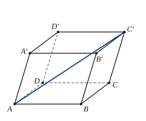
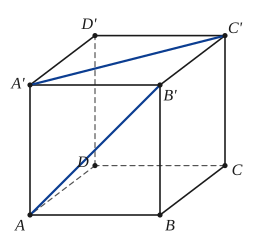
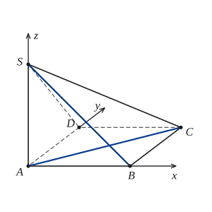

# Chủ đề 3. Vectơ và hệ trục tọa độ trong không gian

> Vectơ trong không gian mở rộng trực tiếp vectơ trong mặt phẳng (lớp 10). Tọa độ $Oxyz$ là công cụ để tính độ dài, góc, chứng minh vuông góc, và là nền cho phương trình mặt phẳng, đường thẳng, mặt cầu ở các chủ đề sau. Trong đề thi tốt nghiệp, chủ đề này có ở câu đúng/sai về tọa độ và câu trả lời ngắn về bài toán thực tế (vị trí máy bay, lực, khoảng cách).

## I. Kiến thức cần nắm

### 1. Vectơ trong không gian và các phép toán
Vectơ, hai vectơ bằng nhau, vectơ-không, phép cộng, phép trừ, phép nhân với một số được định nghĩa **giống như trong mặt phẳng**.
- **Quy tắc ba điểm:** $\overrightarrow{AB} + \overrightarrow{BC} = \overrightarrow{AC}$; $\overrightarrow{OB} - \overrightarrow{OA} = \overrightarrow{AB}$.
- **Quy tắc hình bình hành:** $ABCD$ là hình bình hành thì $\overrightarrow{AB} + \overrightarrow{AD} = \overrightarrow{AC}$.
- **Quy tắc hình hộp:** với hình hộp $ABCD.A'B'C'D'$,
$$\overrightarrow{AB} + \overrightarrow{AD} + \overrightarrow{AA'} = \overrightarrow{AC'}.$$
*Vì sao:* $\overrightarrow{AB} + \overrightarrow{AD} = \overrightarrow{AC}$ và $\overrightarrow{AA'} = \overrightarrow{CC'}$, nên tổng bằng $\overrightarrow{AC} + \overrightarrow{CC'} = \overrightarrow{AC'}$.
- **Trung điểm:** $I$ là trung điểm $AB$ $\iff \overrightarrow{IA} + \overrightarrow{IB} = \vec 0 \iff \overrightarrow{MA} + \overrightarrow{MB} = 2\overrightarrow{MI}$ với mọi $M$.
- **Trọng tâm tam giác:** $\overrightarrow{GA} + \overrightarrow{GB} + \overrightarrow{GC} = \vec 0$. **Trọng tâm tứ diện** $ABCD$: $\overrightarrow{GA} + \overrightarrow{GB} + \overrightarrow{GC} + \overrightarrow{GD} = \vec 0$.

*Ví dụ mẫu.* Trong hình hộp $ABCD.A'B'C'D'$: $\overrightarrow{AB} - \overrightarrow{AD} + \overrightarrow{CC'} = \overrightarrow{DB} + \overrightarrow{BB'} = \overrightarrow{DB'}$ (vì $\overrightarrow{CC'} = \overrightarrow{BB'}$).

### 2. Tích vô hướng
**Góc giữa hai vectơ** $\vec a$, $\vec b$ khác $\vec 0$: lấy $\overrightarrow{OA} = \vec a$, $\overrightarrow{OB} = \vec b$ thì $(\vec a, \vec b) = \widehat{AOB}$, từ $0^\circ$ đến $180^\circ$.
$$\vec a\cdot\vec b = \lvert\vec a\rvert\cdot\lvert\vec b\rvert\cdot\cos(\vec a, \vec b).$$
- $\vec a \perp \vec b \iff \vec a\cdot\vec b = 0$.
- $\vec a^2 = \lvert\vec a\rvert^2$; $\cos(\vec a, \vec b) = \frac{\vec a\cdot\vec b}{\lvert\vec a\rvert\cdot\lvert\vec b\rvert}$.
- Tích vô hướng có tính giao hoán, phân phối với phép cộng.

*Ví dụ mẫu.* Hình lập phương cạnh $a$: $\overrightarrow{AB}\cdot\overrightarrow{AC'} = \overrightarrow{AB}\cdot(\overrightarrow{AB} + \overrightarrow{AD} + \overrightarrow{AA'}) = a^2 + 0 + 0 = a^2$.

### 3. Hệ trục tọa độ $Oxyz$
Ba trục $Ox, Oy, Oz$ đôi một vuông góc tại $O$, với các vectơ đơn vị $\vec i, \vec j, \vec k$.
- $\vec u = (x; y; z) \iff \vec u = x\vec i + y\vec j + z\vec k$.
- $M(x; y; z) \iff \overrightarrow{OM} = (x; y; z)$.
- $\overrightarrow{AB} = (x_B - x_A;\ y_B - y_A;\ z_B - z_A)$.

**Hình chiếu và đối xứng của $M(x; y; z)$:**

| Lên / qua | Hình chiếu | Điểm đối xứng |
|---|---|---|
| mặt phẳng $(Oxy)$ | $(x; y; 0)$ | $(x; y; -z)$ |
| mặt phẳng $(Oyz)$ | $(0; y; z)$ | $(-x; y; z)$ |
| mặt phẳng $(Oxz)$ | $(x; 0; z)$ | $(x; -y; z)$ |
| trục $Ox$ | $(x; 0; 0)$ | $(x; -y; -z)$ |
| trục $Oy$ | $(0; y; 0)$ | $(-x; y; -z)$ |
| trục $Oz$ | $(0; 0; z)$ | $(-x; -y; z)$ |
| gốc $O$ | | $(-x; -y; -z)$ |

**Khoảng cách từ $M$ đến các trục:** $d(M, Ox) = \sqrt{y^2 + z^2}$, $d(M, Oy) = \sqrt{x^2 + z^2}$, $d(M, Oz) = \sqrt{x^2 + y^2}$. Khoảng cách đến mặt phẳng $(Oxy)$ là $\lvert z\rvert$.

### 4. Biểu thức tọa độ của các phép toán
Cho $\vec a = (a_1; a_2; a_3)$, $\vec b = (b_1; b_2; b_3)$, số $k$:
- $\vec a \pm \vec b = (a_1 \pm b_1; a_2 \pm b_2; a_3 \pm b_3)$, $k\vec a = (ka_1; ka_2; ka_3)$.
- $\vec a\cdot\vec b = a_1b_1 + a_2b_2 + a_3b_3$; $\lvert\vec a\rvert = \sqrt{a_1^2 + a_2^2 + a_3^2}$.
- $\cos(\vec a, \vec b) = \dfrac{a_1b_1 + a_2b_2 + a_3b_3}{\sqrt{a_1^2 + a_2^2 + a_3^2}\cdot\sqrt{b_1^2 + b_2^2 + b_3^2}}$.
- $\vec a$ cùng phương $\vec b$ ($\vec b \ne \vec 0$) $\iff$ có số $k$ để $\vec a = k\vec b$. Ba điểm $A, B, C$ thẳng hàng $\iff \overrightarrow{AB}$, $\overrightarrow{AC}$ cùng phương.
- $AB = \sqrt{(x_B - x_A)^2 + (y_B - y_A)^2 + (z_B - z_A)^2}$.
- Trung điểm $I$ của $AB$: $I\left(\frac{x_A + x_B}{2}; \frac{y_A + y_B}{2}; \frac{z_A + z_B}{2}\right)$. Trọng tâm $G$ của tam giác $ABC$: $G\left(\frac{x_A + x_B + x_C}{3}; \dots\right)$.

**Diện tích tam giác** (không cần tích có hướng): $S_{ABC} = \frac12\sqrt{AB^2\cdot AC^2 - \left(\overrightarrow{AB}\cdot\overrightarrow{AC}\right)^2}$.
*Vì sao:* $S = \frac12 AB\cdot AC\sin A$ và $\sin^2 A = 1 - \cos^2 A$.

*Ví dụ mẫu.* $A(1; 0; 2)$, $B(3; 2; 1)$: $\overrightarrow{AB} = (2; 2; -1)$, $AB = 3$, trung điểm $I\left(2; 1; \frac32\right)$.

### 5. Đặt hệ trục tọa độ cho hình không gian
Với hình lập phương, hình hộp chữ nhật, hình chóp có cạnh bên vuông góc với đáy là hình vuông, hình chữ nhật: đặt gốc tại đỉnh có **ba cạnh đôi một vuông góc**, ba trục theo ba cạnh đó. Khi đó mọi đỉnh có tọa độ đơn giản, và góc giữa hai đường thẳng tính bằng $\cos$ của góc giữa hai vectơ chỉ phương (lấy **trị tuyệt đối**, vì góc giữa hai đường thẳng không vượt quá $90^\circ$).

**Ứng dụng thực tế:** vị trí máy bay, drone (tọa độ theo km); hợp lực $\vec F = \vec F_1 + \vec F_2 + \vec F_3$; chuyển động thẳng đều: sau thời gian $t$, $M(t) = M_0 + t\,\vec v$.

### 6. Sai lầm hay gặp
- Nhầm hình chiếu với điểm đối xứng (hình chiếu lên trục $Oz$ là $(0; 0; z)$, đối xứng qua trục $Oz$ là $(-x; -y; z)$).
- Tính $\overrightarrow{AB}$ bằng "tọa độ đầu trừ tọa độ cuối" (phải là cuối trừ đầu).
- Góc giữa hai **đường thẳng** lấy $\lvert\cos\rvert$, còn góc giữa hai **vectơ** giữ nguyên dấu (có thể tù).
- Tìm đỉnh $D$ của hình bình hành $ABCD$: phải có $\overrightarrow{AD} = \overrightarrow{BC}$, tức $D = A + C - B$, không phải $A + B - C$.

---

## II. Bài tập vận dụng

**Bài 1.** Cho hình hộp $ABCD.A'B'C'D'$.
a) Chứng minh $\overrightarrow{AB} + \overrightarrow{B'C'} + \overrightarrow{DD'} = \overrightarrow{AC'}$.
b) Chứng minh $\overrightarrow{AC} + \overrightarrow{BA'} + \overrightarrow{DB} + \overrightarrow{C'D} = \vec 0$.

**Bài 2.** Cho tứ diện $ABCD$. Gọi $M$, $N$ lần lượt là trung điểm của $AB$ và $CD$. Chứng minh $\overrightarrow{MN} = \frac12\left(\overrightarrow{AD} + \overrightarrow{BC}\right)$.

**Bài 3.** Cho hình lập phương $ABCD.A'B'C'D'$ cạnh $a$.
a) Tính $\overrightarrow{AB}\cdot\overrightarrow{A'C'}$.
b) Tính góc giữa hai vectơ $\overrightarrow{AB'}$ và $\overrightarrow{A'C'}$.
c) Chứng minh $AC' \perp BD$.

**Bài 4.** Trong không gian $Oxyz$, cho $\vec a = (1; -2; 3)$ và $\vec b = (2; 0; -1)$. Tính tọa độ của $\vec a + \vec b$, $2\vec a - 3\vec b$; tính $\vec a\cdot\vec b$, $\lvert\vec a\rvert$ và $\cos(\vec a, \vec b)$.

**Bài 5.** Cho ba điểm $A(1; 2; -1)$, $B(3; 0; 1)$, $C(2; -1; 3)$.
a) Chứng minh $A, B, C$ không thẳng hàng.
b) Tìm tọa độ trung điểm $I$ của $AB$ và trọng tâm $G$ của tam giác $ABC$.
c) Tìm tọa độ điểm $D$ để $ABCD$ là hình bình hành.

**Bài 6 (đúng/sai).** Trong không gian $Oxyz$, cho điểm $M(2; -3; 4)$. Mỗi khẳng định sau đúng hay sai?
a) Hình chiếu vuông góc của $M$ lên mặt phẳng $(Oxy)$ là $M_1(2; -3; 0)$.
b) Điểm đối xứng với $M$ qua trục $Oz$ là $M_2(-2; 3; -4)$.
c) $OM = \sqrt{29}$.
d) Khoảng cách từ $M$ đến trục $Oy$ bằng $3$.

**Bài 7.** Cho tam giác $ABC$ với $A(1; 0; 0)$, $B(0; 2; 0)$, $C(0; 0; 3)$. Tính $\cos\widehat{BAC}$, chu vi và diện tích tam giác $ABC$.

**Bài 8.** Cho hai điểm $A(1; 2; 3)$ và $B(3; -1; 1)$. Tìm điểm $M$ trên trục $Ox$ sao cho $MA = MB$.

**Bài 9 (thực tế, trả lời ngắn).** Ba lực $\vec F_1, \vec F_2, \vec F_3$ cùng tác động vào một vật, có giá đôi một vuông góc và độ lớn lần lượt là $3$ N, $4$ N, $12$ N. Tính độ lớn của hợp lực (đơn vị N).

**Bài 10 (thực tế, trả lời ngắn).** Một trạm ra-đa đặt tại gốc $O$ của hệ trục $Oxyz$ (đơn vị trên mỗi trục là km). Một máy bay bay thẳng đều; lúc đầu ở vị trí $M(300; 400; 10)$, sau 2 phút ở vị trí $N(320; 415; 10)$.
a) Tính vận tốc của máy bay theo km/h.
b) Sau 5 phút kể từ khi ở $M$, máy bay cách trạm ra-đa bao nhiêu km (làm tròn đến hàng đơn vị)?

**Bài 11.** Cho hình chóp $S.ABCD$ có đáy là hình vuông cạnh $2$, $SA$ vuông góc với mặt đáy và $SA = 2$. Chọn hệ trục $Axyz$ với $B$ thuộc tia $Ax$, $D$ thuộc tia $Ay$, $S$ thuộc tia $Az$.
a) Viết tọa độ các điểm $S, A, B, C, D$.
b) Tính góc giữa hai đường thẳng $SB$ và $AC$.
c) Chứng minh $SC \perp BD$.

**Bài 12 (vận dụng cao).** Cho $A(1; 2; 3)$ và $B(3; 4; 1)$. Tìm điểm $M$ thuộc mặt phẳng $(Oxy)$ sao cho $MA + MB$ nhỏ nhất. Tính giá trị nhỏ nhất đó.

**Bài 13 (vận dụng cao, trả lời ngắn).** Cho $A(1; 2; 3)$, $B(3; 4; 1)$, $C(2; 0; 5)$. Điểm $M$ thay đổi trên mặt phẳng $(Oxy)$. Tìm giá trị nhỏ nhất của $T = MA^2 + MB^2 + MC^2$.

---

## III. Lời giải chi tiết

### Bài 1

*Hình: Hình hộp ABCD.A'B'C'D' với đường chéo AC'.*

**a)** Trong hình hộp, các mặt là hình bình hành nên $\overrightarrow{B'C'} = \overrightarrow{BC}$ và $\overrightarrow{DD'} = \overrightarrow{CC'}$. Do đó
$$\overrightarrow{AB} + \overrightarrow{B'C'} + \overrightarrow{DD'} = \overrightarrow{AB} + \overrightarrow{BC} + \overrightarrow{CC'} = \overrightarrow{AC'}.$$

**b)** Sắp xếp lại để các vectơ nối đuôi nhau: $\overrightarrow{AC} + \overrightarrow{C'D} + \overrightarrow{DB} + \overrightarrow{BA'}$. Vì $\overrightarrow{AC} = \overrightarrow{A'C'}$ nên
$$\overrightarrow{A'C'} + \overrightarrow{C'D} + \overrightarrow{DB} + \overrightarrow{BA'} = \overrightarrow{A'A'} = \vec 0.$$

*Nhận xét:* muốn rút gọn tổng vectơ, hãy thay các vectơ bằng vectơ bằng nó để tạo thành một đường gấp khúc nối đuôi nhau.

### Bài 2
Theo quy tắc ba điểm, viết $\overrightarrow{MN}$ theo hai đường:
$$\overrightarrow{MN} = \overrightarrow{MA} + \overrightarrow{AD} + \overrightarrow{DN},\qquad \overrightarrow{MN} = \overrightarrow{MB} + \overrightarrow{BC} + \overrightarrow{CN}.$$
Cộng lại: $2\overrightarrow{MN} = (\overrightarrow{MA} + \overrightarrow{MB}) + (\overrightarrow{AD} + \overrightarrow{BC}) + (\overrightarrow{DN} + \overrightarrow{CN})$.

Vì $M$ là trung điểm $AB$ nên $\overrightarrow{MA} + \overrightarrow{MB} = \vec 0$; vì $N$ là trung điểm $CD$ nên $\overrightarrow{DN} + \overrightarrow{CN} = \vec 0$. Vậy $\overrightarrow{MN} = \frac12(\overrightarrow{AD} + \overrightarrow{BC})$.

### Bài 3

*Hình: Hình lập phương với hai vectơ AB' và A'C'.*

**a)** $\overrightarrow{A'C'} = \overrightarrow{AC}$ nên $\overrightarrow{AB}\cdot\overrightarrow{A'C'} = \overrightarrow{AB}\cdot\overrightarrow{AC} = AB\cdot AC\cdot\cos 45^\circ = a\cdot a\sqrt2\cdot\frac{\sqrt2}{2} = a^2$.

**b)** $\overrightarrow{A'C'} = \overrightarrow{AC}$, nên $(\overrightarrow{AB'}, \overrightarrow{A'C'}) = (\overrightarrow{AB'}, \overrightarrow{AC}) = \widehat{B'AC}$. Tam giác $AB'C$ có ba cạnh đều là đường chéo của các mặt hình vuông, $AB' = B'C = CA = a\sqrt2$, nên là tam giác đều. Vậy góc cần tìm bằng $60^\circ$.

**c)** $\overrightarrow{AC'} = \overrightarrow{AB} + \overrightarrow{AD} + \overrightarrow{AA'}$, $\overrightarrow{BD} = \overrightarrow{AD} - \overrightarrow{AB}$. Vì $\overrightarrow{AB}, \overrightarrow{AD}, \overrightarrow{AA'}$ đôi một vuông góc và có độ dài $a$:
$$\overrightarrow{AC'}\cdot\overrightarrow{BD} = \overrightarrow{AD}^2 - \overrightarrow{AB}^2 + \overrightarrow{AA'}\cdot\overrightarrow{AD} - \overrightarrow{AA'}\cdot\overrightarrow{AB} = a^2 - a^2 + 0 - 0 = 0.$$
Vậy $AC' \perp BD$.

### Bài 4
- $\vec a + \vec b = (3; -2; 2)$.
- $2\vec a - 3\vec b = (2 - 6; -4 - 0; 6 + 3) = (-4; -4; 9)$.
- $\vec a\cdot\vec b = 1\cdot2 + (-2)\cdot0 + 3\cdot(-1) = -1$.
- $\lvert\vec a\rvert = \sqrt{1 + 4 + 9} = \sqrt{14}$, $\lvert\vec b\rvert = \sqrt{4 + 0 + 1} = \sqrt5$.
- $\cos(\vec a, \vec b) = \frac{-1}{\sqrt{14}\cdot\sqrt5} = -\frac{1}{\sqrt{70}}$.

### Bài 5
**a)** $\overrightarrow{AB} = (2; -2; 2)$, $\overrightarrow{AC} = (1; -3; 4)$. Nếu $\overrightarrow{AB} = k\overrightarrow{AC}$ thì từ hoành độ $k = 2$, nhưng tung độ cho $-2 = -6$, vô lí. Hai vectơ không cùng phương nên $A, B, C$ không thẳng hàng.

**b)** $I\left(\frac{1 + 3}{2}; \frac{2 + 0}{2}; \frac{-1 + 1}{2}\right) = (2; 1; 0)$; $G\left(\frac{1 + 3 + 2}{3}; \frac{2 + 0 - 1}{3}; \frac{-1 + 1 + 3}{3}\right) = \left(2; \frac13; 1\right)$.

**c)** $ABCD$ là hình bình hành $\iff \overrightarrow{AD} = \overrightarrow{BC}$. $\overrightarrow{BC} = (-1; -1; 2)$, nên $D = (1 - 1; 2 - 1; -1 + 2) = (0; 1; 1)$. Vì $A, B, C$ không thẳng hàng nên $ABCD$ thực sự là hình bình hành.

### Bài 6
**a) Đúng.** Hình chiếu lên $(Oxy)$ giữ nguyên hoành độ, tung độ và cho cao độ bằng $0$.

**b) Sai.** Đối xứng qua trục $Oz$ giữ nguyên cao độ, đổi dấu hoành độ và tung độ: $M_2(-2; 3; 4)$.

**c) Đúng.** $OM = \sqrt{4 + 9 + 16} = \sqrt{29}$.

**d) Sai.** $d(M, Oy) = \sqrt{x^2 + z^2} = \sqrt{4 + 16} = 2\sqrt5$. (Số $3$ là $\lvert y\rvert$, tức khoảng cách từ $M$ đến mặt phẳng $(Oxz)$.)

### Bài 7
$\overrightarrow{AB} = (-1; 2; 0)$, $\overrightarrow{AC} = (-1; 0; 3)$, $\overrightarrow{BC} = (0; -2; 3)$.
$AB = \sqrt5$, $AC = \sqrt{10}$, $BC = \sqrt{13}$, $\overrightarrow{AB}\cdot\overrightarrow{AC} = 1 + 0 + 0 = 1$.
- $\cos\widehat{BAC} = \frac{1}{\sqrt5\cdot\sqrt{10}} = \frac{1}{5\sqrt2} = \frac{\sqrt2}{10}$.
- Chu vi: $\sqrt5 + \sqrt{10} + \sqrt{13}$.
- Diện tích: $S = \frac12\sqrt{AB^2\cdot AC^2 - (\overrightarrow{AB}\cdot\overrightarrow{AC})^2} = \frac12\sqrt{5\cdot10 - 1} = \frac72$.

### Bài 8
$M \in Ox$ nên $M(x; 0; 0)$.
$$MA^2 = (x - 1)^2 + 4 + 9 = x^2 - 2x + 14,\qquad MB^2 = (x - 3)^2 + 1 + 1 = x^2 - 6x + 11.$$
$MA = MB \iff x^2 - 2x + 14 = x^2 - 6x + 11 \iff 4x = -3 \iff x = -\frac34$.

**Đáp số:** $M\left(-\frac34; 0; 0\right)$.

### Bài 9
Chọn hệ trục có ba trục theo giá của ba lực: $\vec F_1 = (3; 0; 0)$, $\vec F_2 = (0; 4; 0)$, $\vec F_3 = (0; 0; 12)$. Hợp lực $\vec F = (3; 4; 12)$, $\lvert\vec F\rvert = \sqrt{9 + 16 + 144} = \sqrt{169} = 13$.

**Đáp số:** $13$ N.

### Bài 10
**a)** $\overrightarrow{MN} = (20; 15; 0)$, $MN = \sqrt{400 + 225} = 25$ km trong 2 phút. Vận tốc $25 : \frac{2}{60} = 750$ km/h.

**b)** Máy bay bay thẳng đều, mỗi 2 phút dịch chuyển một vectơ $\overrightarrow{MN}$. Sau 5 phút, vị trí $P$ thỏa $\overrightarrow{MP} = \frac52\overrightarrow{MN} = (50; 37{,}5; 0)$, nên $P(350; 437{,}5; 10)$.
$$OP = \sqrt{350^2 + 437{,}5^2 + 10^2} = \sqrt{122500 + 191406{,}25 + 100} = \sqrt{314006{,}25} \approx 560{,}36.$$
**Đáp số:** khoảng $560$ km.

### Bài 11

*Hình: Hình chóp S.ABCD đặt trong hệ trục Axyz.*

**a)** $A(0; 0; 0)$, $B(2; 0; 0)$, $C(2; 2; 0)$, $D(0; 2; 0)$, $S(0; 0; 2)$.

**b)** $\overrightarrow{SB} = (2; 0; -2)$, $\overrightarrow{AC} = (2; 2; 0)$.
$$\cos(SB, AC) = \frac{\lvert 4 + 0 + 0\rvert}{\sqrt8\cdot\sqrt8} = \frac12.$$
Góc giữa hai đường thẳng $SB$ và $AC$ bằng $60^\circ$.

**c)** $\overrightarrow{SC} = (2; 2; -2)$, $\overrightarrow{BD} = (-2; 2; 0)$, $\overrightarrow{SC}\cdot\overrightarrow{BD} = -4 + 4 + 0 = 0$. Vậy $SC \perp BD$.

*Nhận xét:* khi hình có ba cạnh đôi một vuông góc tại một đỉnh, đặt hệ trục tại đỉnh đó biến bài toán góc thành phép tính.

### Bài 12
Cao độ của $A$ và $B$ đều dương nên $A$, $B$ nằm cùng phía đối với mặt phẳng $(Oxy)$.

Gọi $B'$ là điểm đối xứng của $B$ qua $(Oxy)$: $B'(3; 4; -1)$. Với mọi $M \in (Oxy)$, $MB = MB'$, nên
$$MA + MB = MA + MB' \ge AB'.$$
Dấu "=" xảy ra khi $M$ là giao điểm của đoạn $AB'$ với $(Oxy)$ ($A$ và $B'$ nằm khác phía nên giao điểm này tồn tại).

$\overrightarrow{AB'} = (2; 2; -4)$. Điểm trên đoạn $AB'$: $M = A + t\overrightarrow{AB'} = (1 + 2t; 2 + 2t; 3 - 4t)$, $0 \le t \le 1$. $M \in (Oxy) \iff 3 - 4t = 0 \iff t = \frac34$. Vậy $M\left(\frac52; \frac72; 0\right)$.

Giá trị nhỏ nhất: $AB' = \sqrt{4 + 4 + 16} = 2\sqrt6$.

### Bài 13
Gọi $G$ là trọng tâm tam giác $ABC$: $G(2; 2; 3)$. Ta có $\overrightarrow{GA} + \overrightarrow{GB} + \overrightarrow{GC} = \vec 0$, nên
$$T = \sum(\overrightarrow{MG} + \overrightarrow{GA})^2 = 3MG^2 + 2\overrightarrow{MG}\cdot(\overrightarrow{GA} + \overrightarrow{GB} + \overrightarrow{GC}) + GA^2 + GB^2 + GC^2 = 3MG^2 + GA^2 + GB^2 + GC^2.$$
$T$ nhỏ nhất khi $MG$ nhỏ nhất, tức $M$ là hình chiếu của $G$ lên $(Oxy)$: $M(2; 2; 0)$, $MG = 3$.

$GA^2 = 1 + 0 + 0 = 1$, $GB^2 = 1 + 4 + 4 = 9$, $GC^2 = 0 + 4 + 4 = 8$.

$T_{\min} = 3\cdot 9 + 1 + 9 + 8 = 45$.

**Đáp số:** $45$.

*Kiểm tra bằng tọa độ:* với $M(x; y; 0)$, $T = 3x^2 - 12x + 3y^2 - 12y + 69 = 3(x - 2)^2 + 3(y - 2)^2 + 45 \ge 45$.
