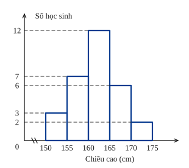

# Chủ đề 4. Các số đo mức độ phân tán của mẫu số liệu ghép nhóm

> Số trung bình cho biết số liệu "ở quanh đâu", còn các số đo phân tán cho biết số liệu "trải rộng bao nhiêu". Chủ đề này dùng để so sánh độ ổn định, độ đồng đều giữa hai nhóm đối tượng. Đề thi tốt nghiệp thường có một câu đúng/sai hoặc trả lời ngắn về khoảng tứ phân vị, phương sai, độ lệch chuẩn của bảng ghép nhóm.

## I. Kiến thức cần nắm

### 1. Mẫu số liệu ghép nhóm và các kí hiệu
Mẫu số liệu ghép nhóm có $k$ nhóm $[a_1; a_2), [a_2; a_3), \dots, [a_k; a_{k+1})$ với tần số $m_1, m_2, \dots, m_k$; cỡ mẫu $n = m_1 + m_2 + \dots + m_k$.
- **Giá trị đại diện** của nhóm $i$ là trung điểm $x_i = \frac{a_i + a_{i+1}}{2}$.
- **Số trung bình:** $\overline{x} = \frac{m_1x_1 + m_2x_2 + \dots + m_kx_k}{n}$.
- **Tần số tích lũy** đến nhóm $i$: $cf_i = m_1 + \dots + m_i$.

Mọi số đặc trưng của mẫu ghép nhóm chỉ là **giá trị xấp xỉ** cho mẫu số liệu gốc.

### 2. Khoảng biến thiên
$$R = a_{k+1} - a_1$$
(đầu mút phải của nhóm cuối trừ đầu mút trái của nhóm đầu, chỉ tính các nhóm có tần số khác 0 ở hai đầu).

*Ý nghĩa:* đo độ trải rộng của toàn bộ mẫu. Dễ tính nhưng **bị ảnh hưởng mạnh bởi giá trị bất thường** (rất lớn hoặc rất nhỏ).

*Ví dụ mẫu.* Bảng thời gian $[10; 20), [20; 30), [30; 40), [40; 50)$ với tần số $3, 8, 6, 3$ có $R = 50 - 10 = 40$.

### 3. Tứ phân vị và khoảng tứ phân vị
**Công thức chung** cho tứ phân vị thứ $j$ ($j = 1, 2, 3$): tìm nhóm $[a_p; a_{p+1})$ đầu tiên có tần số tích lũy $\ge \frac{jn}{4}$. Khi đó
$$Q_j = a_p + \frac{\frac{jn}{4} - (m_1 + \dots + m_{p-1})}{m_p}\cdot(a_{p+1} - a_p).$$
- $j = 1$ cho $Q_1$, $j = 2$ cho trung vị $Q_2 = M_e$, $j = 3$ cho $Q_3$.
- **Khoảng tứ phân vị:** $\Delta_Q = Q_3 - Q_1$.

*Ý nghĩa:* $\Delta_Q$ là độ dài khoảng chứa khoảng **50% số liệu ở giữa**. Nó **ít bị ảnh hưởng bởi giá trị bất thường** hơn khoảng biến thiên.

*Ví dụ mẫu.* Với bảng ở mục 2: $n = 20$, $\frac n4 = 5$; tần số tích lũy $3, 11, 17, 20$. Nhóm chứa $Q_1$ là $[20; 30)$: $Q_1 = 20 + \frac{5 - 3}{8}\cdot10 = 22{,}5$. $\frac{3n}{4} = 15$, nhóm chứa $Q_3$ là $[30; 40)$: $Q_3 = 30 + \frac{15 - 11}{6}\cdot10 = \frac{110}{3} \approx 36{,}67$. $\Delta_Q \approx 14{,}17$.

### 4. Phương sai và độ lệch chuẩn
$$s^2 = \frac{m_1(x_1 - \overline{x})^2 + \dots + m_k(x_k - \overline{x})^2}{n} = \frac{m_1x_1^2 + \dots + m_kx_k^2}{n} - \overline{x}^2,\qquad s = \sqrt{s^2}.$$

*Vì sao hai công thức bằng nhau:* khai triển $(x_i - \overline x)^2 = x_i^2 - 2\overline x x_i + \overline x^2$, rồi dùng $\sum m_ix_i = n\overline x$ và $\sum m_i = n$:
$\sum m_i(x_i - \overline x)^2 = \sum m_ix_i^2 - 2\overline x\cdot n\overline x + n\overline x^2 = \sum m_ix_i^2 - n\overline x^2$.

*Ý nghĩa:* $s$ đo độ lệch "trung bình" của số liệu so với số trung bình, **cùng đơn vị** với số liệu. $s$ càng nhỏ thì số liệu càng tập trung quanh $\overline x$, tức càng **ổn định, đồng đều**.

*Ví dụ mẫu.* Với bảng ở mục 2, các giá trị đại diện $15, 25, 35, 45$: $\overline x = \frac{45 + 200 + 210 + 135}{20} = 29{,}5$; $\frac{\sum m_ix_i^2}{n} = \frac{675 + 5000 + 7350 + 6075}{20} = 955$; $s^2 = 955 - 29{,}5^2 = 84{,}75$; $s \approx 9{,}21$.

### 5. So sánh và một số tính chất hay dùng
- Hai mẫu có số trung bình xấp xỉ nhau: mẫu nào có **độ lệch chuẩn nhỏ hơn** (hoặc khoảng tứ phân vị nhỏ hơn) thì **đồng đều, ổn định hơn**.
- **Đổi đơn vị tuyến tính** $y = ax + b$ (áp dụng cho mọi đầu mút nhóm): $\overline y = a\overline x + b$; $Q_j$ cũng biến đổi như vậy; nhưng $R_y = \lvert a\rvert R_x$, $\Delta_{Q,y} = \lvert a\rvert\Delta_{Q,x}$, $s_y = \lvert a\rvert s_x$, $s_y^2 = a^2s_x^2$. Hằng số $b$ không làm thay đổi độ phân tán.
- **Gộp hai mẫu:** dùng $\sum m_ix_i^2 = n(s^2 + \overline x^2)$ cho từng mẫu, cộng lại, rồi áp dụng lại công thức phương sai cho mẫu gộp.

### 6. Sai lầm hay gặp
- Dùng **đầu mút** nhóm thay cho **trung điểm** khi tính số trung bình, phương sai.
- Quên trừ $\overline x^2$, hoặc trừ $\overline x$ thay vì $\overline x^2$.
- Nhầm phương sai với độ lệch chuẩn (khác đơn vị: đơn vị của $s^2$ là bình phương đơn vị số liệu).
- Trong công thức $Q_j$, lấy tần số tích lũy **đến hết** nhóm $p$ thay cho tần số tích lũy **trước** nhóm $p$.
- Bấm máy tính bỏ túi nhưng nhập sai tần số, hoặc chọn chế độ phương sai "mẫu hiệu chỉnh" (chia $n - 1$). Chương trình dùng công thức chia cho $n$.

---

## II. Bài tập vận dụng

**Bài 1.** Thời gian tự học mỗi ngày (phút) của 40 học sinh được cho trong bảng:

| Thời gian (phút) | $[0; 20)$ | $[20; 40)$ | $[40; 60)$ | $[60; 80)$ | $[80; 100)$ |
|---|---|---|---|---|---|
| Số học sinh | $5$ | $9$ | $12$ | $10$ | $4$ |

Tìm khoảng biến thiên của mẫu số liệu. Khoảng biến thiên của mẫu số liệu gốc có thể lớn hơn giá trị này không?

**Bài 2.** Với mẫu số liệu ở Bài 1, tìm các tứ phân vị $Q_1$, $Q_3$ và khoảng tứ phân vị.

**Bài 3.** Cân nặng (kg) của 40 học sinh lớp 12A:

| Cân nặng (kg) | $[40; 45)$ | $[45; 50)$ | $[50; 55)$ | $[55; 60)$ | $[60; 65)$ |
|---|---|---|---|---|---|
| Số học sinh | $4$ | $10$ | $16$ | $7$ | $3$ |

Tính số trung bình, phương sai và độ lệch chuẩn (làm tròn đến hàng phần trăm).

**Bài 4.** Năng suất lúa (tạ/ha) của hai giống lúa A và B, mỗi giống trồng trên 20 thửa ruộng:

| Năng suất (tạ/ha) | $[50; 55)$ | $[55; 60)$ | $[60; 65)$ | $[65; 70)$ | $[70; 75)$ |
|---|---|---|---|---|---|
| Giống A | $1$ | $4$ | $10$ | $4$ | $1$ |
| Giống B | $3$ | $4$ | $6$ | $4$ | $3$ |

a) So sánh năng suất trung bình và khoảng biến thiên của hai giống.
b) Dùng khoảng tứ phân vị và độ lệch chuẩn, cho biết giống nào cho năng suất ổn định hơn.

**Bài 5 (đúng/sai).** Thời gian sử dụng điện thoại mỗi ngày (giờ) của 40 người:

| Thời gian (giờ) | $[0; 2)$ | $[2; 4)$ | $[4; 6)$ | $[6; 8)$ | $[8; 10)$ |
|---|---|---|---|---|---|
| Số người | $6$ | $10$ | $14$ | $8$ | $2$ |

Mỗi khẳng định sau đúng hay sai?
a) Khoảng biến thiên của mẫu số liệu là $10$ giờ.
b) Tứ phân vị thứ nhất thuộc nhóm $[0; 2)$.
c) Khoảng tứ phân vị bằng $3{,}2$ giờ.
d) Phương sai của mẫu số liệu xấp xỉ $2{,}18$.

**Bài 6 (trả lời ngắn).** Thời gian chạy 100 m (giây) của 40 học sinh nam:

| Thời gian (giây) | $[12; 13)$ | $[13; 14)$ | $[14; 15)$ | $[15; 16)$ | $[16; 17)$ |
|---|---|---|---|---|---|
| Số học sinh | $3$ | $8$ | $15$ | $10$ | $4$ |

Tính khoảng tứ phân vị của mẫu số liệu (viết dưới dạng số thập phân).

**Bài 7 (trả lời ngắn).** Chiều cao của 30 học sinh được biểu diễn bằng biểu đồ tần số dưới đây (các nhóm $[150; 155)$, $[155; 160)$, ..., $[170; 175)$).

*Hình: Biểu đồ tần số ghép nhóm chiều cao của 30 học sinh.*

Tính độ lệch chuẩn của mẫu số liệu (đơn vị cm, làm tròn đến hàng phần trăm).

**Bài 8 (thực tế).** Một cửa hàng thử tuổi thọ (giờ) của 50 bóng đèn mỗi loại thuộc hai nhãn hiệu A và B:

| Tuổi thọ (giờ) | $[800; 1000)$ | $[1000; 1200)$ | $[1200; 1400)$ | $[1400; 1600)$ |
|---|---|---|---|---|
| Nhãn hiệu A | $5$ | $15$ | $22$ | $8$ |
| Nhãn hiệu B | $10$ | $10$ | $18$ | $12$ |

Tính tuổi thọ trung bình và độ lệch chuẩn của mỗi loại. Nên chọn nhãn hiệu nào nếu muốn tuổi thọ bóng đèn đồng đều hơn?

**Bài 9 (vận dụng cao).** Điểm kiểm tra của một nhóm học sinh cho bởi bảng, trong đó $x$ là số nguyên dương chưa biết:

| Điểm | $[0; 2)$ | $[2; 4)$ | $[4; 6)$ | $[6; 8)$ |
|---|---|---|---|---|
| Số học sinh | $4$ | $x$ | $10$ | $6$ |

Biết số trung bình của mẫu số liệu là $4{,}5$. Tìm $x$ rồi tính phương sai và độ lệch chuẩn.

**Bài 10 (đúng/sai, vận dụng cao).** Nhiệt độ trung bình hằng ngày của một thành phố trong 30 ngày được ghi lại dưới dạng mẫu ghép nhóm theo độ C. Mẫu này có khoảng biến thiên $10$, khoảng tứ phân vị $3$ và phương sai $4$. Người ta đổi toàn bộ số liệu (kể cả các đầu mút nhóm) sang độ F theo công thức $F = 1{,}8C + 32$. Đối với mẫu mới, mỗi khẳng định sau đúng hay sai?
a) Khoảng biến thiên bằng $18$.
b) Phương sai bằng $7{,}2$.
c) Độ lệch chuẩn bằng $3{,}6$.
d) Khoảng tứ phân vị bằng $37{,}4$.

**Bài 11 (vận dụng cao, trả lời ngắn).** Từ bảng điểm ghép nhóm môn Toán, người ta tính được: lớp 12A có 40 học sinh, điểm trung bình $6{,}5$, độ lệch chuẩn $1{,}2$; lớp 12B có 35 học sinh, điểm trung bình $7$, độ lệch chuẩn $1{,}5$. Gộp hai bảng thành một mẫu số liệu (cùng cách chia nhóm). Tính độ lệch chuẩn của mẫu gộp (làm tròn đến hàng phần trăm).

---

## III. Lời giải chi tiết

### Bài 1
$R = 100 - 0 = 100$ (phút).

Khoảng biến thiên của mẫu gốc là hiệu giữa giá trị lớn nhất và nhỏ nhất thực sự; các giá trị này nằm trong $[0; 100)$ nên khoảng biến thiên của mẫu gốc **không lớn hơn** $100$. Nó có thể nhỏ hơn (ví dụ thời gian ít nhất là 5 phút, nhiều nhất là 95 phút thì chỉ bằng 90).

*Nhận xét:* khoảng biến thiên của mẫu ghép nhóm là giá trị xấp xỉ, luôn không nhỏ hơn khoảng biến thiên của mẫu gốc.

### Bài 2
$n = 40$. Tần số tích lũy: $5, 14, 26, 36, 40$.

- $\frac n4 = 10$: nhóm đầu tiên có tần số tích lũy $\ge 10$ là $[20; 40)$ (tần số tích lũy trước đó là $5$, tần số nhóm là $9$):
$$Q_1 = 20 + \frac{10 - 5}{9}\cdot20 = \frac{280}{9} \approx 31{,}11.$$
- $\frac{3n}{4} = 30$: nhóm chứa $Q_3$ là $[60; 80)$ (tần số tích lũy trước đó $26$, tần số nhóm $10$):
$$Q_3 = 60 + \frac{30 - 26}{10}\cdot20 = 68.$$
- $\Delta_Q = 68 - \frac{280}{9} = \frac{332}{9} \approx 36{,}89$ (phút).

### Bài 3
Giá trị đại diện: $42{,}5;\ 47{,}5;\ 52{,}5;\ 57{,}5;\ 62{,}5$.
$$\overline x = \frac{4\cdot42{,}5 + 10\cdot47{,}5 + 16\cdot52{,}5 + 7\cdot57{,}5 + 3\cdot62{,}5}{40} = \frac{2075}{40} = 51{,}875 \text{ (kg)}.$$
$$\frac{\sum m_ix_i^2}{n} = \frac{4\cdot42{,}5^2 + 10\cdot47{,}5^2 + 16\cdot52{,}5^2 + 7\cdot57{,}5^2 + 3\cdot62{,}5^2}{40} = \frac{108750}{40} = 2718{,}75.$$
$$s^2 = 2718{,}75 - 51{,}875^2 = 27{,}734375 \approx 27{,}73,\qquad s \approx 5{,}27 \text{ (kg)}.$$

### Bài 4
Giá trị đại diện: $52{,}5;\ 57{,}5;\ 62{,}5;\ 67{,}5;\ 72{,}5$.

**a)** Cả hai bảng đối xứng quanh nhóm giữa, nên
$$\overline x_A = \overline x_B = 62{,}5 \text{ (tạ/ha)}.$$
(Kiểm tra: $\overline x_A = \frac{52{,}5 + 230 + 625 + 270 + 72{,}5}{20} = \frac{1250}{20} = 62{,}5$.) Khoảng biến thiên của hai giống đều bằng $75 - 50 = 25$. Hai số đo này không phân biệt được hai giống.

**b)** *Khoảng tứ phân vị.* $\frac n4 = 5$, $\frac{3n}{4} = 15$.
- Giống A: tần số tích lũy $1, 5, 15, 19, 20$. $Q_1 = 55 + \frac{5 - 1}{4}\cdot5 = 60$; $Q_3 = 60 + \frac{15 - 5}{10}\cdot5 = 65$; $\Delta_Q = 5$.
- Giống B: tần số tích lũy $3, 7, 13, 17, 20$. $Q_1 = 55 + \frac{5 - 3}{4}\cdot5 = 57{,}5$; $Q_3 = 65 + \frac{15 - 13}{4}\cdot5 = 67{,}5$; $\Delta_Q = 10$.

*Độ lệch chuẩn.* Độ lệch $x_i - \overline x$ lần lượt là $-10, -5, 0, 5, 10$:
$$s_A^2 = \frac{1\cdot100 + 4\cdot25 + 0 + 4\cdot25 + 1\cdot100}{20} = 20,\quad s_A \approx 4{,}47;$$
$$s_B^2 = \frac{3\cdot100 + 4\cdot25 + 0 + 4\cdot25 + 3\cdot100}{20} = 40,\quad s_B \approx 6{,}32.$$
Giống A có khoảng tứ phân vị và độ lệch chuẩn đều nhỏ hơn, nên **giống A cho năng suất ổn định hơn**.

### Bài 5
Tần số tích lũy: $6, 16, 30, 38, 40$; $n = 40$.

**a) Đúng.** $R = 10 - 0 = 10$.

**b) Sai.** $\frac n4 = 10 > 6$, nên $Q_1$ không thuộc nhóm $[0; 2)$; nhóm đầu tiên có tần số tích lũy $\ge 10$ là $[2; 4)$.

**c) Đúng.** $Q_1 = 2 + \frac{10 - 6}{10}\cdot2 = 2{,}8$. $\frac{3n}{4} = 30$, nhóm chứa $Q_3$ là $[4; 6)$: $Q_3 = 4 + \frac{30 - 16}{14}\cdot2 = 6$. $\Delta_Q = 6 - 2{,}8 = 3{,}2$.

**d) Sai.** Giá trị đại diện $1, 3, 5, 7, 9$:
$\overline x = \frac{6 + 30 + 70 + 56 + 18}{40} = 4{,}5$; $\frac{\sum m_ix_i^2}{n} = \frac{6 + 90 + 350 + 392 + 162}{40} = 25$; $s^2 = 25 - 4{,}5^2 = 4{,}75$.
Phương sai là $4{,}75$; số $2{,}18$ là độ lệch chuẩn ($\sqrt{4{,}75} \approx 2{,}18$).

### Bài 6
Tần số tích lũy: $3, 11, 26, 36, 40$.
- $\frac n4 = 10$: nhóm $[13; 14)$, $Q_1 = 13 + \frac{10 - 3}{8}\cdot1 = 13{,}875$.
- $\frac{3n}{4} = 30$: nhóm $[15; 16)$, $Q_3 = 15 + \frac{30 - 26}{10}\cdot1 = 15{,}4$.
- $\Delta_Q = 15{,}4 - 13{,}875 = 1{,}525$.

**Đáp số:** $1{,}525$ giây.

### Bài 7
Đọc biểu đồ: tần số các nhóm $[150; 155), \dots, [170; 175)$ lần lượt là $3, 7, 12, 6, 2$, $n = 30$. Giá trị đại diện $152{,}5;\ 157{,}5;\ 162{,}5;\ 167{,}5;\ 172{,}5$.
$$\overline x = \frac{457{,}5 + 1102{,}5 + 1950 + 1005 + 345}{30} = \frac{4860}{30} = 162.$$
Độ lệch $x_i - \overline x$: $-9{,}5;\ -4{,}5;\ 0{,}5;\ 5{,}5;\ 10{,}5$.
$$s^2 = \frac{3\cdot90{,}25 + 7\cdot20{,}25 + 12\cdot0{,}25 + 6\cdot30{,}25 + 2\cdot110{,}25}{30} = \frac{817{,}5}{30} = 27{,}25.$$
$s = \sqrt{27{,}25} \approx 5{,}22$.

**Đáp số:** $5{,}22$ cm.

### Bài 8
Giá trị đại diện: $900;\ 1100;\ 1300;\ 1500$; mỗi mẫu có $n = 50$.

**Nhãn hiệu A:** $\overline x_A = \frac{5\cdot900 + 15\cdot1100 + 22\cdot1300 + 8\cdot1500}{50} = \frac{61600}{50} = 1232$.
$\frac{\sum m_ix_i^2}{n} = \frac{77\,380\,000}{50} = 1\,547\,600$, $s_A^2 = 1\,547\,600 - 1232^2 = 29\,776$, $s_A \approx 172{,}6$ giờ.

**Nhãn hiệu B:** $\overline x_B = \frac{10\cdot900 + 10\cdot1100 + 18\cdot1300 + 12\cdot1500}{50} = \frac{61400}{50} = 1228$.
$\frac{\sum m_ix_i^2}{n} = \frac{77\,620\,000}{50} = 1\,552\,400$, $s_B^2 = 1\,552\,400 - 1228^2 = 44\,416$, $s_B \approx 210{,}8$ giờ.

Tuổi thọ trung bình gần bằng nhau, nhưng $s_A < s_B$. Nên chọn **nhãn hiệu A** để tuổi thọ đồng đều hơn.

### Bài 9
Giá trị đại diện $1, 3, 5, 7$; $n = 20 + x$.
$$\overline x = \frac{4 + 3x + 50 + 42}{20 + x} = \frac{96 + 3x}{20 + x} = 4{,}5 \iff 96 + 3x = 90 + 4{,}5x \iff x = 4.$$
Khi đó $n = 24$, $\sum m_ix_i^2 = 4\cdot1 + 4\cdot9 + 10\cdot25 + 6\cdot49 = 584$.
$$s^2 = \frac{584}{24} - 4{,}5^2 = \frac{73}{3} - \frac{81}{4} = \frac{49}{12} \approx 4{,}08,\qquad s = \frac{7}{2\sqrt3} \approx 2{,}02.$$

### Bài 10
Phép đổi $F = 1{,}8C + 32$ biến mọi đầu mút $a$ thành $1{,}8a + 32$, nên mọi giá trị đại diện, số trung bình và các tứ phân vị cũng biến đổi theo đúng công thức đó (công thức $Q_j$ và công thức trung bình đều "tuyến tính"). Mọi hiệu (như $a_{k+1} - a_1$, $Q_3 - Q_1$, $x_i - \overline x$) được nhân với $1{,}8$, còn số $32$ bị triệt tiêu.

**a) Đúng.** $R_F = 1{,}8\cdot10 = 18$.

**b) Sai.** Các độ lệch $x_i - \overline x$ nhân với $1{,}8$ nên phương sai nhân với $1{,}8^2 = 3{,}24$: $s_F^2 = 3{,}24\cdot4 = 12{,}96$.

**c) Đúng.** $s_F = \sqrt{12{,}96} = 3{,}6 = 1{,}8\cdot2$.

**d) Sai.** $\Delta_{Q,F} = 1{,}8\cdot3 = 5{,}4$. Con số $37{,}4 = 1{,}8\cdot3 + 32$ mắc lỗi cộng thêm $32$ vào một **hiệu**.

*Nhận xét:* cộng thêm một hằng số không làm thay đổi độ phân tán; nhân với $a$ thì các số đo phân tán nhân với $\lvert a\rvert$, phương sai nhân với $a^2$.

### Bài 11
Với mỗi lớp, từ $s^2 = \frac{\sum m_ix_i^2}{n} - \overline x^2$ suy ra $\sum m_ix_i^2 = n(s^2 + \overline x^2)$:
- Lớp 12A: $40(1{,}44 + 42{,}25) = 1747{,}6$.
- Lớp 12B: $35(2{,}25 + 49) = 1793{,}75$.

Mẫu gộp có $n = 75$, tổng các giá trị $40\cdot6{,}5 + 35\cdot7 = 505$, nên $\overline x = \frac{505}{75} = \frac{101}{15}$.
$$s^2 = \frac{1747{,}6 + 1793{,}75}{75} - \left(\frac{101}{15}\right)^2 = 47{,}218 - 45{,}3378\ldots = \frac{8461}{4500} \approx 1{,}8802.$$
$s \approx 1{,}37$.

**Đáp số:** $1{,}37$.

*Nhận xét:* phương sai mẫu gộp lớn hơn trung bình cộng hai phương sai, vì hai lớp có điểm trung bình khác nhau tạo thêm độ phân tán.
