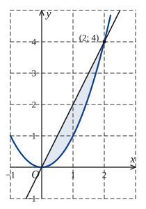
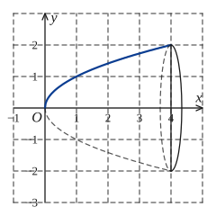

# Chủ đề 6. Tích phân và ứng dụng

> Tích phân đo "tổng tích lũy" của một đại lượng biến thiên: diện tích hình phẳng, thể tích vật thể, quãng đường khi biết vận tốc, lượng nước chảy vào bể. Chủ đề này luyện công thức Newton – Leibniz, các tính chất của tích phân và hai ứng dụng hình học chính.

## I. Kiến thức cần nắm

### 1. Định nghĩa (Newton – Leibniz)

Nếu $F$ là một nguyên hàm của $f$ trên $[a; b]$ thì
$$\int_a^b f(x)\,dx = F(x)\Big|_a^b = F(b) - F(a).$$
Tích phân không phụ thuộc tên biến: $\int_a^b f(x)\,dx = \int_a^b f(t)\,dt$.

### 2. Tính chất

- $\int_a^a f = 0$; $\int_a^b f = -\int_b^a f$.
- $\int_a^b[kf \pm g] = k\int_a^b f \pm \int_a^b g$.
- $\int_a^c f = \int_a^b f + \int_b^c f$.
- Hàm chứa trị tuyệt đối: chia đoạn theo dấu của biểu thức trong trị tuyệt đối.

### 3. Diện tích hình phẳng

- Giới hạn bởi $y = f(x)$, trục $Ox$, $x = a$, $x = b$: $S = \int_a^b\lvert f(x)\rvert\,dx$.
- Giới hạn bởi $y = f(x)$, $y = g(x)$, $x = a$, $x = b$: $S = \int_a^b\lvert f(x) - g(x)\rvert\,dx$. Nếu chưa cho $a$, $b$: giải $f(x) = g(x)$ để tìm cận.

### 4. Thể tích

- Vật thể có diện tích thiết diện $S(x)$ vuông góc với $Ox$: $V = \int_a^b S(x)\,dx$.
- Khối tròn xoay khi quay hình phẳng giới hạn bởi $y = f(x)$, $Ox$, $x = a$, $x = b$ quanh $Ox$: $V = \pi\int_a^b f^2(x)\,dx$.

### 5. Ứng dụng thực tế

Quãng đường đi được từ $t = a$ đến $t = b$ (vận tốc không đổi dấu): $s = \int_a^b v(t)\,dt$.

### 6. Sai lầm hay gặp

- Quên giá trị tuyệt đối khi tính diện tích (phần dưới trục $Ox$ cho tích phân âm).
- Quên hệ số $\pi$ hoặc quên bình phương $f(x)$ trong công thức thể tích.
- Đổi cận sai thứ tự (cận dưới phải là $a$).

## II. Bài tập vận dụng

**Bài 1.** Tính $\int_0^2(3x^2 - 2x + 1)\,dx$.

**Bài 2.** Tính $\int_1^e\dfrac{1}{x}\,dx$ và $\int_0^{\frac{\pi}{2}}\cos x\,dx$.

**Bài 3.** Tính $\int_0^1 e^{2x}\,dx$.

**Bài 4.** Biết $\int_0^3 f(x)\,dx = 5$ và $\int_0^1 f(x)\,dx = 2$. Tính $\int_1^3 f(x)\,dx$ và $\int_0^3[2f(x) + 1]\,dx$.

**Bài 5.** Tính $\int_{-1}^2\lvert x\rvert\,dx$.

**Bài 6.** Tính diện tích hình phẳng giới hạn bởi parabol $y = x^2$ và đường thẳng $y = 2x$.

**Bài 7.** Tính diện tích hình phẳng giới hạn bởi parabol $y = x^2 - 4$ và trục hoành.

**Bài 8.** Tính thể tích khối tròn xoay tạo thành khi quay hình phẳng giới hạn bởi $y = \sqrt{x}$, trục $Ox$ và đường thẳng $x = 4$ quanh trục $Ox$.

**Bài 9.** Dùng tích phân chứng minh thể tích khối nón có bán kính đáy $r$, chiều cao $h$ là $\dfrac{1}{3}\pi r^2h$.

**Bài 10 (đúng/sai).** Xét tính đúng sai, giải thích:
a) $\int_0^1 2x\,dx = 1$.
b) $\int_{-1}^1 x^3\,dx = 0$.
c) $\int_0^\pi\sin x\,dx = 0$.
d) Nếu $f(x) \ge 0$ trên $[a; b]$ thì $\int_a^b f(x)\,dx \ge 0$.

**Bài 11 (thực tế).** Một ô tô đang chạy với vận tốc 20 m/s thì phanh, sau đó chuyển động chậm dần với vận tốc $v(t) = 20 - 5t$ (m/s). Tính quãng đường ô tô đi được từ lúc phanh đến khi dừng hẳn.

**Bài 12 (trả lời ngắn).** Tính diện tích hình phẳng giới hạn bởi hai đồ thị $y = x^3$ và $y = x$.

**Bài 13 (vận dụng cao, thực tế).** Một cổng hình parabol có chiều rộng chân cổng 8 m, chiều cao 6 m. Người ta lắp cửa kính kín cả mặt cổng với giá 1,2 triệu đồng/m². Tính chi phí.

---

## III. Lời giải chi tiết

### Bài 1
$\left[x^3 - x^2 + x\right]_0^2 = 8 - 4 + 2 = 6$.

### Bài 2
$\ln x\Big|_1^e = 1$. $\sin x\Big|_0^{\frac{\pi}{2}} = 1$.

### Bài 3
$\dfrac{e^{2x}}{2}\Big|_0^1 = \dfrac{e^2 - 1}{2}$.

### Bài 4
$\int_1^3 f = 5 - 2 = 3$. $\int_0^3[2f(x) + 1]\,dx = 2 \cdot 5 + 3 = 13$.

### Bài 5
$\int_{-1}^0(-x)\,dx + \int_0^2 x\,dx = \dfrac{1}{2} + 2 = \dfrac{5}{2}$.

### Bài 6

*Hình: Hình phẳng giới hạn bởi parabol y = x² và đường thẳng y = 2x.*

Hoành độ giao điểm: $x^2 = 2x \iff x = 0$ hoặc $x = 2$; trên $[0; 2]$, $2x \ge x^2$.
$S = \int_0^2(2x - x^2)\,dx = \left[x^2 - \dfrac{x^3}{3}\right]_0^2 = \dfrac{4}{3}$.

### Bài 7
Giao với $Ox$: $x = \pm 2$; trên $[-2; 2]$, $x^2 - 4 \le 0$. $S = \int_{-2}^2(4 - x^2)\,dx = \left[4x - \dfrac{x^3}{3}\right]_{-2}^2 = \dfrac{32}{3}$.

### Bài 8

*Hình: Khối tròn xoay sinh ra khi quay hình phẳng giới hạn bởi y = √x, trục Ox, x = 4 quanh Ox.*

$V = \pi\int_0^4 x\,dx = \pi \cdot \dfrac{x^2}{2}\Big|_0^4 = 8\pi$.

### Bài 9
Đặt đỉnh nón tại gốc, trục nón là $Ox$: đường sinh là $y = \dfrac{r}{h}x$, $0 \le x \le h$. $V = \pi\int_0^h\dfrac{r^2}{h^2}x^2\,dx = \pi\dfrac{r^2}{h^2} \cdot \dfrac{h^3}{3} = \dfrac{1}{3}\pi r^2h$.

### Bài 10
a) **Đúng.** $x^2\Big|_0^1 = 1$.
b) **Đúng.** $\dfrac{x^4}{4}\Big|_{-1}^1 = 0$ (hàm lẻ trên đoạn đối xứng).
c) **Sai.** $-\cos x\Big|_0^\pi = 2$.
d) **Đúng.** Tích phân của hàm không âm là diện tích, không âm.

### Bài 11
Dừng khi $v = 0$: $t = 4$. $s = \int_0^4(20 - 5t)\,dt = \left[20t - \dfrac{5t^2}{2}\right]_0^4 = 80 - 40 = 40$ (m).

### Bài 12
$x^3 = x \iff x \in \{-1; 0; 1\}$. Do tính đối xứng: $S = 2\int_0^1(x - x^3)\,dx = 2\left(\dfrac{1}{2} - \dfrac{1}{4}\right) = 0{,}5$.
**Đáp số:** 0,5.

### Bài 13
Gốc tọa độ ở trung điểm chân cổng: parabol $y = 6 - \dfrac{3}{8}x^2$ đi qua $(\pm 4; 0)$. Diện tích $S = \int_{-4}^4\left(6 - \dfrac{3}{8}x^2\right)dx = \left[6x - \dfrac{x^3}{8}\right]_{-4}^4 = 2(24 - 8) = 32$ (m²). Chi phí $32 \cdot 1{,}2 = 38{,}4$ triệu đồng.
