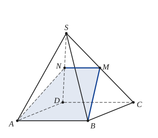

# Chủ đề 7. Hình học không gian

> Câu hình không gian trong đề học sinh giỏi lớp 12 thường kết hợp thể tích (tỉ số thể tích), khoảng cách giữa hai đường chéo nhau, mặt cầu ngoại tiếp, và bài toán cực trị thể tích của khối trụ, khối nón nội tiếp được giải bằng đạo hàm. Phương pháp tọa độ hóa là công cụ hỗ trợ mạnh khi hình có các cạnh vuông góc.

## I. Kiến thức cần nắm

### 1. Tỉ số thể tích

Với $M \in SA$, $N \in SB$, $P \in SC$: $\dfrac{V_{S.MNP}}{V_{S.ABC}} = \dfrac{SM}{SA} \cdot \dfrac{SN}{SB} \cdot \dfrac{SP}{SC}$ (chỉ áp dụng cho khối chóp tam giác; khối chóp tứ giác thì chia thành hai khối chóp tam giác).

### 2. Khoảng cách

- Từ chân đường cao đến mặt bên: đường cao tam giác vuông.
- Hai đường chéo nhau: đưa về khoảng cách từ điểm đến mặt phẳng song song, hoặc tọa độ hóa: $d(a, b) = \dfrac{\lvert[\vec u_a, \vec u_b] \cdot \overrightarrow{M_aM_b}\rvert}{\lvert[\vec u_a, \vec u_b]\rvert}$.

### 3. Mặt cầu ngoại tiếp

- Hình chóp đều cạnh bên $l$, chiều cao $h$: $R = \dfrac{l^2}{2h}$.
- Tứ diện có ba cạnh đôi một vuông góc độ dài $a, b, c$: $R = \dfrac{\sqrt{a^2 + b^2 + c^2}}{2}$.
- Hình chóp có cạnh bên vuông góc với đáy: $R = \sqrt{r^2 + \dfrac{h^2}{4}}$ ($r$ là bán kính đường tròn ngoại tiếp đáy).

### 4. Khối tròn xoay

$V_{\text{trụ}} = \pi r^2h$, $V_{\text{nón}} = \dfrac{1}{3}\pi r^2h$, $V_{\text{cầu}} = \dfrac{4}{3}\pi R^3$.

### 5. Cực trị

Đặt ẩn là một kích thước (chiều cao, bán kính), biểu diễn thể tích theo ẩn đó rồi khảo sát bằng đạo hàm hoặc AM-GM.

## II. Bài tập vận dụng

**Bài 1.** Cho khối chóp $S.ABC$. Lấy $M \in SA$, $N \in SB$ với $SM = \dfrac{1}{2}SA$, $SN = \dfrac{2}{3}SB$. Tính tỉ số $\dfrac{V_{S.MNC}}{V_{S.ABC}}$.

**Bài 2.** Cho khối chóp $S.ABCD$ có đáy là hình bình hành, thể tích $V$; $M$ là trung điểm $SC$. Mặt phẳng $(ABM)$ cắt $SD$ tại $N$. Tính thể tích khối chóp $S.ABMN$ theo $V$.

**Bài 3.** Hình chóp $S.ABC$ có $SA = SB = SC = 2$, đáy là tam giác đều cạnh $\sqrt{3}$. Tính thể tích.

**Bài 4.** Hình chóp $S.ABCD$ có đáy là hình vuông cạnh $a$, $SA \perp (ABCD)$, $SA = a$. Tính khoảng cách giữa $SB$ và $AD$, và khoảng cách giữa $BD$ và $SC$.

**Bài 5.** Với hình chóp ở bài 4, tính góc giữa hai mặt phẳng $(SBC)$ và $(SCD)$.

**Bài 6.** Tính bán kính mặt cầu ngoại tiếp hình chóp tứ giác đều có cạnh đáy 2 và chiều cao 2.

**Bài 7.** Tính bán kính mặt cầu ngoại tiếp tứ diện $OABC$ có $OA = 1$, $OB = 2$, $OC = 2$ đôi một vuông góc.

**Bài 8.** Hình chóp $S.ABC$ có $SA \perp (ABC)$, $SA = 2a$, tam giác $ABC$ đều cạnh $a\sqrt{3}$. Tính bán kính mặt cầu ngoại tiếp hình chóp.

**Bài 9 (cực trị).** Trong các khối trụ nội tiếp mặt cầu bán kính $R$, tìm khối trụ có thể tích lớn nhất.

**Bài 10 (cực trị).** Trong các khối nón nội tiếp mặt cầu bán kính $R$, tìm khối nón có thể tích lớn nhất.

**Bài 11.** Quay tam giác vuông có hai cạnh góc vuông 3 và 4 quanh cạnh dài 3. Tính thể tích khối nón tạo thành.

**Bài 12 (HSG).** Tứ diện $ABCD$ có $AB = CD = a$, $AC = BD = b$, $AD = BC = c$. Tính bán kính mặt cầu ngoại tiếp.

---

## III. Lời giải chi tiết

### Bài 1
$\dfrac{V_{S.MNC}}{V_{S.ABC}} = \dfrac{1}{2} \cdot \dfrac{2}{3} \cdot 1 = \dfrac{1}{3}$.

### Bài 2

*Hình: Hình chóp S.ABCD đáy hình bình hành, mặt phẳng (ABM) cắt SD tại N.*

$AB \parallel CD$ nên $MN \parallel CD$, $N$ là trung điểm $SD$. $V_{S.ABC} = V_{S.ACD} = \dfrac{V}{2}$.
$V_{S.ABM} = \dfrac{SM}{SC} \cdot V_{S.ABC} = \dfrac{V}{4}$; $V_{S.AMN} = \dfrac{SM}{SC} \cdot \dfrac{SN}{SD} \cdot V_{S.ACD} = \dfrac{V}{8}$.
$V_{S.ABMN} = \dfrac{V}{4} + \dfrac{V}{8} = \dfrac{3V}{8}$.

### Bài 3
Chân đường cao là tâm $O$ của đáy, $OA = \dfrac{\sqrt{3}}{\sqrt{3}} = 1$; $h = \sqrt{4 - 1} = \sqrt{3}$. $S_{\text{đáy}} = \dfrac{3\sqrt{3}}{4}$, $V = \dfrac{1}{3} \cdot \dfrac{3\sqrt{3}}{4} \cdot \sqrt{3} = \dfrac{3}{4}$.

### Bài 4
$AD \parallel BC \subset (SBC)$ nên $d(SB, AD) = d(A, (SBC)) = \dfrac{a\sqrt{2}}{2}$ (đường cao tam giác vuông cân $SAB$).
Tọa độ: $A(0; 0; 0)$, $B(a; 0; 0)$, $D(0; a; 0)$, $C(a; a; 0)$, $S(0; 0; a)$. $\vec u_{BD} = (-1; 1; 0)$, $\vec u_{SC} = (1; 1; -1)$, $[\vec u_{BD}, \vec u_{SC}] = (-1; -1; -2)$, $\overrightarrow{BS} = (-a; 0; a)$: $d = \dfrac{\lvert a - 2a\rvert}{\sqrt{6}} = \dfrac{a\sqrt{6}}{6}$.

### Bài 5
Lấy $a = 1$. VTPT của $(SBC)$: $[\overrightarrow{SB}, \overrightarrow{SC}] = (1; 0; 1)$; của $(SCD)$: $[\overrightarrow{SC}, \overrightarrow{SD}] = (0; 1; 1)$. $\cos\varphi = \dfrac{1}{2}$, góc giữa hai mặt phẳng là $60^\circ$.

### Bài 6
Cạnh bên $l = \sqrt{h^2 + \left(\dfrac{a\sqrt{2}}{2}\right)^2} = \sqrt{4 + 2} = \sqrt{6}$. $R = \dfrac{l^2}{2h} = \dfrac{6}{4} = \dfrac{3}{2}$.

### Bài 7
$R = \dfrac{\sqrt{1 + 4 + 4}}{2} = \dfrac{3}{2}$.

### Bài 8
Bán kính đường tròn ngoại tiếp đáy $r = \dfrac{a\sqrt{3}}{\sqrt{3}} = a$. $R = \sqrt{a^2 + a^2} = a\sqrt{2}$.

### Bài 9
Gọi $h$ là chiều cao trụ, bán kính đáy $r$ với $r^2 = R^2 - \dfrac{h^2}{4}$. $V(h) = \pi\left(R^2h - \dfrac{h^3}{4}\right)$, $V'(h) = \pi\left(R^2 - \dfrac{3h^2}{4}\right) = 0 \iff h = \dfrac{2R}{\sqrt{3}}$. $V$ tăng rồi giảm: $V_{\max} = \pi \cdot \dfrac{2R^2}{3} \cdot \dfrac{2R}{\sqrt{3}} = \dfrac{4\pi R^3\sqrt{3}}{9}$.

### Bài 10
Đỉnh nón trên mặt cầu, chiều cao $h$ ($0 < h < 2R$), bán kính đáy $r^2 = h(2R - h)$. $V = \dfrac{\pi}{3}h^2(2R - h)$, $V' = \dfrac{\pi}{3}(4Rh - 3h^2) = 0 \iff h = \dfrac{4R}{3}$. $V_{\max} = \dfrac{\pi}{3} \cdot \dfrac{16R^2}{9} \cdot \dfrac{2R}{3} = \dfrac{32\pi R^3}{81}$.

### Bài 11
Chiều cao 3, bán kính đáy 4: $V = \dfrac{1}{3}\pi \cdot 16 \cdot 3 = 16\pi$.

### Bài 12
Tứ diện nội tiếp hình hộp chữ nhật kích thước $x, y, z$ với $x^2 + y^2 = a^2$, $y^2 + z^2 = b^2$, $z^2 + x^2 = c^2$ (các cạnh tứ diện là đường chéo các mặt). Mặt cầu ngoại tiếp tứ diện cũng là mặt cầu ngoại tiếp hình hộp: $R = \dfrac{\sqrt{x^2 + y^2 + z^2}}{2} = \sqrt{\dfrac{a^2 + b^2 + c^2}{8}}$.
