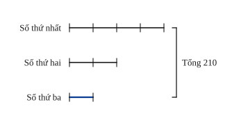

# Chủ đề 4. Số trung bình cộng và bài toán liên quan

> Số trung bình cộng giúp em biết "trung bình mỗi phần được bao nhiêu" khi các phần không bằng nhau: điểm trung bình, cân nặng trung bình, số ki-lô-mét đi được trung bình mỗi giờ. Đề kiểm tra thường có một bài tìm trung bình cộng và một bài ngược: biết trung bình cộng, tìm một số.

## I. Kiến thức cần nắm

### 1. Số trung bình cộng là gì?

Có hai can nước: can thứ nhất 6 l, can thứ hai 4 l. Nếu rót cho hai can bằng nhau thì mỗi can có $(6 + 4) : 2 = 5$ (l). Ta nói **5 là số trung bình cộng** của 6 và 4.

Số trung bình cộng là số ta nhận được khi "san đều" tổng cho các số hạng. Nó luôn nằm giữa số bé nhất và số lớn nhất (hoặc bằng chúng nếu các số bằng nhau).

### 2. Cách tìm số trung bình cộng

Muốn tìm số trung bình cộng của nhiều số, ta tính **tổng** của các số đó, rồi **chia tổng cho số các số hạng**:
$$\text{Trung bình cộng} = \text{Tổng các số} : \text{Số các số hạng}.$$

**Ví dụ.** Số trung bình cộng của 12, 15 và 18 là $(12 + 15 + 18) : 3 = 45 : 3 = 15$.

### 3. Biết trung bình cộng, tìm tổng

Đảo lại công thức trên:
$$\text{Tổng các số} = \text{Trung bình cộng} \times \text{Số các số hạng}.$$

**Ví dụ.** Trung bình mỗi ngày một cửa hàng bán 35 kg đường. Trong 6 ngày cửa hàng bán được $35 \times 6 = 210$ (kg).

### 4. Biết trung bình cộng và các số còn lại, tìm một số

**Bước 1:** tìm tổng của tất cả các số (lấy trung bình cộng nhân với số các số hạng).
**Bước 2:** lấy tổng đó trừ đi tổng các số đã biết.

**Ví dụ.** Trung bình cộng của ba số là 40. Hai số đầu là 35 và 38. Tổng ba số là $40 \times 3 = 120$, số thứ ba là $120 - 35 - 38 = 47$.

### 5. Trung bình cộng của các số cách đều

Với các số cách đều nhau (như 2, 4, 6, 8, 10 hoặc 5 số chẵn liên tiếp):
- trung bình cộng bằng **số ở chính giữa** (khi có lẻ số hạng);
- trung bình cộng cũng bằng $(\text{số đầu} + \text{số cuối}) : 2$.

**Ví dụ.** Trung bình cộng của 2, 4, 6, 8, 10 là $30 : 5 = 6$, đúng bằng số ở giữa, và cũng bằng $(2 + 10) : 2 = 6$.

### 6. Các nhóm có số lượng khác nhau

Khi các nhóm có **số lượng khác nhau**, không được lấy trung bình của các trung bình. Phải tính **tổng tất cả** rồi chia cho **tổng số lượng**.

**Ví dụ.** 2 ngày đầu mỗi ngày đi 30 km, 1 ngày sau đi 60 km. Trung bình mỗi ngày đi $(30 \times 2 + 60) : 3 = 120 : 3 = 40$ (km), không phải $(30 + 60) : 2 = 45$ (km).

### 7. Sai lầm hay gặp

- Chia nhầm số: tổng của **5** số thì phải chia cho 5, kể cả khi có số bằng 0 (một ngày không bán được gì vẫn là một ngày).
- Lấy trung bình của hai trung bình khi hai nhóm có số lượng khác nhau (xem mục 6).
- Bài "thêm một bạn mới": tính tổng mới bằng trung bình **mới** nhân với số người **mới**, không dùng số người cũ.
- Kết quả trung bình nằm ngoài khoảng từ số bé nhất đến số lớn nhất: chắc chắn đã tính sai.

## II. Bài tập vận dụng

**Bài 1.** Tìm số trung bình cộng của các số:
a) 36, 42 và 57;
b) 125, 230, 315 và 410.

**Bài 2.** Cân nặng của năm bạn trong nhóm là 32 kg, 35 kg, 29 kg, 38 kg và 31 kg. Hỏi trung bình mỗi bạn cân nặng bao nhiêu ki-lô-gam?

**Bài 3.** Số trung bình cộng của hai số là 48. Số thứ nhất là 39. Tìm số thứ hai.

**Bài 4.** Một ô tô giờ thứ nhất đi được 48 km, giờ thứ hai đi được 52 km, giờ thứ ba đi được 44 km. Hỏi trung bình mỗi giờ ô tô đi được bao nhiêu ki-lô-mét?

**Bài 5 (thực tế).** Một cửa hàng ngày thứ nhất bán được 120 kg gạo, ngày thứ hai bán được nhiều hơn ngày thứ nhất 30 kg, ngày thứ ba bán được số gạo bằng trung bình cộng số gạo của hai ngày đầu. Hỏi trung bình mỗi ngày cửa hàng bán được bao nhiêu ki-lô-gam gạo?

**Bài 6 (thực tế).** Lớp 4A có 4 tổ, trung bình mỗi tổ trồng được 15 cây. Tổ Một trồng 12 cây, tổ Hai trồng 18 cây, tổ Ba trồng 14 cây. Hỏi tổ Bốn trồng được bao nhiêu cây?

**Bài 7 (thực tế).** Một xe tải chở xi măng. Ba chuyến đầu, mỗi chuyến chở 45 bao. Hai chuyến sau, mỗi chuyến chở 50 bao. Hỏi trung bình mỗi chuyến xe chở được bao nhiêu bao xi măng?

**Bài 8.** Số trung bình cộng của năm số chẵn liên tiếp là 28. Tìm năm số đó.

**Bài 9.** Bốn bạn có cân nặng trung bình là 30 kg. Khi có thêm bạn Minh thì cân nặng trung bình của cả năm bạn là 31 kg. Hỏi bạn Minh cân nặng bao nhiêu ki-lô-gam?

**Bài 10 (vận dụng cao).** Bạn Hà đã làm 3 bài kiểm tra, điểm trung bình là 7. Hà muốn sau bài kiểm tra thứ tư thì điểm trung bình của cả 4 bài là 8. Biết điểm cao nhất của một bài là 10. Hà có thể đạt được mong muốn đó không? Vì sao?

**Bài 11 (vận dụng cao).** Số trung bình cộng của ba số là 70. Số thứ nhất gấp đôi số thứ hai, số thứ hai gấp đôi số thứ ba. Tìm ba số đó.

**Bài 12 (vận dụng cao).** Một đội bóng có 11 cầu thủ, tuổi trung bình là 22. Nếu không tính đội trưởng thì tuổi trung bình của 10 cầu thủ còn lại kém tuổi trung bình của cả đội 1 tuổi. Hỏi đội trưởng bao nhiêu tuổi?

---

## III. Lời giải chi tiết

### Bài 1
a) $(36 + 42 + 57) : 3 = 135 : 3 = 45$.

b) $(125 + 230 + 315 + 410) : 4 = 1\,080 : 4 = 270$.

### Bài 2
Tổng cân nặng của năm bạn là $32 + 35 + 29 + 38 + 31 = 165$ (kg).
Trung bình mỗi bạn cân nặng $165 : 5 = 33$ (kg).

**Đáp số:** 33 kg.

### Bài 3
Tổng của hai số là $48 \times 2 = 96$.
Số thứ hai là $96 - 39 = 57$.

**Đáp số:** 57.

Thử lại: $(39 + 57) : 2 = 96 : 2 = 48$. Đúng.

### Bài 4
Trong ba giờ ô tô đi được $48 + 52 + 44 = 144$ (km).
Trung bình mỗi giờ ô tô đi được $144 : 3 = 48$ (km).

**Đáp số:** 48 km.

### Bài 5
Ngày thứ hai bán được $120 + 30 = 150$ (kg).
Ngày thứ ba bán được $(120 + 150) : 2 = 270 : 2 = 135$ (kg).
Cả ba ngày bán được $120 + 150 + 135 = 405$ (kg).
Trung bình mỗi ngày bán được $405 : 3 = 135$ (kg).

**Đáp số:** 135 kg.

*Nhận xét:* trung bình của ba ngày đúng bằng số gạo ngày thứ ba. Điều này luôn đúng: nếu thêm vào một số bằng trung bình cộng của các số cũ thì trung bình cộng không thay đổi.

### Bài 6
Cả bốn tổ trồng được $15 \times 4 = 60$ (cây).
Ba tổ đầu trồng được $12 + 18 + 14 = 44$ (cây).
Tổ Bốn trồng được $60 - 44 = 16$ (cây).

**Đáp số:** 16 cây.

### Bài 7
Ba chuyến đầu chở được $45 \times 3 = 135$ (bao).
Hai chuyến sau chở được $50 \times 2 = 100$ (bao).
Xe chở tất cả $3 + 2 = 5$ (chuyến), được $135 + 100 = 235$ (bao).
Trung bình mỗi chuyến chở được $235 : 5 = 47$ (bao).

**Đáp số:** 47 bao.

*Nhận xét:* lấy $(45 + 50) : 2$ là **sai**, vì số chuyến chở 45 bao nhiều hơn số chuyến chở 50 bao. Phải chia tổng số bao cho tổng số chuyến.

### Bài 8
Năm số chẵn liên tiếp cách đều nhau 2 đơn vị, nên trung bình cộng của chúng bằng số ở chính giữa. Số ở giữa là 28.
Hai số bên trái là $28 - 2 = 26$ và $26 - 2 = 24$. Hai số bên phải là $28 + 2 = 30$ và $30 + 2 = 32$.

Năm số đó là **24, 26, 28, 30, 32**.

Thử lại: $(24 + 26 + 28 + 30 + 32) : 5 = 140 : 5 = 28$. Đúng.

### Bài 9
Tổng cân nặng của bốn bạn là $30 \times 4 = 120$ (kg).
Tổng cân nặng của năm bạn là $31 \times 5 = 155$ (kg).
Bạn Minh cân nặng $155 - 120 = 35$ (kg).

**Đáp số:** 35 kg.

*Nhận xét:* tổng mới phải lấy trung bình mới (31) nhân với số người mới (5).

### Bài 10
Tổng điểm của 3 bài đã làm là $7 \times 3 = 21$ (điểm).
Muốn trung bình 4 bài là 8 thì tổng điểm 4 bài phải là $8 \times 4 = 32$ (điểm).
Bài thứ tư cần đạt $32 - 21 = 11$ (điểm).

Vì điểm cao nhất của một bài chỉ là 10, mà $11 > 10$, nên Hà **không thể** đạt được mong muốn đó.

*Nhận xét:* bài toán ngược "cần bao nhiêu điểm" luôn làm theo hai bước: tìm tổng cần có, rồi trừ đi tổng đã có. Sau đó kiểm tra xem kết quả có hợp lý không.

### Bài 11

*Hình: Sơ đồ ba số: số thứ nhất 4 phần, số thứ hai 2 phần, số thứ ba 1 phần.*

Tổng của ba số là $70 \times 3 = 210$.
Coi số thứ ba là 1 phần. Số thứ hai gấp đôi số thứ ba nên là 2 phần. Số thứ nhất gấp đôi số thứ hai nên là $2 \times 2 = 4$ phần.
Tổng số phần bằng nhau là $1 + 2 + 4 = 7$ (phần).
Số thứ ba là $210 : 7 = 30$.
Số thứ hai là $30 \times 2 = 60$.
Số thứ nhất là $60 \times 2 = 120$.

**Đáp số:** 120; 60; 30.

Thử lại: $(120 + 60 + 30) : 3 = 210 : 3 = 70$. Đúng.

*Nhận xét:* khi các số "gấp nhau" một số lần, hãy chọn số **bé nhất** làm 1 phần, vẽ sơ đồ đoạn thẳng rồi đếm tổng số phần.

### Bài 12
Tổng số tuổi của cả 11 cầu thủ là $22 \times 11 = 242$ (tuổi).
Tuổi trung bình của 10 cầu thủ còn lại là $22 - 1 = 21$ (tuổi).
Tổng số tuổi của 10 cầu thủ đó là $21 \times 10 = 210$ (tuổi).
Tuổi của đội trưởng là $242 - 210 = 32$ (tuổi).

**Đáp số:** 32 tuổi.

*Nhận xét:* bỏ đội trưởng ra thì trung bình giảm, chứng tỏ đội trưởng nhiều tuổi hơn mức trung bình 22. Kết quả 32 tuổi phù hợp với nhận xét đó.
