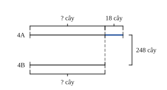

# Chủ đề 5. Tìm hai số khi biết tổng và hiệu của hai số đó

> Đây là một trong những bài toán điển hình quan trọng nhất của lớp 4. Chỉ cần biết tổng và hiệu là tìm được cả hai số. Dạng này xuất hiện trong bài toán về tuổi, về chu vi hình chữ nhật, về chia đồ vật, và gần như luôn có trong đề kiểm tra cuối năm.

## I. Kiến thức cần nắm

### 1. Công thức

Khi biết **tổng** và **hiệu** của hai số:
$$\text{Số lớn} = (\text{Tổng} + \text{Hiệu}) : 2, \qquad \text{Số bé} = (\text{Tổng} - \text{Hiệu}) : 2.$$

Tìm được một số rồi thì số kia có thể tìm nhanh hơn: số bé = số lớn − hiệu, hoặc số lớn = số bé + hiệu, hoặc lấy tổng trừ đi số đã tìm.

**Ví dụ.** Tổng hai số là 60, hiệu là 10. Số lớn là $(60 + 10) : 2 = 35$. Số bé là $35 - 10 = 25$.

### 2. Vì sao công thức đúng? (sơ đồ đoạn thẳng)

Vẽ số bé là một đoạn thẳng, số lớn là một đoạn dài hơn, phần dài hơn chính là **hiệu**.
- Nếu **bớt phần hiệu** ở số lớn thì hai số bằng nhau, đều bằng số bé. Lúc đó tổng còn lại là $\text{Tổng} - \text{Hiệu}$, gồm **hai lần số bé**. Vậy số bé $= (\text{Tổng} - \text{Hiệu}) : 2$.
- Nếu **thêm phần hiệu** vào số bé thì hai số bằng nhau, đều bằng số lớn. Lúc đó tổng mới là $\text{Tổng} + \text{Hiệu}$, gồm **hai lần số lớn**. Vậy số lớn $= (\text{Tổng} + \text{Hiệu}) : 2$.

### 3. Các bước giải bài toán có lời văn

1. Xác định **tổng** và **hiệu** của hai đại lượng (nhiều khi đề bài không cho trực tiếp).
2. Vẽ sơ đồ đoạn thẳng.
3. Tìm số lớn (hoặc số bé) theo công thức, rồi tìm số còn lại.
4. **Thử lại:** cộng hai số phải được tổng, trừ hai số phải được hiệu.

**Ví dụ.** Hai thùng có 30 l nước, thùng thứ nhất nhiều hơn thùng thứ hai 4 l. Thùng thứ nhất có $(30 + 4) : 2 = 17$ (l), thùng thứ hai có $17 - 4 = 13$ (l). Thử lại: $17 + 13 = 30$, $17 - 13 = 4$.

### 4. Khi tổng hoặc hiệu bị "giấu"

- **Chu vi hình chữ nhật:** chiều dài + chiều rộng = **nửa chu vi** = chu vi : 2. Hiệu là "chiều dài hơn chiều rộng".
- **Tuổi:** hiệu số tuổi của hai người **không đổi** theo thời gian. Tổng số tuổi mỗi năm tăng thêm 2 (mỗi người thêm 1 tuổi).
- **Chuyển từ phần này sang phần kia cho bằng nhau:** chuyển $k$ đơn vị thì hai phần bằng nhau, nghĩa là lúc đầu hiệu là $2 \times k$.
- **Số liên tiếp:** hai số tự nhiên liên tiếp có hiệu 1; hai số chẵn (hoặc hai số lẻ) liên tiếp có hiệu 2. Giữa hai số có $n$ số khác thì hiệu là $n + 1$.
- **Trung bình cộng:** biết trung bình cộng của hai số thì tổng bằng trung bình cộng nhân 2.

### 5. Sai lầm hay gặp

- Quên chia đôi chu vi: tổng chiều dài và chiều rộng là **nửa chu vi**, không phải chu vi.
- Chuyển $k$ đơn vị cho bằng nhau mà lấy hiệu là $k$: thật ra hiệu là $2 \times k$, vì một bên bớt $k$ và bên kia thêm $k$.
- Bài tuổi "sau mấy năm nữa" mà quên đổi tổng về hiện nay.
- Nhầm số lớn với số bé: $(\text{Tổng} + \text{Hiệu}) : 2$ luôn là **số lớn**.

## II. Bài tập vận dụng

**Bài 1.** Tìm hai số, biết tổng của chúng là 98 và hiệu của chúng là 24.

**Bài 2.** Tìm hai số, biết tổng của chúng là 1 250 và hiệu của chúng là 350.

**Bài 3.** Hai lớp 4A và 4B trồng được tất cả 248 cây. Lớp 4A trồng được nhiều hơn lớp 4B 18 cây. Hỏi mỗi lớp trồng được bao nhiêu cây?

**Bài 4.** Tổng số tuổi của bố và con là 50 tuổi. Bố hơn con 28 tuổi. Tính tuổi của mỗi người.

**Bài 5 (thực tế).** Một mảnh vườn hình chữ nhật có chu vi 96 m, chiều dài hơn chiều rộng 12 m. Tính diện tích mảnh vườn.

**Bài 6 (thực tế).** Hai thùng có tất cả 156 l dầu. Nếu chuyển 14 l dầu từ thùng thứ nhất sang thùng thứ hai thì số dầu ở hai thùng bằng nhau. Hỏi lúc đầu mỗi thùng có bao nhiêu lít dầu?

**Bài 7.** Tìm hai số, biết tổng của chúng là số lớn nhất có ba chữ số, hiệu của chúng là số lẻ bé nhất có hai chữ số.

**Bài 8.** Tìm hai số lẻ liên tiếp có tổng là 156.

**Bài 9 (thực tế).** Sau 5 năm nữa, tổng số tuổi của hai mẹ con là 52 tuổi. Mẹ hơn con 26 tuổi. Tính tuổi của mỗi người hiện nay.

**Bài 10.** Số trung bình cộng của hai số là 135. Số lớn hơn số bé 34 đơn vị. Tìm hai số đó.

**Bài 11 (vận dụng cao).** An và Bình có tất cả 96 viên bi. Nếu An cho Bình 8 viên bi thì Bình có nhiều hơn An 4 viên bi. Hỏi lúc đầu mỗi bạn có bao nhiêu viên bi?

**Bài 12 (vận dụng cao).** Tìm hai số tự nhiên có tổng là 346, biết rằng giữa hai số đó có đúng 5 số tự nhiên khác.

**Bài 13 (vận dụng cao).** Một hình chữ nhật có chu vi 100 m. Nếu tăng chiều rộng thêm 6 m và giảm chiều dài đi 6 m thì hình chữ nhật trở thành hình vuông. Tính diện tích hình chữ nhật ban đầu.

---

## III. Lời giải chi tiết

### Bài 1
Số lớn là $(98 + 24) : 2 = 122 : 2 = 61$.
Số bé là $61 - 24 = 37$.

**Đáp số:** 61 và 37.

Thử lại: $61 + 37 = 98$, $61 - 37 = 24$. Đúng.

### Bài 2
Số lớn là $(1\,250 + 350) : 2 = 1\,600 : 2 = 800$.
Số bé là $1\,250 - 800 = 450$.

**Đáp số:** 800 và 450.

### Bài 3

*Hình: Sơ đồ: lớp 4A hơn lớp 4B 18 cây, tổng 248 cây.*

Lớp 4A trồng được $(248 + 18) : 2 = 266 : 2 = 133$ (cây).
Lớp 4B trồng được $133 - 18 = 115$ (cây).

**Đáp số:** Lớp 4A: 133 cây; lớp 4B: 115 cây.

*Nhận xét:* trên sơ đồ, nếu bớt đi 18 cây (đoạn màu xanh) của lớp 4A thì hai đoạn bằng nhau. Khi đó $248 - 18 = 230$ là hai lần số cây của lớp 4B, nên lớp 4B trồng $230 : 2 = 115$ cây. Hai cách cho cùng kết quả.

### Bài 4
Tuổi bố là $(50 + 28) : 2 = 78 : 2 = 39$ (tuổi).
Tuổi con là $39 - 28 = 11$ (tuổi).

**Đáp số:** Bố 39 tuổi; con 11 tuổi.

### Bài 5
Nửa chu vi mảnh vườn (tổng chiều dài và chiều rộng) là $96 : 2 = 48$ (m).
Chiều dài là $(48 + 12) : 2 = 30$ (m).
Chiều rộng là $30 - 12 = 18$ (m).
Diện tích mảnh vườn là $30 \times 18 = 540$ (m²).

**Đáp số:** 540 m².

*Nhận xét:* tổng của chiều dài và chiều rộng là **nửa chu vi**. Đây là chỗ hay sai nhất của dạng bài này.

### Bài 6
Chuyển 14 l từ thùng thứ nhất sang thùng thứ hai thì hai thùng bằng nhau. Như vậy thùng thứ nhất hơn thùng thứ hai
$$14 + 14 = 28 \text{ (l)}.$$
(Thùng thứ nhất bớt 14 l, thùng thứ hai thêm 14 l thì mới bằng nhau.)
Lúc đầu thùng thứ nhất có $(156 + 28) : 2 = 184 : 2 = 92$ (l).
Thùng thứ hai có $156 - 92 = 64$ (l).

**Đáp số:** Thùng thứ nhất 92 l; thùng thứ hai 64 l.

Thử lại: chuyển 14 l thì thùng thứ nhất còn $92 - 14 = 78$ (l), thùng thứ hai có $64 + 14 = 78$ (l). Bằng nhau, đúng.

### Bài 7
Số lớn nhất có ba chữ số là 999, nên tổng là 999.
Số lẻ bé nhất có hai chữ số là 11, nên hiệu là 11.
Số lớn là $(999 + 11) : 2 = 1\,010 : 2 = 505$.
Số bé là $505 - 11 = 494$.

**Đáp số:** 505 và 494.

### Bài 8
Hai số lẻ liên tiếp hơn kém nhau 2, nên hiệu của chúng là 2.
Số lớn là $(156 + 2) : 2 = 79$. Số bé là $79 - 2 = 77$.

**Đáp số:** 77 và 79.

### Bài 9
Sau 5 năm nữa, mỗi người thêm 5 tuổi, nên tổng số tuổi tăng thêm $5 + 5 = 10$ (tuổi).
Tổng số tuổi hai mẹ con hiện nay là $52 - 10 = 42$ (tuổi).
Hiệu số tuổi không đổi, vẫn là 26.
Tuổi mẹ hiện nay là $(42 + 26) : 2 = 68 : 2 = 34$ (tuổi).
Tuổi con hiện nay là $34 - 26 = 8$ (tuổi).

**Đáp số:** Mẹ 34 tuổi; con 8 tuổi.

*Nhận xét:* trong bài toán về tuổi, **hiệu số tuổi không bao giờ thay đổi**, còn tổng số tuổi thay đổi 2 tuổi mỗi năm.

### Bài 10
Tổng của hai số là $135 \times 2 = 270$.
Số lớn là $(270 + 34) : 2 = 304 : 2 = 152$.
Số bé là $152 - 34 = 118$.

**Đáp số:** 152 và 118.

### Bài 11
Khi An cho Bình 8 viên bi, tổng số bi của hai bạn không đổi, vẫn là 96 viên.
Sau khi cho, Bình hơn An 4 viên. Lúc đó:
- số bi của Bình là $(96 + 4) : 2 = 50$ (viên);
- số bi của An là $50 - 4 = 46$ (viên).

Lúc đầu, An có $46 + 8 = 54$ (viên), Bình có $50 - 8 = 42$ (viên).

**Đáp số:** An 54 viên; Bình 42 viên.

Thử lại: $54 + 42 = 96$. An cho Bình 8 viên thì An còn 46, Bình có 50, Bình hơn An 4 viên. Đúng.

*Nhận xét:* khi đề bài nói về một lúc khác (sau khi cho, sau mấy năm), hãy giải bài toán **ở thời điểm đề bài cho đủ tổng và hiệu**, rồi quay về thời điểm đề bài hỏi.

### Bài 12
Giữa hai số có đúng 5 số tự nhiên khác, nghĩa là từ số bé đếm thêm $5 + 1 = 6$ đơn vị thì được số lớn. Vậy hiệu của hai số là 6.
Ví dụ: giữa 1 và 7 có 5 số 2, 3, 4, 5, 6, và $7 - 1 = 6$.
Số lớn là $(346 + 6) : 2 = 352 : 2 = 176$.
Số bé là $176 - 6 = 170$.

**Đáp số:** 170 và 176.

Thử lại: giữa 170 và 176 có các số 171, 172, 173, 174, 175, đúng 5 số.

*Nhận xét:* bẫy của bài là lấy hiệu bằng 5. Hãy thử với ví dụ nhỏ để chắc chắn.

### Bài 13
Tăng chiều rộng 6 m và giảm chiều dài 6 m thì được hình vuông, tức là hai cạnh bằng nhau. Vậy chiều dài hơn chiều rộng $6 + 6 = 12$ (m).
Nửa chu vi hình chữ nhật là $100 : 2 = 50$ (m).
Chiều dài là $(50 + 12) : 2 = 31$ (m).
Chiều rộng là $31 - 12 = 19$ (m).
Diện tích hình chữ nhật ban đầu là $31 \times 19 = 589$ (m²).

**Đáp số:** 589 m².

Thử lại: $31 - 6 = 25$ và $19 + 6 = 25$, đúng là hình vuông cạnh 25 m.

*Nhận xét:* bài này giống Bài 6: một bên bớt, một bên thêm cùng một số thì hai bên bằng nhau, nên hiệu bằng hai lần số đó.
