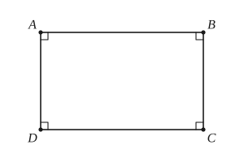
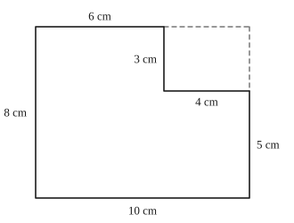
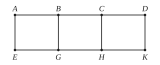
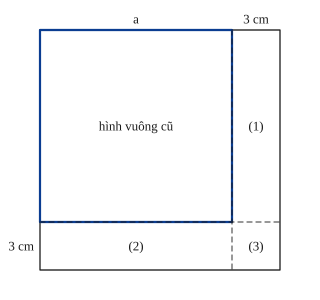

# Chủ đề 9. Hình học

> Chủ đề này gồm các loại góc và cách đo góc, hai đường thẳng vuông góc và song song, nhận biết hình bình hành và hình thoi, cùng chu vi và diện tích các hình đã học. Các bài tính chu vi, diện tích hình chữ nhật, hình vuông và hình ghép là phần vận dụng hay gặp nhất trong đề kiểm tra.

## I. Kiến thức cần nắm

### 1. Góc và đo góc

Đơn vị đo góc là **độ** (kí hiệu $^\circ$). Dùng **thước đo góc**: đặt tâm thước trùng đỉnh góc, một cạnh góc đi qua vạch 0, đọc số đo ở vạch mà cạnh kia đi qua.

| Loại góc | Số đo |
|---|---|
| Góc nhọn | bé hơn $90^\circ$ |
| Góc vuông | bằng $90^\circ$ |
| Góc tù | lớn hơn $90^\circ$ và bé hơn $180^\circ$ |
| Góc bẹt | bằng $180^\circ$ (hai cạnh thẳng hàng, ngược chiều) |

**Ví dụ.** Lúc 3 giờ, kim giờ và kim phút tạo thành góc vuông. Lúc 6 giờ, hai kim tạo thành góc bẹt.

**Góc giữa hai kim đồng hồ:** mặt đồng hồ chia 12 khoảng, mỗi khoảng ứng với $360^\circ : 12 = 30^\circ$. Lúc 2 giờ đúng, hai kim cách nhau 2 khoảng, tạo góc $60^\circ$ (góc nhọn).

### 2. Hai đường thẳng vuông góc, song song

- Hai đường thẳng **vuông góc** cắt nhau tạo thành 4 góc vuông. Kiểm tra bằng ê ke.
- Hai đường thẳng **song song** không bao giờ cắt nhau dù kéo dài mãi.
- Trong hình chữ nhật $ABCD$: $AB$ song song với $DC$, $AD$ song song với $BC$; $AB$ vuông góc với $AD$ và với $BC$.

### 3. Hình bình hành và hình thoi

- **Hình bình hành:** có hai cặp cạnh đối diện **song song** và **bằng nhau**. Chu vi $= (a + b) \times 2$ với $a, b$ là độ dài hai cạnh kề nhau.
- **Hình thoi:** có hai cặp cạnh đối diện song song và **bốn cạnh bằng nhau**. Chu vi $= a \times 4$.
- Hình chữ nhật và hình vuông cũng là hình bình hành. Hình vuông cũng là hình thoi.

### 4. Chu vi và diện tích hình chữ nhật, hình vuông

Hình chữ nhật chiều dài $a$, chiều rộng $b$ (cùng đơn vị):
$$P = (a + b) \times 2, \qquad S = a \times b.$$
Hình vuông cạnh $a$:
$$P = a \times 4, \qquad S = a \times a.$$

**Bài toán ngược:**
- Biết diện tích và một cạnh của hình chữ nhật: cạnh kia $= S : \text{cạnh đã biết}$.
- Biết chu vi hình vuông: cạnh $= P : 4$.
- Biết chu vi hình chữ nhật: nửa chu vi $= a + b = P : 2$.

### 5. Hình ghép

Với hình ghép (hình chữ L, hình có "khoét" một góc), có hai cách tính diện tích:
- **Chia nhỏ:** cắt thành các hình chữ nhật, tính từng phần rồi cộng.
- **Bù vào:** bổ sung thành hình chữ nhật lớn, lấy diện tích hình lớn trừ phần thêm vào.

*Mẹo:* hình chữ nhật bị cắt đi một hình chữ nhật nhỏ **ở góc** thì chu vi **không đổi** (hai đoạn mới thay thế đúng bằng hai đoạn bị mất).

### 6. Sai lầm hay gặp

- Tính chu vi hoặc diện tích khi các cạnh **chưa cùng đơn vị**.
- Ghi đơn vị diện tích là cm thay vì cm².
- Nhầm góc tù với góc bẹt: góc bẹt bằng đúng $180^\circ$, góc tù bé hơn $180^\circ$.
- Đếm hình chữ nhật trong hình ghép mà chỉ đếm các hình nhỏ, quên các hình ghép từ nhiều hình nhỏ.

## II. Bài tập vận dụng

**Bài 1.** Các góc có số đo sau là góc nhọn, góc vuông, góc tù hay góc bẹt: $40^\circ$; $90^\circ$; $135^\circ$; $180^\circ$; $89^\circ$; $91^\circ$?

**Bài 2.** Hai kim đồng hồ tạo thành góc gì vào lúc: a) 3 giờ; b) 6 giờ; c) 2 giờ; d) 5 giờ? Tính số đo các góc đó.

**Bài 3.** Cho hình chữ nhật $ABCD$. Nêu các cặp cạnh song song với nhau và các cặp cạnh vuông góc với nhau.

**Bài 4.** a) Tính chu vi hình thoi có cạnh 7 cm.
b) Tính chu vi hình bình hành có hai cạnh kề nhau dài 9 cm và 5 cm.

**Bài 5.** Một hình vuông có chu vi 36 cm. Tính diện tích hình vuông đó.

**Bài 6 (thực tế).** Một mảnh vườn hình chữ nhật dài 25 m, rộng 16 m. Người ta rào xung quanh vườn, chừa lại một cổng rộng 3 m. Hỏi hàng rào dài bao nhiêu mét? Tính diện tích mảnh vườn.

**Bài 7.** Một tấm bìa hình chữ nhật dài 10 cm, rộng 8 cm bị cắt đi một hình chữ nhật nhỏ dài 4 cm, rộng 3 cm ở một góc (xem hình). Tính diện tích và chu vi phần bìa còn lại.

**Bài 8.** Một hình chữ nhật có diện tích $96 \text{ cm}^2$, chiều rộng 8 cm. Tính chu vi hình chữ nhật đó.

**Bài 9 (thực tế).** Một sân trường hình chữ nhật có chu vi 120 m, chiều dài hơn chiều rộng 20 m. Tính diện tích sân trường.

**Bài 10.** Hình chữ nhật $ADKE$ được chia thành 3 hình chữ nhật nhỏ bằng nhau (xem hình). Trong hình có tất cả bao nhiêu hình chữ nhật?

**Bài 11 (vận dụng cao).** Một hình vuông, nếu tăng mỗi cạnh thêm 3 cm thì diện tích tăng thêm $81 \text{ cm}^2$. Tính cạnh hình vuông ban đầu.

**Bài 12 (vận dụng cao).** Một hình chữ nhật có chu vi 64 cm được chia thành 3 hình vuông bằng nhau xếp thành một hàng. Tính diện tích hình chữ nhật đó.

---

## III. Lời giải chi tiết

### Bài 1
- Góc nhọn: $40^\circ$; $89^\circ$.
- Góc vuông: $90^\circ$.
- Góc tù: $135^\circ$; $91^\circ$.
- Góc bẹt: $180^\circ$.

### Bài 2
Mỗi khoảng giữa hai số liền nhau trên mặt đồng hồ ứng với $360^\circ : 12 = 30^\circ$.
a) Lúc 3 giờ, hai kim cách nhau 3 khoảng: $3 \times 30^\circ = 90^\circ$, góc vuông.
b) Lúc 6 giờ: $6 \times 30^\circ = 180^\circ$, góc bẹt.
c) Lúc 2 giờ: $2 \times 30^\circ = 60^\circ$, góc nhọn.
d) Lúc 5 giờ: $5 \times 30^\circ = 150^\circ$, góc tù.

### Bài 3

*Hình: Hình chữ nhật ABCD.*

- Các cặp cạnh song song: $AB$ và $DC$; $AD$ và $BC$.
- Các cặp cạnh vuông góc: $AB$ và $AD$; $AB$ và $BC$; $CD$ và $BC$; $CD$ và $AD$.

### Bài 4
a) Chu vi hình thoi: $7 \times 4 = 28$ (cm).
b) Chu vi hình bình hành: $(9 + 5) \times 2 = 28$ (cm).

**Đáp số:** a) 28 cm; b) 28 cm.

### Bài 5
Cạnh hình vuông là $36 : 4 = 9$ (cm).
Diện tích hình vuông là $9 \times 9 = 81 \text{ (cm}^2)$.

**Đáp số:** $81 \text{ cm}^2$.

### Bài 6
Chu vi mảnh vườn là $(25 + 16) \times 2 = 82$ (m).
Hàng rào dài $82 - 3 = 79$ (m).
Diện tích mảnh vườn là $25 \times 16 = 400 \text{ (m}^2)$.

**Đáp số:** hàng rào 79 m; diện tích $400 \text{ m}^2$.

### Bài 7

*Hình: Hình chữ nhật 10 cm × 8 cm bị cắt đi một hình chữ nhật 4 cm × 3 cm ở góc.*

**Diện tích.** Diện tích tấm bìa ban đầu là $10 \times 8 = 80 \text{ (cm}^2)$. Phần bị cắt có diện tích $4 \times 3 = 12 \text{ (cm}^2)$.
Diện tích phần còn lại là $80 - 12 = 68 \text{ (cm}^2)$.

**Chu vi.** Phần còn lại có 6 cạnh: $6 + 3 + 4 + 5 + 10 + 8 = 36$ (cm). Đây cũng đúng bằng chu vi tấm bìa ban đầu: $(10 + 8) \times 2 = 36$ (cm).

**Đáp số:** diện tích $68 \text{ cm}^2$; chu vi 36 cm.

*Nhận xét:* cắt một hình chữ nhật nhỏ ở góc thì diện tích giảm nhưng chu vi không đổi. Đoạn 3 cm và 4 cm mới thay đúng cho hai đoạn cùng độ dài đã bị cắt mất.

### Bài 8
Chiều dài hình chữ nhật là $96 : 8 = 12$ (cm).
Chu vi hình chữ nhật là $(12 + 8) \times 2 = 40$ (cm).

**Đáp số:** 40 cm.

### Bài 9
Nửa chu vi sân trường là $120 : 2 = 60$ (m).
Chiều dài là $(60 + 20) : 2 = 40$ (m). Chiều rộng là $40 - 20 = 20$ (m).
Diện tích sân trường là $40 \times 20 = 800 \text{ (m}^2)$.

**Đáp số:** $800 \text{ m}^2$.

### Bài 10

*Hình: Một hình chữ nhật chia thành 3 hình chữ nhật nhỏ bằng nhau.*

Đếm theo số hình nhỏ ghép thành:
- Gồm 1 hình nhỏ: $ABGE$, $BCHG$, $CDKH$: 3 hình.
- Gồm 2 hình nhỏ: $ACHE$, $BDKG$: 2 hình.
- Gồm 3 hình nhỏ: $ADKE$: 1 hình.

Tổng cộng $3 + 2 + 1 = 6$ hình chữ nhật.

**Đáp số:** 6 hình chữ nhật.

*Nhận xét:* mỗi hình chữ nhật ứng với một cách chọn 2 trong 4 đoạn thẳng đứng $AE, BG, CH, DK$. Có $3 + 2 + 1 = 6$ cách chọn.

### Bài 11

*Hình: Hình vuông cạnh a, mỗi cạnh tăng thêm 3 cm.*

Phần diện tích tăng thêm gồm hai hình chữ nhật (1), (2) có cùng kích thước (một cạnh bằng cạnh hình vuông cũ, một cạnh 3 cm) và hình vuông nhỏ (3) cạnh 3 cm.
Diện tích hình vuông nhỏ (3) là $3 \times 3 = 9 \text{ (cm}^2)$.
Diện tích hai hình chữ nhật (1) và (2) là $81 - 9 = 72 \text{ (cm}^2)$, mỗi hình là $72 : 2 = 36 \text{ (cm}^2)$.
Cạnh hình vuông ban đầu là $36 : 3 = 12$ (cm).

**Đáp số:** 12 cm.

Thử lại: $15 \times 15 - 12 \times 12 = 225 - 144 = 81$. Đúng.

### Bài 12
Gọi cạnh mỗi hình vuông nhỏ là một "đoạn". Hình chữ nhật có chiều dài bằng 3 đoạn, chiều rộng bằng 1 đoạn.
Nửa chu vi là $64 : 2 = 32$ (cm), gồm $3 + 1 = 4$ đoạn.
Mỗi đoạn dài $32 : 4 = 8$ (cm).
Chiều dài là $8 \times 3 = 24$ (cm), chiều rộng là 8 cm.
Diện tích hình chữ nhật là $24 \times 8 = 192 \text{ (cm}^2)$.

**Đáp số:** $192 \text{ cm}^2$.
