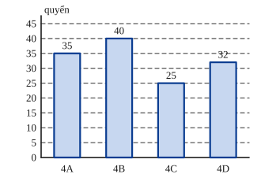
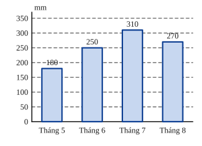
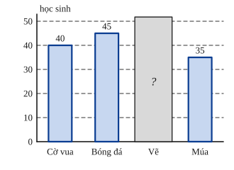

# Chủ đề 10. Thống kê và xác suất

> Chủ đề này dạy đọc và sắp xếp dãy số liệu, đọc bảng số liệu, đọc biểu đồ cột, và kiểm đếm số lần xuất hiện của một sự kiện khi làm thí nghiệm (tung đồng xu, gieo xúc xắc, lấy bóng). Câu hỏi về biểu đồ cột thường kết hợp với tính tổng, tính hiệu và tính trung bình cộng.

## I. Kiến thức cần nắm

### 1. Dãy số liệu

Khi thu thập thông tin (chiều cao các bạn, số cây mỗi tổ trồng…), ta được một **dãy số liệu**. Với dãy số liệu, ta có thể:
- tìm số lớn nhất, số bé nhất;
- sắp xếp theo thứ tự tăng dần hoặc giảm dần;
- tính tổng, tính hiệu hai số liệu, tính số trung bình cộng.

**Ví dụ.** Số cân nặng (kg) của 4 bạn: 30; 28; 33; 29. Bạn nặng nhất là 33 kg, nhẹ nhất là 28 kg, hơn kém nhau $33 - 28 = 5$ (kg). Trung bình mỗi bạn nặng $(30 + 28 + 33 + 29) : 4 = 30$ (kg).

### 2. Bảng số liệu

Bảng số liệu sắp xếp số liệu thành hàng và cột để dễ đọc, dễ so sánh.

| Tổ | Tổ 1 | Tổ 2 | Tổ 3 |
|---|---|---|---|
| Số cây trồng được | 18 | 24 | 21 |

Đọc bảng: tổ 2 trồng nhiều nhất (24 cây), cả ba tổ trồng $18 + 24 + 21 = 63$ (cây).

### 3. Biểu đồ cột

- Mỗi **cột** ứng với một đối tượng (ghi ở chân cột).
- **Chiều cao** cột (đọc theo vạch chia ở trục đứng hoặc số ghi trên đỉnh cột) cho biết số liệu.
- Cột cao hơn thì số liệu lớn hơn.

**Cách đọc:** xem tên biểu đồ, xem trục đứng chỉ đơn vị gì, mỗi vạch chia ứng với bao nhiêu; rồi đọc từng cột.

### 4. Kiểm đếm số lần xuất hiện của một sự kiện

Khi làm thí nghiệm nhiều lần (tung đồng xu, gieo xúc xắc, lấy bóng trong hộp rồi trả lại), ta ghi lại kết quả mỗi lần bằng **vạch kiểm đếm** rồi đếm số lần xuất hiện của từng sự kiện.

- Tổng số lần xuất hiện của tất cả các kết quả bằng **số lần thực hiện**.
- Tung đồng xu 20 lần, mặt sấp xuất hiện 12 lần thì mặt ngửa xuất hiện $20 - 12 = 8$ lần.

### 5. Có thể, chắc chắn, không thể

- **Chắc chắn:** sự kiện luôn xảy ra. Hộp chỉ có bóng đỏ, lấy một quả thì *chắc chắn* được bóng đỏ.
- **Không thể:** sự kiện không bao giờ xảy ra. Hộp chỉ có bóng đỏ thì *không thể* lấy được bóng xanh.
- **Có thể:** sự kiện có lúc xảy ra, có lúc không. Hộp có bóng đỏ và bóng xanh thì *có thể* lấy được bóng xanh.

### 6. Sai lầm hay gặp

- Đọc nhầm vạch chia trên trục đứng (mỗi vạch không phải lúc nào cũng là 1 đơn vị).
- Quên đơn vị khi trả lời (quyển, cây, mm…).
- Khi tính số lần xuất hiện còn lại, quên lấy **tổng số lần thực hiện** trừ đi.

## II. Bài tập vận dụng

**Bài 1.** Chiều cao (cm) của 5 bạn trong tổ là: 132; 128; 135; 130; 125.
a) Bạn cao nhất cao bao nhiêu xăng-ti-mét? Bạn thấp nhất cao bao nhiêu?
b) Bạn cao nhất cao hơn bạn thấp nhất bao nhiêu xăng-ti-mét?
c) Sắp xếp dãy số liệu theo thứ tự từ bé đến lớn.

**Bài 2.** Số cây trồng được của bốn tổ lớp 4A như sau: Tổ 1: 15 cây; Tổ 2: 20 cây; Tổ 3: 18 cây; Tổ 4: 23 cây. Hãy lập bảng số liệu và cho biết cả lớp trồng được bao nhiêu cây.

**Bài 3.** Biểu đồ dưới đây cho biết số quyển sách mỗi lớp khối 4 đã đọc trong tháng.

a) Lớp nào đọc nhiều sách nhất? Lớp nào đọc ít nhất?
b) Lớp 4B đọc nhiều hơn lớp 4C bao nhiêu quyển?
c) Trung bình mỗi lớp đọc bao nhiêu quyển sách?

**Bài 4.** Nam tung một đồng xu 20 lần, thấy mặt sấp xuất hiện 12 lần. Hỏi mặt ngửa xuất hiện bao nhiêu lần? Mặt nào xuất hiện nhiều hơn và nhiều hơn mấy lần?

**Bài 5.** Một hộp có 3 quả bóng xanh và 2 quả bóng đỏ. Lấy ra 1 quả bóng (không nhìn). Dùng các từ "có thể", "chắc chắn", "không thể" để mô tả các sự kiện:
a) Lấy được bóng xanh. b) Lấy được bóng vàng. c) Lấy được bóng xanh hoặc bóng đỏ.

**Bài 6 (thực tế).** Một cửa hàng ghi lại số chai nước bán được trong 5 ngày:

| Ngày | Thứ Hai | Thứ Ba | Thứ Tư | Thứ Năm | Thứ Sáu |
|---|---|---|---|---|---|
| Số chai | 120 | 95 | 140 | 110 | 135 |

a) Ngày nào bán được nhiều nhất? Ít nhất?
b) Cả 5 ngày bán được bao nhiêu chai? Trung bình mỗi ngày bán bao nhiêu chai?

**Bài 7 (thực tế).** Biểu đồ dưới đây cho biết lượng mưa (mm) bốn tháng mùa mưa ở một tỉnh.

a) Tháng nào mưa nhiều nhất? Tháng nào mưa ít nhất?
b) Tháng 7 mưa nhiều hơn tháng 5 bao nhiêu mi-li-mét?
c) Tổng lượng mưa bốn tháng là bao nhiêu?

**Bài 8.** Gieo một con xúc xắc 30 lần, kết quả như sau:

| Mặt | 1 chấm | 2 chấm | 3 chấm | 4 chấm | 5 chấm | 6 chấm |
|---|---|---|---|---|---|---|
| Số lần | 4 | 6 | 5 | 3 | 7 | ? |

a) Mặt 6 chấm xuất hiện bao nhiêu lần?
b) Mặt có số chấm chẵn xuất hiện tất cả bao nhiêu lần?

**Bài 9.** Cân nặng (kg) của 6 bạn là: 31; 28; 35; 30; 29; 33. Tính cân nặng trung bình của mỗi bạn. Có mấy bạn nặng hơn mức trung bình?

**Bài 10.** Ba lớp 4A, 4B, 4C quyên góp được tất cả 210 quyển vở. Lớp 4A góp 72 quyển, lớp 4B góp ít hơn lớp 4A 8 quyển. Hãy lập bảng số liệu số vở của từng lớp.

**Bài 11 (vận dụng cao).** Biểu đồ dưới đây cho biết số học sinh tham gia bốn câu lạc bộ. Cột "Vẽ" bị che mất. Biết tổng số học sinh tham gia cả bốn câu lạc bộ là 150 em.

a) Câu lạc bộ Vẽ có bao nhiêu học sinh?
b) Trung bình mỗi câu lạc bộ có bao nhiêu học sinh? Những câu lạc bộ nào có số học sinh nhiều hơn mức trung bình?

**Bài 12 (vận dụng cao).** Viết các số tự nhiên từ 1 đến 50. Chữ số 5 xuất hiện bao nhiêu lần? Chữ số 1 xuất hiện bao nhiêu lần?

---

## III. Lời giải chi tiết

### Bài 1
a) Bạn cao nhất cao 135 cm, bạn thấp nhất cao 125 cm.
b) $135 - 125 = 10$ (cm).
c) 125; 128; 130; 132; 135.

### Bài 2

| Tổ | Tổ 1 | Tổ 2 | Tổ 3 | Tổ 4 |
|---|---|---|---|---|
| Số cây | 15 | 20 | 18 | 23 |

Cả lớp trồng được $15 + 20 + 18 + 23 = 76$ (cây).

**Đáp số:** 76 cây.

### Bài 3
Đọc biểu đồ: 4A đọc 35 quyển, 4B đọc 40 quyển, 4C đọc 25 quyển, 4D đọc 32 quyển.
a) Lớp 4B đọc nhiều nhất (40 quyển), lớp 4C đọc ít nhất (25 quyển).
b) $40 - 25 = 15$ (quyển).
c) Tổng số sách là $35 + 40 + 25 + 32 = 132$ (quyển). Trung bình mỗi lớp đọc $132 : 4 = 33$ (quyển).

**Đáp số:** a) 4B; 4C. b) 15 quyển. c) 33 quyển.

### Bài 4
Mặt ngửa xuất hiện $20 - 12 = 8$ (lần).
Mặt sấp xuất hiện nhiều hơn mặt ngửa $12 - 8 = 4$ (lần).

**Đáp số:** 8 lần; mặt sấp nhiều hơn 4 lần.

### Bài 5
a) **Có thể** lấy được bóng xanh (cũng có thể lấy được bóng đỏ).
b) **Không thể** lấy được bóng vàng (hộp không có bóng vàng).
c) **Chắc chắn** lấy được bóng xanh hoặc bóng đỏ (hộp chỉ có hai màu đó).

### Bài 6
a) Thứ Tư bán nhiều nhất (140 chai), thứ Ba bán ít nhất (95 chai).
b) Cả 5 ngày bán được $120 + 95 + 140 + 110 + 135 = 600$ (chai). Trung bình mỗi ngày bán $600 : 5 = 120$ (chai).

**Đáp số:** b) 600 chai; 120 chai.

### Bài 7
Đọc biểu đồ: tháng 5: 180 mm; tháng 6: 250 mm; tháng 7: 310 mm; tháng 8: 270 mm.
a) Tháng 7 mưa nhiều nhất, tháng 5 mưa ít nhất.
b) $310 - 180 = 130$ (mm).
c) $180 + 250 + 310 + 270 = 1\,010$ (mm).

**Đáp số:** b) 130 mm; c) 1 010 mm.

### Bài 8
a) Năm mặt đầu xuất hiện $4 + 6 + 5 + 3 + 7 = 25$ (lần). Mặt 6 chấm xuất hiện $30 - 25 = 5$ (lần).
b) Các mặt chẵn là 2, 4, 6 chấm: $6 + 3 + 5 = 14$ (lần).

**Đáp số:** a) 5 lần; b) 14 lần.

### Bài 9
Tổng cân nặng: $31 + 28 + 35 + 30 + 29 + 33 = 186$ (kg).
Trung bình mỗi bạn nặng $186 : 6 = 31$ (kg).
Các bạn nặng hơn 31 kg là 35 kg và 33 kg: có 2 bạn.

**Đáp số:** 31 kg; 2 bạn.

*Lưu ý:* bạn nặng đúng 31 kg không "nặng hơn" mức trung bình.

### Bài 10
Lớp 4B góp $72 - 8 = 64$ (quyển).
Lớp 4C góp $210 - 72 - 64 = 74$ (quyển).

| Lớp | 4A | 4B | 4C |
|---|---|---|---|
| Số quyển vở | 72 | 64 | 74 |

### Bài 11
Đọc biểu đồ: Cờ vua 40 em, Bóng đá 45 em, Múa 35 em.
a) Câu lạc bộ Vẽ có $150 - 40 - 45 - 35 = 30$ (học sinh).
b) Trung bình mỗi câu lạc bộ có $150 : 4 = 37$ dư 2. Như vậy mức trung bình là hơn 37 em một chút và chưa tới 38 em. Các câu lạc bộ có nhiều hơn mức đó là Cờ vua (40 em) và Bóng đá (45 em).

**Đáp số:** a) 30 học sinh; b) Cờ vua và Bóng đá.

*Nhận xét:* lớp 4 chưa học chia ra số thập phân, nên khi chia có dư ta chỉ cần so sánh: 35 và 30 nhỏ hơn 37, còn 40 và 45 lớn hơn 38.

### Bài 12
**Chữ số 5.** Ở hàng đơn vị: 5, 15, 25, 35, 45 (5 lần). Ở hàng chục: 50 (1 lần). Tổng cộng 6 lần.

**Chữ số 1.** Ở hàng đơn vị: 1, 11, 21, 31, 41 (5 lần). Ở hàng chục: 10, 11, 12, …, 19 (10 lần). Tổng cộng 15 lần.

**Đáp số:** chữ số 5: 6 lần; chữ số 1: 15 lần.

*Nhận xét:* số 11 có hai chữ số 1, nên được đếm một lần ở hàng đơn vị và một lần ở hàng chục. Đếm riêng từng hàng giúp không bỏ sót.
