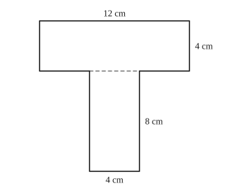

# Đề kiểm tra số 8

**Thời gian làm bài:** 60 phút. **Thang điểm:** mỗi câu 1 điểm, tổng 10 điểm.

## Đề bài

**Câu 1 (Viết số).** Từ bốn chữ số 0, 3, 5, 8, hãy viết số lớn nhất và số bé nhất có bốn chữ số khác nhau. Tính hiệu của hai số đó.

**Câu 2 (Tính thuận tiện).** Tính bằng cách thuận tiện: $999 + 998 + 997 + 3 + 2 + 1$.

**Câu 3 (Phép chia có dư).** Một phép chia có số chia là 25, thương là 108 và số dư là số dư lớn nhất có thể có. Tìm số bị chia.

**Câu 4 (Trung bình cộng).** Trung bình cộng của ba số là 70. Số thứ nhất gấp đôi số thứ hai, số thứ hai gấp đôi số thứ ba. Tìm ba số đó.

**Câu 5 (Tổng và hiệu).** An và Bình có tất cả 64 nhãn vở. Nếu An cho Bình 6 nhãn vở thì số nhãn vở của hai bạn bằng nhau. Hỏi lúc đầu mỗi bạn có bao nhiêu nhãn vở?

**Câu 6 (Phân số).** Tìm phân số bằng $\dfrac{3}{8}$, biết mẫu số hơn tử số 35 đơn vị.

**Câu 7 (Phép tính phân số).** Tính: a) $\dfrac{2}{3} \times \dfrac{9}{4} - \dfrac{5}{6}$; b) $\dfrac{4}{5} : 2 + \dfrac{1}{10}$.

**Câu 8 (Thời gian).** a) Một người sinh năm 1985. Đến năm 2025 người đó bao nhiêu tuổi? Người đó sinh vào thế kỷ nào? b) $\dfrac{3}{4}$ thế kỷ bằng bao nhiêu năm?

**Câu 9 (Hình ghép).** Một miếng bìa hình chữ T được ghép từ hai hình chữ nhật: hình nằm ngang dài 12 cm, rộng 4 cm; hình đứng ở giữa phía dưới rộng 4 cm, cao 8 cm. Tính diện tích và chu vi miếng bìa.

**Câu 10 (Kiểm đếm, xác suất).** Một hộp có 4 bóng đỏ và 3 bóng xanh. Mai lấy ra 1 quả, ghi màu rồi trả lại vào hộp. Mai làm như vậy 20 lần và thấy bóng đỏ xuất hiện 12 lần.
a) Bóng xanh xuất hiện mấy lần? b) Ở lần lấy thứ 21, Mai "chắc chắn", "có thể" hay "không thể" lấy được bóng xanh? Có thể lấy được bóng vàng không?

---

## Lời giải chi tiết

### Câu 1
Số lớn nhất: $8\,530$. Số bé nhất (chữ số 0 không đứng đầu): $3\,058$.
Hiệu: $8\,530 - 3\,058 = 5\,472$.

### Câu 2
$$(999 + 1) + (998 + 2) + (997 + 3) = 1\,000 + 1\,000 + 1\,000 = 3\,000.$$

### Câu 3
Số dư luôn bé hơn số chia, nên số dư lớn nhất là 24.
Số bị chia: $25 \times 108 + 24 = 2\,700 + 24 = 2\,724$.

**Đáp số:** 2 724.

### Câu 4
Tổng ba số: $70 \times 3 = 210$.
Coi số thứ ba là 1 phần thì số thứ hai là 2 phần, số thứ nhất là 4 phần. Tổng số phần: $1 + 2 + 4 = 7$ (phần).
Số thứ ba: $210 : 7 = 30$. Số thứ hai: $30 \times 2 = 60$. Số thứ nhất: $60 \times 2 = 120$.

**Đáp số:** 120; 60; 30.

### Câu 5
An cho Bình 6 nhãn thì bằng nhau, nên An hơn Bình $6 \times 2 = 12$ (nhãn).
An: $(64 + 12) : 2 = 38$ (nhãn). Bình: $38 - 12 = 26$ (nhãn).

**Đáp số:** An 38 nhãn vở, Bình 26 nhãn vở.

### Câu 6
Phân số $\dfrac{3}{8}$ có mẫu hơn tử $8 - 3 = 5$. Nhân cả tử và mẫu với $k$ thì hiệu cũng gấp $k$ lần. $35 : 5 = 7$.
Phân số cần tìm: $\dfrac{3 \times 7}{8 \times 7} = \dfrac{21}{56}$.

**Đáp số:** $\dfrac{21}{56}$.

### Câu 7
a) $\dfrac{18}{12} - \dfrac{5}{6} = \dfrac{3}{2} - \dfrac{5}{6} = \dfrac{9}{6} - \dfrac{5}{6} = \dfrac{4}{6} = \dfrac{2}{3}$.
b) $\dfrac{4}{10} + \dfrac{1}{10} = \dfrac{5}{10} = \dfrac{1}{2}$.

### Câu 8
a) $2025 - 1985 = 40$ (tuổi). Năm 1985 thuộc thế kỷ XX.
b) $100 \times \dfrac{3}{4} = 75$ (năm).

### Câu 9

*Hình: Hình chữ T ghép từ hai hình chữ nhật.*

Diện tích: $12 \times 4 + 4 \times 8 = 48 + 32 = 80 \text{ (cm}^2)$.
Chu vi: đi vòng quanh miếng bìa, độ dài các cạnh là 12; 4; 4; 8; 4; 8; 4; 4 (cm). Hai đoạn "bậc" ở hai bên mỗi đoạn dài $(12 - 4) : 2 = 4$ (cm).
Chu vi: $12 + 4 + 4 + 8 + 4 + 8 + 4 + 4 = 48$ (cm).

**Đáp số:** $80 \text{ cm}^2$; 48 cm.

### Câu 10
a) Bóng xanh xuất hiện $20 - 12 = 8$ (lần).
b) Vì trong hộp có cả bóng xanh và bóng đỏ, nên lần thứ 21 Mai **có thể** lấy được bóng xanh. Hộp không có bóng vàng nên **không thể** lấy được bóng vàng.
