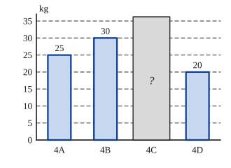

# Đề kiểm tra số 9

**Thời gian làm bài:** 60 phút. **Thang điểm:** mỗi câu 1 điểm, tổng 10 điểm.

## Đề bài

**Câu 1 (Dãy số tự nhiên).** a) Có bao nhiêu số có ba chữ số? b) Có bao nhiêu số chẵn có ba chữ số?

**Câu 2 (Tính thuận tiện).** Tính bằng cách thuận tiện: $5\,000 - 128 - 372$.

**Câu 3 (Nhân).** Tính bằng cách thuận tiện: a) $48 \times 35 + 48 \times 65$; b) $125 \times 32$.

**Câu 4 (Trung bình cộng).** Trung bình cộng của bốn số là 45. Nếu thêm số thứ năm thì trung bình cộng của năm số là 48. Tìm số thứ năm.

**Câu 5 (Bài toán tuổi).** Cách đây 4 năm, tổng số tuổi của bố và con là 40 tuổi. Bố hơn con 30 tuổi. Tính tuổi mỗi người hiện nay.

**Câu 6 (Phân số).** Tìm số tự nhiên $x$ sao cho $\dfrac{2}{7} < \dfrac{x}{14} < \dfrac{1}{2}$.

**Câu 7 (Tổng phân số).** Tính: $\dfrac{1}{3} + \dfrac{1}{6} + \dfrac{1}{9} + \dfrac{1}{18}$.

**Câu 8 (Thời gian).** Một chiếc đồng hồ cứ mỗi giờ chạy nhanh 30 giây. Hỏi sau một ngày đêm, đồng hồ đó chạy nhanh bao nhiêu phút?

**Câu 9 (Hình học).** a) Một hình chữ nhật được ghép từ hai hình vuông cạnh 7 cm đặt cạnh nhau. Tính chu vi và diện tích hình chữ nhật đó.
b) Một góc có số đo bằng nửa góc bẹt. Đó là góc gì?

**Câu 10 (Biểu đồ cột).** Biểu đồ dưới đây cho biết số ki-lô-gam giấy vụn bốn lớp khối 4 thu gom được. Cột của lớp 4C bị che. Biết trung bình mỗi lớp thu gom được 26 kg.

a) Lớp 4C thu gom được bao nhiêu ki-lô-gam giấy vụn? b) Lớp nào thu gom được nhiều nhất?

---

## Lời giải chi tiết

### Câu 1
a) Các số có ba chữ số là từ 100 đến 999: có $999 - 100 + 1 = 900$ (số).
b) Các số chẵn từ 100 đến 998, cách đều 2: có $(998 - 100) : 2 + 1 = 450$ (số).

### Câu 2
$$5\,000 - (128 + 372) = 5\,000 - 500 = 4\,500.$$

### Câu 3
a) $48 \times (35 + 65) = 48 \times 100 = 4\,800$.
b) $125 \times 32 = 125 \times 8 \times 4 = 1\,000 \times 4 = 4\,000$.

### Câu 4
Tổng bốn số: $45 \times 4 = 180$. Tổng năm số: $48 \times 5 = 240$.
Số thứ năm: $240 - 180 = 60$.

**Đáp số:** 60.

### Câu 5
Mỗi người thêm 4 tuổi, nên tổng tuổi hiện nay là $40 + 8 = 48$ (tuổi).
Tuổi bố: $(48 + 30) : 2 = 39$. Tuổi con: $39 - 30 = 9$.

**Đáp số:** bố 39 tuổi, con 9 tuổi.

### Câu 6
$\dfrac{2}{7} = \dfrac{4}{14}$, $\dfrac{1}{2} = \dfrac{7}{14}$. Cần $4 < x < 7$.

**Đáp số:** $x = 5$ hoặc $x = 6$.

### Câu 7
Mẫu số chung 18:
$$\frac{6}{18} + \frac{3}{18} + \frac{2}{18} + \frac{1}{18} = \frac{12}{18} = \frac{2}{3}.$$

### Câu 8
Một ngày đêm có 24 giờ. Đồng hồ chạy nhanh $30 \times 24 = 720$ (giây) $= 12$ (phút).

**Đáp số:** 12 phút.

### Câu 9
a) Hình chữ nhật có chiều dài $7 \times 2 = 14$ (cm), chiều rộng 7 cm.
Chu vi: $(14 + 7) \times 2 = 42$ (cm). Diện tích: $14 \times 7 = 98 \text{ (cm}^2)$.
b) Góc bẹt là $180^\circ$, nửa góc bẹt là $90^\circ$: góc vuông.

### Câu 10
Đọc biểu đồ: 4A 25 kg, 4B 30 kg, 4D 20 kg.
a) Tổng số giấy vụn bốn lớp: $26 \times 4 = 104$ (kg). Lớp 4C: $104 - 25 - 30 - 20 = 29$ (kg).
b) Lớp 4B (30 kg).

**Đáp số:** a) 29 kg; b) lớp 4B.
