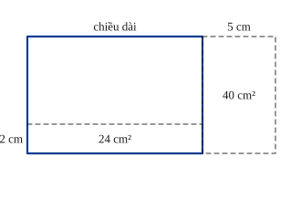

# Đề kiểm tra số 10

**Thời gian làm bài:** 60 phút. **Thang điểm:** mỗi câu 1 điểm, tổng 10 điểm.

## Đề bài

**Câu 1 (Đếm chữ số).** Để viết tất cả các số tự nhiên từ 1 đến 99 cần dùng bao nhiêu chữ số?

**Câu 2 (Tính nhanh).** Tính nhanh: $1 + 3 + 5 + 7 + 9 + 11 + 13 + 15 + 17 + 19$.

**Câu 3 (Phép nhân).** Khi nhân một số với 24, bạn Hà đặt hai tích riêng thẳng cột như phép cộng nên được kết quả là 2 418. Tìm tích đúng.

**Câu 4 (Trung bình cộng).** Lớp 4A có 30 học sinh, chiều cao trung bình là 135 cm. Nếu tính thêm cô giáo cao 166 cm thì chiều cao trung bình của 31 người là bao nhiêu?

**Câu 5 (Tổng và hiệu).** An và Bình có tất cả 120 viên bi. Nếu An cho Bình 10 viên thì Bình có nhiều hơn An 6 viên. Hỏi lúc đầu mỗi bạn có bao nhiêu viên bi?

**Câu 6 (So sánh phân số).** Không quy đồng mẫu số, hãy so sánh $\dfrac{2023}{2025}$ và $\dfrac{2024}{2026}$.

**Câu 7 (Bài toán phân số).** Một cửa hàng có một tấm vải. Ngày thứ nhất bán $\dfrac{1}{4}$ tấm vải, ngày thứ hai bán $\dfrac{1}{3}$ số vải còn lại, cuối cùng còn 30 m. Hỏi tấm vải lúc đầu dài bao nhiêu mét?

**Câu 8 (Thời gian).** Đồng hồ đang chỉ 9 giờ kém 15 phút. Hỏi sau 2 giờ 40 phút nữa, đồng hồ chỉ mấy giờ?

**Câu 9 (Diện tích).** Một hình chữ nhật, nếu tăng chiều dài thêm 5 cm (giữ nguyên chiều rộng) thì diện tích tăng thêm $40 \text{ cm}^2$; nếu giảm chiều rộng đi 2 cm (giữ nguyên chiều dài) thì diện tích giảm đi $24 \text{ cm}^2$. Tính diện tích hình chữ nhật ban đầu.

**Câu 10 (Đếm số lần xuất hiện).** Viết các số tự nhiên từ 1 đến 100. Chữ số 0 xuất hiện bao nhiêu lần? Chữ số 9 xuất hiện bao nhiêu lần?

---

## Lời giải chi tiết

### Câu 1
Từ 1 đến 9 có 9 số có một chữ số: cần 9 chữ số.
Từ 10 đến 99 có $99 - 10 + 1 = 90$ số có hai chữ số: cần $90 \times 2 = 180$ chữ số.
Tổng cộng: $9 + 180 = 189$ (chữ số).

**Đáp số:** 189 chữ số.

### Câu 2
Ghép số đầu với số cuối: $(1 + 19) + (3 + 17) + (5 + 15) + (7 + 13) + (9 + 11)$. Có 5 cặp, mỗi cặp bằng 20.
Tổng: $20 \times 5 = 100$.

### Câu 3
Nhân với 24 thì có hai tích riêng: tích với 4 và tích với 2 (viết lùi sang trái một cột, vì là 2 chục). Đặt thẳng cột thì Hà đã lấy số đó nhân 4 cộng với số đó nhân 2, tức là nhân với 6.
Số đó là $2\,418 : 6 = 403$.
Tích đúng: $403 \times 24 = 9\,672$.

**Đáp số:** 9 672.

### Câu 4
Tổng chiều cao 30 học sinh: $135 \times 30 = 4\,050$ (cm).
Tổng chiều cao 31 người: $4\,050 + 166 = 4\,216$ (cm).
Chiều cao trung bình: $4\,216 : 31 = 136$ (cm).

**Đáp số:** 136 cm.

### Câu 5
Sau khi An cho Bình 10 viên, tổng số bi vẫn là 120 và Bình hơn An 6 viên.
Lúc đó An có $(120 - 6) : 2 = 57$ (viên), Bình có $57 + 6 = 63$ (viên).
Lúc đầu An có $57 + 10 = 67$ (viên), Bình có $63 - 10 = 53$ (viên).

**Đáp số:** An 67 viên, Bình 53 viên.

### Câu 6
$\dfrac{2023}{2025}$ kém 1 là $\dfrac{2}{2025}$; $\dfrac{2024}{2026}$ kém 1 là $\dfrac{2}{2026}$.
Cùng tử số 2, mẫu 2025 bé hơn nên $\dfrac{2}{2025} > \dfrac{2}{2026}$.
Phân số thiếu nhiều hơn thì bé hơn: $\dfrac{2023}{2025} < \dfrac{2024}{2026}$.

### Câu 7
Sau ngày thứ nhất, còn lại $1 - \dfrac{1}{4} = \dfrac{3}{4}$ (tấm vải).
Ngày thứ hai bán $\dfrac{3}{4} \times \dfrac{1}{3} = \dfrac{1}{4}$ (tấm vải).
Còn lại $\dfrac{3}{4} - \dfrac{1}{4} = \dfrac{1}{2}$ (tấm vải), ứng với 30 m.
Tấm vải dài $30 \times 2 = 60$ (m).

**Đáp số:** 60 m.

*Lưu ý:* $\dfrac{1}{3}$ ở ngày thứ hai là của **số vải còn lại**, không phải của cả tấm vải.

### Câu 8
9 giờ kém 15 phút là 8 giờ 45 phút.
$8 \text{ giờ } 45 \text{ phút} + 2 \text{ giờ } 40 \text{ phút} = 10 \text{ giờ } 85 \text{ phút} = 11 \text{ giờ } 25 \text{ phút}$.

**Đáp số:** 11 giờ 25 phút.

### Câu 9

*Hình: Hình chữ nhật kéo dài thêm 5 cm và bớt chiều rộng 2 cm.*

Phần tăng thêm là hình chữ nhật có một cạnh 5 cm, cạnh kia bằng chiều rộng. Chiều rộng: $40 : 5 = 8$ (cm).
Phần giảm đi là hình chữ nhật có một cạnh 2 cm, cạnh kia bằng chiều dài. Chiều dài: $24 : 2 = 12$ (cm).
Diện tích ban đầu: $12 \times 8 = 96 \text{ (cm}^2)$.

**Đáp số:** $96 \text{ cm}^2$.

### Câu 10
**Chữ số 0:** ở hàng đơn vị của 10, 20, …, 90 (9 lần) và hai chữ số 0 của số 100 (2 lần). Tổng: 11 lần.
**Chữ số 9:** ở hàng đơn vị của 9, 19, …, 99 (10 lần); ở hàng chục của 90, 91, …, 99 (10 lần). Tổng: 20 lần.

**Đáp số:** chữ số 0: 11 lần; chữ số 9: 20 lần.
