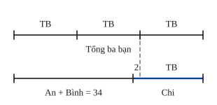

# Chủ đề 5. Trung bình cộng nâng cao

> Số trung bình cộng cho biết "nếu chia đều thì mỗi phần được bao nhiêu". Bài thi học sinh giỏi thường không cho sẵn các số mà giấu trung bình cộng trong điều kiện, như "bạn thứ ba có số bi hơn trung bình cộng của cả ba bạn 2 viên". Chìa khóa là luôn nghĩ đến **tổng**.

## I. Kiến thức cần nắm

### 1. Trung bình cộng và tổng
$$\text{Trung bình cộng} = \text{Tổng các số} : \text{Số các số hạng}, \qquad \text{Tổng} = \text{Trung bình cộng} \times \text{Số các số hạng}.$$

*Ý nghĩa:* trung bình cộng là giá trị mỗi phần nhận được nếu **san đều** tổng cho tất cả. Ví dụ ba bạn có $12$, $15$, $18$ viên bi, gom lại $45$ viên chia đều thì mỗi bạn $15$ viên.

**Quy tắc vàng:** gần như mọi bài trung bình cộng đều giải bằng cách **chuyển về tổng**, tính toán với tổng rồi mới chia lại.

*Ví dụ:* trung bình cộng của ba số là $50$, hai số đầu là $37$ và $53$. Tổng ba số là $50 \times 3 = 150$, nên số thứ ba là $150 - 37 - 53 = 60$.

### 2. Trung bình cộng của dãy cách đều
Với dãy cách đều, trung bình cộng $= (\text{số đầu} + \text{số cuối}) : 2$, và cũng bằng **số ở giữa** (nếu số số hạng lẻ) hoặc trung bình của **hai số ở giữa** (nếu số số hạng chẵn).

*Vì sao:* tổng dãy cách đều bằng $(\text{số đầu} + \text{số cuối}) \times \text{số số hạng} : 2$. Chia tổng cho số số hạng thì được $(\text{số đầu} + \text{số cuối}) : 2$.

*Ví dụ:* $5$ số lẻ liên tiếp có trung bình cộng $21$ thì số ở giữa là $21$: các số là $17, 19, 21, 23, 25$.

### 3. Thêm, bớt hoặc thay một số hạng
- **Thêm một số:** số thêm vào $=$ trung bình mới $\times$ (số số hạng mới) $-$ tổng cũ.
- **Bớt một số:** số bớt đi $=$ tổng cũ $-$ trung bình mới $\times$ (số số hạng còn lại).
- **Thay một số:** tổng thay đổi bao nhiêu thì số mới hơn (hay kém) số cũ bấy nhiêu.

*Cách nghĩ thứ hai (san đều):* trung bình cộng của $9$ số là $20$. Thêm số thứ mười thì trung bình tăng thêm $2$. Hãy tưởng tượng số mới trước hết "giữ lại" $20$ cho mình (bằng trung bình cũ), phần còn lại đem san đều để cả $10$ số đều tăng $2$, tức là cần thêm $10 \times 2 = 20$. Vậy số mới là $20 + 20 = 40$.

### 4. Bài toán "ẩn trung bình cộng"
Dạng: biết các số $a, b$, còn số $c$ **hơn** (hoặc **kém**) trung bình cộng của cả ba số một lượng $k$. Tìm $c$.

Vì tổng ba số bằng $3$ lần trung bình cộng, mà $c$ chiếm "$1$ lần trung bình cộng $+\,k$", nên $a + b$ chiếm "$2$ lần trung bình cộng $-\,k$":
$$\text{Trung bình cộng} = (a + b + k) : 2 \quad\text{(khi } c \text{ hơn trung bình } k\text{)},$$
$$\text{Trung bình cộng} = (a + b - k) : 2 \quad\text{(khi } c \text{ kém trung bình } k\text{)}.$$

Với $n$ số, chia cho $n - 1$ thay cho $2$. Khi làm bài, nên vẽ **sơ đồ đoạn thẳng** (xem Bài 11) thay vì nhớ công thức.

### 5. Trung bình cộng của hai nhóm có số lượng khác nhau
Muốn tính trung bình chung của hai nhóm, phải **tính tổng của từng nhóm** rồi cộng lại, chia cho tổng số phần tử. Chỉ khi hai nhóm có số phần tử bằng nhau mới được lấy trung bình của hai trung bình.

*Ví dụ:* $30$ bạn nặng trung bình $32$ kg, $20$ bạn nặng trung bình $27$ kg. Trung bình chung là $(30 \times 32 + 20 \times 27) : 50 = 30$ kg, không phải $(32 + 27) : 2$.

### 6. Trung bình cộng của từng cặp
Nếu biết trung bình cộng của từng cặp trong ba số, ta tìm được tổng từng cặp. Cộng ba tổng cặp thì mỗi số được tính **hai lần**, nên tổng ba số bằng nửa số đó.

> **Sai lầm hay gặp:**
> - Lấy trung bình của các trung bình khi số lượng hai nhóm khác nhau.
> - Bài thêm người (ví dụ "tính cả cô giáo"): quên rằng số người tăng thêm $1$, chia sai số người.
> - Bài ẩn trung bình: tưởng số $c$ đã biết là "trung bình $+\,k$" rồi lấy $(a + b) : 2 + k$ (sai, vì trung bình còn phụ thuộc vào chính $c$).

---

## II. Bài tập vận dụng

**Bài 1.** Tìm trung bình cộng của các số $12, 18, 25, 30, 35$.

**Bài 2.** Một ô tô trong $3$ giờ đầu, mỗi giờ đi được $48$ km; trong $2$ giờ sau, mỗi giờ đi được $43$ km. Hỏi trung bình mỗi giờ ô tô đi được bao nhiêu ki-lô-mét?

**Bài 3.** Trung bình cộng của ba số là $50$. Số thứ nhất là $37$, số thứ hai là $53$. Tìm số thứ ba.

**Bài 4.** Tính:
a) Trung bình cộng của các số chẵn từ $2$ đến $100$;
b) Trung bình cộng của tất cả các số lẻ có hai chữ số.

**Bài 5.** Lớp 4A có $30$ học sinh, tuổi trung bình là $9$. Nếu tính cả cô giáo chủ nhiệm thì tuổi trung bình của cả lớp và cô là $10$. Hỏi cô giáo bao nhiêu tuổi?

**Bài 6.** Ba bài kiểm tra đầu tiên, bạn Hà được trung bình $6$ điểm.
a) Bài thứ tư Hà phải được bao nhiêu điểm để trung bình bốn bài là $7$ điểm?
b) Hà có thể đạt trung bình bốn bài là $8$ điểm không? Vì sao? (Điểm tối đa của mỗi bài là $10$.)

**Bài 7 (thêm số hạng).** Trung bình cộng của $9$ số là $20$. Thêm số thứ mười thì trung bình cộng của cả mười số tăng thêm $2$. Tìm số thứ mười.

**Bài 8 (hai nhóm).** Lớp 4A có $30$ bạn với cân nặng trung bình $32$ kg, lớp 4B có $20$ bạn với cân nặng trung bình $27$ kg. Tính cân nặng trung bình của tất cả học sinh hai lớp. Vì sao kết quả không phải là $(32 + 27) : 2$?

**Bài 9.** Trung bình cộng của hai số là $45$. Số thứ nhất hơn số thứ hai $12$ đơn vị. Tìm hai số.

**Bài 10 (ẩn trung bình).** An có $18$ viên bi, Bình có $16$ viên bi. Chi có số bi bằng trung bình cộng số bi của cả ba bạn. Hỏi Chi có bao nhiêu viên bi?

**Bài 11 (ẩn trung bình).** An có $18$ viên bi, Bình có $16$ viên bi. Chi có số bi hơn trung bình cộng số bi của cả ba bạn là $2$ viên. Hỏi Chi có bao nhiêu viên bi?

**Bài 12 (ẩn trung bình).** Ba bạn góp tiền mua sách tặng thư viện. An góp $30$ nghìn đồng, Bình góp $36$ nghìn đồng, Chi góp ít hơn trung bình cộng số tiền của cả ba bạn là $4$ nghìn đồng. Hỏi Chi góp bao nhiêu tiền?

**Bài 13.** Tìm sáu số chẵn liên tiếp có trung bình cộng là $51$.

**Bài 14 (khó).** Có ba số. Trung bình cộng của số thứ nhất và số thứ hai là $25$, của số thứ hai và số thứ ba là $30$, của số thứ nhất và số thứ ba là $35$. Tìm ba số đó.

---

## III. Lời giải chi tiết

### Bài 1
Tổng: $12 + 18 + 25 + 30 + 35 = 120$. Trung bình cộng: $120 : 5 = 24$.

**Đáp số:** $24$.

### Bài 2
Quãng đường $3$ giờ đầu: $48 \times 3 = 144$ (km). Quãng đường $2$ giờ sau: $43 \times 2 = 86$ (km).
Tổng quãng đường $144 + 86 = 230$ (km) trong $3 + 2 = 5$ giờ. Trung bình mỗi giờ: $230 : 5 = 46$ (km).

**Đáp số:** $46$ km.

*Nhận xét:* không được lấy $(48 + 43) : 2$, vì số giờ đi với hai vận tốc khác nhau.

### Bài 3
Tổng ba số: $50 \times 3 = 150$. Số thứ ba: $150 - 37 - 53 = 60$.

**Đáp số:** $60$.

### Bài 4
a) Các số chẵn từ $2$ đến $100$ tạo thành dãy cách đều, nên trung bình cộng bằng $(2 + 100) : 2 = 51$.
b) Các số lẻ có hai chữ số là $11, 13, \dots, 99$, dãy cách đều, trung bình cộng $(11 + 99) : 2 = 55$.

**Đáp số:** a) $51$; b) $55$.

### Bài 5
Tổng số tuổi của $30$ học sinh: $9 \times 30 = 270$ (tuổi).
Tính cả cô giáo thì có $31$ người, tổng số tuổi là $10 \times 31 = 310$ (tuổi).
Tuổi cô giáo: $310 - 270 = 40$ (tuổi).

**Đáp số:** $40$ tuổi.

### Bài 6
Tổng điểm ba bài đầu: $6 \times 3 = 18$.
a) Muốn trung bình bốn bài là $7$ thì tổng bốn bài là $7 \times 4 = 28$. Bài thứ tư phải được $28 - 18 = 10$ điểm.
b) Muốn trung bình bốn bài là $8$ thì tổng bốn bài là $8 \times 4 = 32$, bài thứ tư phải được $32 - 18 = 14$ điểm. Điều này không thể, vì mỗi bài tối đa $10$ điểm.

**Đáp số:** a) $10$ điểm; b) không thể.

### Bài 7
Tổng $9$ số: $20 \times 9 = 180$. Trung bình mới là $20 + 2 = 22$, tổng $10$ số là $22 \times 10 = 220$.
Số thứ mười: $220 - 180 = 40$.

*Cách khác (san đều):* số thứ mười phải bằng trung bình cũ $20$, cộng thêm phần đủ để mỗi số trong mười số được tăng $2$, tức là $10 \times 2 = 20$. Vậy số thứ mười là $20 + 20 = 40$.

**Đáp số:** $40$.

### Bài 8
Tổng cân nặng lớp 4A: $32 \times 30 = 960$ (kg). Lớp 4B: $27 \times 20 = 540$ (kg).
Tổng cân nặng hai lớp: $960 + 540 = 1500$ (kg), số học sinh $30 + 20 = 50$. Trung bình: $1500 : 50 = 30$ (kg).

Kết quả không phải $(32 + 27) : 2$ vì hai lớp có số học sinh khác nhau. Lớp 4A đông hơn nên "kéo" trung bình chung về gần $32$ hơn. Chỉ khi hai lớp có số học sinh bằng nhau mới được lấy trung bình của hai trung bình.

**Đáp số:** $30$ kg.

### Bài 9
Tổng hai số: $45 \times 2 = 90$. Hiệu hai số là $12$.
Số thứ nhất: $(90 + 12) : 2 = 51$. Số thứ hai: $90 - 51 = 39$.

**Đáp số:** $51$ và $39$.

### Bài 10
Tổng số bi của ba bạn bằng $3$ lần trung bình cộng. Chi có đúng $1$ lần trung bình cộng, nên An và Bình có $2$ lần trung bình cộng.
Trung bình cộng: $(18 + 16) : 2 = 17$. Vậy Chi có $17$ viên bi.

*Thử lại:* $(18 + 16 + 17) : 3 = 51 : 3 = 17$. Đúng.

**Đáp số:** $17$ viên bi.

### Bài 11

*Hình: Tổng ba bạn gồm 3 lần trung bình cộng; Chi bằng trung bình cộng thêm 2 viên.*

Tổng số bi của ba bạn bằng $3$ lần trung bình cộng. Chi có $1$ lần trung bình cộng và thêm $2$ viên, nên An và Bình có $2$ lần trung bình cộng nhưng **thiếu $2$ viên** (như sơ đồ).

Vậy $2$ lần trung bình cộng bằng $18 + 16 + 2 = 36$ (viên). Trung bình cộng là $36 : 2 = 18$ (viên). Số bi của Chi: $18 + 2 = 20$ (viên).

*Thử lại:* $(18 + 16 + 20) : 3 = 54 : 3 = 18$, và $20$ hơn $18$ đúng $2$ viên.

**Đáp số:** $20$ viên bi.

*Nhận xét:* phần "hơn trung bình" của Chi chính là phần "thiếu" của những bạn còn lại. Vì thế trung bình cộng bằng (tổng các số đã biết $+$ phần hơn) chia cho số bạn còn lại.

### Bài 12
Chi góp $1$ lần trung bình cộng nhưng thiếu $4$ nghìn, nên An và Bình góp $2$ lần trung bình cộng và **thừa $4$ nghìn**.

Vậy $2$ lần trung bình cộng bằng $30 + 36 - 4 = 62$ (nghìn đồng). Trung bình cộng là $62 : 2 = 31$ (nghìn đồng). Chi góp $31 - 4 = 27$ (nghìn đồng).

*Thử lại:* $(30 + 36 + 27) : 3 = 93 : 3 = 31$. Đúng.

**Đáp số:** $27$ nghìn đồng.

### Bài 13
Sáu số chẵn liên tiếp tạo thành dãy cách đều có số số hạng chẵn, nên trung bình cộng $51$ là trung bình của hai số ở giữa (số thứ ba và số thứ tư). Hai số chẵn liên tiếp có trung bình $51$ là $50$ và $52$.

Sáu số là $46, 48, 50, 52, 54, 56$.

*Thử lại:* $(46 + 56) : 2 = 51$. Đúng.

**Đáp số:** $46, 48, 50, 52, 54, 56$.

### Bài 14
Từ các trung bình cộng, ta có tổng từng cặp:
- Số thứ nhất + số thứ hai $= 25 \times 2 = 50$;
- Số thứ hai + số thứ ba $= 30 \times 2 = 60$;
- Số thứ nhất + số thứ ba $= 35 \times 2 = 70$.

Cộng ba tổng, mỗi số được tính hai lần: $2$ lần tổng ba số bằng $50 + 60 + 70 = 180$. Tổng ba số là $180 : 2 = 90$.
- Số thứ ba: $90 - 50 = 40$;
- Số thứ nhất: $90 - 60 = 30$;
- Số thứ hai: $90 - 70 = 20$.

*Thử lại:* $(30 + 20) : 2 = 25$, $(20 + 40) : 2 = 30$, $(30 + 40) : 2 = 35$. Đúng.

**Đáp số:** $30$, $20$, $40$.

*Nhận xét:* khi biết tổng từng cặp, cộng tất cả lại để mỗi số xuất hiện như nhau, rồi lấy tổng trừ đi từng cặp.
