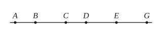
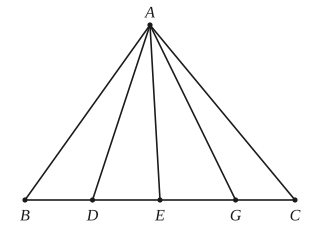
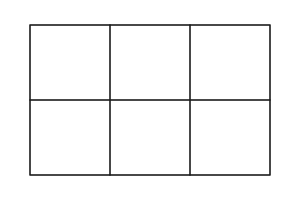
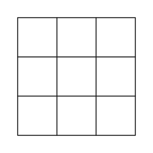
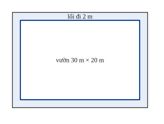
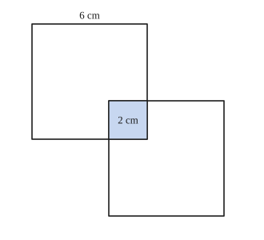
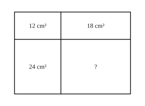
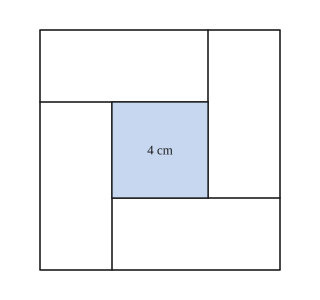

# Chủ đề 9. Hình học nâng cao

> Hình học trong đề học sinh giỏi lớp 4 gồm ba mảng: đếm hình (đoạn thẳng, tam giác, hình chữ nhật, hình vuông), cắt ghép hình, và chu vi, diện tích khi thêm hoặc bớt kích thước. Mấu chốt là vẽ hình cẩn thận và tách hình phức tạp thành những hình đơn giản.

## I. Kiến thức cần nắm

### 1. Đếm đoạn thẳng

Trên một đường thẳng có $n$ điểm thì có
$$(n - 1) + (n - 2) + \dots + 2 + 1 \text{ đoạn thẳng}.$$
*Vì sao:* điểm đầu tiên nối được với $n - 1$ điểm còn lại; điểm thứ hai nối thêm được $n - 2$ đoạn mới (đoạn nối với điểm đầu đã đếm rồi);... Với 5 điểm: $4 + 3 + 2 + 1 = 10$ đoạn.

Có thể tính nhanh: số đoạn $= n \times (n - 1) : 2$.

### 2. Đếm tam giác và hình chữ nhật

- **Tam giác có chung đỉnh A:** từ A kẻ các đoạn tới cạnh đáy, trên đáy có $n$ điểm (kể cả hai đầu). Mỗi đoạn thẳng trên đáy cùng với A tạo một tam giác, nên **số tam giác = số đoạn thẳng trên đáy**.
- **Hình chữ nhật trong lưới:** mỗi hình chữ nhật được xác định bởi 2 đường dọc và 2 đường ngang. Số hình chữ nhật $=$ (số đoạn chọn được từ các đường dọc) $\times$ (số đoạn chọn được từ các đường ngang).
- **Hình vuông trong lưới $3 \times 3$:** đếm theo cỡ: cỡ $1 \times 1$ có 9, cỡ $2 \times 2$ có 4, cỡ $3 \times 3$ có 1. Tổng 14.

**Mẹo chung:** đếm theo **cỡ** (gồm 1 hình nhỏ, 2 hình nhỏ, …) hoặc theo **một yếu tố cố định** để không sót, không trùng.

### 3. Thêm, bớt kích thước

- Tăng (giảm) **một** cạnh của hình chữ nhật thêm $k$: diện tích tăng (giảm) một hình chữ nhật có một cạnh là $k$, cạnh kia là cạnh **không đổi**.
- Tăng chiều rộng, giảm chiều dài cùng $k$ để thành hình vuông: chiều dài hơn chiều rộng $2 \times k$.
- Hình vuông kéo dài một phía thêm $k$: phần tăng là hình chữ nhật $k \times$ cạnh.

**Ví dụ.** Tăng chiều rộng thêm 3 m thì diện tích tăng 36 m². Phần tăng là hình chữ nhật có một cạnh 3 m, cạnh kia là chiều dài: chiều dài $= 36 : 3 = 12$ (m).

### 4. Cắt ghép hình

- Cắt ghép **không làm thay đổi diện tích** (tổng diện tích các mảnh không đổi).
- **Chu vi có thể thay đổi:** hai mảnh ghép sát nhau thì đoạn chung bị "giấu" đi.
- Với cùng một diện tích, hình càng "vuông vức" thì chu vi càng nhỏ.

### 5. Hình chồng nhau, lối đi bao quanh

- Hai hình chồng nhau: diện tích phần được phủ $=$ tổng diện tích hai hình $-$ diện tích phần chung.
- Lối đi bao quanh bên ngoài một hình chữ nhật, rộng $k$: hình lớn có mỗi kích thước dài thêm $2 \times k$. Diện tích lối đi $=$ diện tích hình lớn $-$ diện tích hình trong.

### 6. Sai lầm hay gặp

- Đếm tam giác hay hình chữ nhật mà chỉ đếm các hình nhỏ.
- Lối đi bao quanh rộng 2 m mà chỉ cộng thêm 2 m vào mỗi kích thước (phải cộng $2 + 2 = 4$ m).
- Nghĩ rằng cắt ghép thì chu vi cũng không đổi.

## II. Bài tập vận dụng

**Bài 1.** Trên một đường thẳng lấy 6 điểm $A, B, C, D, E, G$. Hỏi có bao nhiêu đoạn thẳng có hai đầu là hai trong sáu điểm đó?

**Bài 2.** Cho tam giác $ABC$. Trên cạnh $BC$ lấy ba điểm $D, E, G$ rồi nối $A$ với mỗi điểm đó. Hỏi trong hình có bao nhiêu tam giác?

**Bài 3.** Một hình chữ nhật được chia thành 2 hàng, mỗi hàng 3 ô bằng nhau (lưới $2 \times 3$). Hỏi trong hình có bao nhiêu hình chữ nhật (kể cả hình vuông)?

**Bài 4.** Một hình vuông được chia thành $3 \times 3 = 9$ ô vuông bằng nhau. Hỏi trong hình có bao nhiêu hình vuông?

**Bài 5.** Một hình chữ nhật, nếu tăng chiều rộng thêm 4 cm thì trở thành hình vuông và diện tích tăng thêm $48 \text{ cm}^2$. Tính diện tích hình chữ nhật ban đầu.

**Bài 6.** Một hình chữ nhật có chu vi 56 cm. Nếu tăng chiều rộng thêm 3 cm và giảm chiều dài đi 3 cm thì được một hình vuông. Tính diện tích hình chữ nhật.

**Bài 7.** Một mảnh đất hình vuông. Người ta mở rộng về một phía thêm 5 m thì được mảnh đất hình chữ nhật có diện tích hơn mảnh đất ban đầu $60 \text{ m}^2$. Tính diện tích mảnh đất hình vuông ban đầu.

**Bài 8 (cắt ghép).** Một tờ giấy hình chữ nhật dài 12 cm, rộng 3 cm. Hãy cắt tờ giấy thành 2 mảnh rồi ghép thành một hình vuông. Chu vi hình vuông so với chu vi tờ giấy ban đầu tăng hay giảm bao nhiêu xăng-ti-mét?

**Bài 9 (ghép hình).** Có 4 hình vuông nhỏ, mỗi hình có cạnh 2 cm. Ghép sát cả 4 hình (không chồng lên nhau, cạnh khít cạnh) thành một hình chữ nhật. Có những cách ghép nào? Cách nào cho chu vi nhỏ nhất?

**Bài 10 (lối đi).** Một vườn hoa hình chữ nhật dài 30 m, rộng 20 m. Người ta làm một lối đi rộng 2 m bao quanh bên ngoài vườn. Tính diện tích lối đi.

**Bài 11 (hình chồng nhau).** Hai hình vuông cạnh 6 cm đặt chồng lên nhau ở một góc, phần chung là một hình vuông cạnh 2 cm (xem hình). Tính diện tích và chu vi của hình tạo thành.

**Bài 12.** Một hình chữ nhật được chia thành 4 hình chữ nhật nhỏ bởi một đường thẳng dọc và một đường thẳng ngang. Diện tích ba hình nhỏ là $12 \text{ cm}^2$, $18 \text{ cm}^2$ và $24 \text{ cm}^2$ (xem hình). Tính diện tích hình còn lại.

**Bài 13 (khó).** Một hình vuông lớn được ghép từ 4 hình chữ nhật bằng nhau và một hình vuông nhỏ cạnh 4 cm ở giữa (xem hình). Mỗi hình chữ nhật có chu vi 20 cm. Tính diện tích hình vuông lớn và diện tích mỗi hình chữ nhật.

---

## III. Lời giải chi tiết

### Bài 1

*Hình: Sáu điểm A, B, C, D, E, G trên một đường thẳng.*

Điểm A nối với 5 điểm còn lại được 5 đoạn. Điểm B nối với C, D, E, G được thêm 4 đoạn. Tương tự C thêm 3 đoạn, D thêm 2, E thêm 1.
Số đoạn thẳng: $5 + 4 + 3 + 2 + 1 = 15$.

**Đáp số:** 15 đoạn thẳng.

### Bài 2

*Hình: Tam giác ABC với ba đoạn thẳng nối A với BC.*

Mỗi tam giác có đỉnh A và một cạnh đáy là một đoạn thẳng nằm trên $BC$. Trên $BC$ có 5 điểm $B, D, E, G, C$, tạo thành $4 + 3 + 2 + 1 = 10$ đoạn thẳng.

**Đáp số:** 10 tam giác.

### Bài 3

*Hình: Hình chữ nhật chia thành lưới 2 hàng, 3 cột.*

Có 4 đường dọc. Chọn 2 trong 4 đường dọc: $3 + 2 + 1 = 6$ cách.
Có 3 đường ngang. Chọn 2 trong 3 đường ngang: $2 + 1 = 3$ cách.
Mỗi cách chọn 2 đường dọc và 2 đường ngang cho đúng một hình chữ nhật: $6 \times 3 = 18$.

**Đáp số:** 18 hình chữ nhật.

*Kiểm tra bằng cách đếm theo cỡ:* hình 1 ô: 6; 2 ô nằm ngang: 4; 2 ô đứng: 3; 3 ô một hàng: 2; 4 ô ($2 \times 2$): 2; 6 ô: 1. Tổng $6 + 4 + 3 + 2 + 2 + 1 = 18$.

### Bài 4

*Hình: Hình vuông chia thành lưới 3 × 3 ô vuông.*

- Hình vuông cỡ 1 ô: 9 hình.
- Hình vuông cỡ $2 \times 2$ ô: có thể đặt ở 2 vị trí theo chiều ngang và 2 vị trí theo chiều dọc: $2 \times 2 = 4$ hình.
- Hình vuông cỡ $3 \times 3$ ô: 1 hình.

Tổng: $9 + 4 + 1 = 14$.

**Đáp số:** 14 hình vuông.

### Bài 5
Phần diện tích tăng thêm là hình chữ nhật có một cạnh 4 cm, cạnh kia là chiều dài.
Chiều dài: $48 : 4 = 12$ (cm).
Sau khi tăng, hình vuông có cạnh bằng chiều dài 12 cm, nên chiều rộng ban đầu là $12 - 4 = 8$ (cm).
Diện tích ban đầu: $12 \times 8 = 96 \text{ (cm}^2)$.

**Đáp số:** $96 \text{ cm}^2$.

### Bài 6
Tăng rộng 3 cm, giảm dài 3 cm thì bằng nhau, nên chiều dài hơn chiều rộng $3 + 3 = 6$ (cm).
Nửa chu vi: $56 : 2 = 28$ (cm).
Chiều dài: $(28 + 6) : 2 = 17$ (cm). Chiều rộng: $17 - 6 = 11$ (cm).
Diện tích: $17 \times 11 = 187 \text{ (cm}^2)$.

**Đáp số:** $187 \text{ cm}^2$.

### Bài 7
Phần mở rộng là hình chữ nhật có một cạnh 5 m, cạnh kia bằng cạnh hình vuông.
Cạnh hình vuông: $60 : 5 = 12$ (m).
Diện tích mảnh đất ban đầu: $12 \times 12 = 144 \text{ (m}^2)$.

**Đáp số:** $144 \text{ m}^2$.

### Bài 8
Diện tích tờ giấy: $12 \times 3 = 36 \text{ (cm}^2)$. Hình vuông ghép được cũng có diện tích $36 \text{ cm}^2$, nên cạnh là 6 cm (vì $6 \times 6 = 36$).
Cách cắt: cắt đôi theo chiều dài được hai hình chữ nhật $6 \text{ cm} \times 3 \text{ cm}$, đặt chồng hai mảnh lên nhau theo chiều cao (cạnh 6 cm khít nhau) được hình vuông $6 \text{ cm} \times 6 \text{ cm}$.
Chu vi tờ giấy: $(12 + 3) \times 2 = 30$ (cm). Chu vi hình vuông: $6 \times 4 = 24$ (cm).
Chu vi giảm: $30 - 24 = 6$ (cm).

**Đáp số:** giảm 6 cm.

### Bài 9
Có hai cách ghép thành hình chữ nhật:
- Xếp 4 hình thành một hàng: hình chữ nhật $8 \text{ cm} \times 2 \text{ cm}$, chu vi $(8 + 2) \times 2 = 20$ (cm).
- Xếp thành 2 hàng, mỗi hàng 2 hình: hình vuông cạnh 4 cm, chu vi $4 \times 4 = 16$ (cm).

Cả hai hình đều có diện tích $16 \text{ cm}^2$. Cách thứ hai (hình vuông) có chu vi nhỏ nhất: 16 cm.

*Nhận xét:* cùng diện tích, hình càng gần hình vuông thì chu vi càng nhỏ, vì có nhiều cạnh chung bị giấu vào bên trong hơn.

### Bài 10

*Hình: Vườn hình chữ nhật 30 m × 20 m với lối đi rộng 2 m bao quanh.*

Cả vườn và lối đi tạo thành hình chữ nhật lớn dài $30 + 2 + 2 = 34$ (m), rộng $20 + 2 + 2 = 24$ (m).
Diện tích hình lớn: $34 \times 24 = 816 \text{ (m}^2)$. Diện tích vườn: $30 \times 20 = 600 \text{ (m}^2)$.
Diện tích lối đi: $816 - 600 = 216 \text{ (m}^2)$.

**Đáp số:** $216 \text{ m}^2$.

### Bài 11

*Hình: Hai hình vuông cạnh 6 cm chồng lên nhau, phần chung là hình vuông cạnh 2 cm.*

**Diện tích.** Mỗi hình vuông lớn có diện tích $6 \times 6 = 36 \text{ (cm}^2)$. Phần chung $2 \times 2 = 4 \text{ (cm}^2)$ bị tính hai lần.
Diện tích hình tạo thành: $36 + 36 - 4 = 68 \text{ (cm}^2)$.

**Chu vi.** Tổng chu vi hai hình vuông là $24 + 24 = 48$ (cm). Phần nằm bên trong (không thuộc đường bao) là hai cạnh của hình vuông nhỏ thuộc hình thứ nhất và hai cạnh thuộc hình thứ hai, tổng $2 \times 4 = 8$ (cm).
Chu vi hình tạo thành: $48 - 8 = 40$ (cm).

**Đáp số:** $68 \text{ cm}^2$; 40 cm.

*Kiểm tra:* đi vòng quanh đường bao: $6 + 4 + 4 + 6 + 6 + 4 + 4 + 6 = 40$ (cm).

### Bài 12

*Hình: Hình chữ nhật chia thành 4 hình chữ nhật nhỏ.*

Hai hình ở hàng trên ($12 \text{ cm}^2$ và $18 \text{ cm}^2$) có **cùng chiều rộng** (chiều cao của hàng). Diện tích hình bên phải gấp $18 : 12 = \dfrac{3}{2}$ lần hình bên trái, nên chiều dài của cột phải gấp $\dfrac{3}{2}$ lần chiều dài của cột trái.
Ở hàng dưới, hai hình cũng có cùng chiều rộng, và chiều dài cột phải vẫn gấp $\dfrac{3}{2}$ lần cột trái. Vậy diện tích hình còn lại gấp $\dfrac{3}{2}$ lần $24 \text{ cm}^2$:
$$24 \times \frac{3}{2} = 36 \text{ (cm}^2).$$

**Đáp số:** $36 \text{ cm}^2$.

*Nhận xét:* trong hình như vậy, tích hai hình chéo nhau bằng nhau: $12 \times 36 = 18 \times 24 = 432$.

### Bài 13

*Hình: Hình vuông lớn ghép từ 4 hình chữ nhật bằng nhau và 1 hình vuông nhỏ ở giữa.*

Nhìn cạnh trên của hình vuông lớn: gồm chiều dài của một hình chữ nhật và chiều rộng của hình chữ nhật bên cạnh. Vậy **cạnh hình vuông lớn = chiều dài + chiều rộng** của hình chữ nhật $=$ nửa chu vi hình chữ nhật $= 20 : 2 = 10$ (cm).
Diện tích hình vuông lớn: $10 \times 10 = 100 \text{ (cm}^2)$.
Cạnh hình vuông nhỏ bằng **chiều dài − chiều rộng** của hình chữ nhật, nên chiều dài hơn chiều rộng 4 cm.
Chiều dài: $(10 + 4) : 2 = 7$ (cm). Chiều rộng: $7 - 4 = 3$ (cm).
Diện tích mỗi hình chữ nhật: $7 \times 3 = 21 \text{ (cm}^2)$.

**Đáp số:** $100 \text{ cm}^2$; $21 \text{ cm}^2$.

Thử lại: $4 \times 21 + 4 \times 4 = 84 + 16 = 100$. Đúng.
