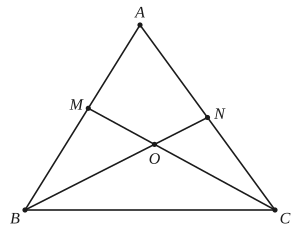

# Đề thi thử số 1

**Thời gian làm bài:** 90 phút. **Thang điểm:** mỗi câu 1 điểm, tổng 10 điểm.

## Đề bài

**Câu 1 (Tính nhanh).** Tính bằng cách hợp lý: $25 \times 37 \times 4 + 63 \times 100$.

**Câu 2 (Cấu tạo số).** Tìm số có hai chữ số, biết rằng nếu viết thêm chữ số 5 vào bên trái số đó thì được số mới gấp 21 lần số đã cho.

**Câu 3 (Dãy số).** Cho dãy số $2, 5, 8, 11, \dots$
a) Tìm số hạng thứ 50 của dãy. b) Tính tổng 50 số hạng đầu tiên.

**Câu 4 (Chia hết).** Tìm các chữ số $a, b$ để số $\overline{3a5b}$ chia hết cho cả 2, 5 và 9.

**Câu 5 (Trung bình cộng).** Trung bình cộng của ba số là 40. Nếu bỏ đi số thứ ba thì trung bình cộng của hai số còn lại là 35. Tìm số thứ ba.

**Câu 6 (Giả thiết tạm).** Có 15 ô tô gồm hai loại: loại 4 chỗ và loại 7 chỗ, chở được tất cả 84 người (các xe đều chở đủ chỗ). Hỏi mỗi loại có bao nhiêu xe?

**Câu 7 (So sánh phân số).** Không quy đồng, hãy so sánh $\dfrac{37}{38}$ và $\dfrac{41}{42}$.

**Câu 8 (Chuyển động).** Quãng đường $AB$ dài 120 km. Lúc 7 giờ, một xe đạp điện đi từ A với vận tốc 25 km/giờ và một xe máy đi từ B với vận tốc 35 km/giờ, đi ngược chiều nhau. Hỏi hai xe gặp nhau lúc mấy giờ, chỗ gặp cách A bao nhiêu ki-lô-mét?

**Câu 9 (Đếm hình).** Cho tam giác $ABC$. Lấy điểm $M$ trên cạnh $AB$, điểm $N$ trên cạnh $AC$. Nối $B$ với $N$, nối $C$ với $M$; hai đoạn này cắt nhau tại $O$. Hỏi trong hình có bao nhiêu tam giác? Kể tên.

**Câu 10 (Đếm).** Có bao nhiêu số có ba chữ số mà tổng các chữ số bằng 4?

---

## Lời giải chi tiết

### Câu 1
$$25 \times 37 \times 4 + 63 \times 100 = 37 \times 100 + 63 \times 100 = (37 + 63) \times 100 = 10\,000.$$

### Câu 2
Viết thêm chữ số 5 vào bên trái số có hai chữ số thì số đó tăng thêm 500. Số mới gấp 21 lần số cũ, nên phần tăng thêm 500 gấp $21 - 1 = 20$ lần số cũ.
Số cần tìm: $500 : 20 = 25$.

**Đáp số:** 25. Thử lại: $525 = 21 \times 25$.

### Câu 3
Dãy cách đều 3, số hạng đầu là 2.
a) Số hạng thứ 50: $2 + (50 - 1) \times 3 = 149$.
b) Tổng 50 số hạng: $(2 + 149) \times 50 : 2 = 3\,775$.

### Câu 4
Chia hết cho 2 và 5 nên $b = 0$.
Chia hết cho 9 nên $3 + a + 5 + 0 = 8 + a$ chia hết cho 9. Vì $a$ là chữ số nên $8 + a = 9$, $a = 1$.

**Đáp số:** $a = 1$, $b = 0$; số đó là 3 150.

### Câu 5
Tổng ba số: $40 \times 3 = 120$. Tổng hai số đầu: $35 \times 2 = 70$.
Số thứ ba: $120 - 70 = 50$.

**Đáp số:** 50.

### Câu 6
Giả sử cả 15 xe đều là loại 4 chỗ: chở được $4 \times 15 = 60$ (người), thiếu $84 - 60 = 24$ (người).
Thay 1 xe 4 chỗ bằng 1 xe 7 chỗ thì chở thêm 3 người.
Số xe 7 chỗ: $24 : 3 = 8$ (xe). Số xe 4 chỗ: $15 - 8 = 7$ (xe).

**Đáp số:** 7 xe 4 chỗ, 8 xe 7 chỗ.

### Câu 7
Phần bù: $1 - \dfrac{37}{38} = \dfrac{1}{38}$; $1 - \dfrac{41}{42} = \dfrac{1}{42}$.
$\dfrac{1}{38} > \dfrac{1}{42}$ nên $\dfrac{37}{38} < \dfrac{41}{42}$.

### Câu 8
Mỗi giờ hai xe gần nhau thêm $25 + 35 = 60$ (km). Thời gian: $120 : 60 = 2$ (giờ).
Hai xe gặp nhau lúc $7 + 2 = 9$ giờ, cách A $25 \times 2 = 50$ (km).

**Đáp số:** 9 giờ; 50 km.

### Câu 9

*Hình: Tam giác ABC, M trên AB, N trên AC, BN cắt CM tại O.*

Các tam giác:
- Tam giác lớn: $ABC$.
- Có cạnh $BN$ làm cạnh: $ABN$, $BCN$.
- Có cạnh $CM$ làm cạnh: $ACM$, $BCM$.
- Có đỉnh $O$: $BOC$, $BOM$, $CON$.

Tổng cộng 8 tam giác.

**Đáp số:** 8 tam giác.

### Câu 10
Gọi số đó là $\overline{abc}$ với $a \ge 1$ và $a + b + c = 4$.
- $a = 1$: $b + c = 3$, có 4 cách $(0, 3), (1, 2), (2, 1), (3, 0)$.
- $a = 2$: $b + c = 2$, có 3 cách.
- $a = 3$: $b + c = 1$, có 2 cách.
- $a = 4$: $b + c = 0$, có 1 cách.

Tổng: $4 + 3 + 2 + 1 = 10$ (số).

**Đáp số:** 10 số.
