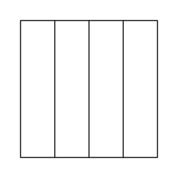

# Đề thi thử số 3

**Thời gian làm bài:** 90 phút. **Thang điểm:** mỗi câu 1 điểm, tổng 10 điểm.

## Đề bài

**Câu 1 (Tính nhanh).** Tính: $(1 + 3 + 5 + \dots + 19) \times (24 \times 5 - 120)$.

**Câu 2 (Cấu tạo số).** Tìm số có ba chữ số, biết rằng chữ số hàng đơn vị là 7 và nếu xóa chữ số 7 đó đi thì số đã cho giảm 331 đơn vị.

**Câu 3 (Đếm chữ số).** Viết liên tiếp các số chẵn từ 2 đến 200. Hỏi phải viết tất cả bao nhiêu chữ số?

**Câu 4 (Chia có dư).** Tìm số tự nhiên nhỏ nhất chia cho 2 dư 1, chia cho 3 dư 2 và chia cho 5 dư 4.

**Câu 5 (Trung bình cộng).** Tuổi trung bình của 11 cầu thủ một đội bóng là 22 tuổi. Nếu không tính thủ môn thì tuổi trung bình của 10 cầu thủ còn lại là 21 tuổi. Hỏi thủ môn bao nhiêu tuổi?

**Câu 6 (Bài toán tuổi).** Năm nay mẹ 36 tuổi, con 8 tuổi. Hỏi sau mấy năm nữa tuổi mẹ gấp 3 lần tuổi con?

**Câu 7 (Phân số).** Bớt cùng một số tự nhiên ở cả tử số và mẫu số của phân số $\dfrac{23}{35}$ thì được phân số bằng $\dfrac{2}{5}$. Tìm số đó.

**Câu 8 (Đuổi nhau).** Lúc 6 giờ, một xe máy rời A với vận tốc 40 km/giờ. Lúc 6 giờ 30 phút, một ô tô cũng rời A đuổi theo với vận tốc 60 km/giờ. Hỏi ô tô đuổi kịp xe máy lúc mấy giờ, chỗ đó cách A bao nhiêu ki-lô-mét?

**Câu 9 (Hình học).** Một hình vuông được chia thành 4 hình chữ nhật bằng nhau bởi 3 đường thẳng song song với một cạnh (xem hình). Mỗi hình chữ nhật có chu vi 30 cm. Tính diện tích hình vuông.

**Câu 10 (Suy luận).** Ba bạn Lan, Huệ, Hồng cầm ba bông hoa: lan, huệ, hồng. Không bạn nào cầm hoa trùng với tên mình. Bạn cầm hoa hồng nói với Lan: "Hoa của bạn đẹp quá!". Hỏi mỗi bạn cầm hoa gì?

---

## Lời giải chi tiết

### Câu 1
Thừa số thứ hai: $24 \times 5 - 120 = 120 - 120 = 0$. Tích của một số với 0 bằng 0.

**Đáp số:** 0.

*Nhận xét:* nhìn trước toàn bộ biểu thức có thể giúp tránh được một phép tính dài.

### Câu 2
Gọi số đó là $\overline{ab7}$. Xóa chữ số 7 được $\overline{ab}$. Ta có $\overline{ab7} = \overline{ab} \times 10 + 7$.
Số đã cho hơn số mới: $\overline{ab} \times 10 + 7 - \overline{ab} = \overline{ab} \times 9 + 7 = 331$.
Suy ra $\overline{ab} \times 9 = 324$, $\overline{ab} = 36$.

**Đáp số:** 367. Thử lại: $367 - 36 = 331$.

### Câu 3
- Số chẵn có một chữ số: 2, 4, 6, 8: 4 số, cần 4 chữ số.
- Số chẵn có hai chữ số: từ 10 đến 98, có $(98 - 10) : 2 + 1 = 45$ số, cần $45 \times 2 = 90$ chữ số.
- Số chẵn có ba chữ số: từ 100 đến 200, có $(200 - 100) : 2 + 1 = 51$ số, cần $51 \times 3 = 153$ chữ số.

Tổng: $4 + 90 + 153 = 247$ (chữ số).

**Đáp số:** 247 chữ số.

### Câu 4
Số cần tìm thêm 1 thì chia hết cho cả 2, 3 và 5, tức là chia hết cho 30. Số nhỏ nhất (khác 0) chia hết cho 30 là 30.
Số cần tìm: $30 - 1 = 29$.

**Đáp số:** 29. Thử lại: $29 = 2 \times 14 + 1 = 3 \times 9 + 2 = 5 \times 5 + 4$.

### Câu 5
Tổng tuổi 11 cầu thủ: $22 \times 11 = 242$. Tổng tuổi 10 cầu thủ: $21 \times 10 = 210$.
Tuổi thủ môn: $242 - 210 = 32$.

**Đáp số:** 32 tuổi.

### Câu 6
Hiệu số tuổi luôn là $36 - 8 = 28$ (tuổi).
Khi tuổi mẹ gấp 3 lần tuổi con: tuổi con là 1 phần, tuổi mẹ là 3 phần, hiệu là 2 phần ứng với 28 tuổi.
Tuổi con lúc đó: $28 : 2 = 14$ (tuổi). Số năm: $14 - 8 = 6$ (năm).

**Đáp số:** 6 năm nữa. Thử lại: sau 6 năm mẹ 42 tuổi, con 14 tuổi, $42 = 3 \times 14$.

### Câu 7
Bớt cùng một số ở tử và mẫu thì hiệu không đổi: $35 - 23 = 12$.
Phân số $\dfrac{2}{5}$ có hiệu 3. Nhân cả tử và mẫu với $12 : 3 = 4$: $\dfrac{8}{20}$.
Số đã bớt: $23 - 8 = 15$.

**Đáp số:** 15.

### Câu 8
Xe máy đi trước 30 phút, được $40 : 2 = 20$ (km).
Mỗi giờ ô tô gần xe máy thêm $60 - 40 = 20$ (km). Thời gian đuổi kịp: $20 : 20 = 1$ (giờ).
Ô tô đuổi kịp lúc $6 \text{ giờ } 30 \text{ phút} + 1 \text{ giờ} = 7 \text{ giờ } 30 \text{ phút}$, cách A $60 \times 1 = 60$ (km).

**Đáp số:** 7 giờ 30 phút; 60 km.

### Câu 9

*Hình: Hình vuông chia thành 4 hình chữ nhật bằng nhau.*

Mỗi hình chữ nhật có chiều dài bằng cạnh hình vuông, chiều rộng bằng $\dfrac{1}{4}$ cạnh hình vuông.
Coi cạnh hình vuông gồm 4 phần thì chiều dài là 4 phần, chiều rộng là 1 phần, nửa chu vi hình chữ nhật là 5 phần $= 30 : 2 = 15$ (cm).
Mỗi phần: $15 : 5 = 3$ (cm). Cạnh hình vuông: $3 \times 4 = 12$ (cm).
Diện tích hình vuông: $12 \times 12 = 144 \text{ (cm}^2)$.

**Đáp số:** $144 \text{ cm}^2$.

### Câu 10
Bạn cầm hoa hồng nói chuyện với Lan, nên Lan không cầm hoa hồng. Lan cũng không cầm hoa lan (trùng tên). Vậy Lan cầm **hoa huệ**.
Hồng không cầm hoa hồng, hoa huệ đã của Lan, nên Hồng cầm **hoa lan**.
Huệ cầm **hoa hồng**.

**Đáp số:** Lan cầm hoa huệ, Huệ cầm hoa hồng, Hồng cầm hoa lan.
