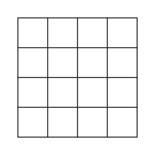

# Đề thi thử số 4

**Thời gian làm bài:** 90 phút. **Thang điểm:** mỗi câu 1 điểm, tổng 10 điểm.

## Đề bài

**Câu 1 (Tính nhanh).** Tính bằng cách hợp lý: $2 \times 3 \times 4 \times 5 \times 25 \times 8$.

**Câu 2 (Cấu tạo số).** Tìm tất cả các số có hai chữ số, biết mỗi số gấp 4 lần tổng các chữ số của nó.

**Câu 3 (Dãy số).** Cho dãy số $1, 2, 4, 7, 11, 16, \dots$ (khoảng cách giữa hai số liền nhau tăng dần 1, 2, 3, 4, 5, …). Tìm số hạng thứ 10 của dãy.

**Câu 4 (Chữ số tận cùng).** Tích $1 \times 3 \times 5 \times 7 \times \dots \times 99$ (tích các số lẻ từ 1 đến 99) có chữ số tận cùng là chữ số nào? Vì sao?

**Câu 5 (Ẩn trung bình).** An có 18 viên bi, Bình có 24 viên bi. Chi có số bi nhiều hơn trung bình cộng số bi của cả ba bạn là 4 viên. Hỏi Chi có bao nhiêu viên bi?

**Câu 6 (Giả thiết tạm).** Một trại nuôi có 40 con gồm thỏ và gà. Số chân thỏ nhiều hơn số chân gà là 28 chân. Hỏi có bao nhiêu con thỏ, bao nhiêu con gà?

**Câu 7 (Tổng phân số).** Tính: $\dfrac{1}{3} + \dfrac{1}{15} + \dfrac{1}{35} + \dfrac{1}{63}$.

**Câu 8 (Vận tốc trung bình).** Một người đi từ A đến B dài 60 km với vận tốc 30 km/giờ, rồi quay về A với vận tốc 20 km/giờ. Tính vận tốc trung bình của người đó trên cả quãng đường đi và về.

**Câu 9 (Đếm hình).** Một hình vuông được chia thành $4 \times 4 = 16$ ô vuông bằng nhau. Hỏi trong hình có tất cả bao nhiêu hình vuông?

**Câu 10 (Lập số).** Từ bốn chữ số 0, 1, 2, 3 có thể lập được bao nhiêu số có ba chữ số khác nhau?

---

## Lời giải chi tiết

### Câu 1
$$(2 \times 5) \times (4 \times 25) \times (3 \times 8) = 10 \times 100 \times 24 = 24\,000.$$

### Câu 2
Gọi số đó là $\overline{ab}$ ($a \ge 1$). Ta có $\overline{ab} = a \times 10 + b = (a + b) \times 4 = a \times 4 + b \times 4$.
Bớt $a \times 4 + b$ ở hai bên: $a \times 6 = b \times 3$, tức là $b = a \times 2$.
Các cặp chữ số: $a = 1, b = 2$; $a = 2, b = 4$; $a = 3, b = 6$; $a = 4, b = 8$.

**Đáp số:** 12; 24; 36; 48.

### Câu 3
Số hạng thứ 10 bằng số hạng đầu cộng với 9 khoảng cách đầu tiên:
$$1 + (1 + 2 + 3 + \dots + 9) = 1 + 45 = 46.$$

**Đáp số:** 46.

### Câu 4
Tích có thừa số 5 nên chia hết cho 5, chữ số tận cùng là 0 hoặc 5.
Các thừa số đều là số lẻ nên tích là số lẻ, tận cùng không thể là 0.

**Đáp số:** chữ số 5.

### Câu 5
Tổng số bi của ba bạn bằng 3 lần trung bình cộng. Số bi của Chi bằng 1 lần trung bình cộng thêm 4 viên.
Vậy số bi của An và Bình bằng 2 lần trung bình cộng bớt đi 4 viên: $18 + 24 = 42$.
Hai lần trung bình cộng là $42 + 4 = 46$, trung bình cộng là $46 : 2 = 23$.
Chi có $23 + 4 = 27$ (viên).

**Đáp số:** 27 viên. Thử lại: $(18 + 24 + 27) : 3 = 23$, $27 = 23 + 4$.

### Câu 6
Giả sử cả 40 con đều là gà: chân gà là 80, chân thỏ là 0, nên chân gà nhiều hơn chân thỏ 80.
Mỗi lần thay 1 gà bằng 1 thỏ: chân thỏ tăng 4, chân gà giảm 2, nên (chân thỏ − chân gà) tăng $4 + 2 = 6$.
Từ chỗ chân gà hơn 80 đến chỗ chân thỏ hơn 28, phải tăng $80 + 28 = 108$.
Số thỏ: $108 : 6 = 18$ (con). Số gà: $40 - 18 = 22$ (con).

**Đáp số:** 18 thỏ, 22 gà. Thử lại: $18 \times 4 - 22 \times 2 = 72 - 44 = 28$.

### Câu 7
$3 = 1 \times 3$, $15 = 3 \times 5$, $35 = 5 \times 7$, $63 = 7 \times 9$. Ta có $\dfrac{2}{n \times (n+2)} = \dfrac{1}{n} - \dfrac{1}{n+2}$, nên mỗi phân số $\dfrac{1}{n \times (n+2)}$ bằng một nửa hiệu đó:
$$\text{Tổng} = \frac{1}{2} \times \left(1 - \frac{1}{3} + \frac{1}{3} - \frac{1}{5} + \frac{1}{5} - \frac{1}{7} + \frac{1}{7} - \frac{1}{9}\right) = \frac{1}{2} \times \frac{8}{9} = \frac{4}{9}.$$

### Câu 8
Thời gian đi: $60 : 30 = 2$ (giờ). Thời gian về: $60 : 20 = 3$ (giờ).
Vận tốc trung bình: $(60 + 60) : (2 + 3) = 120 : 5 = 24$ (km/giờ).

**Đáp số:** 24 km/giờ (không phải 25 km/giờ).

### Câu 9

*Hình: Hình vuông chia thành lưới 4 × 4 ô vuông.*

Đếm theo cỡ: cỡ $1 \times 1$: 16; cỡ $2 \times 2$: $3 \times 3 = 9$; cỡ $3 \times 3$: $2 \times 2 = 4$; cỡ $4 \times 4$: 1.
Tổng: $16 + 9 + 4 + 1 = 30$.

**Đáp số:** 30 hình vuông.

### Câu 10
Chữ số hàng trăm khác 0: có 3 cách (1, 2, 3). Chữ số hàng chục khác chữ số hàng trăm: 3 cách (kể cả 0). Chữ số hàng đơn vị: 2 cách.
Số các số: $3 \times 3 \times 2 = 18$.

**Đáp số:** 18 số.
