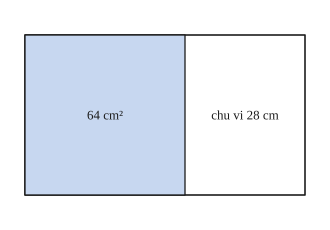

# Đề thi thử số 5

**Thời gian làm bài:** 90 phút. **Thang điểm:** mỗi câu 1 điểm, tổng 10 điểm.

## Đề bài

**Câu 1 (Tính nhanh).** Không tính từng tích, hãy tính: $2025 \times 2025 - 2024 \times 2026$.

**Câu 2 (Cấu tạo số).** Một số tự nhiên có chữ số hàng đơn vị là 0. Nếu xóa chữ số 0 đó đi thì số đó giảm 1 800 đơn vị. Tìm số đó.

**Câu 3 (Dãy số).** Tìm số tự nhiên $n$ biết $1 + 2 + 3 + \dots + n = 210$.

**Câu 4 (Chia hết).** Tìm số lớn nhất có ba chữ số, có chữ số hàng trăm là 5 và chia hết cho cả 2, 3 và 5.

**Câu 5 (Trung bình cộng).** Tìm bốn số lẻ liên tiếp có trung bình cộng là 50.

**Câu 6 (Rút về đơn vị).** 4 công nhân làm trong 5 ngày được 100 sản phẩm. Hỏi 6 công nhân làm trong 8 ngày được bao nhiêu sản phẩm? (Năng suất mỗi người như nhau.)

**Câu 7 (Phân số).** Một bể đang chứa $\dfrac{3}{5}$ bể nước. Người ta dùng hết $\dfrac{1}{3}$ lượng nước đó thì trong bể còn 240 l. Hỏi bể chứa đầy được bao nhiêu lít nước?

**Câu 8 (Đuổi nhau).** Hai người cùng lúc xuất phát từ A và B cách nhau 18 km, đi cùng chiều theo hướng từ A đến B. Người đi từ A có vận tốc 14 km/giờ, người đi từ B có vận tốc 8 km/giờ. Hỏi sau bao lâu người đi từ A đuổi kịp người đi từ B?

**Câu 9 (Hình học).** Từ một hình chữ nhật, người ta cắt bỏ một hình vuông có cạnh bằng chiều rộng hình chữ nhật. Hình vuông cắt bỏ có diện tích $64 \text{ cm}^2$, phần còn lại là hình chữ nhật có chu vi 28 cm. Tính diện tích hình chữ nhật ban đầu.

**Câu 10 (Suy luận).** Bốn bạn An, Bình, Chi, Dũng thi chạy. Biết: Bình về cuối; Dũng về ngay sau An; An không về thứ hai; Chi không về nhất. Hỏi thứ tự về đích của bốn bạn?

---

## Lời giải chi tiết

### Câu 1
$2024 \times 2026 = 2024 \times 2025 + 2024$ và $2025 \times 2025 = 2024 \times 2025 + 2025$.
Hiệu: $2025 - 2024 = 1$.

**Đáp số:** 1.

### Câu 2
Xóa chữ số 0 ở hàng đơn vị thì số đó giảm đi 10 lần: số cũ gấp 10 lần số mới. Phần giảm đi bằng $10 - 1 = 9$ lần số mới.
Số mới: $1\,800 : 9 = 200$. Số cần tìm: $2\,000$.

**Đáp số:** 2 000.

### Câu 3
$1 + 2 + \dots + n = (1 + n) \times n : 2 = 210$, nên $n \times (n + 1) = 420$.
Hai số tự nhiên liên tiếp có tích 420: $20 \times 21 = 420$. Vậy $n = 20$.

**Đáp số:** $n = 20$.

### Câu 4
Số có dạng $\overline{5b0}$ (chia hết cho 2 và 5 nên tận cùng 0). Chia hết cho 3 nên $5 + b$ chia hết cho 3: $b \in \{1; 4; 7\}$.
Lớn nhất: $b = 7$.

**Đáp số:** 570.

### Câu 5
Bốn số lẻ liên tiếp cách đều 2. Trung bình cộng 50 nằm chính giữa số thứ hai và số thứ ba, nên số thứ hai là 49, số thứ ba là 51.

**Đáp số:** 47; 49; 51; 53.

### Câu 6
Một công nhân một ngày làm được $100 : 4 : 5 = 5$ (sản phẩm).
6 công nhân trong 8 ngày: $5 \times 6 \times 8 = 240$ (sản phẩm).

**Đáp số:** 240 sản phẩm.

### Câu 7
Lượng nước đã dùng: $\dfrac{3}{5} \times \dfrac{1}{3} = \dfrac{1}{5}$ (bể).
Còn lại: $\dfrac{3}{5} - \dfrac{1}{5} = \dfrac{2}{5}$ (bể), ứng với 240 l.
Bể chứa đầy: $240 : 2 \times 5 = 600$ (l).

**Đáp số:** 600 l.

### Câu 8
Mỗi giờ người đi từ A gần người đi từ B thêm $14 - 8 = 6$ (km).
Thời gian: $18 : 6 = 3$ (giờ).

**Đáp số:** 3 giờ.

### Câu 9

*Hình: Hình chữ nhật bị cắt bỏ một hình vuông có cạnh bằng chiều rộng.*

Vì $8 \times 8 = 64$ nên cạnh hình vuông là 8 cm, đó cũng là chiều rộng hình chữ nhật.
Phần còn lại là hình chữ nhật có một cạnh 8 cm, nửa chu vi $28 : 2 = 14$ (cm), nên cạnh kia là $14 - 8 = 6$ (cm).
Chiều dài hình chữ nhật ban đầu: $8 + 6 = 14$ (cm).
Diện tích ban đầu: $14 \times 8 = 112 \text{ (cm}^2)$.

**Đáp số:** $112 \text{ cm}^2$.

### Câu 10
Bình về thứ tư. Ba vị trí 1, 2, 3 dành cho An, Chi, Dũng, trong đó Dũng về ngay sau An: (An, Dũng) ở vị trí (1, 2) hoặc (2, 3).
An không về thứ hai, nên An về nhất, Dũng về nhì. Chi về thứ ba (đúng với điều kiện Chi không về nhất).

**Đáp số:** An, Dũng, Chi, Bình.
