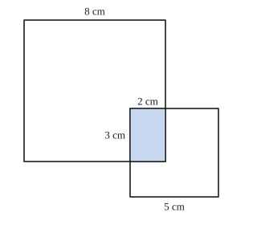

# Đề thi thử số 6

**Thời gian làm bài:** 90 phút. **Thang điểm:** mỗi câu 1 điểm, tổng 10 điểm.

## Đề bài

**Câu 1 (Tính nhanh).** Tính: $(2 + 4 + 6 + \dots + 100) - (1 + 3 + 5 + \dots + 99)$.

**Câu 2 (Cấu tạo số).** Tìm các số có ba chữ số, biết chữ số hàng trăm gấp 3 lần chữ số hàng đơn vị, còn chữ số hàng chục bằng tổng của chữ số hàng trăm và chữ số hàng đơn vị.

**Câu 3 (Dãy số).** Tính tổng $11 + 13 + 15 + \dots + 99$.

**Câu 4 (Chia hết).** Tìm các chữ số $a, b$ để số $\overline{a45b}$ chia hết cho 45.

**Câu 5 (Trung bình cộng).** Trung bình cộng của năm số là 30. Nếu thay số 20 trong năm số đó bằng số 45 thì trung bình cộng mới là bao nhiêu?

**Câu 6 (Chuyển hàng).** Ba kho có tất cả 360 tấn hàng. Người ta chuyển 20 tấn từ kho A sang kho B, rồi chuyển 30 tấn từ kho B sang kho C, thì số hàng ba kho bằng nhau. Hỏi lúc đầu mỗi kho có bao nhiêu tấn hàng?

**Câu 7 (Phân số).** Tính: $\left(1 - \dfrac{1}{2}\right) \times \left(1 - \dfrac{1}{3}\right) \times \left(1 - \dfrac{1}{4}\right) \times \dots \times \left(1 - \dfrac{1}{10}\right)$.

**Câu 8 (Chuyển động).** Lúc 7 giờ, hai xe đi từ A và B ngược chiều nhau và gặp nhau lúc 9 giờ tại một điểm cách A 90 km. Xe đi từ B mỗi giờ đi chậm hơn xe đi từ A 5 km. Tính quãng đường $AB$.

**Câu 9 (Hình chồng nhau).** Một hình vuông cạnh 8 cm và một hình vuông cạnh 5 cm đặt chồng lên nhau ở một góc, phần chung là hình chữ nhật dài 3 cm, rộng 2 cm (xem hình). Tính diện tích và chu vi của hình tạo thành.

**Câu 10 (Dirichlet).** Trong một ngăn kéo tối có rất nhiều chiếc tất thuộc 4 màu khác nhau. Không nhìn, phải lấy ra ít nhất bao nhiêu chiếc để chắc chắn có:
a) 2 chiếc cùng màu? b) 3 chiếc cùng màu?

---

## Lời giải chi tiết

### Câu 1
Mỗi tổng có 50 số hạng. Ghép từng cặp: $(2 - 1) + (4 - 3) + \dots + (100 - 99)$, có 50 cặp, mỗi cặp bằng 1.

**Đáp số:** 50.

### Câu 2
Gọi số đó là $\overline{abc}$ với $a = 3 \times c$ và $b = a + c = 4 \times c$. Vì $b \le 9$ và $c \ge 1$ (để $a \ge 1$) nên $c = 1$ hoặc $c = 2$.
- $c = 1$: $a = 3$, $b = 4$, số 341.
- $c = 2$: $a = 6$, $b = 8$, số 682.

**Đáp số:** 341 và 682.

### Câu 3
Số số hạng: $(99 - 11) : 2 + 1 = 45$. Tổng: $(11 + 99) \times 45 : 2 = 2\,475$.

### Câu 4
$45 = 5 \times 9$, nên số phải chia hết cho 5 và cho 9.
Chia hết cho 5: $b = 0$ hoặc $b = 5$.
- $b = 0$: $a + 4 + 5 + 0 = a + 9$ chia hết cho 9, $a \ne 0$ nên $a = 9$. Số 9 450.
- $b = 5$: $a + 14$ chia hết cho 9, nên $a = 4$. Số 4 455.

**Đáp số:** 9 450 hoặc 4 455.

### Câu 5
Tổng năm số: $30 \times 5 = 150$. Thay 20 bằng 45 thì tổng tăng $45 - 20 = 25$, thành 175.
Trung bình cộng mới: $175 : 5 = 35$.

**Đáp số:** 35.

### Câu 6
Lúc sau mỗi kho có $360 : 3 = 120$ (tấn). Tính ngược:
- Kho C nhận thêm 30 tấn mới có 120 tấn, nên lúc đầu có $120 - 30 = 90$ (tấn).
- Kho B nhận 20 tấn rồi chuyển đi 30 tấn, tức là bớt 10 tấn, còn 120 tấn. Lúc đầu có $120 + 10 = 130$ (tấn).
- Kho A chuyển đi 20 tấn còn 120 tấn. Lúc đầu có $120 + 20 = 140$ (tấn).

**Đáp số:** A 140 tấn, B 130 tấn, C 90 tấn. Thử lại: $140 + 130 + 90 = 360$.

### Câu 7
$$\frac{1}{2} \times \frac{2}{3} \times \frac{3}{4} \times \dots \times \frac{9}{10} = \frac{1 \times 2 \times 3 \times \dots \times 9}{2 \times 3 \times 4 \times \dots \times 10} = \frac{1}{10}.$$
Mỗi tử số từ 2 đến 9 đều giản ước với mẫu số của phân số đứng trước nó.

**Đáp số:** $\dfrac{1}{10}$.

### Câu 8
Hai xe đi đến lúc gặp mất $9 - 7 = 2$ (giờ). Vận tốc xe từ A: $90 : 2 = 45$ (km/giờ). Vận tốc xe từ B: $45 - 5 = 40$ (km/giờ).
Xe từ B đi được $40 \times 2 = 80$ (km). Quãng đường $AB$: $90 + 80 = 170$ (km).

**Đáp số:** 170 km.

### Câu 9

*Hình: Hình vuông cạnh 8 cm và hình vuông cạnh 5 cm chồng lên nhau.*

Diện tích: $8 \times 8 + 5 \times 5 - 3 \times 2 = 64 + 25 - 6 = 83 \text{ (cm}^2)$.
Chu vi: tổng chu vi hai hình vuông là $32 + 20 = 52$ (cm). Phần nằm bên trong hình tạo thành gồm hai cạnh của hình chữ nhật chung thuộc hình vuông lớn và hai cạnh thuộc hình vuông nhỏ, tổng $(3 + 2) \times 2 = 10$ (cm).
Chu vi hình tạo thành: $52 - 10 = 42$ (cm).

**Đáp số:** $83 \text{ cm}^2$; 42 cm.

### Câu 10
a) Trường hợp xấu nhất: 4 chiếc đầu có 4 màu khác nhau. Chiếc thứ năm chắc chắn trùng màu. Cần ít nhất 5 chiếc.
b) Trường hợp xấu nhất: mỗi màu có 2 chiếc, tức là $4 \times 2 = 8$ chiếc mà chưa có 3 chiếc cùng màu. Chiếc thứ chín chắc chắn tạo thành 3 chiếc cùng màu. Cần ít nhất 9 chiếc.

**Đáp số:** a) 5 chiếc; b) 9 chiếc.
