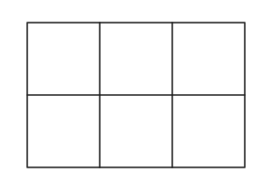

# Đề thi thử số 7

**Thời gian làm bài:** 90 phút. **Thang điểm:** mỗi câu 1 điểm, tổng 10 điểm.

## Đề bài

**Câu 1 (Tính nhanh).** Tính: $100 - 99 + 98 - 97 + 96 - 95 + \dots + 4 - 3 + 2 - 1$.

**Câu 2 (Cấu tạo số).** Tìm số có hai chữ số, biết tổng hai chữ số của nó bằng 10 và nếu đổi chỗ hai chữ số thì được số mới lớn hơn số cũ 36 đơn vị.

**Câu 3 (Tổng các chữ số).** Tính tổng tất cả các chữ số của các số tự nhiên từ 1 đến 99.

**Câu 4 (Chia có dư).** Hôm nay là thứ Hai. Hỏi 100 ngày nữa là thứ mấy?

**Câu 5 (Trung bình cộng).** Ba bạn An, Bình, Chi đứng lên cân từng đôi một: An và Bình cân được 60 kg, Bình và Chi cân được 64 kg, Chi và An cân được 68 kg. Tính cân nặng trung bình của ba bạn và cân nặng của từng bạn.

**Câu 6 (Giả thiết tạm).** Một đội trồng cây có 45 người gồm nam và nữ, trồng được tất cả 300 cây. Mỗi bạn nam trồng được 8 cây, mỗi bạn nữ trồng được 5 cây. Hỏi đội có bao nhiêu nam, bao nhiêu nữ?

**Câu 7 (Vòi chảy vào, tháo ra).** Một bể không có nước. Vòi thứ nhất chảy vào thì đầy bể sau 4 giờ. Vòi thứ hai tháo nước ra thì tháo cạn bể đầy sau 6 giờ. Nếu mở cả hai vòi cùng lúc thì sau bao lâu bể đầy?

**Câu 8 (Đuổi nhau).** Lúc 7 giờ, An đi bộ từ nhà đến trường với vận tốc 80 m/phút. 10 phút sau, anh của An đi xe đạp đuổi theo với vận tốc 240 m/phút. Hỏi anh đuổi kịp An lúc mấy giờ? Chỗ đó cách nhà bao nhiêu mét?

**Câu 9 (Hình học).** Một hình chữ nhật được ghép từ 6 hình vuông bằng nhau xếp thành 2 hàng, mỗi hàng 3 hình (xem hình). Chu vi hình chữ nhật là 60 cm. Tính diện tích hình chữ nhật.

**Câu 10 (Dirichlet).** Lớp 4A có 40 học sinh. Trong bài kiểm tra, điểm của mỗi bạn là một số tự nhiên từ 0 đến 10, và không có bạn nào bị dưới 3 điểm. Chứng tỏ rằng có ít nhất 5 bạn có điểm bằng nhau.

---

## Lời giải chi tiết

### Câu 1
Ghép từng cặp: $(100 - 99) + (98 - 97) + \dots + (2 - 1)$. Có 50 cặp, mỗi cặp bằng 1.

**Đáp số:** 50.

### Câu 2
Gọi số đó là $\overline{ab}$. Số mới $\overline{ba}$ lớn hơn số cũ: $\overline{ba} - \overline{ab} = (b \times 10 + a) - (a \times 10 + b) = (b - a) \times 9 = 36$, nên $b - a = 4$.
Lại có $a + b = 10$. Dùng tổng hiệu: $b = (10 + 4) : 2 = 7$, $a = 3$.

**Đáp số:** 37. Thử lại: $73 - 37 = 36$.

### Câu 3
Xét các số từ 1 đến 99 (coi 1 là 01, …, 9 là 09).
- Hàng đơn vị: mỗi chữ số từ 0 đến 9 xuất hiện 10 lần, tổng $(0 + 1 + \dots + 9) \times 10 = 450$.
- Hàng chục: mỗi chữ số từ 1 đến 9 xuất hiện 10 lần, tổng $45 \times 10 = 450$.

Tổng tất cả: $450 + 450 = 900$.

**Đáp số:** 900.

### Câu 4
Cứ 7 ngày thì lặp lại thứ. $100 = 7 \times 14 + 2$.
Sau 98 ngày lại là thứ Hai, thêm 2 ngày nữa là thứ Tư.

**Đáp số:** thứ Tư.

### Câu 5
Cộng ba lần cân, mỗi bạn được cân 2 lần: $60 + 64 + 68 = 192$ là 2 lần tổng cân nặng ba bạn.
Tổng cân nặng: $192 : 2 = 96$ (kg). Trung bình: $96 : 3 = 32$ (kg).
An: $96 - 64 = 32$ (kg). Bình: $96 - 68 = 28$ (kg). Chi: $96 - 60 = 36$ (kg).

**Đáp số:** trung bình 32 kg; An 32 kg, Bình 28 kg, Chi 36 kg.

### Câu 6
Giả sử cả 45 người đều là nữ: trồng được $5 \times 45 = 225$ (cây), thiếu $300 - 225 = 75$ (cây).
Thay 1 nữ bằng 1 nam thì thêm $8 - 5 = 3$ (cây). Số nam: $75 : 3 = 25$. Số nữ: $45 - 25 = 20$.

**Đáp số:** 25 nam, 20 nữ.

### Câu 7
Mỗi giờ vòi thứ nhất chảy vào $\dfrac{1}{4}$ bể, vòi thứ hai tháo ra $\dfrac{1}{6}$ bể.
Mỗi giờ lượng nước trong bể tăng $\dfrac{1}{4} - \dfrac{1}{6} = \dfrac{3}{12} - \dfrac{2}{12} = \dfrac{1}{12}$ (bể).
Bể đầy sau 12 giờ.

**Đáp số:** 12 giờ.

### Câu 8
Trong 10 phút, An đi được $80 \times 10 = 800$ (m).
Mỗi phút anh gần An thêm $240 - 80 = 160$ (m). Thời gian đuổi kịp: $800 : 160 = 5$ (phút).
Anh đuổi kịp lúc $7 \text{ giờ} + 10 \text{ phút} + 5 \text{ phút} = 7 \text{ giờ } 15 \text{ phút}$, cách nhà $240 \times 5 = 1\,200$ (m).

**Đáp số:** 7 giờ 15 phút; 1 200 m.

### Câu 9

*Hình: Hình chữ nhật ghép từ 6 hình vuông bằng nhau.*

Chiều dài gồm 3 cạnh hình vuông nhỏ, chiều rộng gồm 2 cạnh. Nửa chu vi gồm 5 cạnh: $60 : 2 = 30$ (cm).
Cạnh hình vuông nhỏ: $30 : 5 = 6$ (cm).
Diện tích: $6 \times 6 \times 6 = 216 \text{ (cm}^2)$.

**Đáp số:** $216 \text{ cm}^2$.

### Câu 10
Điểm có thể là 3, 4, 5, …, 10: có 8 mức điểm.
Giả sử mỗi mức điểm có nhiều nhất 4 bạn, thì lớp có nhiều nhất $8 \times 4 = 32$ bạn, ít hơn 40. Điều giả sử sai.
Vậy có ít nhất một mức điểm có từ 5 bạn trở lên.
