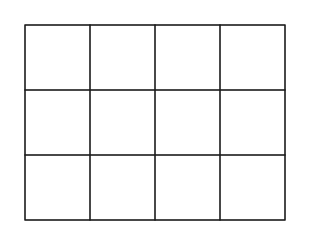

# Đề thi thử số 8

**Thời gian làm bài:** 90 phút. **Thang điểm:** mỗi câu 1 điểm, tổng 10 điểm.

## Đề bài

**Câu 1 (Tính nhanh).** Tính: $125 \times 8 \times 25 \times 4 - 99\,999$.

**Câu 2 (Cấu tạo số).** Tìm số có ba chữ số, biết rằng nếu viết thêm chữ số 2 vào bên phải số đó thì được số mới hơn số cũ 4 403 đơn vị.

**Câu 3 (Đánh số trang).** Để đánh số trang một quyển sách (bắt đầu từ trang 1) người ta dùng hết 435 chữ số. Hỏi quyển sách có bao nhiêu trang?

**Câu 4 (Chia có dư).** Tìm số tự nhiên nhỏ nhất lớn hơn 1, khi chia cho 2, 3, 4, 5 và 6 đều dư 1.

**Câu 5 (Trung bình cộng).** Tuổi trung bình của bố, mẹ và con là 26 tuổi. Tuổi trung bình của bố và mẹ là 36 tuổi. Tính tuổi của con.

**Câu 6 (Tổng hiệu).** Hai thùng có tất cả 120 l nước. Đổ 15 l từ thùng thứ nhất sang thùng thứ hai, rồi lại đổ 5 l từ thùng thứ hai sang thùng thứ nhất, thì thùng thứ nhất có nhiều hơn thùng thứ hai 10 l. Hỏi lúc đầu mỗi thùng có bao nhiêu lít nước?

**Câu 7 (Tính ngược).** Một người bán cam. Lần thứ nhất bán một nửa số cam và thêm 1 quả. Lần thứ hai bán một nửa số cam còn lại và thêm 1 quả. Lần thứ ba bán một nửa số cam còn lại và thêm 1 quả thì vừa hết. Hỏi lúc đầu người đó có bao nhiêu quả cam?

**Câu 8 (Đoàn tàu).** Một đoàn tàu dài 120 m chạy với vận tốc 15 m/giây. Một người đi xe đạp ngược chiều với vận tốc 5 m/giây. Hỏi đoàn tàu vượt qua người đó (từ lúc gặp đầu tàu đến lúc qua hết toa cuối) hết bao nhiêu giây?

**Câu 9 (Đếm hình).** Một hình chữ nhật được chia thành lưới 3 hàng, 4 cột ô bằng nhau (xem hình). Hỏi trong hình có tất cả bao nhiêu hình chữ nhật (kể cả hình vuông)?

**Câu 10 (Đếm).** Tổ 1 có 4 bạn.
a) Có bao nhiêu cách chọn 1 tổ trưởng và 1 tổ phó (hai bạn khác nhau)?
b) Có bao nhiêu cách chọn 2 bạn đi dự thi?

---

## Lời giải chi tiết

### Câu 1
$125 \times 8 \times 25 \times 4 = 1\,000 \times 100 = 100\,000$. Hiệu: $100\,000 - 99\,999 = 1$.

**Đáp số:** 1.

### Câu 2
Viết thêm chữ số 2 vào bên phải thì số mới bằng số cũ nhân 10 rồi cộng 2. Số mới hơn số cũ: $9$ lần số cũ cộng 2, bằng 4 403.
9 lần số cũ: $4\,403 - 2 = 4\,401$. Số cũ: $4\,401 : 9 = 489$.

**Đáp số:** 489. Thử lại: $4\,892 - 489 = 4\,403$.

### Câu 3
Trang 1 đến 9: 9 chữ số. Trang 10 đến 99: $90 \times 2 = 180$ chữ số. Đến trang 99 đã dùng $9 + 180 = 189$ chữ số.
Còn $435 - 189 = 246$ chữ số cho các trang có ba chữ số: $246 : 3 = 82$ (trang), từ trang 100 đến trang $99 + 82 = 181$.

**Đáp số:** 181 trang.

### Câu 4
Số cần tìm bớt 1 thì chia hết cho 2, 3, 4, 5, 6. Số nhỏ nhất khác 0 chia hết cho cả năm số đó là 60 (chia hết cho 4 và 5 thì chia hết cho 20; thêm chia hết cho 3 thì là 60, và 60 cũng chia hết cho 2, 6).
Số cần tìm: $60 + 1 = 61$.

**Đáp số:** 61.

### Câu 5
Tổng tuổi ba người: $26 \times 3 = 78$. Tổng tuổi bố và mẹ: $36 \times 2 = 72$.
Tuổi con: $78 - 72 = 6$.

**Đáp số:** 6 tuổi.

### Câu 6
Sau hai lần đổ, thùng thứ nhất mất $15 - 5 = 10$ (l), thùng thứ hai được thêm 10 l. Tổng vẫn là 120 l.
Lúc đó thùng thứ nhất: $(120 + 10) : 2 = 65$ (l); thùng thứ hai: $65 - 10 = 55$ (l).
Lúc đầu thùng thứ nhất: $65 + 10 = 75$ (l); thùng thứ hai: $55 - 10 = 45$ (l).

**Đáp số:** 75 l và 45 l.

### Câu 7
Tính ngược từ cuối.
- Lần thứ ba: bán một nửa và thêm 1 quả thì hết, nên một nửa số cam trước lần ba là 1 quả, số cam trước lần ba là 2 quả.
- Lần thứ hai: bán một nửa và thêm 1 quả còn 2 quả, nên một nửa số cam trước lần hai là $2 + 1 = 3$, số cam trước lần hai là 6 quả.
- Lần thứ nhất: một nửa số cam lúc đầu là $6 + 1 = 7$, số cam lúc đầu là 14 quả.

**Đáp số:** 14 quả. Thử lại: bán $7 + 1 = 8$, còn 6; bán $3 + 1 = 4$, còn 2; bán $1 + 1 = 2$, hết.

### Câu 8
Tàu và người đi ngược chiều, mỗi giây "lướt qua nhau" thêm $15 + 5 = 20$ (m).
Để vượt qua hết người đó, cần lướt qua đúng chiều dài tàu 120 m: $120 : 20 = 6$ (giây).

**Đáp số:** 6 giây.

### Câu 9

*Hình: Hình chữ nhật chia thành lưới 3 hàng, 4 cột.*

Có 5 đường dọc: chọn 2 đường được $4 + 3 + 2 + 1 = 10$ cách. Có 4 đường ngang: chọn 2 đường được $3 + 2 + 1 = 6$ cách.
Số hình chữ nhật: $10 \times 6 = 60$.

**Đáp số:** 60 hình chữ nhật.

### Câu 10
a) Tổ trưởng có 4 cách chọn, tổ phó (khác tổ trưởng) có 3 cách: $4 \times 3 = 12$ (cách).
b) Chọn 2 bạn đi thi thì không phân biệt vai trò: mỗi cặp bạn được đếm 2 lần trong 12 cách ở câu a. Số cách: $12 : 2 = 6$.

**Đáp số:** a) 12 cách; b) 6 cách.

*Nhận xét:* khi hai vị trí khác nhau (trưởng, phó) thì thứ tự quan trọng; khi chỉ chọn một nhóm thì không.
