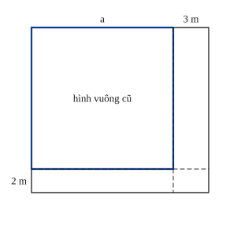

# Đề thi thử số 9

**Thời gian làm bài:** 90 phút. **Thang điểm:** mỗi câu 1 điểm, tổng 10 điểm.

## Đề bài

**Câu 1 (Tính nhanh).** Tính: $(2024 \times 2025 - 2024 \times 2023) : 4048$.

**Câu 2 (Cấu tạo số).** Tìm số có hai chữ số, biết rằng số đó cộng với số viết theo thứ tự ngược lại thì được 121, và hai chữ số của nó hơn kém nhau 5.

**Câu 3 (Dãy chữ số).** Viết liền nhau các số tự nhiên từ 1: $123456789101112\dots$ Hỏi chữ số thứ 100 là chữ số nào?

**Câu 4 (Chia có dư).** Tìm số nhỏ nhất có bốn chữ số, chia cho 3, cho 4 và cho 5 đều dư 1.

**Câu 5 (Trung bình cộng).** Một ô tô trong 2 giờ đầu, trung bình mỗi giờ đi được 50 km. Hỏi giờ thứ ba ô tô phải đi bao nhiêu ki-lô-mét để trung bình mỗi giờ trong 3 giờ là 52 km?

**Câu 6 (Giả thiết tạm).** Một bạn có 20 tờ tiền gồm ba loại 2 000 đồng, 5 000 đồng và 10 000 đồng, tổng giá trị 135 000 đồng. Số tờ 2 000 đồng bằng số tờ 5 000 đồng. Hỏi mỗi loại có bao nhiêu tờ?

**Câu 7 (Ba vòi nước).** Một bể không có nước. Vòi thứ nhất chảy riêng thì đầy bể sau 6 giờ, vòi thứ hai sau 12 giờ, vòi thứ ba sau 4 giờ. Nếu mở cả ba vòi cùng lúc thì sau bao lâu bể đầy?

**Câu 8 (Đi và về).** Một người đi từ A đến B với vận tốc 15 km/giờ, rồi về A với vận tốc 10 km/giờ. Thời gian về nhiều hơn thời gian đi 1 giờ. Tính quãng đường $AB$.

**Câu 9 (Mở rộng hình vuông).** Một mảnh vườn hình vuông. Người ta mở rộng một cạnh thêm 3 m và cạnh kia thêm 2 m thì được mảnh vườn hình chữ nhật có diện tích hơn mảnh vườn cũ $66 \text{ m}^2$. Tính diện tích mảnh vườn hình vuông ban đầu.

**Câu 10 (Trò chơi).** Trên bàn có 20 que diêm. Hai bạn lần lượt bốc, mỗi lượt được bốc 1, 2 hoặc 3 que. Ai bốc được que cuối cùng thì thắng. Bạn đi trước hay bạn đi sau có cách chắc chắn thắng? Nêu cách chơi đó.

---

## Lời giải chi tiết

### Câu 1
$2024 \times 2025 - 2024 \times 2023 = 2024 \times (2025 - 2023) = 2024 \times 2 = 4\,048$. Chia cho 4 048 được 1.

**Đáp số:** 1.

### Câu 2
Gọi số đó là $\overline{ab}$. $\overline{ab} + \overline{ba} = (a \times 10 + b) + (b \times 10 + a) = (a + b) \times 11 = 121$, nên $a + b = 11$.
Hai chữ số hơn kém nhau 5: chữ số lớn là $(11 + 5) : 2 = 8$, chữ số bé là 3.

**Đáp số:** 83 hoặc 38.

### Câu 3
Các số từ 1 đến 9 dùng 9 chữ số. Còn $100 - 9 = 91$ chữ số nằm trong các số có hai chữ số.
$91 = 2 \times 45 + 1$: viết hết 45 số có hai chữ số (từ 10 đến 54) dùng 90 chữ số, chữ số thứ 91 là chữ số đầu của số tiếp theo, 55.

**Đáp số:** chữ số 5.

### Câu 4
Số cần tìm bớt 1 thì chia hết cho 3, 4 và 5, tức là chia hết cho 60.
Số nhỏ nhất có bốn chữ số dạng "bội của 60 cộng 1": $60 \times 17 = 1\,020$, số cần tìm là $1\,021$ (vì $60 \times 16 + 1 = 961$ chỉ có ba chữ số).

**Đáp số:** 1 021.

### Câu 5
Quãng đường 3 giờ cần đi: $52 \times 3 = 156$ (km). 2 giờ đầu đi được $50 \times 2 = 100$ (km).
Giờ thứ ba cần đi: $156 - 100 = 56$ (km).

**Đáp số:** 56 km.

### Câu 6
Ghép mỗi tờ 2 000 đồng với một tờ 5 000 đồng thành một "cặp" gồm 2 tờ, giá trị 7 000 đồng.
Giả sử cả 20 tờ đều là tờ 10 000 đồng: tổng là 200 000 đồng, thừa $200\,000 - 135\,000 = 65\,000$ (đồng).
Thay 2 tờ 10 000 đồng (20 000 đồng) bằng một cặp (7 000 đồng) thì tổng giảm 13 000 đồng.
Số cặp: $65\,000 : 13\,000 = 5$. Vậy có 5 tờ 2 000 đồng, 5 tờ 5 000 đồng và $20 - 10 = 10$ tờ 10 000 đồng.

**Đáp số:** 5 tờ 2 000 đồng, 5 tờ 5 000 đồng, 10 tờ 10 000 đồng.
Thử lại: $10\,000 + 25\,000 + 100\,000 = 135\,000$.

### Câu 7
Mỗi giờ ba vòi chảy được $\dfrac{1}{6} + \dfrac{1}{12} + \dfrac{1}{4} = \dfrac{2}{12} + \dfrac{1}{12} + \dfrac{3}{12} = \dfrac{6}{12} = \dfrac{1}{2}$ (bể).
Bể đầy sau 2 giờ.

**Đáp số:** 2 giờ.

### Câu 8
Đi 1 km hết $\dfrac{1}{15}$ giờ, về 1 km hết $\dfrac{1}{10}$ giờ. Mỗi ki-lô-mét, lúc về lâu hơn lúc đi:
$$\frac{1}{10} - \frac{1}{15} = \frac{3}{30} - \frac{2}{30} = \frac{1}{30} \text{ (giờ)}.$$
Cả quãng đường lúc về lâu hơn 1 giờ, nên quãng đường dài $1 : \dfrac{1}{30} = 30$ (km).

**Đáp số:** 30 km. Thử lại: đi 2 giờ, về 3 giờ.

### Câu 9

*Hình: Hình vuông cạnh a mở rộng một cạnh thêm 3 m, cạnh kia thêm 2 m.*

Phần tăng thêm gồm: một hình chữ nhật 3 m × cạnh cũ, một hình chữ nhật 2 m × cạnh cũ và một hình chữ nhật nhỏ ở góc $3 \times 2 = 6 \text{ (m}^2)$.
Hai hình chữ nhật dài có tổng diện tích $66 - 6 = 60 \text{ (m}^2)$, gộp lại là một hình chữ nhật có một cạnh $3 + 2 = 5$ (m) và cạnh kia là cạnh hình vuông cũ.
Cạnh hình vuông: $60 : 5 = 12$ (m). Diện tích ban đầu: $12 \times 12 = 144 \text{ (m}^2)$.

**Đáp số:** $144 \text{ m}^2$. Thử lại: $15 \times 14 - 144 = 210 - 144 = 66$.

### Câu 10
**Bạn đi sau** có cách chắc chắn thắng.
Cách chơi: mỗi khi bạn đi trước bốc $k$ que ($k$ là 1, 2 hoặc 3), bạn đi sau bốc $4 - k$ que. Như vậy sau mỗi vòng hai lượt, số que giảm đúng 4.
Vì $20 = 4 \times 5$, sau 5 vòng que diêm hết, và que cuối cùng do bạn đi sau bốc.

*Nhận xét:* số que là bội của 4 thì người đi sau thắng. Nếu số que không là bội của 4, người đi trước bốc để số que còn lại là bội của 4, rồi chơi như trên thì thắng.
