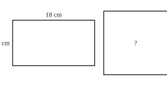
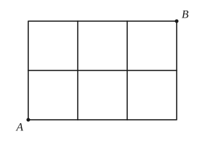

# Đề thi thử số 10

**Thời gian làm bài:** 90 phút. **Thang điểm:** mỗi câu 1 điểm, tổng 10 điểm.

## Đề bài

**Câu 1 (Tính nhanh).** Tính tổng $1 + 11 + 111 + 1\,111 + \dots + 111\,111\,111$ (số hạng cuối có 9 chữ số 1).

**Câu 2 (Cấu tạo số).** Tìm số $\overline{abcd}$ biết $\overline{abcd} + \overline{abc} + \overline{ab} + a = 4\,321$.

**Câu 3 (Đếm chữ số).** Để viết tất cả các số tự nhiên từ 1 đến 1 000 cần dùng bao nhiêu chữ số?

**Câu 4 (Chữ số 0 tận cùng).** Tích $1 \times 2 \times 3 \times \dots \times 20$ có tận cùng bao nhiêu chữ số 0? Giải thích.

**Câu 5 (Trung bình cộng).** Trung bình cộng của ba số là 60. Số thứ nhất bằng trung bình cộng của số thứ hai và số thứ ba. Số thứ hai hơn số thứ ba 20 đơn vị. Tìm ba số đó.

**Câu 6 (Tuổi ba người).** Tổng số tuổi của ông, bố và cháu là 120 tuổi. Ông hơn bố 25 tuổi, bố hơn cháu 25 tuổi. Tính tuổi mỗi người.

**Câu 7 (Phân số).** Tìm một phân số, biết rằng nếu thêm 3 vào tử số thì được phân số bằng 1, còn nếu bớt ở tử số đi 1 thì được phân số bằng $\dfrac{3}{5}$.

**Câu 8 (Gặp nhau).** Một người đi từ A lúc 6 giờ và đến B lúc 9 giờ. Một người khác đi từ B lúc 7 giờ và đến A lúc 9 giờ. Hai người gặp nhau lúc mấy giờ?

**Câu 9 (Chu vi, diện tích).** Một hình chữ nhật dài 18 cm, rộng 10 cm và một hình vuông có chu vi bằng chu vi hình chữ nhật đó. Hình nào có diện tích lớn hơn và lớn hơn bao nhiêu?

**Câu 10 (Đếm đường đi).** Một khu phố có các con đường tạo thành lưới 2 hàng, 3 cột ô (xem hình). Một người đi từ góc A đến góc B, chỉ đi theo các con đường, mỗi bước chỉ đi sang phải hoặc đi lên. Hỏi có bao nhiêu đường đi khác nhau?

---

## Lời giải chi tiết

### Câu 1
Đặt các số hạng thẳng cột theo hàng:
- Hàng đơn vị: cả 9 số đều có chữ số 1, tổng 9.
- Hàng chục: 8 số (từ 11 trở đi) có chữ số 1, tổng 8 chục.
- …
- Hàng trăm triệu: chỉ số cuối có chữ số 1, tổng 1 trăm triệu.

Tổng $= 1 \times 100\,000\,000 + 2 \times 10\,000\,000 + 3 \times 1\,000\,000 + \dots + 8 \times 10 + 9 = 123\,456\,789$.

**Đáp số:** 123 456 789.

### Câu 2
Phân tích theo hàng:
$$\overline{abcd} + \overline{abc} + \overline{ab} + a = a \times 1\,111 + b \times 111 + c \times 11 + d = 4\,321.$$
- $a \times 1\,111 \le 4\,321$ và phần còn lại không vượt quá $9 \times 111 + 9 \times 11 + 9 = 1\,107$, nên $a = 3$ (vì $a = 2$ thì còn $2\,099 > 1\,107$). Còn $4\,321 - 3\,333 = 988$.
- $b \times 111 \le 988$, phần còn lại không quá $9 \times 11 + 9 = 108$: $b = 8$, còn $988 - 888 = 100$.
- $c \times 11 \le 100$, phần còn lại không quá 9: $c = 9$, còn $100 - 99 = 1$, nên $d = 1$.

**Đáp số:** 3 891. Thử lại: $3\,891 + 389 + 38 + 3 = 4\,321$.

### Câu 3
- Từ 1 đến 9: 9 chữ số.
- Từ 10 đến 99: $90 \times 2 = 180$ chữ số.
- Từ 100 đến 999: $900 \times 3 = 2\,700$ chữ số.
- Số 1 000: 4 chữ số.

Tổng: $9 + 180 + 2\,700 + 4 = 2\,893$.

**Đáp số:** 2 893 chữ số.

### Câu 4
Mỗi chữ số 0 tận cùng sinh ra từ một tích $2 \times 5 = 10$. Trong tích có rất nhiều thừa số chẵn (cung cấp thừa số 2), nên số chữ số 0 tận cùng bằng số lần thừa số 5 xuất hiện.
Các số chia hết cho 5 từ 1 đến 20: 5, 10, 15, 20, mỗi số chỉ chứa một thừa số 5 (không có số nào chia hết cho 25).
Vậy tích có tận cùng 4 chữ số 0.

**Đáp số:** 4 chữ số 0.

### Câu 5
Tổng ba số: $60 \times 3 = 180$.
Số thứ nhất bằng trung bình cộng của hai số kia, tức là tổng hai số kia bằng 2 lần số thứ nhất. Vậy 180 bằng 3 lần số thứ nhất, số thứ nhất là 60.
Tổng số thứ hai và số thứ ba: $180 - 60 = 120$. Số thứ hai: $(120 + 20) : 2 = 70$. Số thứ ba: 50.

**Đáp số:** 60; 70; 50.

### Câu 6
Bố hơn cháu 25 tuổi, ông hơn cháu $25 + 25 = 50$ tuổi.
Bớt 25 ở tuổi bố và 50 ở tuổi ông thì cả ba bằng tuổi cháu, tổng còn $120 - 25 - 50 = 45$ (tuổi).
Tuổi cháu: $45 : 3 = 15$. Tuổi bố: $15 + 25 = 40$. Tuổi ông: $40 + 25 = 65$.

**Đáp số:** ông 65 tuổi, bố 40 tuổi, cháu 15 tuổi.

### Câu 7
Thêm 3 vào tử thì được 1, nghĩa là mẫu số hơn tử số 3 đơn vị.
Bớt 1 ở tử thì mẫu hơn tử $3 + 1 = 4$ đơn vị và được phân số $\dfrac{3}{5}$. Phân số $\dfrac{3}{5}$ có mẫu hơn tử 2, nên nhân cả tử và mẫu với 2: $\dfrac{6}{10}$.
Vậy mẫu số là 10, tử số lúc đầu là $6 + 1 = 7$.

**Đáp số:** $\dfrac{7}{10}$. Thử lại: $\dfrac{10}{10} = 1$; $\dfrac{6}{10} = \dfrac{3}{5}$.

### Câu 8
Người thứ nhất đi hết quãng đường trong 3 giờ, mỗi giờ đi $\dfrac{1}{3}$ quãng đường. Người thứ hai đi hết trong 2 giờ, mỗi giờ đi $\dfrac{1}{2}$ quãng đường.
Lúc 7 giờ, người thứ nhất đã đi $\dfrac{1}{3}$ quãng đường, hai người còn cách nhau $\dfrac{2}{3}$ quãng đường.
Mỗi giờ hai người gần nhau thêm $\dfrac{1}{3} + \dfrac{1}{2} = \dfrac{5}{6}$ quãng đường.
Thời gian để gặp: $\dfrac{2}{3} : \dfrac{5}{6} = \dfrac{2}{3} \times \dfrac{6}{5} = \dfrac{4}{5}$ (giờ) $= 48$ phút.
Hai người gặp nhau lúc 7 giờ 48 phút.

**Đáp số:** 7 giờ 48 phút.

### Câu 9

*Hình: Hình chữ nhật 18 cm × 10 cm và hình vuông có cùng chu vi.*

Chu vi hình chữ nhật: $(18 + 10) \times 2 = 56$ (cm). Cạnh hình vuông: $56 : 4 = 14$ (cm).
Diện tích hình chữ nhật: $18 \times 10 = 180 \text{ (cm}^2)$. Diện tích hình vuông: $14 \times 14 = 196 \text{ (cm}^2)$.
Hình vuông lớn hơn $196 - 180 = 16 \text{ (cm}^2)$.

**Đáp số:** hình vuông lớn hơn $16 \text{ cm}^2$.

### Câu 10

*Hình: Lưới đường đi 2 × 3 ô từ A đến B.*

Ghi tại mỗi ngã tư số đường đi từ A đến đó. Các ngã tư ở hàng dưới cùng và cột trái cùng chỉ có 1 cách đến (đi thẳng). Mỗi ngã tư khác: số cách bằng tổng số cách của ngã tư ngay bên trái và ngay bên dưới.

| 1 | 3 | 6 | 10 |
|---|---|---|---|
| 1 | 2 | 3 | 4 |
| 1 | 1 | 1 | 1 |

(Hàng dưới cùng là hàng có A ở góc trái; B ở góc phải hàng trên cùng.)

**Đáp số:** 10 đường đi.

*Nhận xét:* mỗi đường đi gồm 3 bước sang phải và 2 bước đi lên; chỉ cần chọn 2 trong 5 bước là bước đi lên: $4 + 3 + 2 + 1 = 10$ cách.
