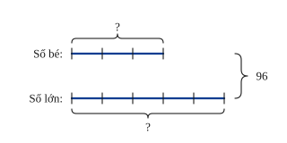
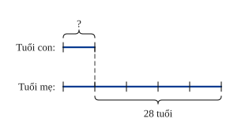

# Chủ đề 1. Phân số, hỗn số và tỉ số

> Chủ đề này ôn lại phân số, hỗn số và học thêm về tỉ số. Hai dạng toán "tìm hai số khi biết tổng và tỉ" và "tìm hai số khi biết hiệu và tỉ" gần như luôn có trong đề kiểm tra lớp 5, thường dưới dạng bài toán có lời văn.

## I. Kiến thức cần nắm

### 1. Phân số và tính chất cơ bản
- Phân số $\frac{a}{b}$ có tử số $a$ và mẫu số $b$ (mẫu số khác 0). Phân số có mẫu số là 10, 100, 1000, ... gọi là **phân số thập phân**, ví dụ $\frac{3}{10}$, $\frac{47}{100}$.
- **Tính chất cơ bản:** nhân (hoặc chia) cả tử số và mẫu số với cùng một số tự nhiên khác 0 thì được một phân số bằng phân số đã cho.
- **Rút gọn:** chia cả tử và mẫu cho cùng một số lớn hơn 1, đến khi không chia được nữa (phân số tối giản). Ví dụ: $\frac{24}{36} = \frac{24 : 12}{36 : 12} = \frac{2}{3}$.
- **Quy đồng mẫu số:** đưa hai phân số về cùng một mẫu số. Ví dụ: $\frac{1}{4}$ và $\frac{5}{6}$ có mẫu số chung 12: $\frac{1}{4} = \frac{3}{12}$, $\frac{5}{6} = \frac{10}{12}$.
- **So sánh:** cùng mẫu số thì phân số nào có tử số lớn hơn thì lớn hơn; cùng tử số thì phân số nào có mẫu số bé hơn thì lớn hơn; khác mẫu thì quy đồng rồi so sánh.

### 2. Hỗn số
- Hỗn số $2\frac{3}{4}$ gồm phần nguyên 2 và phần phân số $\frac{3}{4}$ (phần phân số luôn bé hơn 1), đọc là "hai và ba phần tư".
- **Hỗn số thành phân số:** tử số bằng phần nguyên nhân mẫu số rồi cộng tử số; mẫu số giữ nguyên.
$$2\frac{3}{4} = \frac{2 \times 4 + 3}{4} = \frac{11}{4}.$$
- **Phân số (lớn hơn 1) thành hỗn số:** chia tử số cho mẫu số. Thương là phần nguyên, số dư là tử số của phần phân số. Ví dụ: $17 : 5 = 3$ dư 2, nên $\frac{17}{5} = 3\frac{2}{5}$.
- Khi cộng, trừ, nhân, chia hỗn số, ta thường **đổi hỗn số ra phân số** rồi tính.

### 3. Bốn phép tính với phân số
- Cộng, trừ: quy đồng mẫu số (nếu cần), rồi cộng hoặc trừ tử số, giữ nguyên mẫu số.
- Nhân: $\frac{a}{b} \times \frac{c}{d} = \frac{a \times c}{b \times d}$. Nên rút gọn trước khi nhân.
- Chia: nhân với phân số đảo ngược của số chia: $\frac{a}{b} : \frac{c}{d} = \frac{a}{b} \times \frac{d}{c}$.
- **Tìm phân số của một số:** muốn tìm $\frac{m}{n}$ của số $A$, ta lấy $A \times \frac{m}{n}$ (hay $A : n \times m$).

*Ví dụ:* $\frac{3}{4}$ của 60 kg là $60 : 4 \times 3 = 45$ (kg).

### 4. Tỉ số
- **Tỉ số** của $a$ và $b$ (với $b$ khác 0) là thương $a : b$, viết là $a : b$ hoặc $\frac{a}{b}$.
- Tỉ số cho biết số này **bằng mấy phần** số kia. Nói "số bé bằng $\frac{3}{5}$ số lớn" nghĩa là: nếu số lớn có 5 phần bằng nhau thì số bé có 3 phần như thế.
- Hai đại lượng cùng loại phải **cùng đơn vị đo** trước khi lập tỉ số. Ví dụ: tỉ số của 30 cm và 1 m là $30 : 100 = \frac{3}{10}$.

*Ví dụ:* một lớp có 12 bạn nam và 20 bạn nữ. Tỉ số của số bạn nam và số bạn nữ là $\frac{12}{20} = \frac{3}{5}$.

### 5. Tìm hai số khi biết tổng và tỉ số
**Các bước giải:**
1. Vẽ sơ đồ đoạn thẳng theo tỉ số.
2. Tìm tổng số phần bằng nhau.
3. Tìm giá trị một phần: tổng chia cho tổng số phần.
4. Tìm từng số: giá trị một phần nhân với số phần của số đó.

*Ví dụ:* tổng hai số là 40, số bé bằng $\frac{3}{5}$ số lớn. Tổng số phần là $3 + 5 = 8$, một phần là $40 : 8 = 5$. Số bé là $5 \times 3 = 15$, số lớn là $5 \times 5 = 25$.

### 6. Tìm hai số khi biết hiệu và tỉ số
**Các bước giải:** giống dạng tổng và tỉ, nhưng thay "tổng số phần" bằng **hiệu số phần**:
1. Vẽ sơ đồ đoạn thẳng.
2. Tìm hiệu số phần bằng nhau.
3. Tìm giá trị một phần: hiệu chia cho hiệu số phần.
4. Tìm từng số.

*Ví dụ:* hiệu hai số là 24, số bé bằng $\frac{1}{4}$ số lớn. Hiệu số phần là $4 - 1 = 3$, một phần là $24 : 3 = 8$. Số bé là 8, số lớn là $8 \times 4 = 32$.

**Mẹo nhận dạng:** đề cho "tổng" (hoặc "cả hai", "chu vi" → nửa chu vi) thì dùng tổng và tỉ; đề cho "nhiều hơn", "hơn kém", "hơn ... tuổi" thì dùng hiệu và tỉ.

### 7. Sai lầm hay gặp
- Đổi hỗn số sai: $2\frac{3}{4} = \frac{2 \times 3 + 4}{4}$ là **sai**; đúng phải là $\frac{2 \times 4 + 3}{4}$.
- Dùng chu vi làm tổng hai cạnh của hình chữ nhật. Tổng chiều dài và chiều rộng là **nửa chu vi**.
- Quên rằng **hiệu số tuổi của hai người không đổi** theo thời gian, còn tỉ số tuổi thì thay đổi.
- Khi chuyển hàng từ kho này sang kho kia, **tổng không đổi** nhưng hiệu thay đổi.
- Lập tỉ số của hai đại lượng khác đơn vị (ví dụ $\frac{30 \text{ cm}}{1 \text{ m}} = 30$ là sai).

---

## II. Bài tập vận dụng

**Bài 1.** a) Rút gọn các phân số $\frac{18}{24}$ và $\frac{45}{60}$.
b) Quy đồng mẫu số hai phân số $\frac{2}{3}$ và $\frac{5}{8}$.

**Bài 2.** a) Chuyển các hỗn số sau thành phân số: $3\frac{2}{5}$; $2\frac{3}{4}$.
b) Chuyển phân số $\frac{23}{6}$ thành hỗn số.

**Bài 3.** Tính:
a) $2\frac{1}{3} + 1\frac{3}{4}$;
b) $3\frac{1}{2} \times 1\frac{1}{7}$;
c) $2\frac{2}{5} : 1\frac{1}{5}$.

**Bài 4.** Lớp 5A có 15 học sinh nam và 18 học sinh nữ.
a) Viết tỉ số của số học sinh nam và số học sinh nữ.
b) Viết tỉ số của số học sinh nữ và số học sinh cả lớp.

**Bài 5 (tổng và tỉ).** Tổng của hai số là 96. Số bé bằng $\frac{3}{5}$ số lớn. Tìm hai số đó.

**Bài 6 (hiệu và tỉ).** Mẹ hơn con 28 tuổi. Tuổi con bằng $\frac{1}{5}$ tuổi mẹ. Tính tuổi của mỗi người.

**Bài 7 (thực tế).** Một mảnh vườn hình chữ nhật có chu vi 120 m. Chiều rộng bằng $\frac{2}{3}$ chiều dài. Tính diện tích mảnh vườn.

**Bài 8 (thực tế).** Thư viện của trường có số sách truyện nhiều hơn số sách giáo khoa là 450 quyển. Số sách giáo khoa bằng $\frac{3}{5}$ số sách truyện. Hỏi thư viện có bao nhiêu quyển sách mỗi loại?

**Bài 9 (phân số của một số).** Một cửa hàng có 360 kg gạo. Ngày thứ nhất bán được $\frac{1}{3}$ số gạo. Ngày thứ hai bán được $\frac{2}{5}$ số gạo còn lại. Hỏi cửa hàng còn lại bao nhiêu ki-lô-gam gạo?

**Bài 10 (bài toán tuổi).** Năm nay tuổi bố gấp 4 lần tuổi con và tổng số tuổi của hai bố con là 50 tuổi.
a) Tính tuổi mỗi người hiện nay.
b) Sau bao nhiêu năm nữa thì tuổi bố gấp 3 lần tuổi con?

**Bài 11 (vận dụng cao).** Hai kho chứa tất cả 540 tấn thóc. Nếu chuyển 30 tấn thóc từ kho A sang kho B thì số thóc ở kho B bằng $\frac{4}{5}$ số thóc ở kho A. Hỏi lúc đầu mỗi kho chứa bao nhiêu tấn thóc?

**Bài 12 (vận dụng cao).**
a) Tìm một phân số bằng $\frac{2}{5}$, biết mẫu số hơn tử số 21 đơn vị.
b) Cho phân số $\frac{23}{41}$. Hỏi phải cùng bớt ở cả tử số và mẫu số một số tự nhiên nào để được phân số mới bằng $\frac{1}{3}$?

---

## III. Lời giải chi tiết

### Bài 1
a) $\frac{18}{24} = \frac{18 : 6}{24 : 6} = \frac{3}{4}$; $\quad \frac{45}{60} = \frac{45 : 15}{60 : 15} = \frac{3}{4}$.

b) Mẫu số chung là 24 (vì $24 = 3 \times 8$):
$$\frac{2}{3} = \frac{2 \times 8}{3 \times 8} = \frac{16}{24}; \qquad \frac{5}{8} = \frac{5 \times 3}{8 \times 3} = \frac{15}{24}.$$

### Bài 2
a) $3\frac{2}{5} = \frac{3 \times 5 + 2}{5} = \frac{17}{5}$; $\quad 2\frac{3}{4} = \frac{2 \times 4 + 3}{4} = \frac{11}{4}$.

b) $23 : 6 = 3$ dư 5, nên $\frac{23}{6} = 3\frac{5}{6}$.

### Bài 3
a) $2\frac{1}{3} + 1\frac{3}{4} = \frac{7}{3} + \frac{7}{4} = \frac{28}{12} + \frac{21}{12} = \frac{49}{12} = 4\frac{1}{12}$.

b) $3\frac{1}{2} \times 1\frac{1}{7} = \frac{7}{2} \times \frac{8}{7} = \frac{7 \times 8}{2 \times 7} = \frac{8}{2} = 4$.

c) $2\frac{2}{5} : 1\frac{1}{5} = \frac{12}{5} : \frac{6}{5} = \frac{12}{5} \times \frac{5}{6} = \frac{12}{6} = 2$.

*Nhận xét:* đổi hỗn số ra phân số trước, rồi rút gọn trước khi nhân để tính nhẹ hơn.

### Bài 4
a) Tỉ số của số học sinh nam và số học sinh nữ là $\frac{15}{18} = \frac{5}{6}$.

b) Lớp có $15 + 18 = 33$ học sinh. Tỉ số của số học sinh nữ và số học sinh cả lớp là $\frac{18}{33} = \frac{6}{11}$.

### Bài 5

*Hình: Sơ đồ: số bé 3 phần, số lớn 5 phần, tổng 96.*

Coi số bé là 3 phần thì số lớn là 5 phần như thế.
- Tổng số phần bằng nhau: $3 + 5 = 8$ (phần).
- Giá trị một phần: $96 : 8 = 12$.
- Số bé: $12 \times 3 = 36$.
- Số lớn: $12 \times 5 = 60$.

Thử lại: $36 + 60 = 96$ và $\frac{36}{60} = \frac{3}{5}$.

**Đáp số:** số bé 36; số lớn 60.

### Bài 6

*Hình: Sơ đồ: tuổi con 1 phần, tuổi mẹ 5 phần, mẹ hơn con 28 tuổi.*

Coi tuổi con là 1 phần thì tuổi mẹ là 5 phần như thế.
- Hiệu số phần bằng nhau: $5 - 1 = 4$ (phần).
- Giá trị một phần (tuổi con): $28 : 4 = 7$ (tuổi).
- Tuổi mẹ: $7 \times 5 = 35$ (tuổi).

**Đáp số:** con 7 tuổi; mẹ 35 tuổi.

*Nhận xét:* bài 5 và bài 6 có cùng cách vẽ sơ đồ. Chỉ khác ở bước 2: dạng tổng thì **cộng** số phần, dạng hiệu thì **trừ** số phần.

### Bài 7
Nửa chu vi (tổng chiều dài và chiều rộng) là $120 : 2 = 60$ (m).

Coi chiều rộng là 2 phần thì chiều dài là 3 phần như thế.
- Tổng số phần bằng nhau: $2 + 3 = 5$ (phần).
- Một phần: $60 : 5 = 12$ (m).
- Chiều rộng: $12 \times 2 = 24$ (m). Chiều dài: $12 \times 3 = 36$ (m).

Diện tích mảnh vườn: $36 \times 24 = 864$ (m²).

**Đáp số:** $864$ m².

*Nhận xét:* tổng hai cạnh là nửa chu vi, không phải chu vi. Đây là chỗ hay sai nhất.

### Bài 8
Coi số sách giáo khoa là 3 phần thì số sách truyện là 5 phần như thế.
- Hiệu số phần bằng nhau: $5 - 3 = 2$ (phần).
- Một phần: $450 : 2 = 225$ (quyển).
- Số sách giáo khoa: $225 \times 3 = 675$ (quyển).
- Số sách truyện: $225 \times 5 = 1125$ (quyển).

Thử lại: $1125 - 675 = 450$.

**Đáp số:** 675 quyển sách giáo khoa; 1125 quyển sách truyện.

### Bài 9
- Ngày thứ nhất bán: $360 : 3 = 120$ (kg).
- Số gạo còn lại sau ngày thứ nhất: $360 - 120 = 240$ (kg).
- Ngày thứ hai bán: $240 : 5 \times 2 = 96$ (kg).
- Số gạo còn lại: $240 - 96 = 144$ (kg).

**Đáp số:** 144 kg.

*Nhận xét:* "$\frac{2}{5}$ số gạo **còn lại**" được tính trên 240 kg, không phải trên 360 kg.

### Bài 10
a) Coi tuổi con là 1 phần thì tuổi bố là 4 phần.
- Tổng số phần: $1 + 4 = 5$ (phần).
- Tuổi con: $50 : 5 = 10$ (tuổi). Tuổi bố: $10 \times 4 = 40$ (tuổi).

b) Bố hơn con $40 - 10 = 30$ tuổi. Mỗi năm cả hai người cùng thêm 1 tuổi, nên **bố luôn hơn con 30 tuổi**.

Khi tuổi bố gấp 3 lần tuổi con: coi tuổi con lúc đó là 1 phần, tuổi bố là 3 phần.
- Hiệu số phần: $3 - 1 = 2$ (phần).
- Tuổi con lúc đó: $30 : 2 = 15$ (tuổi).
- Số năm cần chờ: $15 - 10 = 5$ (năm).

Thử lại: sau 5 năm, con 15 tuổi, bố 45 tuổi, và $45 = 3 \times 15$.

**Đáp số:** a) con 10 tuổi, bố 40 tuổi; b) sau 5 năm.

*Nhận xét:* trong bài toán tuổi, hiệu số tuổi không đổi. Vì thế câu b) là bài toán hiệu và tỉ.

### Bài 11
Chuyển thóc từ kho A sang kho B thì tổng số thóc của hai kho **không đổi**, vẫn là 540 tấn.

Sau khi chuyển, coi số thóc kho B là 4 phần thì số thóc kho A là 5 phần.
- Tổng số phần: $4 + 5 = 9$ (phần).
- Một phần: $540 : 9 = 60$ (tấn).
- Sau khi chuyển: kho A có $60 \times 5 = 300$ (tấn), kho B có $60 \times 4 = 240$ (tấn).

Lúc đầu:
- Kho A có $300 + 30 = 330$ (tấn).
- Kho B có $240 - 30 = 210$ (tấn).

Thử lại: $330 + 210 = 540$; sau khi chuyển được 300 và 240, mà $\frac{240}{300} = \frac{4}{5}$.

**Đáp số:** kho A 330 tấn; kho B 210 tấn.

*Nhận xét:* tìm đại lượng **không đổi** (ở đây là tổng), giải bài toán ở thời điểm "sau", rồi tính ngược lại thời điểm "trước".

### Bài 12
a) Phân số cần tìm bằng $\frac{2}{5}$ nên coi tử số là 2 phần thì mẫu số là 5 phần.
- Hiệu số phần: $5 - 2 = 3$ (phần).
- Một phần: $21 : 3 = 7$.
- Tử số: $7 \times 2 = 14$; mẫu số: $7 \times 5 = 35$.

Phân số cần tìm là $\frac{14}{35}$ (thử lại: $35 - 14 = 21$ và $\frac{14}{35} = \frac{2}{5}$).

b) Hiệu giữa mẫu số và tử số là $41 - 23 = 18$. Khi cùng bớt một số ở tử và mẫu thì **hiệu này không đổi**.

Phân số mới bằng $\frac{1}{3}$: coi tử số mới là 1 phần thì mẫu số mới là 3 phần.
- Hiệu số phần: $3 - 1 = 2$ (phần).
- Tử số mới: $18 : 2 = 9$; mẫu số mới: $9 \times 3 = 27$.
- Số phải bớt: $23 - 9 = 14$.

Thử lại: $\frac{23 - 14}{41 - 14} = \frac{9}{27} = \frac{1}{3}$.

**Đáp số:** a) $\frac{14}{35}$; b) bớt 14.

*Nhận xét:* cùng thêm hoặc cùng bớt một số ở tử và mẫu thì hiệu giữa mẫu và tử không đổi. Cùng chuyển một số từ mẫu sang tử thì tổng không đổi.
