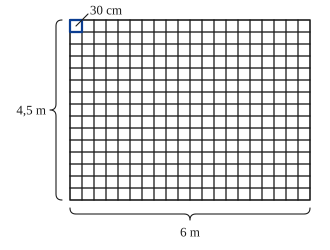

# Chủ đề 5. Đơn vị đo

> Đổi đơn vị đo là bước cần thiết trong mọi bài toán về hình học, chuyển động và thực tế. Chủ đề này ôn lại đơn vị đo độ dài, khối lượng và học thêm đơn vị đo diện tích (héc-ta, ki-lô-mét vuông) và đơn vị đo thể tích (xăng-ti-mét khối, đề-xi-mét khối, mét khối).

## I. Kiến thức cần nắm

### 1. Đơn vị đo độ dài và khối lượng
**Độ dài:**

| km | hm | dam | m | dm | cm | mm |
|---|---|---|---|---|---|---|
| 1 km = 10 hm | 1 hm = 10 dam | 1 dam = 10 m | 1 m = 10 dm | 1 dm = 10 cm | 1 cm = 10 mm | |

**Khối lượng:**

| tấn | tạ | yến | kg | hg | dag | g |
|---|---|---|---|---|---|---|
| 1 tấn = 10 tạ | 1 tạ = 10 yến | 1 yến = 10 kg | 1 kg = 10 hg | 1 hg = 10 dag | 1 dag = 10 g | |

- Hai đơn vị đo liền nhau gấp (hoặc kém) nhau **10 lần**. Mỗi đơn vị ứng với **một chữ số**.
- Cần nhớ: 1 km = 1000 m; 1 m = 100 cm; 1 tấn = 1000 kg; 1 tạ = 100 kg; 1 kg = 1000 g.

*Ví dụ:* $4{,}25 \text{ km} = 4250 \text{ m}$; $\ 450 \text{ g} = 0{,}45 \text{ kg}$.

### 2. Đơn vị đo diện tích
| km² | hm² (ha) | dam² | m² | dm² | cm² | mm² |
|---|---|---|---|---|---|---|
| 1 km² = 100 hm² | 1 hm² = 100 dam² | 1 dam² = 100 m² | 1 m² = 100 dm² | 1 dm² = 100 cm² | 1 cm² = 100 mm² | |

- Hai đơn vị đo diện tích liền nhau gấp (hoặc kém) nhau **100 lần**. Mỗi đơn vị ứng với **hai chữ số**.
- **Héc-ta:** $1 \text{ ha} = 1 \text{ hm}^2 = 10\,000 \text{ m}^2$ (diện tích hình vuông cạnh 100 m). Dùng để đo ruộng, vườn, rừng.
- **Ki-lô-mét vuông:** $1 \text{ km}^2 = 100 \text{ ha} = 1\,000\,000 \text{ m}^2$ (hình vuông cạnh 1 km). Dùng để đo diện tích xã, tỉnh, hồ lớn.

*Ví dụ:* $2{,}5 \text{ ha} = 25\,000 \text{ m}^2$; $\ 3 \text{ m}^2\, 5 \text{ dm}^2 = 3{,}05 \text{ m}^2$.

### 3. Đơn vị đo thể tích
| m³ | dm³ | cm³ |
|---|---|---|
| 1 m³ = 1000 dm³ | 1 dm³ = 1000 cm³ | |

- Hai đơn vị đo thể tích liền nhau gấp (hoặc kém) nhau **1000 lần**. Mỗi đơn vị ứng với **ba chữ số**.
- **1 cm³** là thể tích hình lập phương cạnh 1 cm; **1 dm³** là thể tích hình lập phương cạnh 1 dm (gồm $10 \times 10 \times 10 = 1000$ hình lập phương 1 cm³).
- Liên hệ với lít: $1 \text{ dm}^3 = 1 \text{ l}$; $\ 1 \text{ cm}^3 = 1 \text{ ml}$; $\ 1 \text{ m}^3 = 1000 \text{ l}$.

*Ví dụ:* $2{,}5 \text{ m}^3 = 2500 \text{ dm}^3$; $\ 750 \text{ cm}^3 = 0{,}75 \text{ dm}^3$.

### 4. Cách đổi đơn vị bằng dịch dấu phẩy
Đổi từ đơn vị lớn sang đơn vị bé liền sau thì dịch dấu phẩy sang **phải**; từ bé sang lớn thì dịch sang **trái**. Mỗi bậc đơn vị dịch:

| Loại đơn vị | Gấp nhau | Dịch mỗi bậc |
|---|---|---|
| Độ dài, khối lượng | 10 lần | 1 chữ số |
| Diện tích | 100 lần | 2 chữ số |
| Thể tích | 1000 lần | 3 chữ số |

*Ví dụ:* đổi $0{,}8 \text{ km}^2$ ra ha: km² sang hm² là một bậc diện tích, dịch phải 2 chữ số: $0{,}8 \text{ km}^2 = 80 \text{ ha}$.

**Số đo có hai đơn vị** (như $4 \text{ dm}^3\, 25 \text{ cm}^3$): viết phần lẻ thành phân số thập phân của đơn vị lớn. Vì $1 \text{ dm}^3 = 1000 \text{ cm}^3$ nên $25 \text{ cm}^3 = \frac{25}{1000} \text{ dm}^3$, do đó $4 \text{ dm}^3\, 25 \text{ cm}^3 = 4{,}025 \text{ dm}^3$.

### 5. So sánh và tính với số đo
- Muốn so sánh hoặc cộng, trừ hai số đo, phải **đổi về cùng một đơn vị**.
- Trong bài toán về diện tích, thường tính bằng m² rồi đổi ra ha hoặc km² ở cuối.
- **Rút về đơn vị:** biết khối lượng của 1 dm³ (hoặc sản lượng trên 1 ha) thì nhân lên để được khối lượng (sản lượng) của phần lớn hơn.

### 6. Sai lầm hay gặp
- Đổi diện tích như độ dài: $3 \text{ m}^2\, 5 \text{ dm}^2 = 3{,}5 \text{ m}^2$ là **sai**; đúng là $3{,}05 \text{ m}^2$ (vì 1 m² = 100 dm²).
- Đổi thể tích chỉ dịch 1 hoặc 2 chữ số: $1{,}2 \text{ dm}^3 = 120 \text{ cm}^3$ là sai; đúng là $1200 \text{ cm}^3$.
- Quên $1 \text{ ha} = 10\,000 \text{ m}^2$ (không phải 1000 m²).
- So sánh hai số đo khác đơn vị mà không đổi.
- Chia không đều mà quên làm tròn lên: cần chở 8 tấn hàng, mỗi chuyến tối đa $4{,}5$ tấn thì phải 2 chuyến, không phải $1{,}78$ chuyến.

---

## II. Bài tập vận dụng

**Bài 1.** Viết số thích hợp vào chỗ chấm:
a) $4{,}25 \text{ km} = \dots \text{ m}$; $\quad 36 \text{ cm} = \dots \text{ m}$.
b) $2{,}7 \text{ tấn} = \dots \text{ kg}$; $\quad 450 \text{ g} = \dots \text{ kg}$; $\quad 5 \text{ tạ } 8 \text{ kg} = \dots \text{ tạ}$.

**Bài 2.** Viết số thích hợp vào chỗ chấm:
a) $3 \text{ m}^2\, 5 \text{ dm}^2 = \dots \text{ m}^2$; $\quad 2{,}5 \text{ ha} = \dots \text{ m}^2$; $\quad 7500 \text{ m}^2 = \dots \text{ ha}$.
b) $4 \text{ km}^2 = \dots \text{ ha}$; $\quad 0{,}8 \text{ km}^2 = \dots \text{ ha}$.

**Bài 3.** Viết số thích hợp vào chỗ chấm:
a) $2{,}5 \text{ m}^3 = \dots \text{ dm}^3$; $\quad 3500 \text{ dm}^3 = \dots \text{ m}^3$.
b) $4 \text{ dm}^3\, 25 \text{ cm}^3 = \dots \text{ dm}^3$; $\quad 750 \text{ cm}^3 = \dots \text{ dm}^3$; $\quad 1{,}2 \text{ dm}^3 = \dots \text{ cm}^3$.

**Bài 4.** Điền dấu $>$, $<$, $=$:
a) $3 \text{ m}^2\, 8 \text{ dm}^2 \;\square\; 3{,}8 \text{ m}^2$; $\quad$ b) $2 \text{ ha} \;\square\; 19\,800 \text{ m}^2$;
c) $5{,}2 \text{ dm}^3 \;\square\; 5200 \text{ cm}^3$; $\quad$ d) $0{,}5 \text{ tấn} \;\square\; 480 \text{ kg}$.

**Bài 5 (thực tế).** Một cánh đồng hình chữ nhật có chiều dài 400 m, chiều rộng 250 m.
a) Tính diện tích cánh đồng theo đơn vị héc-ta.
b) Trung bình mỗi héc-ta thu hoạch được $6{,}5$ tấn thóc. Hỏi cả cánh đồng thu hoạch được bao nhiêu tấn thóc?

**Bài 6 (thực tế).** Một bể nước chứa $1{,}8 \text{ m}^3$ nước.
a) Bể chứa bao nhiêu lít nước?
b) Mỗi ngày gia đình dùng hết 120 l nước. Hỏi sau bao nhiêu ngày thì dùng hết nước trong bể?

**Bài 7 (thực tế).** Một xe tải mỗi chuyến chở được nhiều nhất $4{,}5$ tấn hàng. Cần chở 160 bao xi măng, mỗi bao nặng 50 kg. Hỏi xe phải chở ít nhất bao nhiêu chuyến?

**Bài 8 (thực tế).** Người ta lát nền một căn phòng hình chữ nhật có chiều dài 6 m, chiều rộng $4{,}5$ m bằng những viên gạch hình vuông cạnh 30 cm. Hỏi cần bao nhiêu viên gạch để lát kín nền phòng (coi mạch vữa không đáng kể)?

**Bài 9 (thực tế).** Một xã có diện tích $12{,}5 \text{ km}^2$, trong đó đất trồng lúa là 480 ha. Hỏi diện tích đất trồng lúa chiếm bao nhiêu phần trăm diện tích của xã?

**Bài 10 (thực tế).** Một chai si-rô ho chứa $0{,}15 \text{ dm}^3$ thuốc. Mỗi ngày bạn Nam uống 3 lần, mỗi lần 5 ml. Hỏi chai thuốc đủ cho Nam uống trong bao nhiêu ngày?

**Bài 11 (vận dụng cao).** Một thửa ruộng hình chữ nhật có chu vi $0{,}48$ km, chiều rộng bằng $\frac{3}{5}$ chiều dài. Tính diện tích thửa ruộng theo đơn vị héc-ta.

**Bài 12 (vận dụng cao).** Sắp xếp các số đo sau theo thứ tự từ bé đến lớn:
$$0{,}05 \text{ km}^2; \quad 4{,}8 \text{ ha}; \quad 52\,000 \text{ m}^2; \quad 0{,}5 \text{ km}^2.$$

**Bài 13 (vận dụng cao).** Một khối kim loại có thể tích $1{,}5 \text{ dm}^3$ cân nặng $11{,}7$ kg. Hỏi một khối kim loại cùng loại có thể tích $400 \text{ cm}^3$ cân nặng bao nhiêu ki-lô-gam?

---

## III. Lời giải chi tiết

### Bài 1
a) $4{,}25 \text{ km} = 4250 \text{ m}$ (1 km = 1000 m); $\quad 36 \text{ cm} = \frac{36}{100} \text{ m} = 0{,}36 \text{ m}$.

b) $2{,}7 \text{ tấn} = 2700 \text{ kg}$; $\quad 450 \text{ g} = \frac{450}{1000} \text{ kg} = 0{,}45 \text{ kg}$; $\quad 5 \text{ tạ } 8 \text{ kg} = 5\frac{8}{100} \text{ tạ} = 5{,}08 \text{ tạ}$ (vì 1 tạ = 100 kg).

### Bài 2
a)
- $3 \text{ m}^2\, 5 \text{ dm}^2 = 3\frac{5}{100} \text{ m}^2 = 3{,}05 \text{ m}^2$.
- $2{,}5 \text{ ha} = 2{,}5 \times 10\,000 \text{ m}^2 = 25\,000 \text{ m}^2$.
- $7500 \text{ m}^2 = \frac{7500}{10\,000} \text{ ha} = 0{,}75 \text{ ha}$.

b) $4 \text{ km}^2 = 400 \text{ ha}$; $\quad 0{,}8 \text{ km}^2 = 80 \text{ ha}$ (1 km² = 100 ha).

### Bài 3
a) $2{,}5 \text{ m}^3 = 2500 \text{ dm}^3$; $\quad 3500 \text{ dm}^3 = 3{,}5 \text{ m}^3$.

b) $4 \text{ dm}^3\, 25 \text{ cm}^3 = 4\frac{25}{1000} \text{ dm}^3 = 4{,}025 \text{ dm}^3$; $\quad 750 \text{ cm}^3 = 0{,}75 \text{ dm}^3$; $\quad 1{,}2 \text{ dm}^3 = 1200 \text{ cm}^3$.

*Nhận xét:* với thể tích, mỗi bậc đơn vị dịch dấu phẩy 3 chữ số.

### Bài 4
a) $3 \text{ m}^2\, 8 \text{ dm}^2 = 3{,}08 \text{ m}^2 < 3{,}8 \text{ m}^2$. Dấu $<$.

b) $2 \text{ ha} = 20\,000 \text{ m}^2 > 19\,800 \text{ m}^2$. Dấu $>$.

c) $5{,}2 \text{ dm}^3 = 5200 \text{ cm}^3$. Dấu $=$.

d) $0{,}5 \text{ tấn} = 500 \text{ kg} > 480 \text{ kg}$. Dấu $>$.

### Bài 5
a) Diện tích cánh đồng: $400 \times 250 = 100\,000 \text{ (m}^2)$. Đổi: $100\,000 \text{ m}^2 = 10 \text{ ha}$.

b) Số thóc thu hoạch được: $6{,}5 \times 10 = 65$ (tấn).

**Đáp số:** a) 10 ha; b) 65 tấn.

### Bài 6
a) $1{,}8 \text{ m}^3 = 1800 \text{ dm}^3 = 1800 \text{ l}$.

b) Số ngày dùng hết nước: $1800 : 120 = 15$ (ngày).

**Đáp số:** a) 1800 l; b) 15 ngày.

### Bài 7
- Khối lượng xi măng: $50 \times 160 = 8000$ (kg) $= 8$ tấn.
- Mỗi chuyến chở nhiều nhất $4{,}5$ tấn. Một chuyến không đủ ($8 > 4{,}5$), hai chuyến chở được nhiều nhất $4{,}5 \times 2 = 9$ tấn, đủ để chở 8 tấn.

Vậy xe phải chở ít nhất 2 chuyến.

**Đáp số:** 2 chuyến.

*Nhận xét:* $8 : 4{,}5 \approx 1{,}78$ nhưng số chuyến phải là số tự nhiên và phải chở hết hàng, nên lấy 2.

### Bài 8

*Hình: Nền phòng 6 m nhân 4,5 m lát gạch vuông cạnh 30 cm.*

**Cách 1 (tính diện tích).**
- Diện tích nền phòng: $6 \times 4{,}5 = 27 \text{ (m}^2) = 270\,000 \text{ cm}^2$.
- Diện tích một viên gạch: $30 \times 30 = 900 \text{ (cm}^2)$.
- Số viên gạch: $270\,000 : 900 = 300$ (viên).

**Cách 2 (đếm theo hàng).** Đổi 6 m = 600 cm, $4{,}5$ m = 450 cm. Mỗi hàng theo chiều dài có $600 : 30 = 20$ viên; theo chiều rộng có $450 : 30 = 15$ hàng. Số viên gạch: $20 \times 15 = 300$ (viên).

**Đáp số:** 300 viên.

*Nhận xét:* phải đổi diện tích nền và diện tích viên gạch về **cùng đơn vị** trước khi chia.

### Bài 9
Đổi: $12{,}5 \text{ km}^2 = 1250 \text{ ha}$.

Tỉ số phần trăm diện tích đất lúa so với diện tích của xã:
$$480 : 1250 = 0{,}384 = 38{,}4\%.$$

**Đáp số:** $38{,}4\%$.

### Bài 10
- Đổi: $0{,}15 \text{ dm}^3 = 150 \text{ cm}^3 = 150 \text{ ml}$.
- Mỗi ngày Nam uống: $5 \times 3 = 15$ (ml).
- Số ngày: $150 : 15 = 10$ (ngày).

**Đáp số:** 10 ngày.

### Bài 11
Đổi: $0{,}48 \text{ km} = 480 \text{ m}$. Nửa chu vi: $480 : 2 = 240$ (m).

Coi chiều rộng là 3 phần thì chiều dài là 5 phần.
- Tổng số phần: $3 + 5 = 8$ (phần).
- Một phần: $240 : 8 = 30$ (m).
- Chiều rộng: $30 \times 3 = 90$ (m); chiều dài: $30 \times 5 = 150$ (m).

Diện tích: $150 \times 90 = 13\,500 \text{ (m}^2) = 1{,}35 \text{ ha}$.

**Đáp số:** $1{,}35$ ha.

### Bài 12
Đổi tất cả ra mét vuông:
- $0{,}05 \text{ km}^2 = 0{,}05 \times 1\,000\,000 = 50\,000 \text{ m}^2$;
- $4{,}8 \text{ ha} = 48\,000 \text{ m}^2$;
- $52\,000 \text{ m}^2$;
- $0{,}5 \text{ km}^2 = 500\,000 \text{ m}^2$.

Thứ tự từ bé đến lớn:
$$4{,}8 \text{ ha}; \quad 0{,}05 \text{ km}^2; \quad 52\,000 \text{ m}^2; \quad 0{,}5 \text{ km}^2.$$

*Nhận xét:* nhìn số thì $4{,}8$ "to" hơn $0{,}05$, nhưng đơn vị khác nhau nên phải đổi về cùng một đơn vị rồi mới so sánh.

### Bài 13
- $1 \text{ dm}^3$ kim loại nặng: $11{,}7 : 1{,}5 = 7{,}8$ (kg).
- Đổi: $400 \text{ cm}^3 = 0{,}4 \text{ dm}^3$.
- Khối kim loại $400 \text{ cm}^3$ nặng: $7{,}8 \times 0{,}4 = 3{,}12$ (kg).

**Đáp số:** $3{,}12$ kg.

*Nhận xét:* rút về đơn vị (khối lượng của $1 \text{ dm}^3$), nhớ đổi $400 \text{ cm}^3$ ra dm³ trước khi nhân.
