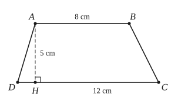
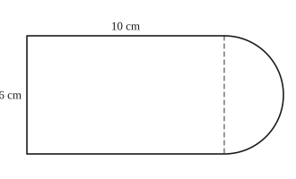
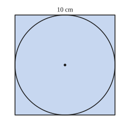
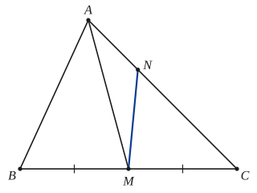

# Chủ đề 6. Hình tam giác, hình thang, hình tròn

> Lớp 5 học cách tính diện tích hình tam giác, hình thang, và chu vi, diện tích hình tròn. Các công thức này dùng rất nhiều trong bài toán thực tế (thửa ruộng, bánh xe, bồn hoa) và trong các bài hình ghép của đề kiểm tra cuối năm.

## I. Kiến thức cần nắm

### 1. Hình tam giác

- Tam giác có 3 cạnh, 3 góc, 3 đỉnh. Từ một đỉnh hạ đường vuông góc xuống cạnh đối diện được **chiều cao** ứng với cạnh đó (gọi cạnh đó là **đáy**).
- **Diện tích:**
$$S = \frac{a \times h}{2},$$
trong đó $a$ là độ dài đáy, $h$ là chiều cao ứng với đáy đó (cùng đơn vị).
- Tam giác vuông: lấy một cạnh góc vuông làm đáy thì cạnh góc vuông kia là chiều cao: $S = \dfrac{\text{tích hai cạnh góc vuông}}{2}$.

*Vì sao chia 2:* ghép hai tam giác bằng nhau thành một hình chữ nhật (hoặc hình bình hành) có cùng đáy và chiều cao. Tam giác là một nửa hình đó.

**Tìm đáy hoặc chiều cao:** $a = S \times 2 : h$, $h = S \times 2 : a$.

### 2. Hình thang

- Hình thang có một cặp cạnh đối diện **song song** gọi là hai **đáy** (đáy lớn, đáy bé). Khoảng cách giữa hai đáy là **chiều cao**.
- Hình thang có một cạnh bên vuông góc với hai đáy gọi là **hình thang vuông**.
- **Diện tích:**
$$S = \frac{(a + b) \times h}{2},$$
với $a, b$ là hai đáy, $h$ là chiều cao.

*Vì sao đúng:* ghép hai hình thang bằng nhau (xoay ngược một hình) được hình bình hành có đáy $a + b$ và chiều cao $h$.

**Tìm chiều cao hoặc tổng hai đáy:** $h = S \times 2 : (a + b)$, $a + b = S \times 2 : h$.

### 3. Hình tròn

- Tâm $O$; **bán kính** $r$ nối tâm với một điểm trên đường tròn; **đường kính** $d = r \times 2$.
- **Chu vi** (độ dài đường tròn):
$$C = d \times 3{,}14 = r \times 2 \times 3{,}14.$$
- **Diện tích:**
$$S = r \times r \times 3{,}14.$$

Số $3{,}14$ là giá trị gần đúng của số $\pi$: chu vi luôn gấp khoảng $3{,}14$ lần đường kính.

**Ví dụ.** Hình tròn bán kính 2 cm: $C = 2 \times 2 \times 3{,}14 = 12{,}56$ (cm), $S = 2 \times 2 \times 3{,}14 = 12{,}56 \text{ (cm}^2)$.

**Bánh xe:** mỗi vòng bánh xe lăn được quãng đường bằng **chu vi** bánh xe.

### 4. Hình ghép

Chia hình thành các hình đã biết công thức (hình chữ nhật, tam giác, hình thang, hình tròn, nửa hình tròn), tính từng phần rồi cộng (hoặc lấy hình lớn trừ phần bị khoét).

### 5. Tam giác chung chiều cao

Hai tam giác có **chung chiều cao** thì tỉ số diện tích bằng tỉ số hai đáy. Đặc biệt, đường nối một đỉnh với **trung điểm** cạnh đối diện chia tam giác thành hai tam giác có diện tích bằng nhau.

### 6. Sai lầm hay gặp

- Quên chia 2 khi tính diện tích tam giác, hình thang.
- Lấy cạnh bên của tam giác (không vuông góc với đáy) làm chiều cao.
- Dùng đường kính thay bán kính trong công thức diện tích hình tròn.
- Đơn vị: chu vi là cm, m; diện tích là cm², m².

## II. Bài tập vận dụng

**Bài 1.** Tính diện tích hình tam giác có độ dài đáy 8 cm và chiều cao 5 cm.

**Bài 2.** Tính diện tích hình tam giác vuông có hai cạnh góc vuông dài 6 cm và $4{,}5$ cm.

**Bài 3.** Tính diện tích hình thang $ABCD$ có đáy lớn 12 cm, đáy bé 8 cm và chiều cao 5 cm.

**Bài 4.** Tính chu vi và diện tích hình tròn có bán kính 5 cm.

**Bài 5.** Tính chu vi hình tròn có đường kính $1{,}2$ m.

**Bài 6 (thực tế).** Bánh xe đạp có đường kính $0{,}65$ m. Hỏi người đi xe đạp đi được bao nhiêu mét nếu bánh xe lăn trên mặt đất được 100 vòng?

**Bài 7 (thực tế).** Một thửa ruộng hình thang có đáy lớn 120 m, đáy bé bằng $\dfrac{2}{3}$ đáy lớn, chiều cao bằng trung bình cộng của hai đáy. Trung bình cứ $100 \text{ m}^2$ thu hoạch được 64 kg thóc. Hỏi thửa ruộng thu hoạch được bao nhiêu tấn thóc?

**Bài 8.** Một hình tam giác có diện tích $24 \text{ cm}^2$, đáy dài 6 cm. Tính chiều cao của tam giác.

**Bài 9.** Một hình thang có diện tích $60 \text{ cm}^2$, hai đáy dài 7 cm và 13 cm. Tính chiều cao hình thang.

**Bài 10.** Một hình gồm một hình chữ nhật dài 10 cm, rộng 6 cm và một nửa hình tròn có đường kính bằng chiều rộng hình chữ nhật, ghép ở một đầu (xem hình). Tính diện tích của hình đó.

**Bài 11 (vận dụng cao).** Một hình vuông có cạnh 10 cm. Vẽ một hình tròn tiếp xúc với cả bốn cạnh hình vuông (hình tròn nằm trong hình vuông, đường kính bằng cạnh hình vuông). Tính diện tích phần hình vuông nằm ngoài hình tròn.

**Bài 12 (vận dụng cao).** Tam giác $ABC$ có diện tích $60 \text{ cm}^2$. $M$ là trung điểm của $BC$; điểm $N$ nằm trên cạnh $AC$ sao cho $AN = \dfrac{1}{3} AC$. Tính diện tích tam giác $AMN$.

**Bài 13 (vận dụng cao).** Nếu bán kính một hình tròn tăng gấp 2 lần thì chu vi và diện tích hình tròn tăng gấp mấy lần?

---

## III. Lời giải chi tiết

### Bài 1
$S = 8 \times 5 : 2 = 20 \text{ (cm}^2)$.

**Đáp số:** $20 \text{ cm}^2$.

### Bài 2
$S = 6 \times 4{,}5 : 2 = 13{,}5 \text{ (cm}^2)$.

**Đáp số:** $13{,}5 \text{ cm}^2$.

### Bài 3

*Hình: Hình thang ABCD có đáy lớn 12 cm, đáy bé 8 cm, chiều cao 5 cm.*

$S = (12 + 8) \times 5 : 2 = 50 \text{ (cm}^2)$.

**Đáp số:** $50 \text{ cm}^2$.

### Bài 4
$C = 5 \times 2 \times 3{,}14 = 31{,}4$ (cm). $S = 5 \times 5 \times 3{,}14 = 78{,}5 \text{ (cm}^2)$.

**Đáp số:** $31{,}4$ cm; $78{,}5 \text{ cm}^2$.

### Bài 5
$C = 1{,}2 \times 3{,}14 = 3{,}768$ (m).

**Đáp số:** $3{,}768$ m.

### Bài 6
Mỗi vòng bánh xe lăn được một đoạn bằng chu vi bánh xe: $0{,}65 \times 3{,}14 = 2{,}041$ (m).
100 vòng: $2{,}041 \times 100 = 204{,}1$ (m).

**Đáp số:** $204{,}1$ m.

### Bài 7
Đáy bé: $120 \times \dfrac{2}{3} = 80$ (m). Chiều cao: $(120 + 80) : 2 = 100$ (m).
Diện tích: $(120 + 80) \times 100 : 2 = 10\,000 \text{ (m}^2)$.
Thóc thu được: $10\,000 : 100 \times 64 = 6\,400$ (kg) $= 6{,}4$ tấn.

**Đáp số:** $6{,}4$ tấn.

### Bài 8
$h = 24 \times 2 : 6 = 8$ (cm).

**Đáp số:** 8 cm.

### Bài 9
$h = 60 \times 2 : (7 + 13) = 120 : 20 = 6$ (cm).

**Đáp số:** 6 cm.

### Bài 10

*Hình: Hình chữ nhật 10 cm × 6 cm ghép với nửa hình tròn đường kính 6 cm.*

Diện tích hình chữ nhật: $10 \times 6 = 60 \text{ (cm}^2)$.
Nửa hình tròn có bán kính $6 : 2 = 3$ (cm), diện tích $3 \times 3 \times 3{,}14 : 2 = 14{,}13 \text{ (cm}^2)$.
Diện tích cả hình: $60 + 14{,}13 = 74{,}13 \text{ (cm}^2)$.

**Đáp số:** $74{,}13 \text{ cm}^2$.

### Bài 11

*Hình: Hình tròn nội tiếp hình vuông cạnh 10 cm.*

Diện tích hình vuông: $10 \times 10 = 100 \text{ (cm}^2)$.
Hình tròn có đường kính 10 cm, bán kính 5 cm, diện tích $5 \times 5 \times 3{,}14 = 78{,}5 \text{ (cm}^2)$.
Phần ngoài hình tròn: $100 - 78{,}5 = 21{,}5 \text{ (cm}^2)$.

**Đáp số:** $21{,}5 \text{ cm}^2$.

### Bài 12

*Hình: Tam giác ABC, M là trung điểm BC, N trên AC với AN bằng một phần ba AC.*

Tam giác $AMC$ và tam giác $ABC$ có chung chiều cao hạ từ $A$, đáy $MC = \dfrac{1}{2} BC$. Nên $S_{AMC} = 60 : 2 = 30 \text{ (cm}^2)$.
Tam giác $AMN$ và tam giác $AMC$ có chung chiều cao hạ từ $M$ xuống $AC$, đáy $AN = \dfrac{1}{3} AC$. Nên $S_{AMN} = 30 : 3 = 10 \text{ (cm}^2)$.

**Đáp số:** $10 \text{ cm}^2$.

*Nhận xét:* bài toán tỉ số diện tích dựa vào "chung chiều cao thì diện tích tỉ lệ với đáy". Đây là công cụ chính của hình học nâng cao lớp 5.

### Bài 13
Bán kính $r$ thành $r \times 2$.
- Chu vi mới: $r \times 2 \times 2 \times 3{,}14 = (r \times 2 \times 3{,}14) \times 2$: gấp **2 lần** chu vi cũ.
- Diện tích mới: $(r \times 2) \times (r \times 2) \times 3{,}14 = (r \times r \times 3{,}14) \times 4$: gấp **4 lần** diện tích cũ.

**Đáp số:** chu vi gấp 2 lần, diện tích gấp 4 lần.

*Nhận xét:* độ dài tăng $k$ lần thì diện tích tăng $k \times k$ lần.
