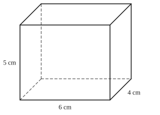
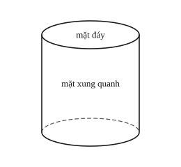
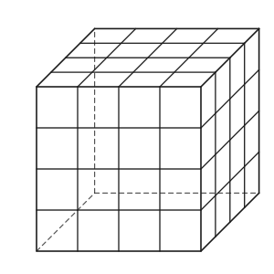

# Chủ đề 7. Hình hộp chữ nhật, hình lập phương, hình trụ

> Chủ đề này học diện tích xung quanh, diện tích toàn phần và thể tích của hình hộp chữ nhật và hình lập phương, các đơn vị đo thể tích, và nhận biết hình trụ. Bài toán về bể nước, thùng, hộp là dạng thực tế quen thuộc của đề kiểm tra cuối năm lớp 5.

## I. Kiến thức cần nắm

### 1. Hình hộp chữ nhật và hình lập phương

- **Hình hộp chữ nhật** có 6 mặt đều là hình chữ nhật, 12 cạnh, 8 đỉnh. Ba kích thước: chiều dài $a$, chiều rộng $b$, chiều cao $c$.
- **Hình lập phương** có 6 mặt là các hình vuông bằng nhau. Hình lập phương là hình hộp chữ nhật có ba kích thước bằng nhau.

### 2. Diện tích xung quanh và toàn phần

- **Diện tích xung quanh** là tổng diện tích 4 mặt bên:
$$S_{xq} = (a + b) \times 2 \times c \quad (\text{chu vi đáy} \times \text{chiều cao}).$$
- **Diện tích toàn phần** là tổng diện tích 6 mặt:
$$S_{tp} = S_{xq} + a \times b \times 2.$$
- Hình lập phương cạnh $a$: $S_{xq} = a \times a \times 4$, $S_{tp} = a \times a \times 6$.

*Vì sao $S_{xq}$ = chu vi đáy × chiều cao:* trải 4 mặt bên ra thì được một hình chữ nhật có chiều dài bằng chu vi đáy, chiều rộng bằng chiều cao.

**Hộp không nắp:** diện tích cần dùng $= S_{xq} +$ diện tích **một** đáy.

### 3. Thể tích và đơn vị đo thể tích

- $1 \text{ cm}^3$ là thể tích hình lập phương cạnh 1 cm. Tương tự $\text{dm}^3$, $\text{m}^3$.
- $1 \text{ m}^3 = 1\,000 \text{ dm}^3$, $1 \text{ dm}^3 = 1\,000 \text{ cm}^3$. Mỗi đơn vị thể tích **gấp 1 000 lần** đơn vị liền sau.
- $1 \text{ dm}^3 = 1$ lít, $1 \text{ m}^3 = 1\,000$ lít.

**Công thức:**
$$V_{\text{hộp}} = a \times b \times c, \qquad V_{\text{lập phương}} = a \times a \times a.$$

*Vì sao:* xếp các hình lập phương cạnh 1 cm vào hộp: mỗi lớp có $a \times b$ hình, có $c$ lớp.

### 4. Hình trụ (nhận biết)

Hình trụ có **hai mặt đáy là hai hình tròn bằng nhau** và một **mặt xung quanh** cong. Ví dụ: lon nước ngọt, ống nước, hộp sữa tròn, cái trống.

### 5. Nước dâng và vật chìm

Thả một vật chìm hẳn vào bể nước, thể tích vật bằng thể tích phần nước dâng lên:
$$V_{\text{vật}} = \text{dài} \times \text{rộng (đáy bể)} \times \text{chiều cao nước dâng thêm}.$$

### 6. Sai lầm hay gặp

- Đổi thể tích mà dùng hệ số 100 (như diện tích): $1 \text{ m}^3 = 1\,000 \text{ dm}^3$, không phải 100.
- Tính hộp không nắp mà cộng cả hai đáy.
- Các kích thước chưa cùng đơn vị đã nhân với nhau.
- Lẫn $S_{xq}$ (4 mặt) với $S_{tp}$ (6 mặt).

## II. Bài tập vận dụng

**Bài 1.** Một hình hộp chữ nhật dài 6 cm, rộng 4 cm, cao 5 cm. Tính diện tích xung quanh, diện tích toàn phần và thể tích của hình hộp đó.

**Bài 2.** Một hình lập phương có cạnh 5 cm. Tính diện tích xung quanh, diện tích toàn phần và thể tích.

**Bài 3.** Tính thể tích hình hộp chữ nhật có chiều dài $2{,}5$ dm, chiều rộng $1{,}2$ dm, chiều cao $0{,}8$ dm.

**Bài 4.** Điền số thích hợp: a) $3 \text{ m}^3 = \dots \text{ dm}^3$; b) $4{,}5 \text{ dm}^3 = \dots \text{ cm}^3$; c) $2\,500 \text{ cm}^3 = \dots \text{ dm}^3 = \dots$ lít.

**Bài 5 (thực tế).** Một bể nước hình hộp chữ nhật có các kích thước trong lòng bể: dài 2 m, rộng $1{,}5$ m, cao 1 m. Bể chứa đầy được bao nhiêu lít nước? Hiện nay lượng nước trong bể chiếm $80\%$ thể tích bể. Trong bể có bao nhiêu lít nước?

**Bài 6 (thực tế).** Một cái thùng không nắp hình lập phương có cạnh 6 dm. Người ta sơn mặt ngoài của thùng. Tính diện tích cần sơn.

**Bài 7 (thực tế).** Người ta làm một cái hộp không nắp hình hộp chữ nhật bằng tôn, dài 30 cm, rộng 20 cm, cao 15 cm. Tính diện tích tôn cần dùng (không tính mép hàn).

**Bài 8.** Một hình lập phương có diện tích toàn phần là $216 \text{ cm}^2$. Tính thể tích hình lập phương đó.

**Bài 9.** a) Hình trụ có những đặc điểm gì? b) Trong các đồ vật sau, đồ vật nào có dạng hình trụ: lon nước ngọt, viên gạch, quả bóng, ống nước, hộp phấn hình hộp?

**Bài 10 (thực tế).** Một bể kính hình hộp chữ nhật có đáy dài $1{,}2$ m, rộng $0{,}8$ m đang chứa nước. Thả một hòn đá chìm hẳn vào bể thì mực nước dâng thêm 5 cm (nước không tràn). Tính thể tích hòn đá.

**Bài 11 (vận dụng cao).** Nếu tăng cạnh một hình lập phương lên gấp 2 lần thì diện tích toàn phần và thể tích của nó tăng gấp mấy lần?

**Bài 12 (vận dụng cao).** Người ta xếp 64 hình lập phương nhỏ cạnh 1 cm thành một hình lập phương lớn cạnh 4 cm rồi sơn tất cả các mặt ngoài của hình lớn. Hỏi có bao nhiêu hình lập phương nhỏ được sơn 3 mặt, 2 mặt, 1 mặt và không được sơn mặt nào?

**Bài 13 (vận dụng cao).** Một hình hộp chữ nhật có thể tích $360 \text{ cm}^3$, đáy là hình vuông cạnh 6 cm. Tính diện tích xung quanh của hình hộp đó.

---

## III. Lời giải chi tiết

### Bài 1

*Hình: Hình hộp chữ nhật dài 6 cm, rộng 4 cm, cao 5 cm.*

$S_{xq} = (6 + 4) \times 2 \times 5 = 100 \text{ (cm}^2)$.
$S_{tp} = 100 + 6 \times 4 \times 2 = 148 \text{ (cm}^2)$.
$V = 6 \times 4 \times 5 = 120 \text{ (cm}^3)$.

**Đáp số:** $100 \text{ cm}^2$; $148 \text{ cm}^2$; $120 \text{ cm}^3$.

### Bài 2
$S_{xq} = 5 \times 5 \times 4 = 100 \text{ (cm}^2)$; $S_{tp} = 5 \times 5 \times 6 = 150 \text{ (cm}^2)$; $V = 5 \times 5 \times 5 = 125 \text{ (cm}^3)$.

### Bài 3
$V = 2{,}5 \times 1{,}2 \times 0{,}8 = 2{,}4 \text{ (dm}^3)$.

**Đáp số:** $2{,}4 \text{ dm}^3$.

### Bài 4
a) $3\,000 \text{ dm}^3$. b) $4\,500 \text{ cm}^3$. c) $2{,}5 \text{ dm}^3 = 2{,}5$ lít.

### Bài 5
Thể tích bể: $2 \times 1{,}5 \times 1 = 3 \text{ (m}^3) = 3\,000 \text{ dm}^3 = 3\,000$ lít.
Lượng nước hiện có: $3\,000 \times 80 : 100 = 2\,400$ (lít).

**Đáp số:** $3\,000$ lít; $2\,400$ lít.

### Bài 6
Thùng không nắp có 5 mặt (4 mặt bên và 1 mặt đáy), mỗi mặt là hình vuông cạnh 6 dm.
Diện tích cần sơn: $6 \times 6 \times 5 = 180 \text{ (dm}^2)$.

**Đáp số:** $180 \text{ dm}^2$.

### Bài 7
$S_{xq} = (30 + 20) \times 2 \times 15 = 1\,500 \text{ (cm}^2)$. Diện tích một đáy: $30 \times 20 = 600 \text{ (cm}^2)$.
Diện tích tôn: $1\,500 + 600 = 2\,100 \text{ (cm}^2)$.

**Đáp số:** $2\,100 \text{ cm}^2$.

### Bài 8
Diện tích một mặt: $216 : 6 = 36 \text{ (cm}^2)$. Vì $6 \times 6 = 36$ nên cạnh là 6 cm.
Thể tích: $6 \times 6 \times 6 = 216 \text{ (cm}^3)$.

**Đáp số:** $216 \text{ cm}^3$.

### Bài 9

*Hình: Hình trụ.*

a) Hình trụ có hai mặt đáy là hai hình tròn bằng nhau và một mặt xung quanh cong.
b) Lon nước ngọt và ống nước có dạng hình trụ. Viên gạch, hộp phấn có dạng hình hộp chữ nhật; quả bóng có dạng hình cầu.

### Bài 10
Thể tích hòn đá bằng thể tích phần nước dâng lên. Đổi $5 \text{ cm} = 0{,}05$ m.
$V = 1{,}2 \times 0{,}8 \times 0{,}05 = 0{,}048 \text{ (m}^3) = 48 \text{ dm}^3$.

**Đáp số:** $48 \text{ dm}^3$.

### Bài 11
Cạnh $a$ thành $a \times 2$.
- Diện tích toàn phần mới: $(a \times 2) \times (a \times 2) \times 6 = (a \times a \times 6) \times 4$: gấp **4 lần**.
- Thể tích mới: $(a \times 2) \times (a \times 2) \times (a \times 2) = (a \times a \times a) \times 8$: gấp **8 lần**.

**Đáp số:** diện tích toàn phần gấp 4 lần; thể tích gấp 8 lần.

### Bài 12

*Hình: Hình lập phương cạnh 4 cm ghép từ 64 hình lập phương nhỏ cạnh 1 cm.*

- **3 mặt sơn:** các hình ở 8 đỉnh: 8 hình.
- **2 mặt sơn:** các hình nằm trên cạnh, trừ hai đầu. Mỗi cạnh có $4 - 2 = 2$ hình, 12 cạnh: $2 \times 12 = 24$ hình.
- **1 mặt sơn:** các hình nằm giữa mỗi mặt (không trên cạnh). Mỗi mặt có $2 \times 2 = 4$ hình, 6 mặt: $4 \times 6 = 24$ hình.
- **Không sơn:** các hình nằm hoàn toàn bên trong, tạo thành hình lập phương $2 \times 2 \times 2$: 8 hình.

**Đáp số:** 8; 24; 24; 8. Thử lại: $8 + 24 + 24 + 8 = 64$.

### Bài 13
Diện tích đáy: $6 \times 6 = 36 \text{ (cm}^2)$. Chiều cao: $360 : 36 = 10$ (cm).
$S_{xq} = 6 \times 4 \times 10 = 240 \text{ (cm}^2)$.

**Đáp số:** $240 \text{ cm}^2$.
