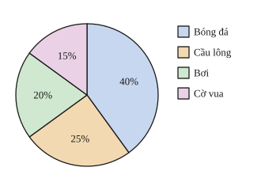
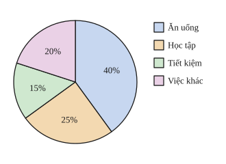
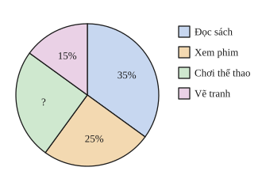

# Chủ đề 10. Thống kê và xác suất

> Lớp 5 học thêm biểu đồ hình quạt tròn (biểu diễn các phần trăm của một tổng) và dùng tỉ số để mô tả số lần lặp lại của một khả năng khi làm thí nghiệm nhiều lần. Bài đọc biểu đồ hình quạt thường kết hợp với tính tỉ số phần trăm của một số.

## I. Kiến thức cần nắm

### 1. Biểu đồ hình quạt tròn

- Cả hình tròn biểu diễn **tổng số** (100%). Mỗi hình quạt biểu diễn một phần, ghi bằng **tỉ số phần trăm** của phần đó so với tổng.
- Tổng các phần trăm trên một biểu đồ hình quạt bằng **100%**.
- Hình quạt càng lớn thì phần đó càng nhiều.

**Đọc biểu đồ:** biết tổng số và phần trăm của một phần thì số lượng của phần đó là
$$\text{Số lượng} = \text{Tổng} \times \text{phần trăm} : 100.$$

**Ví dụ.** 200 học sinh, 40% thích bóng đá: $200 \times 40 : 100 = 80$ học sinh.

### 2. Lập tỉ số phần trăm cho biểu đồ

Từ bảng số liệu, tỉ số phần trăm của mỗi phần là
$$\text{Số lượng phần đó} : \text{Tổng} \times 100\%.$$

### 3. Tìm tổng khi biết một phần

Biết phần A chiếm $p\%$ và có $m$ người thì tổng số người là $m : p \times 100$.

### 4. Tỉ số mô tả số lần lặp lại của một khả năng

Khi thực hiện một thí nghiệm (tung đồng xu, gieo xúc xắc, lấy bóng rồi trả lại…) nhiều lần, ta dùng tỉ số
$$\frac{\text{số lần khả năng đó xảy ra}}{\text{tổng số lần thực hiện}}$$
để mô tả khả năng đó xảy ra nhiều hay ít. Tỉ số này cũng có thể viết dưới dạng phần trăm.

**Ví dụ.** Tung đồng xu 50 lần, mặt sấp xuất hiện 22 lần. Tỉ số số lần mặt sấp xuất hiện và tổng số lần tung là $\dfrac{22}{50} = \dfrac{11}{25} = 44\%$.

**Nhận xét:** khi làm thí nghiệm càng nhiều lần, tỉ số này thường càng gần với "khả năng thật" (đồng xu cân đối thì gần $\dfrac{1}{2}$).

### 5. Chắc chắn, có thể, không thể

- Sự kiện **chắc chắn** xảy ra: tỉ số luôn là $\dfrac{n}{n} = 1$ (100%).
- Sự kiện **không thể** xảy ra: tỉ số luôn là 0.
- Sự kiện **có thể** xảy ra: tỉ số nằm giữa 0 và 1.

### 6. Sai lầm hay gặp

- Tổng các phần trên biểu đồ hình quạt không bằng 100% mà không phát hiện.
- Lấy phần trăm nhân trực tiếp với tổng mà quên chia 100.
- Lập tỉ số mà lấy số lần xảy ra chia cho số lần **không** xảy ra.

## II. Bài tập vận dụng

**Bài 1.** Biểu đồ hình quạt dưới đây cho biết kết quả khảo sát môn thể thao yêu thích của 200 học sinh khối 5.

a) Môn nào được yêu thích nhiều nhất? b) Tính số học sinh thích mỗi môn.

**Bài 2.** Lớp 5B có 40 học sinh. Kết quả học tập cuối năm: 25% học sinh hoàn thành xuất sắc, 50% hoàn thành tốt, còn lại là hoàn thành. Tính số học sinh mỗi loại.

**Bài 3.** Nam tung một đồng xu 50 lần, mặt sấp xuất hiện 22 lần. Viết tỉ số giữa số lần xuất hiện mặt sấp và tổng số lần tung (dạng phân số tối giản và dạng tỉ số phần trăm).

**Bài 4.** Gieo một con xúc xắc 60 lần, mặt 6 chấm xuất hiện 12 lần. Viết tỉ số mô tả số lần xuất hiện mặt 6 chấm.

**Bài 5.** Một hộp có 3 quả bóng đỏ và 2 quả bóng xanh. Lan lấy ra một quả, ghi màu rồi trả lại vào hộp. Lan làm như vậy 20 lần và thấy bóng xanh xuất hiện 9 lần. Viết tỉ số (dạng phần trăm) mô tả số lần lấy được bóng xanh, và số lần lấy được bóng đỏ.

**Bài 6 (thực tế).** Một gia đình có thu nhập hằng tháng là 10 000 000 đồng. Biểu đồ dưới đây cho biết cách gia đình chi tiêu số tiền đó.

Tính số tiền gia đình dành cho mỗi khoản. Khoản ăn uống nhiều hơn khoản tiết kiệm bao nhiêu tiền?

**Bài 7.** Số học sinh tham gia các câu lạc bộ của một trường: Vẽ 12 em, Hát 18 em, Múa 6 em, Võ thuật 24 em. Tính tỉ số phần trăm số học sinh của mỗi câu lạc bộ so với tổng số học sinh tham gia (để vẽ biểu đồ hình quạt).

**Bài 8.** Biểu đồ dưới đây cho biết hoạt động yêu thích vào cuối tuần của một nhóm học sinh. Phần "Chơi thể thao" bị thiếu số liệu.

a) Phần "Chơi thể thao" chiếm bao nhiêu phần trăm? b) Biết có 50 học sinh thích chơi thể thao, hỏi nhóm có bao nhiêu học sinh?

**Bài 9 (thực tế).** Một cầu thủ tập sút phạt đền 40 quả, sút vào 30 quả. Viết tỉ số phần trăm mô tả số lần sút vào và số lần sút trượt.

**Bài 10.** Chọn ngẫu nhiên một số trong các số từ 1 đến 10. Mỗi sự kiện sau là chắc chắn, có thể hay không thể?
a) Số được chọn bé hơn 11. b) Số được chọn là 0. c) Số được chọn là số chẵn.

**Bài 11 (vận dụng cao).** Lớp 5A có 40 học sinh, trong đó 30% thích bơi. Lớp 5B có 60 học sinh, trong đó 40% thích bơi. Hỏi số học sinh thích bơi chiếm bao nhiêu phần trăm tổng số học sinh của cả hai lớp?

**Bài 12 (vận dụng cao).** Tung cùng lúc hai đồng xu 40 lần, kết quả: hai mặt sấp 9 lần, một sấp một ngửa 21 lần, hai mặt ngửa 10 lần.
a) Viết tỉ số mô tả số lần có ít nhất một mặt sấp.
b) Trong 40 lần tung đó, tổng cộng mặt sấp đã xuất hiện bao nhiêu lần (tính trên cả hai đồng xu)?

---

## III. Lời giải chi tiết

### Bài 1
a) Bóng đá (40%).
b) Bóng đá: $200 \times 40 : 100 = 80$ (em). Cầu lông: $200 \times 25 : 100 = 50$ (em). Bơi: $200 \times 20 : 100 = 40$ (em). Cờ vua: $200 \times 15 : 100 = 30$ (em).

Thử lại: $80 + 50 + 40 + 30 = 200$.

### Bài 2
Hoàn thành xuất sắc: $40 \times 25 : 100 = 10$ (em). Hoàn thành tốt: $40 \times 50 : 100 = 20$ (em). Hoàn thành: $40 - 10 - 20 = 10$ (em).

### Bài 3
$\dfrac{22}{50} = \dfrac{11}{25} = \dfrac{44}{100} = 44\%$.

### Bài 4
$\dfrac{12}{60} = \dfrac{1}{5}$ (bằng 20%).

### Bài 5
Bóng xanh: $\dfrac{9}{20} = \dfrac{45}{100} = 45\%$.
Bóng đỏ xuất hiện $20 - 9 = 11$ lần: $\dfrac{11}{20} = 55\%$.

### Bài 6
Ăn uống: $10\,000\,000 \times 40 : 100 = 4\,000\,000$ (đồng).
Học tập: $10\,000\,000 \times 25 : 100 = 2\,500\,000$ (đồng).
Tiết kiệm: $10\,000\,000 \times 15 : 100 = 1\,500\,000$ (đồng).
Việc khác: $10\,000\,000 \times 20 : 100 = 2\,000\,000$ (đồng).
Ăn uống nhiều hơn tiết kiệm: $4\,000\,000 - 1\,500\,000 = 2\,500\,000$ (đồng).

### Bài 7
Tổng số học sinh: $12 + 18 + 6 + 24 = 60$ (em).
Vẽ: $12 : 60 \times 100\% = 20\%$. Hát: $18 : 60 \times 100\% = 30\%$. Múa: $6 : 60 \times 100\% = 10\%$. Võ thuật: $24 : 60 \times 100\% = 40\%$.

Thử lại: $20\% + 30\% + 10\% + 40\% = 100\%$.

### Bài 8
a) $100\% - 35\% - 25\% - 15\% = 25\%$.
b) 25% số học sinh là 50 em. Số học sinh của nhóm: $50 : 25 \times 100 = 200$ (em).

**Đáp số:** a) 25%; b) 200 học sinh.

### Bài 9
Sút vào: $\dfrac{30}{40} = \dfrac{3}{4} = 75\%$. Sút trượt: $40 - 30 = 10$ quả, $\dfrac{10}{40} = 25\%$.

### Bài 10
a) Chắc chắn (mọi số từ 1 đến 10 đều bé hơn 11).
b) Không thể (không có số 0 để chọn).
c) Có thể (có thể chọn được số chẵn, cũng có thể chọn được số lẻ).

### Bài 11
Lớp 5A có $40 \times 30 : 100 = 12$ (em) thích bơi. Lớp 5B có $60 \times 40 : 100 = 24$ (em) thích bơi.
Cả hai lớp có $12 + 24 = 36$ (em) thích bơi trên tổng số $40 + 60 = 100$ (em).
Tỉ số phần trăm: $36 : 100 \times 100\% = 36\%$.

**Đáp số:** 36%.

*Lưu ý:* $(30\% + 40\%) : 2 = 35\%$ là sai, vì hai lớp có số học sinh khác nhau.

### Bài 12
a) "Có ít nhất một mặt sấp" gồm các lần "hai sấp" và "một sấp một ngửa": $9 + 21 = 30$ (lần).
Tỉ số: $\dfrac{30}{40} = \dfrac{3}{4}$ (75%).
b) Mỗi lần "hai sấp" có 2 mặt sấp, mỗi lần "một sấp một ngửa" có 1 mặt sấp: $9 \times 2 + 21 \times 1 = 39$ (lần).

**Đáp số:** a) $\dfrac{3}{4}$; b) 39 lần.
