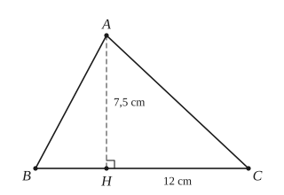
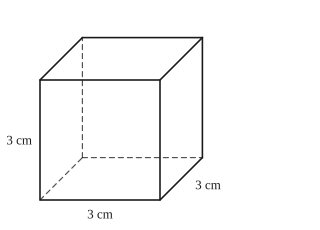

# Đề kiểm tra số 1

**Thời gian làm bài:** 60 phút. **Thang điểm:** mỗi câu 1 điểm, tổng 10 điểm.

## Đề bài

**Câu 1 (Phân số, tổng tỉ).** a) Rút gọn phân số $\dfrac{18}{24}$. b) Tổng của hai số là 60, số thứ nhất bằng $\dfrac{2}{3}$ số thứ hai. Tìm hai số.

**Câu 2 (Số thập phân).** a) Viết $\dfrac{3}{4}$ dưới dạng số thập phân. b) So sánh $2{,}35$ và $2{,}305$. c) Làm tròn $7{,}486$ đến hàng phần mười.

**Câu 3 (Phép tính).** Đặt tính rồi tính: a) $12{,}5 + 7{,}85$; b) $4{,}6 \times 2{,}5$; c) $9{,}36 : 3{,}6$.

**Câu 4 (Tỉ số phần trăm).** a) Tìm 25% của 240. b) Tìm tỉ số phần trăm của 18 và 24.

**Câu 5 (Đơn vị đo).** Điền số thích hợp: a) $3 \text{ km } 45 \text{ m} = \dots \text{ km}$; b) $2{,}5 \text{ tấn} = \dots \text{ kg}$; c) $4 \text{ ha} = \dots \text{ m}^2$.

**Câu 6 (Tam giác).** Tính diện tích tam giác có đáy 12 cm và chiều cao $7{,}5$ cm.

**Câu 7 (Hình lập phương).** Một hình lập phương có cạnh 3 cm. Tính diện tích toàn phần và thể tích.

**Câu 8 (Chuyển động).** Một xe máy đi với vận tốc 40 km/giờ trong 2 giờ 15 phút. Tính quãng đường xe đi được.

**Câu 9 (Bản đồ).** Trên bản đồ tỉ lệ $1 : 500\,000$, quãng đường từ A đến B dài 4 cm. Tính độ dài thật của quãng đường đó.

**Câu 10 (Biểu đồ).** Lớp 5A có 40 học sinh. Trên biểu đồ hình quạt về môn học yêu thích, phần "Toán" chiếm 45%. Hỏi có bao nhiêu học sinh thích môn Toán?

---

## Lời giải chi tiết

### Câu 1
a) $\dfrac{18}{24} = \dfrac{3}{4}$.
b) Số thứ nhất 2 phần, số thứ hai 3 phần, tổng 5 phần. Một phần: $60 : 5 = 12$. Số thứ nhất: 24; số thứ hai: 36.

### Câu 2
a) $\dfrac{3}{4} = \dfrac{75}{100} = 0{,}75$. b) $2{,}35 = 2{,}350 > 2{,}305$. c) $7{,}5$.

### Câu 3
a) $20{,}35$. b) $11{,}5$. c) $2{,}6$.

### Câu 4
a) $240 \times 25 : 100 = 60$. b) $18 : 24 = 0{,}75 = 75\%$.

### Câu 5
a) $3{,}045$ km. b) $2\,500$ kg. c) $40\,000 \text{ m}^2$.

### Câu 6

*Hình: Tam giác ABC có đáy BC = 12 cm, chiều cao AH = 7,5 cm.*

$S = 12 \times 7{,}5 : 2 = 45 \text{ (cm}^2)$.

### Câu 7

*Hình: Hình lập phương cạnh 3 cm.*

$S_{tp} = 3 \times 3 \times 6 = 54 \text{ (cm}^2)$. $V = 3 \times 3 \times 3 = 27 \text{ (cm}^3)$.

### Câu 8
2 giờ 15 phút $= 2{,}25$ giờ. Quãng đường: $40 \times 2{,}25 = 90$ (km).

### Câu 9
$4 \times 500\,000 = 2\,000\,000$ (cm) $= 20$ km.

### Câu 10
$40 \times 45 : 100 = 18$ (học sinh).
