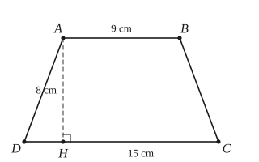
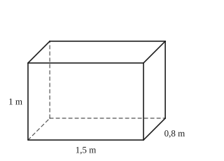

# Đề kiểm tra số 2

**Thời gian làm bài:** 60 phút. **Thang điểm:** mỗi câu 1 điểm, tổng 10 điểm.

## Đề bài

**Câu 1 (Hỗn số, hiệu tỉ).** a) Chuyển hỗn số $2\dfrac{3}{5}$ thành phân số. b) Hiệu của hai số là 24, số bé bằng $\dfrac{3}{5}$ số lớn. Tìm hai số.

**Câu 2 (Số thập phân).** a) Viết số thập phân gồm 5 đơn vị và 7 phần trăm. b) Sắp xếp theo thứ tự từ bé đến lớn: $0{,}5$; $0{,}45$; $0{,}505$; $0{,}055$.

**Câu 3 (Tìm x).** a) $x \times 1{,}5 = 6{,}3$; b) $x - 3{,}75 = 2{,}5$.

**Câu 4 (Phần trăm).** Một cửa hàng nhập một chiếc quạt giá 150 000 đồng. Muốn lãi 20% giá vốn thì phải bán chiếc quạt với giá bao nhiêu?

**Câu 5 (Đơn vị đo).** Điền số thích hợp: a) $4{,}5 \text{ m}^2 = \dots \text{ cm}^2$; b) $2 \text{ dm}^3 \, 50 \text{ cm}^3 = \dots \text{ dm}^3$; c) $3{,}2$ lít $= \dots \text{ dm}^3$.

**Câu 6 (Hình thang).** Tính diện tích hình thang có hai đáy 15 cm và 9 cm, chiều cao 8 cm.

**Câu 7 (Thể tích).** Một bể nước hình hộp chữ nhật có các kích thước trong lòng bể: dài $1{,}5$ m, rộng $0{,}8$ m, cao 1 m. Bể chứa đầy được bao nhiêu lít nước?

**Câu 8 (Chuyển động).** Một ô tô đi quãng đường 120 km với vận tốc 48 km/giờ, khởi hành lúc 7 giờ 30 phút. Hỏi ô tô đến nơi lúc mấy giờ?

**Câu 9 (Rút về đơn vị).** 6 người làm xong một công việc trong 8 ngày. Hỏi 12 người (năng suất như nhau) làm xong công việc đó trong mấy ngày?

**Câu 10 (Tỉ số lặp lại).** Gieo một con xúc xắc 50 lần, mặt 1 chấm xuất hiện 9 lần. Viết tỉ số phần trăm mô tả số lần xuất hiện mặt 1 chấm.

---

## Lời giải chi tiết

### Câu 1
a) $2\dfrac{3}{5} = \dfrac{2 \times 5 + 3}{5} = \dfrac{13}{5}$.
b) Số bé 3 phần, số lớn 5 phần, hiệu 2 phần ứng với 24. Một phần: 12. Số bé: 36; số lớn: 60.

### Câu 2
a) $5{,}07$. b) $0{,}055 < 0{,}45 < 0{,}5 < 0{,}505$.

### Câu 3
a) $x = 6{,}3 : 1{,}5 = 4{,}2$. b) $x = 2{,}5 + 3{,}75 = 6{,}25$.

### Câu 4
Tiền lãi: $150\,000 \times 20 : 100 = 30\,000$ (đồng). Giá bán: $180\,000$ đồng.

### Câu 5
a) $45\,000 \text{ cm}^2$. b) $2{,}05 \text{ dm}^3$. c) $3{,}2 \text{ dm}^3$.

### Câu 6

*Hình: Hình thang ABCD có hai đáy 15 cm và 9 cm, chiều cao 8 cm.*

$S = (15 + 9) \times 8 : 2 = 96 \text{ (cm}^2)$.

### Câu 7

*Hình: Bể nước hình hộp chữ nhật 1,5 m × 0,8 m × 1 m.*

$V = 1{,}5 \times 0{,}8 \times 1 = 1{,}2 \text{ (m}^3) = 1\,200 \text{ dm}^3 = 1\,200$ lít.

### Câu 8
Thời gian đi: $120 : 48 = 2{,}5$ (giờ) = 2 giờ 30 phút. Đến nơi lúc $7 \text{ giờ } 30 \text{ phút} + 2 \text{ giờ } 30 \text{ phút} = 10$ giờ.

### Câu 9
Công việc cần $6 \times 8 = 48$ (ngày công). 12 người làm trong $48 : 12 = 4$ (ngày).

### Câu 10
$\dfrac{9}{50} = \dfrac{18}{100} = 18\%$.
