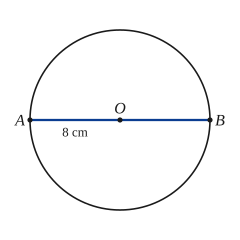
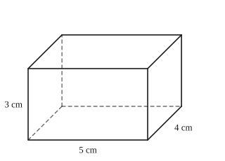

# Đề kiểm tra số 3

**Thời gian làm bài:** 60 phút. **Thang điểm:** mỗi câu 1 điểm, tổng 10 điểm.

## Đề bài

**Câu 1 (Tổng tỉ).** Tổng của hai số là 105. Số thứ nhất bằng $\dfrac{3}{4}$ số thứ hai. Tìm hai số.

**Câu 2 (Số thập phân và phân số).** a) Viết $0{,}25$ và $2{,}5$ dưới dạng phân số tối giản. b) Viết $\dfrac{3}{8}$ dưới dạng số thập phân.

**Câu 3 (Tính thuận tiện).** Tính bằng cách thuận tiện: $4{,}7 \times 6{,}8 + 4{,}7 \times 3{,}2$.

**Câu 4 (Tỉ số phần trăm).** Lớp 5B có 35 học sinh, trong đó có 14 học sinh nữ. Tính tỉ số phần trăm giữa số học sinh nữ và số học sinh cả lớp.

**Câu 5 (Đơn vị đo).** Điền số thích hợp: a) $7 \text{ tấn } 25 \text{ kg} = \dots \text{ tấn}$; b) $3 \text{ giờ } 15 \text{ phút} = \dots \text{ giờ}$.

**Câu 6 (Hình tròn).** Tính chu vi và diện tích hình tròn có đường kính 8 cm.

**Câu 7 (Hình hộp chữ nhật).** Một hình hộp chữ nhật dài 5 cm, rộng 4 cm, cao 3 cm. Tính diện tích xung quanh, diện tích toàn phần và thể tích.

**Câu 8 (Chuyển động).** Một người đi bộ với vận tốc $4{,}5$ km/giờ trên quãng đường dài 9 km. Hỏi người đó đi hết bao nhiêu thời gian?

**Câu 9 (Rút về đơn vị).** Mua 3 kg đường hết 75 000 đồng. Hỏi mua 5 kg đường cùng loại hết bao nhiêu tiền?

**Câu 10 (Thống kê).** Kết quả học tập của 40 học sinh lớp 5C: 12 em hoàn thành xuất sắc, 20 em hoàn thành tốt, 8 em hoàn thành. Tính tỉ số phần trăm của mỗi loại so với cả lớp (để vẽ biểu đồ hình quạt).

---

## Lời giải chi tiết

### Câu 1
Số thứ nhất 3 phần, số thứ hai 4 phần, tổng 7 phần. Một phần: $105 : 7 = 15$. Số thứ nhất: 45; số thứ hai: 60.

### Câu 2
a) $0{,}25 = \dfrac{25}{100} = \dfrac{1}{4}$; $2{,}5 = \dfrac{25}{10} = \dfrac{5}{2}$. b) $\dfrac{3}{8} = 3 : 8 = 0{,}375$.

### Câu 3
$4{,}7 \times (6{,}8 + 3{,}2) = 4{,}7 \times 10 = 47$.

### Câu 4
$14 : 35 = 0{,}4 = 40\%$.

### Câu 5
a) $7{,}025$ tấn. b) $3{,}25$ giờ.

### Câu 6

*Hình: Hình tròn đường kính 8 cm.*

$C = 8 \times 3{,}14 = 25{,}12$ (cm). Bán kính 4 cm: $S = 4 \times 4 \times 3{,}14 = 50{,}24 \text{ (cm}^2)$.

### Câu 7

*Hình: Hình hộp chữ nhật dài 5 cm, rộng 4 cm, cao 3 cm.*

$S_{xq} = (5 + 4) \times 2 \times 3 = 54 \text{ (cm}^2)$. $S_{tp} = 54 + 5 \times 4 \times 2 = 94 \text{ (cm}^2)$. $V = 5 \times 4 \times 3 = 60 \text{ (cm}^3)$.

### Câu 8
$9 : 4{,}5 = 2$ (giờ).

### Câu 9
1 kg giá $75\,000 : 3 = 25\,000$ (đồng). 5 kg giá $125\,000$ đồng.

### Câu 10
Hoàn thành xuất sắc: $12 : 40 = 30\%$. Hoàn thành tốt: $20 : 40 = 50\%$. Hoàn thành: $8 : 40 = 20\%$.
