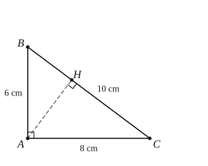
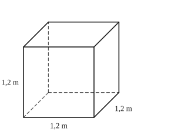

# Đề kiểm tra số 4

**Thời gian làm bài:** 60 phút. **Thang điểm:** mỗi câu 1 điểm, tổng 10 điểm.

## Đề bài

**Câu 1 (Hiệu tỉ).** Hiệu của hai số là 45. Số lớn gấp 4 lần số bé. Tìm hai số.

**Câu 2 (Số thập phân).** a) Làm tròn $15{,}678$ đến hàng phần trăm. b) Tìm số tự nhiên $x$ biết $2{,}9 < x < 3{,}1$.

**Câu 3 (Phép tính).** Tính: a) $0{,}25 \times 37 \times 4$ (bằng cách thuận tiện); b) $12{,}6 : 0{,}4$.

**Câu 4 (Giảm giá).** Một chiếc áo giá 400 000 đồng được giảm giá 15%. Hỏi sau khi giảm, chiếc áo có giá bao nhiêu?

**Câu 5 (Đơn vị đo).** Điền số thích hợp: a) $2{,}05 \text{ km}^2 = \dots \text{ ha}$; b) $3 \text{ m}^3 \, 5 \text{ dm}^3 = \dots \text{ m}^3$.

**Câu 6 (Tam giác vuông).** Tam giác $ABC$ vuông tại $A$ có $AB = 6$ cm, $AC = 8$ cm, $BC = 10$ cm. Tính diện tích tam giác và chiều cao $AH$ ứng với cạnh $BC$.

**Câu 7 (Thùng không nắp).** Người ta làm một cái thùng không nắp hình lập phương cạnh $1{,}2$ m bằng tôn. Tính diện tích tôn cần dùng (không tính mép hàn).

**Câu 8 (Ngược chiều).** Quãng đường $AB$ dài 150 km. Cùng một lúc, một ô tô đi từ A với vận tốc 40 km/giờ và một xe máy đi từ B với vận tốc 35 km/giờ, ngược chiều nhau. Hỏi sau bao lâu hai xe gặp nhau?

**Câu 9 (Bản đồ).** Một sân vận động hình chữ nhật dài 50 m, rộng 30 m. Trên bản đồ tỉ lệ $1 : 1\,000$, chiều dài và chiều rộng sân vận động là bao nhiêu xăng-ti-mét?

**Câu 10 (Biểu đồ hình quạt).** Một gia đình có thu nhập 12 000 000 đồng mỗi tháng. Biểu đồ hình quạt cho biết khoản ăn uống chiếm 35%. Tính số tiền dành cho ăn uống.

---

## Lời giải chi tiết

### Câu 1
Số bé 1 phần, số lớn 4 phần, hiệu 3 phần ứng với 45. Số bé: $45 : 3 = 15$; số lớn: 60.

### Câu 2
a) $15{,}68$. b) $x = 3$.

### Câu 3
a) $(0{,}25 \times 4) \times 37 = 1 \times 37 = 37$. b) $12{,}6 : 0{,}4 = 31{,}5$.

### Câu 4
Số tiền giảm: $400\,000 \times 15 : 100 = 60\,000$ (đồng). Giá mới: $340\,000$ đồng.

### Câu 5
a) $205$ ha. b) $3{,}005 \text{ m}^3$.

### Câu 6

*Hình: Tam giác vuông ABC có hai cạnh góc vuông 6 cm và 8 cm.*

$S = 6 \times 8 : 2 = 24 \text{ (cm}^2)$. Lấy $BC$ làm đáy: $AH = 24 \times 2 : 10 = 4{,}8$ (cm).

### Câu 7

*Hình: Thùng không nắp hình lập phương cạnh 1,2 m.*

Thùng không nắp có 5 mặt: $1{,}2 \times 1{,}2 \times 5 = 7{,}2 \text{ (m}^2)$.

### Câu 8
$150 : (40 + 35) = 2$ (giờ).

### Câu 9
Đổi 50 m = 5 000 cm, 30 m = 3 000 cm. Trên bản đồ: $5\,000 : 1\,000 = 5$ (cm) và $3\,000 : 1\,000 = 3$ (cm).

### Câu 10
$12\,000\,000 \times 35 : 100 = 4\,200\,000$ (đồng).
