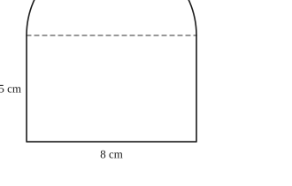
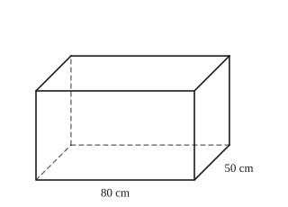

# Đề kiểm tra số 5

**Thời gian làm bài:** 60 phút. **Thang điểm:** mỗi câu 1 điểm, tổng 10 điểm.

## Đề bài

**Câu 1 (Bài toán tuổi).** Mẹ hơn con 27 tuổi. Tuổi con bằng $\dfrac{1}{4}$ tuổi mẹ. Tính tuổi mỗi người.

**Câu 2 (Số thập phân).** a) Viết $\dfrac{7}{20}$ dưới dạng số thập phân và tỉ số phần trăm. b) Viết số thập phân lớn nhất có ba chữ số khác nhau, trong đó phần thập phân có hai chữ số.

**Câu 3 (Biểu thức).** Tính: $(6{,}4 + 3{,}6) \times 2{,}5 - 7{,}5$.

**Câu 4 (Giá vốn).** Một người bán hàng được 260 000 đồng và lãi 30% so với giá vốn. Tính giá vốn.

**Câu 5 (Thời gian).** Điền số thích hợp: a) $1 \text{ giờ } 45 \text{ phút} = \dots \text{ giờ}$; b) $0{,}8 \text{ giờ} = \dots \text{ phút}$.

**Câu 6 (Hình ghép).** Một hình gồm một hình chữ nhật dài 8 cm, rộng 5 cm và một nửa hình tròn có đường kính là chiều dài hình chữ nhật, ghép ở phía trên. Tính diện tích của hình.

**Câu 7 (Thể tích).** Một bể kính hình hộp chữ nhật có đáy dài 80 cm, rộng 50 cm, đang chứa nước cao 30 cm. Thả một hòn đá chìm hẳn vào bể thì mực nước cao 35 cm. Tính thể tích hòn đá.

**Câu 8 (Đuổi nhau).** Một người đi xe đạp đang ở trước một người đi xe máy 18 km, cả hai đi cùng chiều. Xe đạp đi 12 km/giờ, xe máy đi 36 km/giờ. Hỏi sau bao nhiêu phút xe máy đuổi kịp xe đạp?

**Câu 9 (Rút về đơn vị).** 5 máy bơm như nhau bơm cạn một hồ trong 12 giờ. Hỏi 6 máy bơm như thế bơm cạn hồ đó trong mấy giờ?

**Câu 10 (Tỉ số lặp lại).** Tung cùng lúc hai đồng xu 30 lần, thấy có 7 lần cả hai đồng xu đều ngửa. Viết tỉ số mô tả số lần cả hai đồng xu đều ngửa và tỉ số mô tả số lần không phải cả hai đều ngửa.

---

## Lời giải chi tiết

### Câu 1
Con 1 phần, mẹ 4 phần, hiệu 3 phần ứng với 27 tuổi. Tuổi con: $27 : 3 = 9$; tuổi mẹ: 36.

### Câu 2
a) $\dfrac{7}{20} = \dfrac{35}{100} = 0{,}35 = 35\%$. b) $9{,}87$.

### Câu 3
$10 \times 2{,}5 - 7{,}5 = 25 - 7{,}5 = 17{,}5$.

### Câu 4
Giá bán bằng $100\% + 30\% = 130\%$ giá vốn. Giá vốn: $260\,000 : 130 \times 100 = 200\,000$ (đồng).

### Câu 5
a) $1{,}75$ giờ. b) $0{,}8 \times 60 = 48$ phút.

### Câu 6

*Hình: Hình chữ nhật 8 cm × 5 cm ghép với nửa hình tròn đường kính 8 cm.*

Hình chữ nhật: $8 \times 5 = 40 \text{ (cm}^2)$. Nửa hình tròn bán kính 4 cm: $4 \times 4 \times 3{,}14 : 2 = 25{,}12 \text{ (cm}^2)$.
Diện tích: $40 + 25{,}12 = 65{,}12 \text{ (cm}^2)$.

### Câu 7

*Hình: Bể kính hình hộp chữ nhật đáy 80 cm × 50 cm.*

Mực nước dâng thêm $35 - 30 = 5$ (cm). Thể tích hòn đá: $80 \times 50 \times 5 = 20\,000 \text{ (cm}^3) = 20 \text{ dm}^3$.

### Câu 8
Thời gian đuổi kịp: $18 : (36 - 12) = 0{,}75$ (giờ) $= 45$ phút.

### Câu 9
Bơm cạn hồ cần $5 \times 12 = 60$ (giờ máy). 6 máy: $60 : 6 = 10$ (giờ).

### Câu 10
Cả hai ngửa: $\dfrac{7}{30}$. Không phải cả hai ngửa: $30 - 7 = 23$ lần, tỉ số $\dfrac{23}{30}$.
